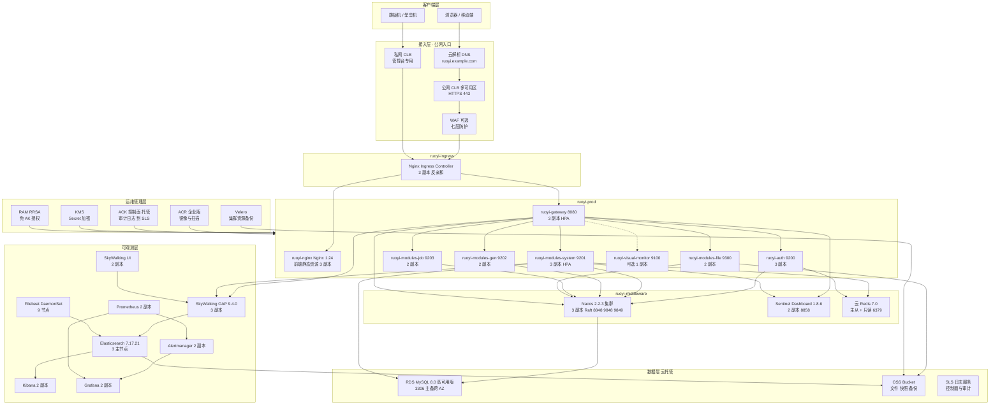
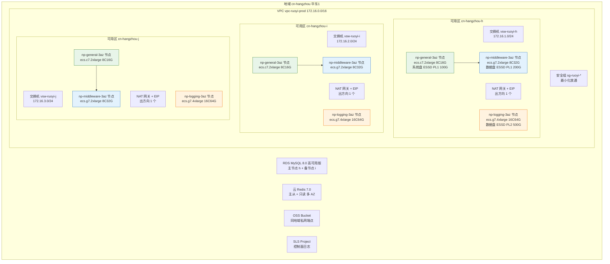
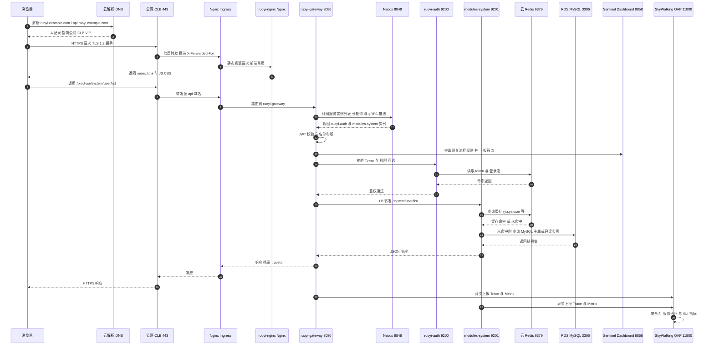
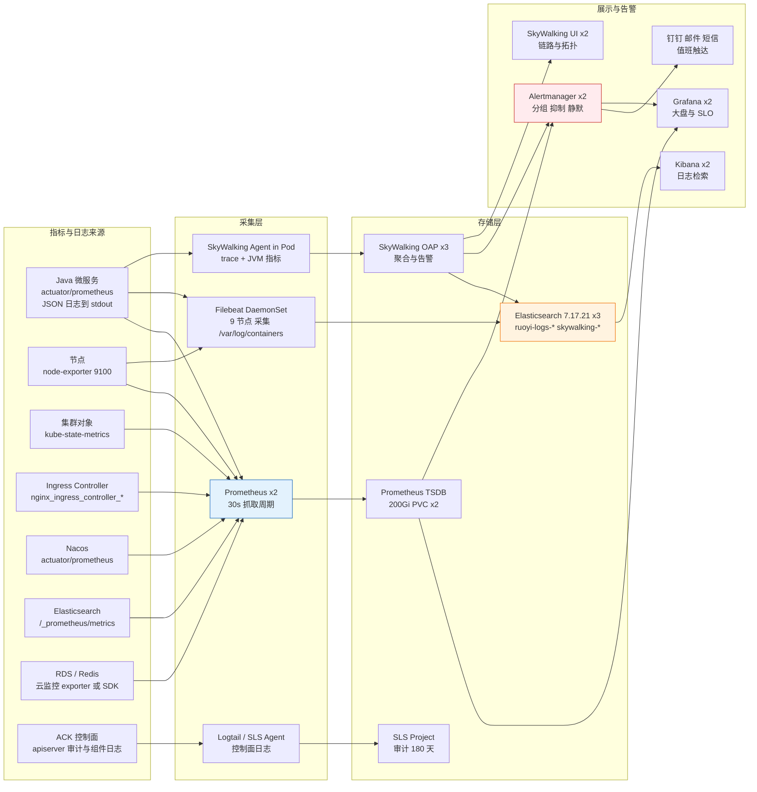
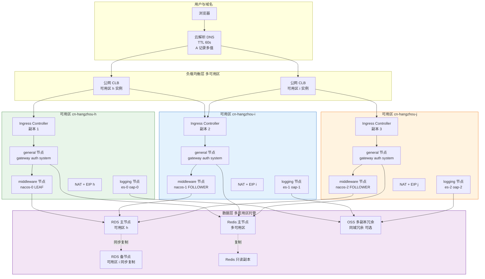

# 若依微服务项目部署学习手册 — 系统架构方案（企业级架构作为学习蓝本）

> 文档编号：ruoyi-enterprise-deploy / 01
> 密级：内部公开（Internal）
> 适用阶段：架构设计评审 → 部署实施 → 验收
> 统一基线：本文件第 1.5 节定义的版本/资源/网络基线为《02-部署手册》《03-故障处理手册》的**唯一事实来源（Single Source of Truth）**，三份文档中的地域、可用区、网段、集群版本、节点池规格、端口、资源配额、域名、镜像地址必须与本文件一致；如需调整，须走变更评审并同步修订三份文档。

> **【学习环境说明（先读这 6 行再往下看）】**
> 1. **本文档定位是"学习蓝本"，不是实施令**：正文默认按**企业级生产标准**给出规格、拓扑与设计取舍（这是学习的目标形态，也是理解"为什么要这么做"的参照系）；但**动手搭建学习环境时请执行"学习值"**，不要照搬生产规格去开通资源。生产数值原样保留在正文各表中，学习值统一在本文件 `### 1.7 学习模式说明（最小规格、成本与可跳过内容）` 给出。
> 2. **架构不变、只是降规格**：学习环境的架构层次、组件清单、依赖关系、监控与日志链路（Filebeat→ES→Kibana、SkyWalking→ES、Prometheus→Alertmanager）**完全不改**，只把副本数、节点数、中间件形态降到"能跑通即可"，因此学到的方法与生产完全同构。
> 3. **三份文档的分工**：学习总览与两天计划见《00-总览与实施计划》（学习版总册）；分步操作见《02-部署手册》的"学习模式说明"小节（该手册第 0 章小节，现编号 `0.6` 若已被"读者前置技能"等其它内容占用，则以该手册实际新增的"学习模式说明"小节编号为准）；故障演练见《03-故障处理手册》的学习模式小节。
> 4. **学习顺序建议**：先读本文件第 3 章（架构图与说明）建立整体印象 → 再按《02-部署手册》动手 → 遇到问题查《03-故障处理手册》。
> 5. **哪些必须动手、哪些可以先只读**：命名与标签、ConfigMap/Secret、三类探针、优雅停机、Helm 打包、Nacos、Sentinel 持久化、SkyWalking、日志链路、告警规则、滚动更新与回滚、备份恢复与三个演练属于**必须动手**；KMS、ACK 审计、WAF、SLB 高可用、跨地域备份、RRSA、多 AZ 容灾等属于**可先只读**，清单见 `### 1.7.3`。
> 6. **成本提醒**：学习环境全部使用**按量付费**资源，**用完必须释放**，否则会持续计费；释放清单见《02-部署手册》第 10 章附录。

---

## 目录

- 1. 文档说明
- 2. 项目背景与建设目标
- 3. 总体架构设计
- 4. 组件清单与版本矩阵
- 5. 技术选型与决策记录（ADR）
- 6. 命名规范与配置规范
- 7. 节点与操作系统基线（Rocky Linux 9.3）
- 8. 容量与资源估算
- 9. 安全架构设计
- 10. 可观测性架构
- 11. 高可用与容灾架构
- 12. 架构风险与约束
- 13. 附录

---

## 1. 文档说明

### 1.1 编写目的

本方案用于指导 RuoYi-Cloud 3.6.5 微服务套件从本地联调环境（单机 Docker Compose 形态）整体迁移到阿里云容器服务 Kubernetes 版（ACK）托管集群，并交付一套满足**企业级高可用标准**的生产架构。具体目的：

1. 固化一套可直接落地的**统一基线**（地域、可用区、VPC/交换机、集群版本、节点池规格、命名空间、端口、资源配额、域名、镜像地址、标签规范），使架构设计、部署实施、故障处理三份文档不会出现参数漂移。
2. 给出**三层高可用**（多可用区、多副本、多探针）的具体实现手段与可执行 YAML 片段，明确 `topologySpreadConstraints`、`PodDisruptionBudget`、`preStop` 优雅停机、`HPA` 等关键配置的取值。
3. 明确**可观测性四支柱**（Metrics / Logging / Tracing / Alerting）的采集链路、存储容量、保留策略、SLI/SLO 与告警分级阈值，使系统"可被观测、可被定界、可被追责"。
4. 明确**容灾与备份矩阵**，将 RTO ≤ 30 分钟、RPO ≤ 5 分钟（数据库 ≈0）落到具体机制上（RDS 跨可用区高可用 + binlog、Redis 主从 + 备份、ES Snapshot 到 OSS、Velero 集群资源备份）。
5. 收敛**技术选型决策（ADR）**，把"为什么用 RDS 而不用 K8s 自建 MySQL""为什么用 Nginx Ingress 而不用 ALB Ingress"等争议点在评审阶段一次性结论化，避免实施期返工。

### 1.2 文档范围

**在范围内（In Scope）：**

| 范围项 | 说明 |
| --- | --- |
| 云上基础架构 | VPC、三可用区交换机、NAT/EIP、安全组、SLB、ACK 托管集群、节点池（3 个）、节点操作系统基线 |
| 应用部署架构 | 6 个业务微服务（gateway/auth/system/gen/job/file）+ 前端 Nginx + 可选 visual-monitor 的副本、资源、探针、调度约束设计 |
| 中间件架构 | Nacos 注册配置中心、MySQL（RDS 高可用为主方案）、Redis（云 Redis 主从+只读为主方案）的高可用拓扑与降级策略 |
| 可观测性架构 | SkyWalking + ES 链路追踪、Prometheus + Grafana + Alertmanager 指标告警、Filebeat + ES + Kibana 日志 |
| 网络与安全 | 网络分层、安全组规则矩阵、NetworkPolicy、RRSA、KMS 加密、ACR 镜像扫描、PodSecurity、审计 |
| 容量与成本 | 组件资源汇总、节点池选型计算、存储/IOPS 估算、成本优化建议 |
| 容灾与备份 | 同城多 AZ 拓扑、故障域分析、备份矩阵、RTO/RPO 分解、故障切换场景 |

**不在范围内（Out of Scope）：**

| 范围项 | 归属说明 |
| --- | --- |
| 业务代码改造与业务功能测试 | 本地联调阶段已完成功能验证，本方案只做部署形态适配（容器化配置、JVM 参数、外置化配置） |
| CICD 流水线具体搭建步骤 | 本方案只定义镜像 tag 策略与制品库规范（第 6.4 节），流水线实现详见《02-部署手册》第 4.1 节（镜像构建与推送、CI） |
| 数据库表结构设计与 DBA 调优 | 复用 RuoYi-Cloud 3.6.5 官方 `ry_20xxxxxx.sql` 脚本，仅定义参数模板与备份策略 |
| 跨地域异地容灾（多 Region） | 本方案为同城三可用区容灾；异地容灾作为演进方向在第 11.6 节给出路线，不纳入本次交付 |
| 等保测评的具体整改项 | 第 9 章给出分级安全配置建议（基础版/标准版/增强版），实际测评以第三方机构结论为准 |

### 1.3 读者对象

| 角色 | 关注章节 | 使用方式 |
| --- | --- | --- |
| 架构师 / 技术负责人 | 2、3、5、8、11、12 | 评审架构合理性与风险，确认 ADR 结论 |
| 云平台 / SRE 工程师 | 3.4、6、7、8、9、11 | 按基线创建 VPC/集群/节点池/安全组/存储，实施容灾与备份 |
| 运维工程师（DevOps） | 3.6、4、6、10、11 | 编写 Helm values、探针、HPA、告警规则 |
| 中间件/DBA 工程师 | 3.7、4、5、8、11 | 负责 RDS / Redis / Nacos / ES 规格与运维 |
| 应用开发工程师 | 3.5、3.7、6.3、10.5 | 配置接入（Nacos dataId、SkyWalking agent、日志规范） |
| 安全与合规工程师 | 9、12 | 核查网络安全组、RRSA、KMS、审计、镜像扫描 |
| 项目管理 | 2、8、12 | 成本与进度评估、风险跟踪 |

### 1.4 术语表

| 术语/缩写 | 全称 | 说明 |
| --- | --- | --- |
| ACK | Alibaba Cloud Container Service for Kubernetes | 阿里云容器服务 Kubernetes 版，本方案使用**托管版**（控制面由阿里云运维，SLA 承诺） |
| ACK 托管版 | ACK Managed Cluster | 控制面（apiserver/etcd/scheduler/controller-manager）由阿里云托管，用户只管理节点池 |
| Terway | Alibaba Cloud Terway CNI | 基于 ENI 的 CNI 插件，Pod 直接使用 VPC IP，支持 NetworkPolicy 与独占 ENI |
| RRSA | RAM Roles for Service Accounts | 通过 OIDC 把 RAM 角色绑定到 ServiceAccount，Pod 免 AK 访问阿里云 OpenAPI |
| KMS | Key Management Service | 密钥管理服务，用于 ACK Secret 加密与 RDS/Redis TDE |
| SLS | Simple Log Service | 日志服务，用于 ACK 控制面审计日志与组件日志采集 |
| SLB | Server Load Balancer | 负载均衡，本方案使用 CLB（传统型）四层暴露 Nginx Ingress |
| CLB | Classic Load Balancer | 四层负载均衡实例 |
| ALB | Application Load Balancer | 七层负载均衡，与 ALB Ingress 配合 |
| PDB | PodDisruptionBudget | 自愿中断保护，限制驱逐时可用副本下限 |
| HPA | Horizontal Pod Autoscaler | 水平自动扩缩容 |
| VPA | Vertical Pod Autoscaler | 垂直自动扩缩容，本方案仅用于容量分析，不启用自动改写 |
| topologySpreadConstraints | 拓扑分布约束 | 按 zone/hostname 打散 Pod 的调度约束 |
| ILM | Index Lifecycle Management | 索引生命周期管理（ES/Kibana 侧） |
| ISM | Index State Management | 索引状态管理（OpenSearch 概念，ES 中对应 ILM） |
| SLI / SLO / SLA | Service Level Indicator / Objective / Agreement | 指标 / 目标 / 协议，见第 10.5 节 |
| RTO / RPO | Recovery Time Objective / Recovery Point Objective | 恢复时间目标 / 恢复点目标 |
| TDE | Transparent Data Encryption | 透明数据加密 |
| RPS | Requests Per Second | 每秒请求数，容量估算基准 |
| QPS | Queries Per Second | 每秒查询数 |
| PSS | Pod Security Standards | Kubernetes Pod 安全标准（baseline/restricted） |
| WAL | Write-Ahead Logging | 预写日志，MySQL(redo/binlog) 与 ES(translog) 均涉及 |

> **命名约定**：前端组件的 K8s 资源名、Service 名与镜像名统一为 `ruoyi-nginx`（镜像内运行 Nginx 1.24，静态资源构建自若依前端工程 `ruoyi-ui`）；文档中出现的 `ruoyi-ui/dist`、`ruoyi-ui/.env.production` 等为源码工程路径，非集群资源名。

### 1.5 参考基线与统一约定（全文强制）

#### 1.5.1 地域与可用区基线

| 项目 | 取值 | 备注 |
| --- | --- | --- |
| 地域 | `cn-hangzhou`（华东1 杭州） | 全部资源必须同地域，禁止跨地域混部署 |
| 可用区 | `cn-hangzhou-h` / `cn-hangzhou-i` / `cn-hangzhou-j` | 三可用区均衡，任一 AZ 整机房故障不影响核心链路 |
| VPC | `vpc-ruoyi-prod`，`172.16.0.0/16` | 单 VPC 单环境，不做多环境复用 |
| 交换机 | `vsw-ruoyi-h` `172.16.1.0/24`（h）、`vsw-ruoyi-i` `172.16.2.0/24`（i）、`vsw-ruoyi-j` `172.16.3.0/24`（j） | 每交换机对应一个可用区，**各含 1 个 NAT 网关/EIP 出口** |
| 说明 | 交换机 /24 共 256 个 IP，其中阿里云保留 3 个（.253/.254/.255 网关与系统），**可用 253 个** | Terway 下 Pod IP 直接消耗交换机 IP，容量核算见第 8.4 节 |

#### 1.5.2 集群基线

| 项目 | 取值 |
| --- | --- |
| 集群名称 | `ack-ruoyi-prod`（ACK 托管版，Pro 版能力集） |
| Kubernetes 版本 | `1.28.9-aliyun.1` |
| 容器运行时 | `containerd 1.6.28` |
| 网络插件 | Terway（ENI 多 IP 模式；**独占 ENI 模式可选**，用于需要独立安全组的场景） |
| kube-proxy 模式 | IPVS（`ipvs.scheduler=wrr`，`strictARP=true`） |
| Service CIDR | `172.21.0.0/20`（与服务网段不重叠，Pod 网段随交换机） |
| 安全与审计 | 开启 RRSA、KMS Secret 加密、ACK 审计日志、控制面日志采集到 SLS |
| 集群内 DNS | CoreDNS（默认 2 副本，生产建议按节点数扩至 3 副本） |

> 说明：Kubernetes 1.28 已移除 `iptables` 之外的若干旧特性，Ruoyi-Cloud 依赖的 Java 应用无需任何 1.28 特有 API；Ingress 使用 `networking.k8s.io/v1`（`ingressClassName` 字段），**不可使用** `extensions/v1beta1`。

#### 1.5.3 节点池基线（三可用区均衡）

| 节点池 | 实例规格 | 数量 | 系统盘 | 数据盘 | 标签 | 污点 | 弹性伸缩 | 承载组件 |
| --- | --- | --- | --- | --- | --- | --- | --- | --- |
| `np-general-3az` | `ecs.c7.2xlarge`（8 vCPU / 16 GiB） | 3（h/i/j 各 1） | ESSD PL1 100 GiB | — | `node-pool=general` | 无 | min 3 / max 9 | 6 个业务微服务、前端 Nginx、Sentinel Dashboard、SkyWalking UI/UI、Grafana、Prometheus、Kibana |
| `np-middleware-3az` | `ecs.g7.2xlarge`（8 vCPU / 32 GiB） | 3（h/i/j 各 1） | ESSD PL1 100 GiB | ESSD PL1 200 GiB | `node-pool=middleware` | `dedicated=middleware:NoSchedule` | 固定 3 | Nacos、Ingress Controller（可选）、自建中间件（可选） |
| `np-logging-3az` | `ecs.g7.4xlarge`（16 vCPU / 64 GiB） | 3（h/i/j 各 1） | ESSD PL1 100 GiB | ESSD PL2 500 GiB | `node-pool=logging` | `dedicated=logging:NoSchedule` | 固定 3 | Elasticsearch（3 主节点）、SkyWalking OAP、Filebeat（DaemonSet 全节点） |

> 关键约定：`np-middleware-3az` 与 `np-logging-3az` **不参与**业务 Pod 调度（污点隔离），避免日志/中间件 IO 抖动影响业务延迟；`np-general-3az` 开弹性伸缩承接流量高峰。
> `filebeat` 为 DaemonSet，需 `tolerations` 容忍上述两类污点，覆盖全部 9 个节点。

#### 1.5.4 命名空间基线

| 命名空间 | 承载内容 | 资源配额（requests/limits 汇总） |
| --- | --- | --- |
| `ruoyi-prod` | 6 个业务微服务 + 前端 Nginx（+ 可选 `ruoyi-visual-monitor`） | 见第 8.2 节 |
| `ruoyi-middleware` | Nacos；自建 MySQL / Redis（可选，主方案使用 RDS/云 Redis） | 见第 8.2 节 |
| `ruoyi-monitoring` | Sentinel Dashboard、SkyWalking OAP/UI、Prometheus、Grafana、Alertmanager | 见第 8.2 节 |
| `ruoyi-logging` | Elasticsearch、Kibana、Filebeat（DaemonSet） | 见第 8.2 节 |
| `ruoyi-ingress` | Nginx Ingress Controller（或改用 ACK 组件管理，二者择一，不可并存） | 见第 8.2 节 |

#### 1.5.5 域名与暴露策略

| 域名 | 指向 | 暴露范围 | TLS 证书 |
| --- | --- | --- | --- |
| `https://ruoyi.example.com` | 前端 Nginx（`ruoyi-nginx`） | 公网（经 SLB → Ingress） | 阿里云 SSL 证书 / cert-manager，TLS 1.2+ |
| `https://api.ruoyi.example.com` | `ruoyi-gateway`（8080） | 公网（经 SLB → Ingress） | 同上 |
| `https://nacos.example.com` | Nacos 控制台（8848） | **仅内网/堡垒机可达** | 内网自签或企业 CA |
| `https://sentinel.example.com` | Sentinel Dashboard（8858） | 仅内网/堡垒机可达 | 内网自签或企业 CA |
| `https://skywalking.example.com` | SkyWalking UI（8080） | 仅内网/堡垒机可达 | 内网自签或企业 CA |
| `https://kibana.example.com` | Kibana（5601） | 仅内网/堡垒机可达 | 内网自签或企业 CA |
| `https://grafana.example.com` | Grafana（3000） | 仅内网/堡垒机可达 | 内网自签或企业 CA |
| `https://alert.example.com` | Alertmanager（9093） | 仅内网/堡垒机可达 | 内网自签或企业 CA |

> 管控台"仅内网可达"的落地方式：这些域名解析到**内网 CLB（私网 IP）**，且安全组只放通堡垒机/办公网段；公网 DNS 不解析这些记录。详见第 3.4 与 9.1 节。

#### 1.5.6 镜像仓库基线

| 项目 | 取值 |
| --- | --- |
| 仓库类型 | ACR 企业版（支持 P2P 加速、镜像扫描、VPC 私网链路） |
| 命名空间 | `ruoyi-prod` |
| 镜像地址模板 | `registry.cn-hangzhou.aliyuncs.com/ruoyi-prod/<服务名>:3.6.5` |
| 示例 | `registry.cn-hangzhou.aliyuncs.com/ruoyi-prod/ruoyi-gateway:3.6.5` |
| 拉取凭证 | 通过 `imagePullSecrets` 或节点级免密（ACR 企业版 VPC 免密插件） |

#### 1.5.7 版本基线

| 组件 | 版本 | 备注 |
| --- | --- | --- |
| RuoYi-Cloud | 3.6.5 | Spring Boot 2.7.18 / Spring Cloud 2021.0.8 / Spring Cloud Alibaba 2021.0.5.0 |
| JDK | Temurin 17.0.11（基线） | 兼容 JDK 8，见第 3.7.9 节 |
| Nacos | 2.2.3 | 支持 gRPC 长连接（9848/9849） |
| Sentinel | 1.8.6 | Dashboard 8858，客户端 8719+ |
| MySQL | 8.0 | 主方案：阿里云 RDS 高可用版 |
| Redis | 7.0 | 主方案：阿里云云数据库 Redis 主从 + 只读 |
| SkyWalking | 9.4.0 | OAP 3 副本 + ES7 存储 |
| Elasticsearch | 7.17.21 | 日志 + SkyWalking 链路存储 |
| Filebeat | 7.17.21 | DaemonSet |
| Kibana | 7.17.21 | 日志检索 |
| Nginx | 1.24 | 前端静态资源 + Ingress Controller |
| Helm | 3.14 | 应用编排 |
| kubectl | 1.28 | 与集群 1.28.9 匹配（±1 小版本内） |

#### 1.5.8 端口基线

| 组件 | 端口 | 协议 | 说明 |
| --- | --- | --- | --- |
| ruoyi-gateway | 8080 | HTTP | 统一入口 |
| ruoyi-auth | 9200 | HTTP | 认证授权 |
| ruoyi-modules-system | 9201 | HTTP | 系统模块 |
| ruoyi-modules-gen | 9202 | HTTP | 代码生成 |
| ruoyi-modules-job | 9203 | HTTP | 定时任务 |
| ruoyi-modules-file | 9300 | HTTP | 文件服务 |
| ruoyi-visual-monitor | 9100 | HTTP | Spring Boot Admin（可选） |
| Nacos | 8848 / 9848 / 9849 | HTTP / gRPC / gRPC | 9848 = 8848+1000，9849 = 8848+1001 |
| Sentinel Dashboard | 8858 | HTTP | 客户端占用 8719+ |
| SkyWalking OAP | 11800（gRPC）/ 12800（HTTP） | gRPC / HTTP | Agent 上报 / 查询 |
| SkyWalking UI | 8080 | HTTP | 前端 |
| Elasticsearch | 9200 / 9300 | HTTP / TCP | REST / 节点间传输 |
| Kibana | 5601 | HTTP | 检索 |
| MySQL | 3306 | TCP | RDS 内网 |
| Redis | 6379 | TCP | 云 Redis 内网 |
| Nginx | 80 / 443 | HTTP / HTTPS | 前端与 Ingress |
| Prometheus | 9090 | HTTP | 指标查询/联邦 |
| Alertmanager | 9093 | HTTP | 告警路由 |
| Grafana | 3000 | HTTP | 可视化 |

> 冲突提示：SkyWalking UI 默认 8080 与 `ruoyi-gateway` 8080 同号，但由于处于不同 Pod 网络命名空间且属于不同 Service，不构成冲突；但**端口命名（`containerPort.name`）必须唯一**，约定网关用 `http-gateway`、SkyWalking UI 用 `http-ui`。

#### 1.5.9 资源基线（requests / limits / 副本）

| 组件 | requests (CPU/内存) | limits (CPU/内存) | 副本数 | 所属命名空间 | 调度节点池 |
| --- | --- | --- | --- | --- | --- |
| ruoyi-gateway | 500m / 1Gi | 2 / 2Gi | 3 | ruoyi-prod | general |
| ruoyi-auth | 500m / 1Gi | 2 / 2Gi | 3 | ruoyi-prod | general |
| ruoyi-modules-system | 1000m / 2Gi | 2 / 4Gi | 3 | ruoyi-prod | general |
| ruoyi-modules-gen | 500m / 1Gi | 1 / 2Gi | 2 | ruoyi-prod | general |
| ruoyi-modules-job | 500m / 1Gi | 1 / 2Gi | 2 | ruoyi-prod | general |
| ruoyi-modules-file | 500m / 1Gi | 1 / 2Gi | 2 | ruoyi-prod | general |
| ruoyi-nginx（nginx） | 200m / 256Mi | 1 / 1Gi | 3 | ruoyi-prod | general |
| nacos | 1000m / 2Gi | 2 / 4Gi | 3 | ruoyi-middleware | middleware |
| sentinel-dashboard | 500m / 1Gi | 1 / 2Gi | 2 | ruoyi-monitoring | general |
| skywalking-oap | 2000m / 8Gi | 4 / 12Gi | 3 | ruoyi-monitoring | logging |
| skywalking-ui | 200m / 512Mi | 500m / 1Gi | 2 | ruoyi-monitoring | general |
| elasticsearch | 4000m / 16Gi | 8 / 32Gi | 3 | ruoyi-logging | logging |
| kibana | 500m / 1Gi | 1 / 2Gi | 2 | ruoyi-logging | general |
| prometheus | 1000m / 4Gi | 2 / 8Gi | 2 | ruoyi-monitoring | general |
| grafana | 100m / 256Mi | 500m / 1Gi | 2 | ruoyi-monitoring | general |
| filebeat（DaemonSet） | 100m / 200Mi | 500m / 500Mi | 每节点 1 | ruoyi-logging | 全部节点 |

> **requests 总和决定调度可行性，limits 总和决定突发上限**。第 8 章在此基线上做节点池选型校验，并保留 30% 余量。

#### 1.5.10 统一标签规范

| 标签键 | 取值范围 | 说明 |
| --- | --- | --- |
| `app.kubernetes.io/name` | `ruoyi-gateway` / `ruoyi-auth` / `nacos` / `elasticsearch` … | 组件名（与实际镜像服务名一致） |
| `app.kubernetes.io/instance` | `<name>-<env>`，如 `ruoyi-gateway-prod` | 实例名（同一组件多实例区分） |
| `app.kubernetes.io/version` | `3.6.5` / `2.2.3` / `9.4.0` … | 与镜像 tag 对齐 |
| `app.kubernetes.io/component` | `gateway` / `auth` / `business` / `registry` / `cache` / `database` / `logging` / `tracing` / `monitoring` / `frontend` / `ingress` | 功能层次 |
| `app.kubernetes.io/part-of` | `ruoyi-cloud`（**固定值**） | 归属系统 |
| `app.kubernetes.io/managed-by` | `Helm`（**固定值**） | 管理方式 |

补充约定：

- 所有 K8s 资源名统一前缀 `ruoyi-`（如 Deployment `ruoyi-gateway`、StatefulSet `ruoyi-nacos`、Service `ruoyi-nacos-svc`）。
- 选择器标签最小集：`app.kubernetes.io/name` + `app.kubernetes.io/instance`，**不要**把 `version` 放进 `selector.matchLabels`（否则升级即需重建 Deployment）。
- 补充运维标签：`environment=prod`、`team=ruoyi`、`node-pool=<general|middleware|logging>`（由 nodeAffinity 与调度匹配）。

统一标签 YAML 片段（所有工作负载复用）：

```yaml
metadata:
  name: ruoyi-gateway
  namespace: ruoyi-prod
  labels:
    app.kubernetes.io/name: ruoyi-gateway
    app.kubernetes.io/instance: ruoyi-gateway-prod
    app.kubernetes.io/version: "3.6.5"
    app.kubernetes.io/component: gateway
    app.kubernetes.io/part-of: ruoyi-cloud
    app.kubernetes.io/managed-by: Helm
    environment: prod
    team: ruoyi
spec:
  selector:
    matchLabels:
      app.kubernetes.io/name: ruoyi-gateway
      app.kubernetes.io/instance: ruoyi-gateway-prod
```

#### 1.5.11 高可用 KPI 基线

| KPI | 目标值 | 度量方式 | 违反时的动作 |
| --- | --- | --- | --- |
| 核心链路可用性 | ≥ 99.95%（月度） | SLB/Ingress 5xx 率 + 探针成功率，"请求成功数/总请求数"，按 1 分钟粒度聚合 | 触发 P1 告警，启动《03-故障处理手册》第 4 章 |
| RTO | ≤ 30 分钟 | 从故障注入到核心链路恢复 | 复盘并调整切换脚本 |
| RPO | ≤ 5 分钟；数据库 ≈ 0 | RDS binlog 持续备份 + 跨可用区高可用；Redis AOF everysec | 触发 P0 告警 |
| 单可用区整机房故障 | 核心链路可用（降级可接受） | 混沌演练：下线一个 AZ 的全部节点 | 演练报告归档 |
| 单节点 N+1 故障 | 核心链路无损 | 混沌演练：驱逐任一节点 | 同上 |
| 网关 P99 延迟 | ≤ 300 ms（不含慢 SQL 场景） | SkyWalking / Prometheus Histogram | P2 告警 |

### 1.6 版本记录表

| 版本 | 日期 | 修订人 | 修订内容 | 评审状态 |
| --- | --- | --- | --- | --- |
| v0.1 | 2025-01-06 | 云原生架构组 | 初稿：总体架构、组件清单 | 内部讨论 |
| v0.2 | 2025-01-13 | 云原生架构组 / DBA | 补充容量估算、RDS/Redis 规格、ADR | 待评审 |
| v1.0 | 2025-01-20 | 云原生架构组 | 统一基线固化（1.5 节）、补充可观测性与容灾章节 | 架构评审通过 |
| v1.1 | 待定 | 云原生架构组 | 依据 ACK/RDS 实际规格调整（如节点池规格缺货替换） | — |

> 变更控制：任何对第 1.5 节基线的修改，必须同步更新《02-部署手册》《03-故障处理手册》，并在本表登记；实施期若遇到规格缺货（如 `ecs.c7.2xlarge` 指定 AZ 无库存），按第 8.6 节的替代清单执行并登记变更。

### 1.7 学习模式说明（最小规格、成本与可跳过内容）

> 本节只做"**新增说明**"，不替换正文任何生产数值。正文（第 1.5 节基线与第 3–13 章）按**企业级生产**给出，是学习的目标形态；动手搭建学习环境时按本节的学习值执行即可。学习基线 LB 与《00-总览与实施计划》《02-部署手册》《03-故障处理手册》的学习模式保持一致。

#### 1.7.1 架构不变、规格降级

学习环境的**架构层次（第 3.1 节分层）、组件清单（第 4.1 节主表）、依赖关系（第 4.3 节矩阵）、监控与日志链路（第 10 章四支柱）完全不改**，只把三样东西降下来：**节点数量与规格、副本数、中间件形态（云产品 → 集群内单实例）**。因此学到的每一个方法（命名与标签、ConfigMap/Secret、三类探针、PDB、反亲和、Nacos 注册与配置、Sentinel 规则持久化、traceId 贯穿、告警规则、备份恢复、故障演练）与生产完全同构；将来放大到生产只是"改数字"，不是"换做法"。

**学习基线 LB（统一口径）**

| 项目 | 学习基线 |
| --- | --- |
| 集群 | `ack-ruoyi-lab` |
| VPC / 交换机 | `vpc-ruoyi-lab` 172.16.0.0/16 / `vsw-ruoyi-lab` 172.16.1.0/24 |
| 可用区 | **单可用区 `cn-hangzhou-j`**（生产为三可用区 h/i/j，见第 1.5.1 节） |
| 节点池 | `np-lab` |
| 命名空间 | `ruoyi-prod` / `ruoyi-middleware` / `ruoyi-monitoring` / `ruoyi-logging` / `ruoyi-ingress`（**名称不变**，以保证与既有清单完全对齐；学习环境可先只建前三个） |
| 计费方式 | 全部**按量付费** |
| 系统盘 | ESSD PL1 60 GiB |

**节点池三方案（三选一，默认方案 B）**

| 方案 | 实例与数量 | 可用区 | 合计资源 | 学习重点 / 代价 |
| --- | --- | --- | --- | --- |
| A 最小单节点 | `ecs.g7.2xlarge`（8C32G）×1 | cn-hangzhou-j | 8C32G | 最省钱（约为方案 B 的 60%）；能体会"单点故障 = 全挂"，但做不了 drain、PDB、反亲和的真实效果 |
| **B 默认** | `ecs.c7.xlarge`（4C8G）×3 | cn-hangzhou-j | 12C24G | requests 水位约 62%；可完整练反亲和 / PDB / drain / 滚动更新 / 回滚 |
| C 进阶 | `ecs.c7.xlarge`（4C8G）×3（2+1 分布） | 2 个可用区 | 12C24G | 可练跨 AZ 打散；需多一个交换机与 NAT，成本略增 |

**副本数对照表（学习值 ← 原生产值）**

| 组件 | 生产副本 | 学习副本 | 学习形态说明 |
| --- | --- | --- | --- |
| ruoyi-gateway | 3 | 1 | Deployment；探针、HPA、标签规范照抄生产 |
| ruoyi-auth | 3 | 1 | 同上 |
| ruoyi-modules-system | 3 | 1 | 同上（资源单独加大，见资源对照表） |
| ruoyi-modules-gen | 2 | 1 | 同上 |
| ruoyi-modules-job | 2 | 1 | 同上（单副本下不会出现定时任务重复触发，见第 1.7.6 节） |
| ruoyi-modules-file | 2 | 1 | 同上 |
| ruoyi-nginx | 3 | 1 | 前端静态资源，Deployment |
| nacos | 3 | 1 | StatefulSet **standalone 模式**（`MODE=standalone`，仍用 MySQL 做配置存储） |
| mysql | 主备 RDS | 1 | 集群内 `mysql:8.0` StatefulSet 单实例 + 50GiB ESSD（另**保留 RDS 基础版最小规格作为"云产品对照实验"可选**） |
| redis | 主从 | 1 | 集群内 `redis:7` 单实例 + 20GiB |
| sentinel-dashboard | 2 | 1 | Deployment；规则持久化到 Nacos 的做法不变 |
| skywalking-oap | 3 | 1 | Deployment；agent 接入与 traceId 贯穿不变 |
| skywalking-ui | 2 | 1 | Deployment；用 port-forward 访问 |
| elasticsearch | 3 | 1 | `discovery.type=single-node` 单节点 + 30GiB 数据盘 |
| kibana | 2 | 1 | Deployment；用 port-forward 访问 |
| prometheus | 2 | 1 | Deployment；ServiceMonitor + 告警规则不变 |
| grafana | 2 | 1 | Deployment；Dashboard 仍用 Provisioning |
| alertmanager | 2 | 1 | StatefulSet；告警只接钉钉/企业微信个人机器人 |
| filebeat | DaemonSet（9 节点） | DaemonSet（3 节点） | 形态仍为 DaemonSet，Pod 数随节点数变化 |

**资源对照表（学习值 requests / limits 与 JVM）**

| 组件 | 生产 requests → limits | 学习 requests → limits | 学习 JVM 参数 |
| --- | --- | --- | --- |
| 业务微服务（gateway / auth / modules-gen / modules-job / modules-file） | 见第 1.5.9 / 8.2 节 | 250m / 512Mi → 1 / 1Gi | `-Xms512m -Xmx768m` |
| ruoyi-modules-system | 见第 1.5.9 / 8.2 节 | 1 / 1Gi → 1 / 2Gi | `-Xms1g -Xmx1536m` |
| nacos | 见第 1.5.9 / 8.2 节 | 500m / 1Gi → 1 / 2Gi | `-Xms1g -Xmx1536m` |
| mysql（集群内单实例） | RDS 规格（非 Pod，见第 4.2 节） | 500m / 1Gi → 1 / 2Gi | —（MySQL 非 JVM） |
| redis（集群内单实例） | 云 Redis 规格（非 Pod，见第 4.2 节） | 200m / 512Mi → 500m / 1Gi | —（Redis 非 JVM） |
| ruoyi-nginx | 见第 8.2 节（3 副本合计 600m / 768Mi） | 100m / 128Mi → 500m / 512Mi | —（Nginx 非 JVM） |
| sentinel-dashboard | 见第 8.2 节 | 200m / 512Mi → 500m / 1Gi | `-Xms512m -Xmx768m` |
| skywalking-oap | 见第 8.2 节 | 1000m / 2Gi → 2 / 4Gi | `-Xms2g -Xmx3g` |
| skywalking-ui | 见第 8.2 节 | 100m / 256Mi → 500m / 512Mi | —（UI 进程非 JVM） |
| elasticsearch | 见第 8.2 节 | 2000m / 4Gi → 4 / 8Gi | 固定 heap `-Xms2g -Xmx2g` |
| kibana | 见第 8.2 节 | 200m / 512Mi → 1 / 2Gi | —（Kibana 非 JVM） |
| prometheus | 见第 8.2 节 | 500m / 1Gi → 1 / 2Gi | —（Go 程序） |
| grafana | 见第 8.2 节 | 100m / 256Mi → 500m / 512Mi | —（Go 程序） |
| alertmanager | 见第 8.2 节 | 50m / 128Mi → 200m / 256Mi | —（Go 程序） |
| filebeat | 100m / 200Mi → 500m / 500Mi（每节点，见第 8.2 节） | 沿用生产值（DaemonSet 无副本概念） | —（Go 程序） |

> 口径说明：学习值统一为"6 个业务微服务与非网关服务统一 250m/512Mi → 1/1Gi，其中 `system` 为 1/1Gi → 1/2Gi"；上表把 `system` 单列一行，其余 5 个业务微服务合并为一行，数值与口径完全一致。
>
> **JVM 规则不变**（`XMX ≤ 0.75 × limits`、`XMS = requests`）：学习值即按此推导 —— limits 1Gi → XMX 768m；2Gi → XMX 1536m；4Gi → 3g；ES 固定 heap 2g。正文第 3.7.9 节推荐的 `-XX:MaxRAMPercentage=70.0`（70% ≤ 75% 上限）与固定值两种写法都成立，学习环境用固定值便于直观观察堆变化。

#### 1.7.2 学习环境的中间件落地方式

| 中间件 | 生产形态（正文） | 学习落地方式 | 指向《02-部署手册》 |
| --- | --- | --- | --- |
| MySQL | RDS 高可用版（主备、半同步、binlog 保留、自动备份） | 集群内 `mysql:8.0` StatefulSet **单实例** + 50GiB ESSD，`ry-cloud` 与 `ry-config` 两个库照建 | 第 3.2 节（取其"方案 B：K8s 自建 MySQL"的单实例裁剪版） |
| Redis | 云数据库 Redis 主从 + 只读副本 | 集群内 `redis:7` **单实例** + 20GiB，`maxmemory-policy=allkeys-lru`、AOF everysec 照配 | 第 3.3 节（方案 B 的单实例裁剪版） |
| Nacos | 3 节点集群（Raft、`cluster.conf`、防脑裂） | Nacos 2.2.3 **单机模式**（`MODE=standalone`），**仍用 MySQL 做配置存储**，以便理解配置落库与推送原理 | 第 3.1.6 节 StatefulSet（去掉多节点与 `cluster.conf`） |
| Elasticsearch | 3 节点、96GiB 内存池、索引 1 副本 | **单节点** `discovery.type=single-node` + 30GiB 数据盘；索引副本数必须为 0（见第 1.7.6 节） | 第 3 章持久化组件部署（ES 部分按单节点裁剪） |
| 云产品对照实验（可选） | — | 另开 1 个 RDS MySQL 基础版最小规格，跑一遍"云产品 vs 自建"的连接串、备份、监控差异对比 | 第 3.2.1 节方案 A（RDS 高可用版） |

**为什么不影响学习效果**：降级只发生在"副本数 = 1、没有主从与多节点一致性"这一处；而**镜像与版本、配置项（dataId / Group / 连接串 / 账号口令来源）、三类探针、备份动作（mysqldump、RDB+AOF、Nacos 配置导出、ES Snapshot）与生产完全一致**。也就是说，学习环境练的是"怎么配、怎么验、怎么备、怎么恢复"，生产环境多出来的只是"多副本一致性"这一层，而这一层恰恰被第 1.7.6 节单独列为需要理解的差异点。

#### 1.7.3 可跳过清单 vs 必须动手清单

**可跳过（生产必做，学习可选；建议只读理解原理）**

| 可跳过项 | 一句话理由 |
| --- | --- |
| KMS Secret 加密 | 属控制台配置 + 密钥授权，读第 9.3 节原理即可，学习环境无合规要求 |
| ACK 审计日志 | 需要 SLS 按量计费，且与核心知识点无关（读第 9.6 节） |
| WAF | 依赖公网域名与备案，学习环境不暴露公网，无从生效 |
| SLB 高可用实例 | 学习环境用 EIP + NodePort / nip.io 即可访问，不必为 LB 付费 |
| 跨地域备份 | 需要第二个地域的资源，成本翻倍；读第 11.6 节演进路线即可 |
| ARMS / SLS 付费项 | 属云产品托管能力，与本方案自建 SkyWalking / Prometheus 链路重复 |
| RRSA | 可只读第 9.2 节原理，学习环境用节点 RAM 角色或静态 AK 即可跑通 |
| 多可用区容灾 | 单 AZ 单节点环境没有第二故障域，演练无意义（见第 11 章【学习值】块） |

**必须动手（核心知识点，不得省）**

| 必须动手项 | 一句话理由 |
| --- | --- |
| 命名与标签规范（第 6 章） | 后续所有 YAML 的 `selector`、告警分组、日志过滤都依赖它，不先做就抄不动后面的清单 |
| ConfigMap / Secret（第 6.3 节） | 配置外置化是微服务上云第一道关，也是最容易出错的一关 |
| 三类探针（第 3.6.5 节） | readiness 决定是否进流量、liveness 决定是否重启，配错就是"发布即 502" |
| 优雅停机 `preStop`（第 3.6.6 节） | 与探针配套使用，不做则滚动更新必然掉请求 |
| Deployment / Service / Ingress | K8s 最小可用闭环，必须手写一遍才能理解 Service 与 Endpoint |
| Helm 打包 | 生产交付方式，重点理解 values 分层、`helm upgrade` 与 `helm rollback` |
| Nacos 注册与配置 | 看控制台实例列表、配置变更实时推送，才算真正理解注册中心与配置中心 |
| Sentinel 规则持久化到 Nacos | 不做持久化则 Dashboard 重启后规则全丢，这是生产高频事故 |
| SkyWalking agent 接入与 traceId 贯穿 | 用同一个 traceId 把 gateway → 业务服务串起来，是排障的核心能力 |
| Filebeat DaemonSet → ES → Kibana | 日志链路三跳，必须亲眼见到索引创建与 Kibana 检索结果 |
| Prometheus ServiceMonitor + 告警规则 + Alertmanager | 指标闭环；告警规则同时是第 03 册故障演练的判据 |
| 滚动更新与回滚 | `kubectl rollout restart` / `rollout undo`，生产变更的保命动作 |
| 备份一次并恢复一次 | 只有恢复成功过才算"会备份"（MySQL dump、Nacos 配置导出） |
| 三个演练：删 Pod / drain 节点 / 重启 Nacos | 分别覆盖自愈、驱逐迁移、中间件故障三类场景，是两天学习的最低验收线 |

#### 1.7.4 访问方式替代方案

学习环境**不备案、不买证书**，生产的三条做法各有替代：

| 生产做法 | 学习替代 | 说明 |
| --- | --- | --- |
| 已备案域名 + 云解析 DNS | `<EIP 或公网 IP>.nip.io`，或本机 hosts 绑定 `ruoyi.lab.local` | nip.io 免备案，域名里直接写 IP 即可解析；hosts 方式完全离线可用，适合无公网 EIP 的场景 |
| 付费 TLS 证书（`*.ruoyi.example.com`） | openssl 自签证书 | 浏览器会提示不受信任，选择"继续访问"即可；验证的是 Ingress TLS 配置链路而非证书本身 |
| 私网 CLB + 堡垒机访问管控台 | `kubectl port-forward` | Nacos / Sentinel / SkyWalking / Kibana / Grafana **全部不暴露公网**，随用随开、用完断掉 |

**自签证书**（一条命令即可，域名按需替换）：

```bash
openssl req -x509 -nodes -days 365 -newkey rsa:2048 \
  -keyout ruoyi-lab.key -out ruoyi-lab.crt \
  -subj "/CN=ruoyi.lab.local" \
  -addext "subjectAltName=DNS:ruoyi.lab.local,DNS:<EIP>.nip.io"
kubectl create secret tls ruoyi-lab-tls -n ruoyi-ingress \
  --key ruoyi-lab.key --cert ruoyi-lab.crt
```

**管控台端口转发**（远端端口沿用第 1.5.8 节端口基线与第 13.1 节全端口表，本地端口沿用《02-部署手册》的 `1xxxx` 习惯）：

```bash
# Nacos 控制台（8848）
kubectl -n ruoyi-middleware port-forward svc/ruoyi-nacos 18848:8848 &
# Sentinel Dashboard（8858）
kubectl -n ruoyi-middleware port-forward svc/ruoyi-sentinel-dashboard 18858:8858 &
# SkyWalking UI（8080）
kubectl -n ruoyi-monitoring port-forward svc/ruoyi-skywalking-ui 18082:8080 &
# Kibana（5601）
kubectl -n ruoyi-logging port-forward svc/ruoyi-kibana 15601:5601 &
# Grafana（3000）
kubectl -n ruoyi-monitoring port-forward svc/kube-prometheus-stack-grafana 13000:80 &
```

#### 1.7.5 成本与防扣费

| 分项 | 学习方案（方案 B）量级参考 | 备注 |
| --- | --- | --- |
| ECS 按量 3 × `ecs.c7.xlarge` | 约 ¥2.4–3.0/小时 ≈ ¥60–75/天 | 量级参考，需按阿里云价格计算器复核 |
| ESSD PL1 系统盘 3 × 60GiB | 约 ¥0.5/天 | 按量云盘单价随地域浮动 |
| EIP / NAT 网关 | 约 ¥5–10/天 | 含实例费与出网带宽费 |
| ACK 托管集群管理费 | Pro 版约 ¥0.64/小时（按官方计费规则） | 按量计费，删除集群即停 |
| （可选）RDS MySQL 基础版最小规格 | 按控制台按量价格计 | "云产品对照实验"专用，实验结束立即释放 |
| **合计** | **约 ¥80–120/天，学 2 天约 ¥200–250** | 方案 A 单节点可再省约 40% |

> **学完必须释放**：以上资源全部按量计费，不释放会持续扣费（尤其是 ECS、EIP、NAT、ACK 管理费与云盘）。释放顺序建议：先删工作负载与 PVC → 再删节点池与集群 → 最后删 NAT / EIP / 云盘 / RDS 对照实例；完整释放清单见《02-部署手册》第 10 章附录。

#### 1.7.6 学习中"降级"后需要注意的点

1. **单副本时"滚动更新零中断"实验不成立**：没有第二个可用副本时，`maxSurge` / `maxUnavailable` 无法做到"先起新再停旧"，更新期间会出现短暂 502。**这是正常现象，不是配置写错**；对照第 3.6.1 节生产 3 副本的行为差异理解即可。
2. **Nacos standalone 学不到集群一致性**：`cluster.conf`、Raft 选主、防脑裂（详见《02-部署手册》第 3.1.7 节"防脑裂与集群一致性配置"）只能阅读理解；但 standalone 下配置持久化到 MySQL、配置推送、注册列表这些主体功能照常可以练。
3. **ES 单节点时索引副本数必须为 0**：否则分片无法分配，所有索引停留在 `yellow`（Kibana 会出现"部分数据不可用"的错觉）；设 `number_of_replicas: 0` 后转 `green`，正好借机理解"副本数 = 0 就等于没有冗余"。
4. **单节点集群 drain 前没有地方迁移 Pod**：`kubectl drain` 会因无处调度而卡住或报错（PDB 也会阻止驱逐）。想真正练 drain，先把节点加到 2–3 台（即方案 B）；只想看行为可用 `--disable-eviction --force`，并借此理解"强制驱逐 ≠ 优雅迁移"。
5. **单 AZ 时"整机房故障"演练无意义**：第 11 章的多可用区拓扑、CLB 多 AZ、RDS 主备切换都属于阅读理解（见第 11 章【学习值】块），不要在单 AZ 环境里追求复现。
6. **单副本会掩盖"定时任务重复执行"问题**：生产 2 副本下同一任务可能被多个实例同时触发（需要分布式锁或调度框架保证幂等），学习环境单副本不会暴露该问题，属于"知道即可"的差异点。

---

## 2. 项目背景与建设目标

### 2.1 项目建设背景

若依微服务版（RuoYi-Cloud）是一套基于 Spring Cloud Alibaba 生态的通用中后台解决方案，包含网关（Gateway）、认证（Auth）、系统管理（modules-system）、代码生成（modules-gen）、定时任务（modules-job）、文件服务（modules-file）等 6 个业务微服务，以及 Nacos（注册中心/配置中心）、Sentinel（流量防护）、MySQL、Redis、SkyWalking、Elasticsearch 等支撑组件。

**现状（本地环境）：**

- 以 Docker Compose 形态在单台开发/联调服务器上运行全部组件，所有组件功能已完成联调验证：登录鉴权、菜单权限、代码生成、定时任务、文件上传下载、Sentinel 限流降级、SkyWalking 链路追踪、日志检索均可正常使用。
- 该形态存在明确的**生产不可用缺陷**：单机单点、无副本、无多可用区、无探针与自愈、无资源隔离、配置与镜像未版本化、无监控告警、无备份容灾，任何一次宿主机重启或磁盘故障都会导致全站不可用。

**建设诉求（本地 → 云上迁移）：**

| 诉求 | 本地现状问题 | 云上目标 |
| --- | --- | --- |
| 高可用 | 单机单点，无副本 | 三可用区多副本，单 AZ 故障业务不中断 |
| 弹性 | 规格固定，扩缩容靠人工重启 | HPA（网关/系统模块）+ 节点池弹性伸缩（min 3 / max 9） |
| 可观测 | 靠 `docker logs` 与手动排查 | Metrics/Logging/Tracing/Alerting 四支柱，P0–P3 分级告警 |
| 安全 | 端口暴露、明文密码、无审计 | 安全组最小化放通、KMS 加密、RRSA 免 AK、ACK 审计日志 |
| 交付一致性 | 手工 `docker run`，环境漂移 | Helm 3.14 编排 + ACR 企业版镜像 + 不可变 tag |
| 容灾 | 无备份 | RDS 自动备份 + binlog、Redis 备份、ES Snapshot 到 OSS、Velero 备份 |

### 2.2 企业级高可用标准的量化定义

本方案的"企业级高可用"不是形容词，而是可由第 1.5.11 节 KPI 校验的工程约束，具体拆解为以下 6 条硬性要求：

1. **无单点**：核心链路（浏览器 → SLB → Ingress → Gateway → Auth/System → MySQL/Redis）上每一跳都有 ≥2 副本，且副本分散在 ≥2 个可用区。
2. **故障域隔离**：任一可用区整体不可用时，剩余两可用区的副本可承载流量（容量冗余 ≥ 33%，见第 8.3 节校验）。
3. **自愈**：三类探针（startup / readiness / liveness）覆盖全部工作负载，异常 Pod 在 60 秒内被摘除并被替换。
4. **优雅**：`preStop sleep 15s` + `terminationGracePeriodSeconds: 60`，滚动更新期间 5xx 为 0 目标。
5. **可观测**：SLI/SLO 定义完整，P0/P1 告警 1 分钟内触达值班（钉钉/邮件/短信），且告警可自愈（脚本化处置）。
6. **可恢复**：备份矩阵完整且有演练记录；RTO ≤ 30 分钟、RPO ≤ 5 分钟经混沌演练验证。

### 2.3 量化 KPI 表

| 维度 | KPI 项 | 目标值 | 测量方法 | 责任方 |
| --- | --- | --- | --- | --- |
| 可用性 | 核心链路月度可用性 | ≥ 99.95%（月停机 ≤ 21.6 分钟） | 每分钟探测 `https://api.ruoyi.example.com/actuator/health`，成功率聚合 | SRE |
| 可用性 | 网关 5xx 率 | < 0.1%（5 分钟窗口） | Nginx Ingress / SkyWalking 统计 | SRE |
| 性能 | 网关 P99 延迟 | ≤ 300 ms | Prometheus Histogram `http_server_requests_seconds` | 应用 |
| 性能 | 认证接口 P99 | ≤ 500 ms（含 JWT 签发） | 同上 | 应用 |
| 性能 | 系统模块列表接口 P99 | ≤ 800 ms | 同上 | 应用 |
| 性能 | 单 Pod 承载能力 | gateway ≥ 800 QPS/Pod（压测核实） | 本地 JMeter/wrk 压测外推 | 应用 |
| 容量 | 峰值 QPS（设计） | 3000 QPS（保留 30% 余量，集群可承 4000） | 压测 + 容量模型 | 架构 |
| 容量 | 日志日均量 | 约 100 GB/天（0.5 KB/条 × 2000 条/秒 × 86400 ≈ 86 GB） | ES 索引 `_cat/indices` | SRE |
| 容量 | 链路日均 span | 约 3000 万 span/天（采样率 100% 时） | SkyWalking UI → OAP 指标 | SRE |
| 容灾 | RTO | ≤ 30 分钟 | 混沌演练 | SRE |
| 容灾 | RPO | ≤ 5 分钟（DB ≈ 0） | RDS binlog / Redis AOF / ES snapshot 恢复点 | DBA |
| 安全 | 高危漏洞修复 SLA | P0 ≤ 24 h，P1 ≤ 72 h | ACR 镜像扫描报告 | 安全 |
| 安全 | 公网暴露端口数 | 仅 80/443（经 SLB） | 安全组与 SLB 监听核查 | 安全 |
| 运维 | 备份成功率 | ≥ 99% | 备份任务报表 | DBA |
| 运维 | 变更回滚时长 | ≤ 10 分钟（`helm rollback`） | 发布记录 | DevOps |

---

## 3. 总体架构设计

### 3.1 架构分层

本方案采用 **7 层架构**：接入层、网关层、应用层、中间件层、数据层、可观测层、运维管理层。分层的核心目的是**收敛故障域与权限边界**：每层只依赖其下层，禁止跨层反向调用（如应用层禁止直连数据层，必须经中间件层或明确的数据访问约束）。

#### 3.1.1 分层职责表

| 层次 | 组件 | 主要职责 | 副本/形态 | 所在命名空间 | 故障影响半径 |
| --- | --- | --- | --- | --- | --- |
| 接入层 | 公网 CLB（2 实例，多 AZ）、私网 CLB、Nginx Ingress Controller | TLS 卸载、七层路由、限速、WAF（可选）、真实 IP 透传 | CLB 高可用实例；Ingress Controller 3 副本 | `ruoyi-ingress` | 接入层故障 = 全站不可达（最高优先级） |
| 网关层 | `ruoyi-gateway`（Spring Cloud Gateway） | 统一入口、路由转发、JWT 校验透传、Sentinel 网关限流、跨域、请求日志 | 3 副本 | `ruoyi-prod` | 网关故障 = 所有 API 不可用 |
| 应用层 | `ruoyi-auth`、`ruoyi-modules-system`、`-gen`、`-job`、`-file`、`ruoyi-nginx` | 业务逻辑：认证签发、系统管理、代码生成、定时任务、文件上传下载、前端静态资源 | 3/3/2/2/2/3 | `ruoyi-prod` | 单模块故障仅影响对应功能 |
| 中间件层 | Nacos 2.2.3（3 副本）、Sentinel Dashboard（2 副本）、Redis 7.0（云主从+只读） | 服务注册发现、动态配置推送、流量防护规则托管、缓存/Session/分布式锁 | 3 / 2 / 云实例 | `ruoyi-middleware`、`ruoyi-monitoring` | Nacos 故障 = 新实例无法注册、配置无法推送（已有实例可继续运行，见第 12 章 R1） |
| 数据层 | RDS MySQL 8.0 高可用版、云 Redis 7.0、OSS（文件与快照） | 持久化业务数据、缓存数据、文件对象存储、ES 快照仓库 | 云托管多可用区 | 云产品（VPC 内网） | MySQL 故障 = 写不可用（读可经只读实例降级） |
| 可观测层 | SkyWalking OAP/UI、Elasticsearch 7.17.21、Kibana、Prometheus、Grafana、Alertmanager、Filebeat | 链路追踪、日志采集检索、指标采集告警、可视化 | 3/2/3/2/2/2/2/DaemonSet | `ruoyi-monitoring`、`ruoyi-logging` | 可观测层故障不影响业务，但**丧失可观测性**（需在 30 分钟内恢复，否则视为 P1） |
| 运维管理层 | ACK 控制面（托管）、Helm 3.14、Argo CD（可选）、堡垒机、ACR 企业版、SLS、KMS、RAM/RRSA、Velero | 集群生命周期、应用编排、镜像治理、审计、密钥管理、备份恢复 | 云托管 + 集群内组件 | 云产品 + `velero`（可选） | 控制面故障 = 无法变更（已运行 Pod 不受影响，托管版 SLA 99.95%） |

#### 3.1.2 分层依赖规则（强制）

| 规则编号 | 规则 | 校验方式 |
| --- | --- | --- |
| L1 | 应用层 Pod **不得**直连公网（NAT 出口只放通 ACR/OSS/SLS/更新源） | NetworkPolicy + 安全组出方向白名单 |
| L2 | 应用层**不得**绕过网关直接对外暴露 Service（除调试用 `kubectl port-forward`） | Ingress 资源仅允许 `ruoyi-nginx`、`ruoyi-gateway` 两类后端；管控台走私网 CLB |
| L3 | 业务命名空间与服务命名空间隔离：`ruoyi-monitoring`/`ruoyi-logging` 的 Pod 不承载业务流量 | NetworkPolicy 入方向限制 |
| L4 | 数据层只允许中间件层与明确白名单应用访问（MySQL 仅 `ruoyi-*` 微服务与 Nacos；Redis 仅微服务） | RDS/Redis 白名单（VPC 内网 + 交换机网段） |
| L5 | 跨层调用必须可追踪：所有跨层调用携带 `traceId`（SkyWalking agent 自动注入） | SkyWalking topology 图核查 |
| L6 | 中间件层与数据层的连接串必须来自 Nacos 配置或 K8s Secret，**禁止硬编码进镜像** | 镜像扫描 + 配置审计 |

### 3.2 逻辑架构图

#### 3.2.1 Mermaid 逻辑架构图

> 说明：所有节点 id 使用 ASCII 英文（`slb_pub`、`ingress`、`gateway` 等），中文写在 `["..."]` 引号内，避免渲染器解析失败。



#### 3.2.2 等价 ASCII / 文字版拓扑图

> 供不支持 Mermaid 的渲染器（如部分 Wiki、纯文本邮件、打印稿）阅读。

```text
                             [ 浏览器 / 移动端 ]     [ 堡垒机 / 办公网 ]
                                      |                        |
                           云解析 DNS (ruoyi.example.com)       |
                                      |                        |
                        +---------------------------+   +------------------+
                        | 公网 CLB (多可用区, 443)   |   | 私网 CLB (管控台) |
                        +---------------------------+   +------------------+
                                      |                        |
                                 [ WAF 可选 ]                  |
                                      \                       /
                                       \                     /
                        +------------------------------------------+
                        | Nginx Ingress Controller  (ruoyi-ingress)|
                        | 3 副本 / 反亲和 / TLS 卸载 / Ingress 路由 |
                        +------------------------------------------+
                              |                          |
                  ruoyi.example.com           api.ruoyi.example.com
                              |                          |
                   +---------------------+     +-------------------------+
                   | ruoyi-nginx (Nginx) |     | ruoyi-gateway :8080 x3  |
                   | :80 x3              |     | HPA 3->9 / Sentinel 限流|
                   +---------------------+     +-------------------------+
                                                          |
        +----------------+----------------+---------------+---------------+
        |                |                |               |               |
  ruoyi-auth      modules-system    modules-gen     modules-job    modules-file
    :9200 x3         :9201 x3         :9202 x2        :9203 x2        :9300 x2
        |                |                |               |               |
        +----------------+----------------+---------------+               |
                         |                                               |
             +------------------------+                        +------------------+
             | Nacos 2.2.3 x3 (Raft)  |                        | OSS Bucket       |
             | 8848/9848/9849         |                        | 文件 + ES Snapshot|
             +------------------------+                        +------------------+
                         |
             +------------------------+      +--------------------------+
             | RDS MySQL 8.0 高可用版  |      | 云 Redis 7.0 主从 + 只读  |
             | 3306 主备跨可用区       |      | 6379                     |
             +------------------------+      +--------------------------+

  可观测层:
    Filebeat(DaemonSet, 9 节点) --> Elasticsearch 7.17.21 x3 --> Kibana x2
    SkyWalking Agent(全部 Java Pod) --> OAP x3 --> ES ; OAP <-- UI x2
    Prometheus x2 --> Alertmanager x2 --> 钉钉/邮件/短信 ; Prometheus --> Grafana x2
    数据流: ES Snapshot --> OSS ; 控制面审计日志 --> SLS
```

### 3.3 物理部署架构图

#### 3.3.1 Mermaid 物理部署图（三可用区 × 三节点池）



#### 3.3.2 组件-可用区分布表与副本打散策略

| 组件 | 副本 | h | i | j | 打散策略 | PDB |
| --- | --- | --- | --- | --- | --- | --- |
| ruoyi-gateway | 3 | 1 | 1 | 1 | `topologySpreadConstraints` zone 1/1 + hostname 1/1 | minAvailable 2 |
| ruoyi-auth | 3 | 1 | 1 | 1 | 同上 | minAvailable 2 |
| ruoyi-modules-system | 3 | 1 | 1 | 1 | 同上 | minAvailable 2 |
| ruoyi-modules-gen | 2 | 1 | 1 | 0 | zone `maxSkew: 1` + `whenUnsatisfiable: ScheduleAnyway`，hostname 硬反亲和 | minAvailable 1 |
| ruoyi-modules-job | 2 | 1 | 0 | 1 | 同上 | minAvailable 1 |
| ruoyi-modules-file | 2 | 0 | 1 | 1 | 同上 | minAvailable 1 |
| ruoyi-nginx | 3 | 1 | 1 | 1 | zone 1/1 + hostname 1/1 | minAvailable 2 |
| nacos | 3 | 1 | 1 | 1 | zone 硬打散（`DoNotSchedule`）+ hostname 硬反亲和 | `minAvailable 2`（Raft 多数派） |
| sentinel-dashboard | 2 | 1 | 1 | 0 | zone `maxSkew: 1` | minAvailable 1 |
| skywalking-oap | 3 | 1 | 1 | 1 | zone 硬打散 + hostname 硬反亲和 | minAvailable 2 |
| skywalking-ui | 2 | 1 | 0 | 1 | zone `maxSkew: 1` | minAvailable 1 |
| elasticsearch | 3 | 1 | 1 | 1 | 每 AZ 1 个，`StatefulSet` + `podAntiAffinity` 硬反亲和 | `minAvailable 2`（主分片 1 副本 1，见 3.6.9） |
| kibana | 2 | 1 | 1 | 0 | zone `maxSkew: 1` | minAvailable 1 |
| prometheus | 2 | 1 | 1 | 0 | zone `maxSkew: 1` | minAvailable 1 |
| grafana | 2 | 1 | 0 | 1 | zone `maxSkew: 1` | minAvailable 1 |
| alertmanager | 2 | 1 | 1 | 0 | zone `maxSkew: 1` | minAvailable 1 |
| nginx-ingress-controller | 3 | 1 | 1 | 1 | 全部调度到 `np-general-3az` + zone 硬打散（或 `np-middleware-3az`，见第 5.5 节 ADR-5） | minAvailable 2 |
| filebeat | 9（每节点 1） | 3 | 3 | 3 | DaemonSet 天然按节点打散，容忍全部污点 | 不适用 |

> 说明：`topologySpreadConstraints` 的 `maxSkew` 对奇数副本（3）取 1 可实现 1/1/1；对偶数副本（2）取 1 时 `DoNotSchedule` 会因第三 AZ 缺 Pod 而无法满足 skew 计算（实际是允许的，因为只有 2 个 AZ 有候选节点，skew = 1 恰好满足），因此对 2 副本组件统一使用 `maxSkew: 1` + `whenUnsatisfiable: ScheduleAnyway`，并叠加 `hostname` 硬反亲和保证不落在同一节点。

调度约束 YAML 片段（以 `ruoyi-modules-system` 为例，可直接用于 Helm values）：

```yaml
affinity:
  nodeAffinity:
    requiredDuringSchedulingIgnoredDuringExecution:
      nodeSelectorTerms:
        - matchExpressions:
            - key: node-pool
              operator: In
              values: ["general"]
  podAntiAffinity:
    requiredDuringSchedulingIgnoredDuringExecution:
      - labelSelector:
          matchLabels:
            app.kubernetes.io/name: ruoyi-modules-system
        topologyKey: kubernetes.io/hostname
    preferredDuringSchedulingIgnoredDuringExecution:
      - weight: 100
        podAffinityTerm:
          labelSelector:
            matchLabels:
              app.kubernetes.io/name: ruoyi-modules-system
          topologyKey: topology.kubernetes.io/zone
topologySpreadConstraints:
  - maxSkew: 1
    topologyKey: topology.kubernetes.io/zone
    whenUnsatisfiable: DoNotSchedule
    labelSelector:
      matchLabels:
        app.kubernetes.io/name: ruoyi-modules-system
  - maxSkew: 1
    topologyKey: kubernetes.io/hostname
    whenUnsatisfiable: ScheduleAnyway
    labelSelector:
      matchLabels:
        app.kubernetes.io/name: ruoyi-modules-system
tolerations: []
```

节点池污点容忍片段（中间件/日志池工作负载）：

```yaml
# 调度到 np-middleware-3az 的工作负载（如 nacos）
tolerations:
  - key: dedicated
    operator: Equal
    value: middleware
    effect: NoSchedule
nodeSelector:
  node-pool: middleware

# 调度到 np-logging-3az 的工作负载（如 elasticsearch / skywalking-oap）
tolerations:
  - key: dedicated
    operator: Equal
    value: logging
    effect: NoSchedule
nodeSelector:
  node-pool: logging

# filebeat DaemonSet 需要容忍全部污点（覆盖 9 个节点）
tolerations:
  - operator: Exists
    effect: NoSchedule
```

> **【学习值】物理部署架构怎么落地**
> 上文第 3.3.1 / 3.3.2 节的"三可用区 × 三节点池"是**生产目标形态**（生产按本节原文执行）；学习环境只用**单可用区 `cn-hangzhou-j` 的 1 个节点池 `np-lab`**，节点数与规格见第 1.7.1 节方案 A/B/C。
> - **怎么选**：只想跑通链路、预算最紧 → 方案 A 单节点（顺便体会"单点故障 = 全挂"）；想练反亲和 / PDB / drain / 滚动更新与回滚 → **方案 B（默认，3 节点）**；想练跨 AZ 打散 → 方案 C（2+1 分布）。
> - **3 节点上仍然可以练一遍打散**：把 `topologySpreadConstraints` 的 `topologyKey` 从 `topology.kubernetes.io/zone` 换成 `kubernetes.io/hostname`，`maxSkew: 1` + `whenUnsatisfiable: ScheduleAnyway` 原样保留，即可观察 Pod 是否均匀落到 3 台节点；将来上生产只需把 `topologyKey` 换回 zone 维度，字段写法完全一致。
> - **污点与 `nodeSelector` 注意**：学习环境只有一个节点池，原表的 `node-pool: middleware` / `node-pool: logging` 与 `dedicated` 污点建议先去掉，或统一打成 `node-pool: lab`，否则 Pod 会因无匹配节点而 Pending——这本身就是理解"调度约束如何生效"的好例子。

### 3.4 网络架构设计

#### 3.4.1 网络分层

| 层级 | 网段/对象 | 作用 | 关键约束 |
| --- | --- | --- | --- |
| VPC | `172.16.0.0/16` | 生产环境隔离边界 | 禁止与非生产 VPC 对等互联 |
| 交换机（业务） | `172.16.1.0/24`（h）、`172.16.2.0/24`（i）、`172.16.3.0/24`（j） | 节点与 Pod（Terway ENI 模式）地址池 | 每交换机可用 IP 253 个，Pod 密度核算见 8.4 |
| Pod CIDR | 无独立 CIDR（Terway ENI 从交换机分配） | Pod 直连 VPC | 单节点默认最多 64 个辅助 IP（受 ENI 数量与实例规格限制，`ecs.c7.2xlarge` 可支持 12 张 ENI × 多 IP） |
| Service CIDR | `172.21.0.0/20` | ClusterIP 服务网段 | 与 VPC/交换机不重叠；不可与本地 IDC 冲突 |
| 出方向 | 每 AZ 1 个 NAT 网关 + EIP | Pod 访问 ACR/OSS(公网回源)/更新源/SMTP | 出方向白名单，禁止任意公网访问 |
| 内网访问云服务 | ACR VPC 私网域名、OSS VPC 端点、SLS VPC 端点、RDS/Redis 内网地址 | 免公网、低延迟、免流量费 | 通过 PrivateLink/内网域名实现 |
| 入口 | 公网 CLB（2 实例跨 AZ）+ 私网 CLB | 七层入口与管控台入口 | 公网 CLB 只监听 443（80 强制跳转） |
| 集群内东西向 | NetworkPolicy（Terway 支持） | 微服务间最小化访问 | 默认拒绝 + 显式放通 |

#### 3.4.2 安全组规划

| 安全组 | 绑定对象 | 用途 |
| --- | --- | --- |
| `sg-ruoyi-clb-pub` | 公网 CLB | 放通 0.0.0.0/0 → 443；80 → 443 跳转 |
| `sg-ruoyi-clb-priv` | 私网 CLB | 只放通堡垒机/办公网段 → 443 |
| `sg-ruoyi-node` | ACK 全部节点（9 台） | 节点间通信、Pod 网段互访、kubelet 端口 |
| `sg-ruoyi-ecs-mgmt` | 堡垒机（可选自建） | 只放通办公网段 22 |
| `sg-ruoyi-rds` | RDS 实例 | 只放通 `172.16.0.0/16` 的 3306（进一步可细化为微服务节点池网段） |
| `sg-ruoyi-redis` | 云 Redis | 只放通 `172.16.0.0/16` 的 6379 |

#### 3.4.3 安全组规则矩阵表

**`sg-ruoyi-node`（节点安全组，最关键）**

| 方向 | 协议 | 端口 | 源/目的 | 说明 | 优先级 |
| --- | --- | --- | --- | --- | --- |
| 入 | TCP | 6443 | `172.16.0.0/16` | 节点访问 apiserver（托管版经内网 CLB/ENI，保留） | 1 |
| 入 | TCP | 10250 | `sg-ruoyi-node` | kubelet API（apiserver 调用） | 1 |
| 入 | TCP | 30000-32767 | `sg-ruoyi-clb-pub`,`sg-ruoyi-clb-priv` | NodePort 范围（Ingress Controller 使用 NodePort 时） | 1 |
| 入 | TCP/UDP | 8472 | `sg-ruoyi-node` | VXLAN（若使用 Flannel；Terway 无需，保留兼容） | 2 |
| 入 | 所有 | 所有 | `sg-ruoyi-node` | 节点间与 Pod 间东西向通信（同一安全组互访） | 1 |
| 入 | TCP | 9100 | `172.16.0.0/16` | node-exporter（Prometheus 抓取） | 1 |
| 入 | TCP | 9100 | `172.16.0.0/16` | kube-state-metrics 通过 Service 暴露，无需节点端口 | — |
| 入 | TCP | 22 | 堡垒机安全组 / 办公网段 | SSH 运维（**必须收敛源**，禁止 0.0.0.0/0） | 1 |
| 入 | ICMP | — | `172.16.0.0/16` | 网络诊断 | 2 |
| 出 | 所有 | 所有 | `0.0.0.0/0` | 经 NAT 网关出网（受 NAT 与 ACR/OSS 私网端点约束） | 1 |
| 拒绝 | 所有 | 所有 | `0.0.0.0/0` | 默认拒绝入方向（安全组默认即为拒绝） | 100 |

**`sg-ruoyi-rds` / `sg-ruoyi-redis`**

| 方向 | 协议 | 端口 | 源 | 说明 |
| --- | --- | --- | --- | --- |
| 入 | TCP | 3306 | `172.16.1.0/24`、`172.16.2.0/24`、`172.16.3.0/24` | 仅 VPC 三交换机内网访问，公网不开放 |
| 入 | TCP | 6379 | `172.16.1.0/24`、`172.16.2.0/24`、`172.16.3.0/24` | 同上；Redis 开启 `requirepass` 并启用 TLS（可选） |
| 出 | — | — | — | RDS/Redis 默认无出方向需求 |

**`sg-ruoyi-clb-pub`**

| 方向 | 协议 | 端口 | 源 | 说明 |
| --- | --- | --- | --- | --- |
| 入 | TCP | 443 | `0.0.0.0/0` | HTTPS 公网入口 |
| 入 | TCP | 80 | `0.0.0.0/0` | HTTP，Nginx Ingress 侧 301 跳转 443 |
| 出 | TCP | 30080/30443（NodePort）或 Ingress 后端端口 | `sg-ruoyi-node` | 转发到 Ingress Controller |

#### 3.4.4 Ingress 与路由设计

| Ingress 资源 | 域名 | 后端 Service | 端口 | 注解要点 |
| --- | --- | --- | --- | --- |
| `ruoyi-nginx-ingress` | `ruoyi.example.com` | `ruoyi-nginx-svc` | 80 | `ssl-redirect: "true"`；`proxy-body-size: "100m"`（文件上传走 Nginx 时）；gzip 开启 |
| `ruoyi-api-ingress` | `api.ruoyi.example.com` | `ruoyi-gateway-svc` | 8080 | `proxy-body-size: "100m"`；`proxy-read-timeout: "300"`；`upstream-keepalive` |
| `ruoyi-console-ingress` | `nacos.example.com` 等 6 个 | 对应 Service | 各自端口 | `whitelist-source-range: <办公网段>/24`；仅私网 CLB 生效 |

关键注解片段（真实可用）：

```yaml
apiVersion: networking.k8s.io/v1
kind: Ingress
metadata:
  name: ruoyi-api-ingress
  namespace: ruoyi-prod
  annotations:
    nginx.ingress.kubernetes.io/proxy-body-size: "100m"
    nginx.ingress.kubernetes.io/proxy-read-timeout: "300"
    nginx.ingress.kubernetes.io/proxy-send-timeout: "300"
    nginx.ingress.kubernetes.io/enable-real-ip: "true"
    nginx.ingress.kubernetes.io/use-forwarded-headers: "true"
    nginx.ingress.kubernetes.io/limit-rps: "2000"
    nginx.ingress.kubernetes.io/limit-burst-multiplier: "5"
spec:
  ingressClassName: nginx
  tls:
    - hosts: ["api.ruoyi.example.com"]
      secretName: ruoyi-api-tls
  rules:
    - host: api.ruoyi.example.com
      http:
        paths:
          - path: /
            pathType: Prefix
            backend:
              service:
                name: ruoyi-gateway-svc
                port:
                  number: 8080
```

#### 3.4.5 NetworkPolicy 设计（默认拒绝）

```yaml
# 1) 默认拒绝所有入方向（ruoyi-prod）
apiVersion: networking.k8s.io/v1
kind: NetworkPolicy
metadata:
  name: ruoyi-default-deny-ingress
  namespace: ruoyi-prod
spec:
  podSelector: {}
  policyTypes: ["Ingress"]

---
# 2) 放通 Ingress Controller 到 ruoyi-nginx / ruoyi-gateway
apiVersion: networking.k8s.io/v1
kind: NetworkPolicy
metadata:
  name: ruoyi-allow-ingress-to-gateway
  namespace: ruoyi-prod
spec:
  podSelector:
    matchExpressions:
      - key: app.kubernetes.io/name
        operator: In
        values: ["ruoyi-gateway", "ruoyi-nginx"]
  policyTypes: ["Ingress"]
  ingress:
    - from:
        - namespaceSelector:
            matchLabels:
              kubernetes.io/metadata.name: ruoyi-ingress
      ports:
        - protocol: TCP
          port: 8080
        - protocol: TCP
          port: 80

---
# 3) 放通网关到各业务微服务
apiVersion: networking.k8s.io/v1
kind: NetworkPolicy
metadata:
  name: ruoyi-allow-gateway-to-services
  namespace: ruoyi-prod
spec:
  podSelector:
    matchLabels:
      app.kubernetes.io/component: business
  policyTypes: ["Ingress"]
  ingress:
    - from:
        - podSelector:
            matchLabels:
              app.kubernetes.io/name: ruoyi-gateway
      ports:
        - protocol: TCP
          port: 9200
        - protocol: TCP
          port: 9201
        - protocol: TCP
          port: 9202
        - protocol: TCP
          port: 9203
        - protocol: TCP
          port: 9300

---
# 4) 放通 Prometheus 抓取（跨命名空间）
apiVersion: networking.k8s.io/v1
kind: NetworkPolicy
metadata:
  name: ruoyi-allow-prometheus-scrape
  namespace: ruoyi-prod
spec:
  podSelector: {}
  policyTypes: ["Ingress"]
  ingress:
    - from:
        - namespaceSelector:
            matchLabels:
              kubernetes.io/metadata.name: ruoyi-monitoring
      ports:
        - protocol: TCP
          port: 8080
        - protocol: TCP
          port: 9200
        - protocol: TCP
          port: 9201
        - protocol: TCP
          port: 9202
        - protocol: TCP
          port: 9203
        - protocol: TCP
          port: 9300
```

> **注意**：Terway 的网络策略由 `terway-eniip`/`policy` 组件实现（ACK 组件管理中开启"网络策略"能力）；未开启时 NetworkPolicy 会被静默忽略——这会让"默认拒绝"形同虚设，实施时必须核查（详见《02-部署手册》第 2.4 节（基础组件安装与网络策略能力核查））。

#### 3.4.6 云服务私网访问设计

| 目标服务 | 访问方式 | 端点示例 | 收益 |
| --- | --- | --- | --- |
| ACR 企业版 | VPC 私网域名 + 免密插件 | `registry-vpc.cn-hangzhou.aliyuncs.com/ruoyi-prod/...` | 拉镜像不经公网，速度快、免流量费 |
| OSS | VPC 端点 | `oss-cn-hangzhou-internal.aliyuncs.com` | ES Snapshot/文件上传走内网 |
| SLS | VPC 端点 | `cn-hangzhou-intranet.log.aliyuncs.com` | 日志上报走内网 |
| RDS | 内网地址 | `rm-xxxx.mysql.rds.aliyuncs.com`（内网） | 免公网、SSL 加密 |
| Redis | 内网地址 | `r-xxxx.redis.rds.aliyuncs.com` | 同上 |

### 3.5 数据流向与调用链路

#### 3.5.1 主调用链路（Mermaid sequenceDiagram）



#### 3.5.2 Nacos 服务发现与配置推送时序

| 阶段 | 动作 | 端口/协议 | 频率 | 失败影响 |
| --- | --- | --- | --- | --- |
| 注册 | 微服务启动后向 Nacos 注册实例（`ephemeral=true` 临时实例） | 8848 HTTP（2.x 客户端实际走 9848 gRPC） | 启动时 1 次 | 注册失败 = 该实例不被发现（Pod 不就绪） |
| 心跳 | 临时实例维持 gRPC 长连接，断开即摘除；非临时实例由 Nacos 主动探测 | 9848 gRPC | 长连接保活 | 长连接断开 → 实例被摘除 → 流量切换 |
| 订阅 | 消费者订阅服务实例列表，Nacos 通过 gRPC 推送变更 | 9848 gRPC | 变更即推 | 推送失败降级为客户端定时拉取 |
| 配置拉取 | 启动时拉取 `ruoyi-gateway-prod.yml` 等 dataId | 8848 HTTP / 9848 gRPC | 启动 + 变更推送 | 拉取失败启动失败（需本地 `bootstrap.yml` 兜底关键项） |
| 配置推送 | 控制台修改 → Nacos 推送 → 客户端 `@RefreshScope` 刷新 | 9848 gRPC | 变更即推 | 推送延迟导致配置不一致（≤ 5 s 可接受） |

#### 3.5.3 Sentinel 限流点设计

| 限流点 | 位置 | 规则类型 | 阈值建议 | 说明 |
| --- | --- | --- | --- | --- |
| 网关整体入口 | `ruoyi-gateway`（GatewayFlowRule，资源 `ruoyi-gateway`） | QPS 流控 | 3000 QPS（集群可承 4000，预留 25%） | 防止打垮后端 |
| 认证接口 `/auth/login` | `ruoyi-gateway` 路由级 | QPS 流控（热点参数：IP） | 单 IP 20 QPS；接口总体 200 QPS | 防暴力破解 |
| 系统模块查询 | `ruoyi-modules-system` 方法级（`@SentinelResource`） | QPS + 线程数 | 800 QPS / 200 线程 | 保护慢 SQL |
| 代码生成 | `ruoyi-modules-gen` | QPS | 50 QPS | 低频重负载 |
| 定时任务触发 | `ruoyi-modules-job` | 并发线程数 | 20 线程 | 防止任务堆积 |
| 文件上传 | `ruoyi-modules-file` | QPS + 超大请求拒绝 | 100 QPS；单文件 ≤ 100 MB | 配合 OSS 直传 |
| 熔断降级 | 全部服务 | 慢调用比例（RT > 1 s 比例 > 30%）→ 熔断 10 s | — | 下游雪崩保护 |

> 规则持久化：**不要**使用 Sentinel Dashboard 默认的内存存储（重启即丢），规则必须持久化到 Nacos（group `RUOYI_SENTINEL_GROUP`，dataId 规划见第 6.5 节），Dashboard 通过 Nacos 数据源读写。详见第 6.5 节。

#### 3.5.4 SkyWalking 埋点位置

| 埋点位置 | 方式 | 采集内容 | 关键配置 |
| --- | --- | --- | --- |
| 全部 Java 微服务 | `-javaagent:/skywalking/agent/skywalking-agent.jar`（initContainer 或镜像内置） | 入口 Span、JDBC、Redis、HTTP 客户端、Gateway 路由 | `SW_AGENT_NAME=${APP_NAME}`、`SW_AGENT_COLLECTOR_BACKEND_SERVICES=ruoyi-oap-svc.ruoyi-monitoring:11800` |
| 网关 | Gateway 插件（SkyWalking 8.9+ 内置 Spring Cloud Gateway 插件） | 路由级 Span、上游服务名、状态码 | 确保 `apm-spring-cloud-gateway-3.x-plugin` 已加载 |
| MySQL 调用 | JDBC 插件 | SQL 语句（**默认脱敏**，参数用 `?` 占位）、耗时 | 关闭 `plugin.jdbc.trace_sql_parameters`（防敏感数据） |
| Redis 调用 | Jedis/Lettuce 插件 | 命令、耗时 | — |
| Nginx Ingress | OpenTracing/OpenTelemetry 模块（可选） | 入口 Span（更完整链路） | 若开启需在 CLB 传 `X-Request-ID` |
| 前端 | 浏览器探针（可选） | 页面加载、AJAX | 采样率 10% |

SkyWalking Agent 关键参数（环境变量形式，进入 Deployment）：

```yaml
env:
  - name: SW_AGENT_NAME
    value: ruoyi-gateway
  - name: SW_AGENT_COLLECTOR_BACKEND_SERVICES
    value: ruoyi-oap-svc.ruoyi-monitoring.svc.cluster.local:11800
  - name: SW_AGENT_INSTANCE_NAME
    valueFrom:
      fieldRef:
        fieldPath: metadata.name
  - name: SW_AGENT_SAMPLE
    value: "1000"        # 1000 = 100% 采样；核心服务建议 100%，非核心 100（10%）
  - name: SW_AGENT_SPAN_LIMIT
    value: "300"
  - name: SW_GRPC_LOG_MAX_MESSAGE_SIZE
    value: "10485760"
  - name: SW_AGENT_MAX_BUFFER_SIZE
    value: "500"
  - name: JAVA_TOOL_OPTIONS
    value: "-javaagent:/skywalking/agent/skywalking-agent.jar"
```

#### 3.5.5 调用链路超时与重试基线

| 链路环节 | 连接超时 | 读超时 | 重试 | 说明 |
| --- | --- | --- | --- | --- |
| CLB → Ingress | 5 s | 300 s | 不重试 | 长连接复用 |
| Ingress → Gateway | 5 s | 300 s | `proxy_next_upstream error timeout http_502` 1 次 | 幂等接口可重试 |
| Gateway → 业务服务 | 3 s | 30 s（文件上传 300 s） | 1 次（仅 GET/幂等） | Ribbon/LoadBalancer 超时配置 |
| 业务服务 → MySQL | 3 s | 30 s | 不重试（由应用层控制） | Druid `maxWait=3000` |
| 业务服务 → Redis | 2 s | 3 s | 1 次 | Lettuce 超时 |
| 业务服务 → Nacos | 3 s | 5 s | 客户端内置重试 | — |
| Filebeat → ES | 10 s | 60 s | 内置重试（backoff） | 丢弃前记录日志 |

### 3.6 高可用设计

#### 3.6.1 多副本与反亲和

核心原则：**任意单点故障不导致服务不可用**。

- 无状态服务（gateway/auth/system/gen/job/file/ui）：副本数 ≥ 2，核心 3；`podAntiAffinity` 按 `hostname` 硬反亲和（同一组件绝不同节点）+ 按 `zone` 优先反亲和。
- 有状态服务（nacos/es）：StatefulSet + 每 AZ 1 副本 + 硬反亲和；Nacos 依赖 Raft 多数派（3 副本容忍 1 副本故障），ES 依赖主分片与副本分片不在同一节点。
- 数据层：RDS 高可用版主备跨 AZ；云 Redis 主从跨 AZ + 只读实例。

#### 3.6.2 topologySpreadConstraints 取值表

| 组件类型 | zone 约束 | hostname 约束 | 说明 |
| --- | --- | --- | --- |
| 3 副本核心（gateway/auth/system/ui/nacos/oap/es） | `maxSkew: 1`，`DoNotSchedule` | `maxSkew: 1`，`ScheduleAnyway` | 保证 1/1/1；hostname 用软约束避免节点不足时 Pending |
| 2 副本（gen/job/file/sentinel/ui-prom 等） | `maxSkew: 1`，`ScheduleAnyway` | `maxSkew: 1`，`ScheduleAnyway` + 硬反亲和 | 避免 Pending，同时保证不同节点 |

#### 3.6.3 PodDisruptionBudget

```yaml
apiVersion: policy/v1
kind: PodDisruptionBudget
metadata:
  name: ruoyi-gateway-pdb
  namespace: ruoyi-prod
spec:
  minAvailable: 2          # 3 副本至少保留 2 个
  selector:
    matchLabels:
      app.kubernetes.io/name: ruoyi-gateway
---
apiVersion: policy/v1
kind: PodDisruptionBudget
metadata:
  name: ruoyi-nacos-pdb
  namespace: ruoyi-middleware
spec:
  minAvailable: 2          # Raft 多数派不可破坏
  selector:
    matchLabels:
      app.kubernetes.io/name: nacos
---
apiVersion: policy/v1
kind: PodDisruptionBudget
metadata:
  name: ruoyi-es-pdb
  namespace: ruoyi-logging
spec:
  maxUnavailable: 1        # ES 一次只允许 1 个节点下线
  selector:
    matchLabels:
      app.kubernetes.io/name: elasticsearch
```

> 2 副本组件（gen/job/file/kibana/grafana 等）设置 `minAvailable: 1`；`filebeat` DaemonSet 不设 PDB（节点下线本身即删除 Pod）。

#### 3.6.4 HPA 设计

| 工作负载 | 最小/最大副本 | 指标 | 目标值 | 扩容/缩容策略 |
| --- | --- | --- | --- | --- |
| ruoyi-gateway | 3 / 9 | CPU 利用率 | 60% | 扩容 30 s 内完成；缩容稳定窗口 300 s |
| ruoyi-modules-system | 3 / 8 | CPU 利用率 | 65% | 同上 |
| ruoyi-auth | 3 / 6 | CPU 利用率 | 65% | 同上 |
| ruoyi-nginx | 3 / 6 | CPU 利用率 | 70% | 静态资源，扩容收益有限，仅作保护 |
| 其它业务模块 | 2 / 4 | CPU | 70% | 低频模块，保守配置 |

```yaml
apiVersion: autoscaling/v2
kind: HorizontalPodAutoscaler
metadata:
  name: ruoyi-gateway-hpa
  namespace: ruoyi-prod
spec:
  scaleTargetRef:
    apiVersion: apps/v1
    kind: Deployment
    name: ruoyi-gateway
  minReplicas: 3
  maxReplicas: 9
  behavior:
    scaleUp:
      stabilizationWindowSeconds: 30
      policies:
        - type: Percent
          value: 100
          periodSeconds: 60
        - type: Pods
          value: 3
          periodSeconds: 60
      selectPolicy: Max
    scaleDown:
      stabilizationWindowSeconds: 300
      policies:
        - type: Pods
          value: 1
          periodSeconds: 120
  metrics:
    - type: Resource
      resource:
        name: cpu
        target:
          type: Utilization
          averageUtilization: 60
```

> **前提**：HPA 生效要求容器设置 `resources.requests`（已在本基线中定义）；若接入 ACK 的 `ack-alibaba-cloud-metrics-adapter`，可补充 QPS 指标（基于 SLS 或 ARMS）实现"按流量扩容"，本方案作为第二阶段优化项。

#### 3.6.5 三类探针

| 探针 | 端点 | 参数 | 作用 |
| --- | --- | --- | --- |
| startupProbe | `/actuator/health/liveness` | `periodSeconds: 5`，`failureThreshold: 36`（最长 180 s） | 保护慢启动（Spring Cloud 应用启动 40–120 s），期间 liveness 不生效 |
| readinessProbe | `/actuator/health/readiness` | `initialDelaySeconds: 20`，`periodSeconds: 10`，`timeoutSeconds: 3`，`failureThreshold: 3` | 未就绪不接流量（含 Nacos 注册完成、DB 连接池就绪） |
| livenessProbe | `/actuator/health/liveness` | `periodSeconds: 10`，`timeoutSeconds: 3`，`failureThreshold: 3` | 死锁/假死时重启容器 |

```yaml
startupProbe:
  httpGet: { path: /actuator/health/liveness, port: 8080 }
  periodSeconds: 5
  failureThreshold: 36
readinessProbe:
  httpGet: { path: /actuator/health/readiness, port: 8080 }
  initialDelaySeconds: 20
  periodSeconds: 10
  timeoutSeconds: 3
  failureThreshold: 3
  successThreshold: 1
livenessProbe:
  httpGet: { path: /actuator/health/liveness, port: 8080 }
  periodSeconds: 10
  timeoutSeconds: 3
  failureThreshold: 3
```

> 前提：应用需开启 `management.endpoint.health.probes.enabled=true`（Spring Boot 2.7 默认在 K8s 环境下自动开启 `liveness`/`readiness` 组）。`ruoyi-auth`、`ruoyi-modules-*` 端口分别为 9200–9203、9300，需按服务替换 `port`。Nacos/ES 使用 TCP 探针或专用 HTTP 端点（`/nacos/actuator/health`、`_cluster/health`）。

#### 3.6.6 优雅停机

```yaml
lifecycle:
  preStop:
    exec:
      command: ["/bin/sh", "-c", "sleep 15"]
terminationGracePeriodSeconds: 60
```

要点说明：

1. `preStop sleep 15s` 的目的：Pod 进入 Terminating 后，端点摘除（EndpointSlice 更新）与 kube-proxy/Ingress 更新存在延迟，sleep 15 s 让"正在路上的请求"打完。
2. 应用侧必须配置 `server.shutdown=graceful` 与 `spring.lifecycle.timeout-per-shutdown-phase=30s`（Spring Boot 2.7 支持），确保线程池中的请求完成。
3. Nacos 客户端需在停机前注销实例：应用侧监听 `ContextClosedEvent` 调用 `NacosServiceRegistry.deregister()`（RuoYi-Cloud 已内置 `@PreDestroy` 逻辑，需核实版本行为）。
4. ES/Nacos 等有状态组件使用 `terminationGracePeriodSeconds: 120`，给 Raft 迁移与分片迁移留时间。

#### 3.6.7 优先级与抢占

| PriorityClass | 值 | 适用对象 | 说明 |
| --- | --- | --- | --- |
| `ruoyi-critical` | 1000000 | gateway、auth、nacos、ingress controller、coredns | 资源紧张时优先调度，可抢占低优先级 |
| `ruoyi-high` | 900000 | modules-system、redis 代理 | 核心业务 |
| `ruoyi-default` | 500000 | gen、job、file、ui、监控组件 | 普通业务 |
| `ruoyi-low` | 100000 | 压测 Pod、临时任务、一次性 Job | **可被抢占**，禁止用于生产组件 |

```yaml
apiVersion: scheduling.k8s.io/v1
kind: PriorityClass
metadata:
  name: ruoyi-critical
value: 1000000
globalDefault: false
preemptionPolicy: PreemptLowerPriority
description: "RuoYi core path: gateway auth nacos ingress coredns"
```

#### 3.6.8 故障域隔离总结

| 故障域 | 影响 | 缓解机制 | 预期结果 |
| --- | --- | --- | --- |
| 单 Pod | 该 Pod 请求失败（≤ 单副本流量份额） | readiness 摘除 + 多副本 + 客户端重试 | 无感 |
| 单节点 | 该节点上所有 Pod | 多副本 + 反亲和 + 节点池弹性伸缩 + PDB | 核心链路无损，容量降 1/3 |
| 单可用区 | 该 AZ 的 1/3 容量 + 该 AZ NAT | 三 AZ 均衡部署 + 剩余 2/3 容量 + 其他 AZ NAT | 核心链路可用，延迟略升 |
| 单中间件实例（Nacos 1/3） | 无（Raft 多数派存活） | Nacos 3 副本 + 客户端重连 | 无感 |
| MySQL 主库故障 | 写中断 30–60 s | RDS 高可用版自动主备切换（VIP 漂移） | 写短暂失败，应用重试成功 |
| Redis 主节点故障 | 缓存写中断 10–30 s | 云 Redis 主从自动切换 + 应用降级查库 | 短暂延迟升高 |
| ES 单节点故障 | 该节点分片不可用 | 主分片 1 + 副本 1（不同节点）自动提升 | 检索无感，容量降 1/3 |
| 公网 CLB 故障 | 入口不可用 | 多可用区 CLB + DNS 多 A 记录（TTL 60 s） | 60–120 s 内切换 |

#### 3.6.9 中间件高可用拓扑

| 中间件 | 拓扑 | 副本/规格 | 数据一致性 | 故障切换 |
| --- | --- | --- | --- | --- |
| Nacos 2.2.3 | StatefulSet 3 副本，每 AZ 1 个；集群模式使用 MySQL 外置存储（`ruoyi_config` 库，RDS）而非 Derby | 3 × (1000m/2Gi → 2/4Gi) | Raft（配置与注册数据最终一致，MySQL 为持久层） | 主节点失联，剩余 2 节点选举新主 ≤ 10 s |
| MySQL 8.0 | RDS 高可用版：主（h）+ 备（i），跨 AZ 同步/半同步；可选 1 只读实例承载报表查询 | `mysql.n2.xlarge.2c`（8C16G）+ 200 GB ESSD | 半同步复制，binlog 持续备份 | 自动切换 30–60 s，VIP 漂移 |
| Redis 7.0 | 云 Redis 主从版 + 1 只读副本（多 AZ） | 4 GB 主从 + 只读 | 异步复制（AOF everysec） | 主从自动切换 10–30 s |
| Elasticsearch 7.17.21 | StatefulSet 3 主节点（同时承担数据角色），每 AZ 1 个 | 3 × (4000m/16Gi → 8/32Gi)，500 GB ESSD PL2/节点 | 主分片 1 + 副本 1，`wait_for_active_shards=1` | 单节点故障自动提升副本分片 |
| SkyWalking OAP | Deployment 3 副本 + **集群模式**（`SW_CLUSTERING=kubernetes` 或 `nacos`） | 3 × (2000m/8Gi → 4/12Gi) | 集群内分片聚合 | 单副本故障不影响链路采集 |
| Prometheus | 2 副本（独立采集，非 HA 集群）或 Thanos Sidecar | 2 × (1000m/4Gi → 2/8Gi) | 本地 TSDB + 远程写 OSS（可选） | 单副本故障时另一副本继续采集 |
| Alertmanager | 2 副本集群（`--cluster.peer` 互指） | 2 × (100m/… 按基线 500m/1Gi limits) | Gossip 协议去重 | 单副本故障不影响告警发送 |

Nacos 集群 `cluster.conf` 片段（放在 ConfigMap 中挂载到 `/home/nacos/conf/cluster.conf`）：

```text
# cluster.conf - Nacos 2.2.3 三节点集群（h/i/j 各一）
172.16.1.10:8848
172.16.2.10:8848
172.16.3.10:8848
```

> 由于 Nacos 使用 StatefulSet，Pod IP 会变化，**推荐**用法：将 `cluster.conf` 内容改为 `ruoyi-nacos-0.ruoyi-nacos-headless.ruoyi-middleware.svc.cluster.local:8848` 形式（Nacos 2.2.3 支持域名），或使用固定 IP 的 **独占 ENI 模式** 让 Pod 获得稳定 VPC IP（Terway 独占 ENI）。二选一，推荐前者。

### 3.7 架构说明（组件职责、选型理由、关键配置取向）

#### 3.7.1 ruoyi-gateway（Spring Cloud Gateway，8080）

- **职责**：统一入口；路由（`/auth/**` → auth、`/system/**` → modules-system 等）；JWT 校验（`AuthFilter`）；Sentinel 网关流控；跨域（CORS）；请求日志与 traceId 透传；Swagger 聚合（`ruoyi-swagger` 聚合文档）。
- **选型理由**：RuoYi-Cloud 3.6.5 原生基于 Spring Cloud Gateway（响应式、非阻塞，单 Pod 可承载 800+ QPS），与 Sentinel 网关适配器原生集成。
- **关键配置取向**：3 副本 + HPA 到 9；`preStop 15s`；`X-Forwarded-*` 头透传；`spring.cloud.gateway.discovery.locator.enabled=true` 由 Nacos 服务发现提供实例列表；禁用 `actuator` 敏感端点公网暴露（仅集群内）。

#### 3.7.2 ruoyi-auth（9200）

- **职责**：登录认证（账号密码/验证码）、JWT 签发与刷新、登出、Token 校验（供网关调用）。
- **选型理由**：独立认证服务便于横向扩容；与 Spring Security 深度集成。
- **关键配置取向**：3 副本；Redis 存 Token（`ry:auth:token:*`）与验证码；`jwt.secret` 从 KMS 加密的 Secret 注入；登录失败 5 次锁定 10 分钟（Redis 计数）。

#### 3.7.3 ruoyi-modules-system（9201）

- **职责**：用户/角色/菜单/部门/岗位/字典/参数/公告/日志等系统管理核心；数据权限（`@DataScope`）。
- **关键配置取向**：资源最高（1000m/2Gi → 2/4Gi）；3 副本 + HPA；MyBatis 二级缓存关闭、依赖 Redis 缓存；慢 SQL 阈值 1 s 记入 `sys_oper_log` 与 SkyWalking。

#### 3.7.4 ruoyi-modules-gen（9202）

- **职责**：代码生成器（读取 `information_schema`、Velocity 模板渲染、下载 zip）。
- **关键配置取向**：2 副本（低频、可容忍单副本故障）；`information_schema` 查询权限只读；生成文件写临时目录（`emptyDir`）。

#### 3.7.5 ruoyi-modules-job（9203）

- **职责**：定时任务调度（Quartz）、任务日志。
- **关键配置取向**：**必须**使用 Quartz 集群模式（`org.quartz.jobStore.isClustered=true` + `clusterCheckinInterval=5000`），否则 2 副本会重复执行任务；数据库表 `QRTZ_*` 使用 RDS（`org.quartz.jobStore.class=org.quartz.impl.jdbcjobstore.JobStoreTX`，`driverDelegateClass=org.quartz.impl.jdbcjobstore.StdJDBCDelegate`）。

#### 3.7.6 ruoyi-modules-file（9300）

- **职责**：文件上传/下载/预览；本地存储或 OSS 存储（RuoYi-Cloud 内置 Local/OSS/MinIO 三种策略）。
- **关键配置取向**：生产建议 `Local` + `PVC`（NAS）或直接 `OSS`；若用 OSS 则 2 副本无状态化最彻底；上传大小限制与 Ingress `proxy-body-size` 保持一致（100 MB）。

#### 3.7.7 ruoyi-nginx 前端（Nginx 1.24，80）

- **职责**：前端静态资源（Vue 打包产物）+ `/prod-api` 反向代理到网关（若采用前端代理模式）。
- **关键配置取向**：3 副本；镜像内置 `nginx.conf`，开启 gzip、`try_files ... /index.html`（Vue history 模式）、静态资源 `Cache-Control: max-age=31536000`（带 hash 文件名）、`index.html` 不缓存。

#### 3.7.8 Nacos 2.2.3

- **职责**：服务注册发现（临时/永久实例）+ 动态配置中心（dataId/group/namespace）。
- **选型理由**：RuoYi-Cloud 原生使用；3.6.5 兼容 Nacos 2.x；MSE 托管作为备选（见 ADR-3）。
- **关键配置取向**：3 副本 StatefulSet + MySQL 外置存储；JVM `-Xms2g -Xmx2g`；开启鉴权（`nacos.core.auth.enabled=true` + `nacos.core.auth.plugin.nacos.token.secret.key` ≥ 32 字节 Base64）；**必须**放通 9848/9849（2.x 客户端 gRPC 端口 = 8848+1000/1001）。

#### 3.7.9 JDK 版本说明（Temurin 17.0.11 与 JDK 8 兼容）

RuoYi-Cloud 3.6.5 基线为 Spring Boot 2.7.18，**同时支持 JDK 8 与 JDK 17**（Spring Boot 2.7 官方兼容范围 Java 8–19）。本方案统一使用 **Temurin 17.0.11**，理由与兼容说明如下：

| 项目 | JDK 8 | JDK 17（本方案基线） | 影响与处理 |
| --- | --- | --- | --- |
| Spring Boot 2.7.18 | 支持 | 支持 | 无差异 |
| Spring Cloud 2021.0.8 / SCA 2021.0.5.0 | 支持 | 支持 | 无差异 |
| 容器内存感知 | 8u191+ 支持 `UseContainerSupport` | 原生支持 | JDK 8 需确保 ≥ 8u191 并显式设置 `-XX:MaxRAMPercentage` |
| 反射/模块化（Jigsaw） | 无限制 | 强封装，部分库需 `--add-opens` | 若遇 `InaccessibleObjectException`，按需加 `--add-opens java.base/java.lang=ALL-UNNAMED` 等；RuoYi 常用库（MyBatis/Hutool/Fastjson2/Netty）在 17 下验证通过 |
| JVM GC | Parallel/CMS（CMS 已废弃） | G1 默认，可用 ZGC | 基线统一 G1，见下方参数 |
| SkyWalking Agent | 支持 | 支持（8.9+ 建议） | 使用 9.4.0 Agent，**版本与 OAP 保持一致** |
| Nacos Client | 支持 | 支持 | Nacos 2.2.3 客户端在 17 下正常 |
| 时间/字符集 | `LocalDateTime` 序列化 | 同 | 统一 `-Duser.timezone=Asia/Shanghai -Dfile.encoding=UTF-8` |

统一 JVM 参数（所有 Java 微服务）：

```text
-XX:+UseG1GC
-XX:MaxGCPauseMillis=200
-XX:InitiatingHeapOccupancyPercent=45
-XX:+ParallelRefProcEnabled
-XX:+UseStringDeduplication
-XX:+HeapDumpOnOutOfMemoryError
-XX:HeapDumpPath=/app/logs/heapdump.hprof
-XX:MaxRAMPercentage=70.0
-XX:InitialRAMPercentage=50.0
-XX:+ExitOnOutOfMemoryError
-Duser.timezone=Asia/Shanghai
-Dfile.encoding=UTF-8
-Djava.security.egd=file:/dev/./urandom
-Dspring.cloud.nacos.discovery.ip=${POD_IP}
-Dspring.cloud.nacos.discovery.port=${SERVER_PORT}
```

> `-XX:MaxRAMPercentage=70.0` 而非固定 `-Xmx`：容器 limits 为 2Gi 时堆约 1.4Gi，为 4Gi 时约 2.8Gi，随 resources 自动适配，避免"改了 limits 忘了改 Xmx"。
> `-XX:+ExitOnOutOfMemoryError`：OOM 时让 JVM 退出，由 K8s 重启 Pod（配合 `restartPolicy: Always`），避免"假活"实例继续接流量。
> 若必须使用 JDK 8（例如遗留依赖），只需替换基础镜像 tag 为 `eclipse-temurin:8u412-b08-jre`，其余 YAML 无需变更；**但需注意** JDK 8 无 `MaxRAMPercentage` 默认开启的容器感知（8u191+ 已有），且 GC 建议改为 `-XX:+UseParallelGC`。

#### 3.7.10 Elasticsearch 7.17.21

- **职责**：日志存储与检索 + SkyWalking 链路数据存储（双用途）。
- **选型理由**：SkyWalking 9.4.0 的推荐存储为 ES 7.x；日志与链路同集群可减少组件数（但需索引隔离与容量隔离，见第 8.5 节）。
- **关键配置取向**：3 节点，每节点 32 GiB 内存 → `-Xms16g -Xmx16g`（堆 ≤ 物理内存 50%，且不超过 31 GiB 以避免压缩指针失效）；`discovery.seed_hosts` 指向 headless Service；`cluster.initial_master_nodes` 仅在首次引导时使用；关闭 `bootstrap.system_call_filter`（ES 7 已废弃该设置，勿配置）；`vm.max_map_count=262144`；`xpack.security` 在首期保持关闭（内网 + NetworkPolicy 隔离），二期可开启（见第 9 章增强版）。

#### 3.7.11 Prometheus / Grafana / Alertmanager

- **职责**：指标采集（kube-state-metrics、node-exporter、应用 `/actuator/prometheus`、Nacos/ES/MySQL exporter）、可视化、告警路由。
- **关键配置取向**：Prometheus 2 副本（各自采集，非 HA），`retention.time=30d`，`retention.size=150GB`，PVC 200 GiB ESSD PL1；开启 `--web.enable-lifecycle`（重载配置）但**不暴露公网**；采集频率 30 s（核心业务）/60 s（基础设施）；Alertmanager 2 副本 Gossip 集群，`group_wait: 30s`、`group_interval: 5m`、`repeat_interval: 4h`。

#### 3.7.12 Filebeat 7.17.21（DaemonSet）

- **职责**：采集节点上全部容器日志（`/var/log/containers/*.log`），解析 JSON 日志，添加 `kubernetes.*` 元数据，输出到 ES。
- **选型理由与 Sidecar 对比见 ADR-8**。DaemonSet 模式资源开销小（每节点 100m/200Mi）、覆盖全、便于统一升级。
- **关键配置取向**：`autodiscover` 基于 Pod 注解条件采集；`close_inactive: 5m`；`harvester_limit: 1000`；输出使用 `bulk_max_size: 1600`、`worker: 2`；`queue.mem.events: 8192`；ILM 由 Filebeat 自动创建（`setup.ilm.enabled: true`，pattern `ruoyi-logs-*`）。

#### 3.7.13 Sentinel Dashboard 1.8.6

- **职责**：流控/降级/系统保护规则的配置界面与实时监控。
- **关键配置取向**：2 副本（Dashboard 本身无状态，规则持久化到 Nacos）；Dashboard 侧通过 `nacos` 数据源读写规则，客户端通过 `spring.cloud.sentinel.datasource` 订阅规则；`sentinel.dashboard.auth.username/password` 从 Secret 注入；**仅内网可达**。

#### 3.7.14 SkyWalking 9.4.0（OAP ×3 + UI ×2）

- **职责**：分布式链路追踪（Trace）、服务拓扑、JVM 指标、慢 SQL 定位。
- **关键配置取向**：OAP 集群模式（`SW_CLUSTERING=kubernetes`，`SW_CORE_GRPC_PORT=11800`，`SW_CORE_REST_PORT=12800`）；存储指向 ES（`storage.elasticsearch7`，`nameSpace=skywalking`）；采样率对核心服务 100%、非核心 10%；`SW_CORE_DATA_KEEPER_EXECUTE_PERIOD` 默认 5 分钟触发一次聚合；UI 通过 `SW_OAP_ADDRESS` 指向 OAP Service。

---

## 4. 组件清单与版本矩阵

### 4.1 全组件矩阵（主表）

| # | 组件 | 版本 | 部署形态 | 副本数 | 端口 | 资源 requests→limits | 命名空间 | 镜像地址 | 持久化方式 | 高可用机制 |
| --- | --- | --- | --- | --- | --- | --- | --- | --- | --- | --- |
| 1 | ruoyi-nginx | Nginx 1.24 | Deployment | 3 | 80 | 200m/256Mi → 1/1Gi | ruoyi-prod | `registry.cn-hangzhou.aliyuncs.com/ruoyi-prod/ruoyi-nginx:3.6.5` | 无（镜像内置静态资源） | 3 副本 + 反亲和 + PDB 2 |
| 2 | ruoyi-gateway | 3.6.5 | Deployment | 3 | 8080 | 500m/1Gi → 2/2Gi | ruoyi-prod | `.../ruoyi-gateway:3.6.5` | 无状态 | 3 副本 + HPA(3–9) + PDB 2 + 探针 |
| 3 | ruoyi-auth | 3.6.5 | Deployment | 3 | 9200 | 500m/1Gi → 2/2Gi | ruoyi-prod | `.../ruoyi-auth:3.6.5` | 无状态（Token 在 Redis） | 3 副本 + PDB 2 |
| 4 | ruoyi-modules-system | 3.6.5 | Deployment | 3 | 9201 | 1000m/2Gi → 2/4Gi | ruoyi-prod | `.../ruoyi-modules-system:3.6.5` | 无状态 | 3 副本 + HPA(3–8) + PDB 2 |
| 5 | ruoyi-modules-gen | 3.6.5 | Deployment | 2 | 9202 | 500m/1Gi → 1/2Gi | ruoyi-prod | `.../ruoyi-modules-gen:3.6.5` | 临时目录 emptyDir | 2 副本 + PDB 1 |
| 6 | ruoyi-modules-job | 3.6.5 | Deployment | 2 | 9203 | 500m/1Gi → 1/2Gi | ruoyi-prod | `.../ruoyi-modules-job:3.6.5` | Quartz 表在 RDS | 2 副本 + Quartz 集群 + PDB 1 |
| 7 | ruoyi-modules-file | 3.6.5 | Deployment | 2 | 9300 | 500m/1Gi → 1/2Gi | ruoyi-prod | `.../ruoyi-modules-file:3.6.5` | OSS（主）/ NAS PVC（备） | 2 副本 + PDB 1 |
| 8 | ruoyi-visual-monitor（可选） | 3.6.5 | Deployment | 1 | 9100 | 300m/512Mi → 1/1Gi | ruoyi-prod | `.../ruoyi-visual-monitor:3.6.5` | 无状态 | 单副本（非核心，仅内网） |
| 9 | nacos | 2.2.3 | StatefulSet | 3 | 8848/9848/9849 | 1000m/2Gi → 2/4Gi | ruoyi-middleware | `registry.cn-hangzhou.aliyuncs.com/ruoyi-prod/nacos:2.2.3` | MySQL 外置（RDS `ry-config` 库） | 3 副本 Raft + PDB 2 + 硬反亲和 |
| 10 | sentinel-dashboard | 1.8.6 | Deployment | 2 | 8858（客户端 8719+） | 500m/1Gi → 1/2Gi | ruoyi-monitoring | `.../sentinel-dashboard:1.8.6` | 规则持久化到 Nacos | 2 副本 + PDB 1 |
| 11 | skywalking-oap | 9.4.0 | Deployment | 3 | 11800(gRPC)/12800(HTTP) | 2000m/8Gi → 4/12Gi | ruoyi-monitoring | `.../skywalking-oap:9.4.0` | ES7（`skywalking` namespace） | 3 副本集群模式 + PDB 2 |
| 12 | skywalking-ui | 9.4.0 | Deployment | 2 | 8080 | 200m/512Mi → 500m/1Gi | ruoyi-monitoring | `.../skywalking-ui:9.4.0` | 无状态（配置在 ConfigMap） | 2 副本 + PDB 1 |
| 13 | elasticsearch | 7.17.21 | StatefulSet | 3 | 9200/9300 | 4000m/16Gi → 8/32Gi | ruoyi-logging | `.../elasticsearch:7.17.21` | PVC 500Gi ESSD PL2 ×3 | 3 主节点 + 主分片 1/副本 1 + PDB maxUnavailable 1 |
| 14 | kibana | 7.17.21 | Deployment | 2 | 5601 | 500m/1Gi → 1/2Gi | ruoyi-logging | `.../kibana:7.17.21` | 无状态（Saved Objects 在 ES） | 2 副本 + PDB 1 |
| 15 | filebeat | 7.17.21 | DaemonSet | 9（每节点 1） | — | 100m/200Mi → 500m/500Mi | ruoyi-logging | `docker.elastic.co/beats/filebeat:7.17.21`（或 ACR 同步） | 无（节点路径挂载） | DaemonSet 天然分布 + 容忍全部污点 |
| 16 | prometheus | 2.45+（按基线 2 副本） | StatefulSet | 2 | 9090 | 1000m/4Gi → 2/8Gi | ruoyi-monitoring | `.../prometheus:v2.45.5` | PVC 200Gi ESSD PL1 ×2 | 2 副本独立采集 + PDB 1 |
| 17 | grafana | 10.x（按基线） | Deployment | 2 | 3000 | 100m/256Mi → 500m/1Gi | ruoyi-monitoring | `.../grafana:10.4.5` | Dashboard 存 ConfigMap/Provisioning | 2 副本 + PDB 1 |
| 18 | alertmanager | 0.27 | StatefulSet | 2 | 9093 | 100m/256Mi → 500m/1Gi | ruoyi-monitoring | `.../alertmanager:v0.27.0` | PVC 10Gi + 配置文件 ConfigMap | 2 副本 Gossip 集群 |
| 19 | nginx-ingress-controller | 1.9.x（Nginx 1.24 内核） | Deployment | 3 | 80/443（+NodePort） | 200m/256Mi → 1/1Gi | ruoyi-ingress | ACK 组件管理安装（或 `registry.cn-hangzhou.aliyuncs.com/ruoyi-prod/nginx-ingress-controller:1.9.6`） | 无状态 | 3 副本 + 反亲和 + PDB 2 + CLB 多 AZ |
| 20 | node-exporter | ACK 组件 | DaemonSet | 9 | 9100 | 100m/100Mi → 200m/200Mi | ruoyi-monitoring | ACK 组件管理 | hostPath 挂载 | DaemonSet |
| 21 | kube-state-metrics | 2.10+ | Deployment | 2 | 8080 | 100m/200Mi → 200m/500Mi | ruoyi-monitoring | ACK 组件管理 | 无状态 | 2 副本 |
| 22 | metrics-server | ACK 组件 | Deployment | 2 | 443 | 100m/200Mi → 200m/500Mi | kube-system | ACK 组件管理 | 无状态 | 2 副本（HPA 依赖） |
| 23 | coredns | ACK 组件（1.10.x） | Deployment | 3（建议） | 53 | 100m/150Mi → 500m/500Mi | kube-system | ACK 组件管理 | 无状态 | 3 副本 + 反亲和 |

> **【学习值】版本照用，只改副本数**
> 本章的**版本、镜像地址、端口、命名空间归属、依赖关系一律照用**（学习环境与生产同版本，学到的行为才有可比性）；唯一要改的是**副本数**——第 4.1 节主表的"副本"列按第 1.7.1 节"副本数对照表"的学习值执行（例如 gateway 3 → 1、nacos 3 → 1、elasticsearch 3 → 1）。
> 第 4.2 节云产品清单在学习环境只需保留 VPC / 交换机 / 1 个 EIP / ACK 集群 / ACR；RDS、云 Redis、SLB、KMS、SLS、堡垒机等按第 1.7.3 节"可跳过清单"处理，其中 **RDS 基础版最小规格可作为可选的"云产品对照实验"**保留一个。资源数值一律以第 1.7.1 节资源对照表的学习值为准，本章生产数值原样保留、作为对照。

### 4.2 云产品清单（非 Pod 形态）

| # | 云产品 | 规格/配置 | 数量 | 所在可用区 | 用途 | 关键参数 |
| --- | --- | --- | --- | --- | --- | --- |
| 1 | VPC | `vpc-ruoyi-prod` 172.16.0.0/16 | 1 | 地域级 | 网络隔离 | 开启 IPv4 |
| 2 | 交换机 | /24 ×3 | 3 | h/i/j | 节点与 Pod 地址池 | 可用 IP 各 253 |
| 3 | NAT 网关 | 小型（增强型） | 3 | h/i/j | Pod 出网 | 每 AZ 1 个，绑定 EIP |
| 4 | EIP | 按量/带宽 20 Mbps | 3 | h/i/j | NAT 出口带宽 | 峰值出网带宽 60 Mbps |
| 5 | 公网 CLB | 性能保障型 slb.s2.small 及以上，多可用区 | 1（2 AZ 挂载） | h + i | 七层入口 | HTTPS 443，证书绑定 |
| 6 | 私网 CLB | 标准型 | 1 | h/i | 管控台入口 | 仅办公网段 |
| 7 | ACK 托管集群 | Pro 版，K8s 1.28.9-aliyun.1，Terway，IPVS | 1 | 地域级 | 容器编排 | 开启 RRSA/KMS/审计日志/控制面日志到 SLS |
| 8 | 节点池 | 3 个（见 1.5.3） | 9 台 ECS | h/i/j | 承载工作负载 | general 弹性 3–9 |
| 9 | RDS MySQL | 高可用版 `mysql.n2.xlarge.2c`（8C16G），ESSD PL2 200 GB（主） | 1 | 主 h / 备 i | 业务库 `ry-cloud` + Nacos 库 `ry-config` | 半同步、binlog 保留 7 天、自动备份每日 02:00 |
| 10 | RDS 只读实例（可选） | `mysql.n2.large.2c`（4C8G） | 1 | j | 报表/慢查询隔离 | 异步复制 |
| 11 | 云 Redis | 主从版 4 GB + 只读副本 1 个 | 1 | 多 AZ | 缓存/Token/分布式锁 | `maxmemory-policy=allkeys-lru`、AOF everysec |
| 12 | OSS Bucket | 标准存储，同地域 | 2（文件 + 备份/快照） | 地域级 | 文件存储、ES Snapshot、Velero 备份 | 生命周期：备份 90 天后转低频 |
| 13 | ACR 企业版 | 标准版实例 | 1 | 地域级 | 镜像托管 + 扫描 | 命名空间 `ruoyi-prod`，开启漏洞扫描与镜像不可变 |
| 14 | SLS Project | 标准 | 1 | 地域级 | ACK 控制面/审计日志、Ingress 访问日志 | 保留 180 天 |
| 15 | KMS | 标准 | 1 | 地域级 | Secret 加密密钥、RDS TDE | 密钥轮转 365 天 |
| 16 | RAM + RRSA | — | — | 地域级 | 权限与免 AK 授权 | OIDC 提供商由 ACK 创建 |
| 17 | 云解析 DNS | 标准 | 1 | 地域级 | 域名解析 | TTL 60 s（便于故障切换） |
| 18 | SSL 证书 | DV/OV 证书 | 1（多域名或通配符） | 地域级 | TLS | `*.ruoyi.example.com` 通配符最省事 |
| 19 | 堡垒机 | 云堡垒机或自建 JumpServer | 1 | 可跨 AZ | 运维入口 | 双因子认证，会话审计 |
| 20 | 云监控 | 标准 | 1 | 地域级 | 云产品级监控（RDS/Redis/SLB/ECS） | 与 Prometheus 通过 exporter 或 SDK 集成 |

### 4.3 组件依赖关系矩阵

| 组件 | 依赖项 | 依赖类型 | 依赖不可用时的行为 |
| --- | --- | --- | --- |
| ruoyi-gateway | Nacos、Sentinel、SkyWalking OAP、业务服务 | 强（Nacos）/弱（Sentinel、OAP） | Nacos 不可用：已有实例可继续路由（本地缓存实例列表），新实例无法注册；Sentinel 不可用：规则按本地缓存生效；OAP 不可用：追踪数据丢弃，业务无影响 |
| ruoyi-auth | Nacos、Redis、RDS、OAP | 强（Redis/RDS） | Redis 不可用：登录失败（Token 无法存储）→ 需降级为无状态 JWT（见第 11.5 节） |
| ruoyi-modules-system | Nacos、RDS、Redis、OAP | 强（RDS） | RDS 不可用：查询失败返回 5xx；Redis 不可用：降级查库（延迟升高） |
| ruoyi-modules-gen | Nacos、RDS、OAP | 强（RDS） | 功能不可用（低频，可接受） |
| ruoyi-modules-job | Nacos、RDS（Quartz 表） | 强（RDS） | 任务不执行，恢复后补偿 |
| ruoyi-modules-file | Nacos、OSS（或 PVC）、OAP | 强（OSS） | 上传下载失败 |
| nacos | RDS（`ry-config` 库） | 强 | 配置持久化失败 → 集群只读，注册仍可用（内存） |
| skywalking-oap | ES | 强 | 链路数据丢失/堆积，OAP 内存上涨需限流（`buffer` 上限） |
| elasticsearch | PVC、节点资源 | 强 | 日志与链路均不可用 |
| filebeat | ES | 弱 | 本地缓冲，超限丢弃（`filebeat` 磁盘队列可缓解） |
| prometheus | 各 exporter/target | 弱 | 指标缺失，告警失真 |
| kibana / grafana | ES / Prometheus | 弱 | 可视化不可用 |

> 关键结论：**强依赖集合 = {Nacos, RDS, Redis, OSS, ES}**。其中 RDS 与 Redis 使用云托管（多 AZ 自动切换），Nacos 采用 3 副本自建 + 外置 MySQL，ES 采用 3 节点自建。这 5 项是可靠性的"承重墙"，也是第 11 章容灾设计的主线。

---

## 5. 技术选型与决策记录（ADR）

> ADR 格式：编号 / 决策标题 / 候选方案 / 最终选择 / 决策理由 / 风险与缓解 / 状态。
> 状态取值：`已采纳`、`暂缓`、`待复评`。

### 5.1 ADR-1：MySQL —— 阿里云 RDS 高可用版 vs K8s 自建 MySQL

| 项 | 内容 |
| --- | --- |
| 决策标题 | 业务数据库与 Nacos 配置库的部署形态 |
| 候选方案 | A. 阿里云 RDS MySQL 8.0 高可用版（主备跨 AZ）<br/>B. ACK 内 StatefulSet 自建 MySQL（主从 + Orchestrator/MHA）<br/>C. PolarDB MySQL 版 |
| 最终选择 | **A（RDS 高可用版为主方案）**；`ruoyi-middleware` 命名空间保留自建 MySQL 的部署能力，仅用于非生产/演练 |
| 决策理由 | 1) 高可用由云承担：主备自动切换（30–60 s）、故障自动重建，无需自研切换脚本；2) 备份与 PITR 开箱可用：自动备份 + binlog 持续备份，满足 RPO≈0；3) 运维成本：参数模板、慢 SQL 分析、SQL 审计、监控告警均为托管能力；4) 与 Nacos 外置存储天然契合；5) 自建 MySQL 在 K8s 上的持久化、备份、切换、脑裂处理都需要专人维护，收益与风险不匹配；6) 成本：8C16G 高可用版费用虽高于自建 ECS，但节省的人力与故障损失更高。 |
| 风险与缓解 | R1 云产品绑定 → 通过应用层只用标准 MySQL 协议、不使用阿里云私有语法，保留迁移能力；<br/>R2 主备切换期间写入失败 → 应用侧 Druid `maxWait=3000` + 业务重试；切换窗口内网关返回 503 可接受；<br/>R3 单实例性能上限 → 预留 30% 容量余量，必要时升配或加只读实例分流报表查询；<br/>R4 网络抖动 → RDS 与集群同地域同 VPC，连接串使用内网地址，开启连接池心跳检测（`validationQuery`）。 |
| 状态 | 已采纳 |

RDS 关键参数建议：

| 参数 | 建议值 | 说明 |
| --- | --- | --- |
| 实例规格 | `mysql.n2.xlarge.2c`（8C16G） | 高可用版；QPS 峰值预估 3000，实际承载 > 8000 |
| 存储 | ESSD PL2 200 GB | IOPS 约 10000+，满足 5000 读 IOPS 需求 |
| 主备 | 跨可用区（主 h / 备 i） | 自动切换 |
| 字符集 | `utf8mb4` / `utf8mb4_general_ci` | RuoYi 官方脚本要求 |
| 最大连接数 | 2000 | 6 服务 × 3 副本 × 20 连接 + Nacos + 余量 |
| `innodb_buffer_pool_size` | 物理内存 60%（约 9.6 GB，可在参数模板中设置 `{DBInstanceClassMemory*6/10}`） | 提升缓存命中 |
| `max_allowed_packet` | 64 MB | 代码生成/批量导入 |
| `transaction_isolation` | `READ-COMMITTED` | RuoYi 推荐（避免间隙锁） |
| 慢 SQL 阈值 | 1 s | 结合 SkyWalking JDBC 插件定位 |
| 备份 | 每日 02:00 全量 + binlog 保留 7 天 | RPO≈0（可恢复到任意时间点） |

### 5.2 ADR-2：Redis —— 云数据库 Redis vs K8s 自建 Redis

| 项 | 内容 |
| --- | --- |
| 决策标题 | 缓存/Token/分布式锁的 Redis 形态 |
| 候选方案 | A. 阿里云云数据库 Redis 7.0 主从版 + 只读副本<br/>B. ACK 内 StatefulSet 自建 Redis（主从 + Sentinel）<br/>C. Redis Cluster 自建（3 主 3 从） |
| 最终选择 | **A（云 Redis 主从版 + 只读）** |
| 决策理由 | 1) 数据规模小（预估 < 1 GB 活跃数据），无需 Cluster 分片；2) 主从自动切换、备份恢复、监控告警托管；3) 云 Redis 支持 IP 白名单，与 VPC 内网天然集成；4) 自建 Sentinel 引入额外 3 个 Pod + 故障转移逻辑，复杂度不划算；5) 成本低（4 GB 主从月费用可控）。 |
| 风险与缓解 | R1 主从切换时写失败 → 应用侧 Lettuce 重连 + 缓存写入失败降级（不影响主流程）；<br/>R2 缓存击穿/雪崩 → Key 过期时间加随机偏移（±10%）；热点 Key（如字典）永不过期 + 主动刷新；<br/>R3 大 Key/热 Key 拖慢实例 → 建立 Key 规范（见第 6.6 节），上线前用 `redis-cli --bigkeys` 扫描；<br/>R4 缓存不可用时全站慢 → 降级策略：`modules-system` 查询直接走 DB（限流保护，QPS 降至 200），详见《03-故障处理手册》第 3.4 节。 |
| 状态 | 已采纳 |

云 Redis 参数建议：

| 参数 | 建议值 | 说明 |
| --- | --- | --- |
| 规格 | 4 GB 主从版 + 1 只读副本 | 主从跨 AZ |
| 版本 | 7.0 | 与本地联调一致 |
| `maxmemory-policy` | `allkeys-lru` | 避免 OOM；Token 使用独立逻辑库并加长 TTL 保护 |
| 持久化 | AOF everysec + RDB 每日 | RPO ≤ 1 s（缓存可容忍丢失，Token 丢失影响登录态） |
| 连接数 | 10000 | 3 副本 × 服务数 × 连接池 |
| 白名单 | `172.16.0.0/16` | 仅 VPC 内网 |
| 安全 | 开启密码认证（`requirepass`），二期启用 TLS | 密码存 KMS 加密 Secret |

### 5.3 ADR-3：Nacos —— MSE 托管 vs 自建 StatefulSet

| 项 | 内容 |
| --- | --- |
| 决策标题 | 注册中心与配置中心的部署形态 |
| 候选方案 | A. 自建 Nacos 2.2.3 StatefulSet（3 副本 + RDS 外置存储）<br/>B. 阿里云 MSE 注册配置中心（Nacos 引擎，托管）<br/>C. 自建 + 本地 Derby（**不可用于生产**） |
| 最终选择 | **A**（本期）；**B 作为二期演进选项**（在 MSE 版本与 2.2.3 客户端兼容性验证通过后切换） |
| 决策理由 | 1) 与本地联调环境版本完全一致（2.2.3），零迁移风险；2) RuoYi-Cloud 3.6.5 的 SCA 2021.0.5.0 对 Nacos 2.2.3 有明确适配；3) 数据完全自控，便于排查与二次开发；4) 3 副本 + Raft 已能满足 99.95% 可用性目标，MSE 带来的可用性增量对当前规模不显著；5) 自建可复用本地已调通的 `cluster.conf`/鉴权/命名空间规划。 |
| 风险与缓解 | R1 自建 Nacos 升级与运维责任在我方 → 建立升级流程（先灰度 1 副本，观察 30 分钟）、配置备份（每日导出到 OSS）；<br/>R2 三个 Pod 若与业务同池会互相影响 → 已用 `np-middleware-3az` 污点隔离，资源独占；<br/>R3 Nacos 故障导致无法注册新实例 → 客户端本地缓存 + 注册中心容灾模式（`namingLoadCacheAtStart=true`）；<br/>R4 鉴权密钥泄露 → `token.secret.key` 与 `identity.key/value` 存 KMS 加密 Secret，禁止明文入 Git；<br/>R5 若选 MSE → 需评估 SCA 2021.0.5.0 的 `nacos-client` 版本与 MSE 引擎的兼容矩阵，避免"配置推送不生效"类隐蔽问题（**这是本期不选 MSE 的主要原因**）。 |
| 状态 | 已采纳（本期）/ 二期复评 |

### 5.4 ADR-4：Elasticsearch —— 云 ES vs ECK vs 自建 StatefulSet

| 项 | 内容 |
| --- | --- |
| 决策标题 | 日志与链路存储引擎的部署形态 |
| 候选方案 | A. 阿里云 Elasticsearch（云 ES 7.17）<br/>B. ECK（Elastic Cloud on Kubernetes）Operator 部署<br/>C. 自建 StatefulSet（官方镜像 + 自研运维） |
| 最终选择 | **C（自建 StatefulSet，3 主节点）**；A 作为"运维压力过大"时的替换项 |
| 决策理由 | 1) **版本强约束**：SkyWalking 9.4.0 要求 ES 7.x，云 ES 若默认 8.x 需确认是否可开 7.17 版本，存在兼容不确定性；2) 成本：自建 3 × (16C64G) ECS 资源已在节点池中（`np-logging-3az`），边际成本仅为数据盘；云 ES 同等规格费用显著更高；3) 数据规模可控：日志 100 GB/天 + 链路数据，30 天热数据约 3–4 TB（含副本 2 倍 = 约 6–8 TB），自建可精细控制 ILM 与分片；4) 自主可控：索引模板、`index.refresh_interval`、`translog` 等参数可调，便于性能调优。 |
| 风险与缓解 | R1 自建 ES 运维复杂（脑裂、分片失衡、GC 停顿）→ 明确"3 主节点 + `discovery.seed_hosts` + 禁用 `initial_master_nodes`（运行期）"，堆固定 16 GB（≤ 物理内存 50%，且 < 31 GB 保留压缩指针），`vm.max_map_count=262144`；建立分片数与 ILM 规范（见第 10.4 节）；<br/>R2 单节点故障导致分片不可用 → 主分片 1 + 副本 1，确保主副本不同节点；`index.unassigned.node_left.delayed_timeout=5m`；<br/>R3 ES 是资源大户，可能挤占 SkyWalking OAP → 二者共处 `np-logging-3az` 但目前节点池仅 3 台 16C64G，ES 3 节点即占满，OAP 3 副本（2C8G each）合计需 6 vCPU/24 GiB，**与 ES 的 24 vCPU（limits）冲突** → 缓解：OAP 使用 `np-general-3az` 或扩容 `np-logging-3az` 至 4–6 台（见 8.3 节容量校验的结论与调整建议）；<br/>R4 数据丢失 → ES Snapshot 到 OSS（每日全量 + 每小时增量），见第 11.4 节；<br/>R5 云 ES 替换成本 → 保持索引模板与 mapping 标准（不依赖厂商特性），必要时可平滑迁移。 |
| 状态 | 已采纳（需在实施期确认 8.3 节的资源结论） |

> **重要的容量结论（与基线的关系）**：基线规定 `np-logging-3az` 为 3 台 `ecs.g7.4xlarge`。经核算（第 8.3 节），**ES 3 节点 requests 合计 12 vCPU/48 GiB 已占用该池 48 vCPU/192 GiB 的 25%/25%**，SkyWalking OAP 3 副本 requests 6 vCPU/24 GiB，合计 18 vCPU/72 GiB，占比 37.5%/37.5%，**在 30% 余量原则下仍可通过（< 70% 水位）**，因此基线的 3 节点池**满足要求**，但 ES limits（8 vCPU/32 GiB × 3 = 24 vCPU/96 GiB）在峰值时可能导致 CPU 争抢。缓解措施：ES 使用 `requests=limits` 的 CPU 保障（或设置 `cpu: 4000m` requests 与 limits 差距收敛），并将 Kibana/Filebeat 等辅助组件调度到 `np-general-3az`。

### 5.5 ADR-5：Ingress —— Nginx Ingress Controller vs ALB Ingress

| 项 | 内容 |
| --- | --- |
| 决策标题 | 七层入口控制器选型 |
| 候选方案 | A. Nginx Ingress Controller（ACK 组件管理安装，3 副本 + 公网 CLB）<br/>B. ALB Ingress（ACK 组件管理 + ALB 实例）<br/>C. MSE 云原生网关 Ingress |
| 最终选择 | **A（Nginx Ingress Controller）** |
| 决策理由 | 1) 与本地联调的 Nginx 1.24 行为一致，`proxy-body-size`、`limit-rps`、`whitelist-source-range` 等注解语义熟悉；2) RuoYi-Cloud 的 Swagger 聚合（`ruoyi-swagger`）与 `/prod-api` 前缀重写依赖 `rewrite-target` 等 Nginx 特性，迁移风险最低；3) 组件管理一键安装、可灰度升级；4) 与 Sentinel 网关限流形成"入口限流 + 应用限流"双层防护；5) 成本上无需额外 ALB 实例费（CLB 费用更低）。 |
| 风险与缓解 | R1 Nginx Ingress 需要自行维护（配置、升级、CVE）→ 通过 ACK 组件管理统一升级，纳入变更窗口；<br/>R2 Ingress Controller 是入口单点风险 → 3 副本 + 反亲和 + PDB + 公网 CLB 多 AZ 挂载（见第 12 章 R4）；<br/>R3 注解语义与 ALB 不通用 → 在 Ingress 资源中统一维护，避免混用；<br/>R4 若未来需要 WAF 联动与更细粒度灰度 → 可按"域名级"逐步迁移到 ALB Ingress（支持同集群并存，但需明确不同域名由不同 IngressClass 处理，**不可对同一域名双写**）。 |
| 状态 | 已采纳 |

### 5.6 ADR-6：链路追踪 —— SkyWalking vs ARMS

| 项 | 内容 |
| --- | --- |
| 决策标题 | 分布式链路追踪与 APM 方案 |
| 候选方案 | A. SkyWalking 9.4.0 自建（OAP 3 副本 + ES7 存储 + UI）<br/>B. 阿里云 ARMS 应用监控（Agent 探针）<br/>C. OpenTelemetry Collector + Jaeger/Tempo |
| 最终选择 | **A（SkyWalking 自建）** |
| 决策理由 | 1) 本地联调已使用 SkyWalking 9.4.0，Agent 参数、采样策略、告警规则均已验证；2) 无额外 License/按量费用（ARMS 按探针/调用量计费，规模化后成本显著）；3) 与 ES 存储共用（已有 ES 集群），减少组件；4) 支持自定义告警规则（OAP `alarm-settings.yml`）与自定义埋点；5) 数据完全留在自有 VPC 内，便于内网合规。 |
| 风险与缓解 | R1 运维复杂度（OAP 集群 + ES 容量耦合）→ OAP 使用集群模式，ES 索引 ILM 自动管理；采样率按服务分级（核心 100%、非核心 10%）控制容量（见第 10.3 节）；<br/>R2 采样率调整影响问题定位精度 → 排障期间可临时把非核心服务采样率提升到 100%（`SW_AGENT_SAMPLE=1000`），通过 Helm 滚动重启；<br/>R3 与 ARMS 相比缺少托管告警的便利 → 由 Alertmanager + OAP 告警规则补齐（`alarm-settings.yml` + Alertmanager 接收 Webhook）；<br/>R4 版本升级与 ES 兼容 → 固定 SkyWalking 9.4.0 + ES 7.17.21 组合，不单独升级其一。 |
| 状态 | 已采纳 |

### 5.7 ADR-7：指标与告警 —— 自建 Prometheus vs ARMS Prometheus

| 项 | 内容 |
| --- | --- |
| 决策标题 | 指标采集与告警平台选型 |
| 候选方案 | A. 自建 Prometheus（2 副本）+ Grafana + Alertmanager<br/>B. 阿里云 ARMS Prometheus（托管）+ 云监控告警<br/>C. 自建 Prometheus + Thanos/VictoriaMetrics 长期存储 |
| 最终选择 | **A（自建，本期）**；C 作为长期存储的二期演进路线 |
| 决策理由 | 1) 成本：自建复用 `np-general-3az` 资源（2 × 2/8Gi），无按量费用；2) 与 ACK 生态集成成熟（ServiceMonitor、标准 `kube-state-metrics`/`node-exporter` 指标）；3) 告警规则（`PrometheusRule`）、Grafana Dashboard、Alertmanager 路由完全自主可控；4) 应用侧只要暴露 `/actuator/prometheus`（增加 `micrometer-registry-prometheus` 依赖）即可，无需额外 Agent。 |
| 风险与缓解 | R1 2 副本各自采集导致告警重复 → Prometheus 独立告警（`alerting` 直连 Alertmanager 2 副本 Gossip 集群去重）或仅让 1 个副本启用 `rule_files`（推荐：两个副本都采集，但只有 `prometheus-0` 负责评估告警）；<br/>R2 本地存储 30 天容量不足 → `retention.size=150GB` + PVC 200Gi；超期数据通过 remote_write 到 OSS 或直接丢弃（指标超 30 天价值低）；<br/>R3 Prometheus 自身单点 → 2 副本 + PDB；<br/>R4 大盘与服务发现配置漂移 → 全部用 Helm values + ConfigMap 管理，禁止手改 Pod；<br/>R5 告警疲劳 → 严格执行 P0–P3 分级与阈值（第 10.6 节），并对 `repeat_interval` 做抑制。 |
| 状态 | 已采纳 |

### 5.8 ADR-8：日志采集 —— Sidecar vs Filebeat DaemonSet

| 项 | 内容 |
| --- | --- |
| 决策标题 | 容器日志采集方式 |
| 候选方案 | A. Filebeat DaemonSet（每节点 1 个，采集 `/var/log/containers/*.log`）<br/>B. Sidecar 容器（每 Pod 1 个 Filebeat/Fluent Bit）<br/>C. 应用直接写 SLS（Logtail 或 SDK） |
| 最终选择 | **A（Filebeat DaemonSet 7.17.21）** |
| 决策理由 | 1) 资源效率：DaemonSet 每节点 1 个（100m/200Mi），相比 Sidecar 每 Pod 1 个（3 副本 × 8 服务 ≈ 20+ 个容器）节省 20 倍资源；2) 与 ES 7.17.21 同版本族，ILM 与 Kibana 索引模式开箱即用；3) 通过 `autodiscover` + Pod 注解可按需开启/关闭采集，支持多行（Java 堆栈）与 JSON 解析；4) 节点级采集能看到全部容器，无遗漏（包括 initContainer、Job）。 |
| 风险与缓解 | R1 单节点 Filebeat 故障 → 该节点日志丢失 → DaemonSet 自动重启 + 节点级告警（`absent(filebeat)` 告警）；<br/>R2 ES 不可用时日志堆积 → Filebeat 内存队列（8192 events）满后丢弃，可改为磁盘队列（`queue.spool`）→ 本期用 SLS 作为旁路（ACK 审计日志已在 SLS），关键应用日志同时写本地文件并轮转保留 3 天；<br/>R3 多行日志（Java 异常栈）切分错误 → 统一日志格式为**单行 JSON**（Logback `LogstashEncoder` 或 `JsonLayout`），彻底规避多行解析；<br/>R4 采集重复（Pod 重建后 `log.offset` 丢失）→ 使用 `filebeat` 的 registry 持久化（hostPath 挂载 `/var/lib/filebeat-data`）；<br/>R5 日志量突增打爆 ES → 应用侧日志级别生产固定 INFO，`DEBUG` 需通过 Nacos 动态调整（`logging.level`）；并在 Filebeat 侧限制 `harvester_limit`。 |
| 状态 | 已采纳 |

### 5.9 ADR 汇总速查表

| 编号 | 决策点 | 最终选择 | 一句话理由 | 状态 |
| --- | --- | --- | --- | --- |
| ADR-1 | MySQL | 阿里云 RDS 高可用版 | 切换/备份/PITR 托管，RPO≈0 | 已采纳 |
| ADR-2 | Redis | 云 Redis 主从 + 只读 | 数据量小，托管切换更省心 | 已采纳 |
| ADR-3 | Nacos | 自建 StatefulSet 3 副本 | 与本地版本一致，零迁移风险 | 已采纳（MSE 二期复评） |
| ADR-4 | ES | 自建 StatefulSet 3 主节点 | 版本受 SkyWalking 9.4.0 约束（ES7） | 已采纳 |
| ADR-5 | Ingress | Nginx Ingress Controller | 与本地 Nginx 行为一致，注解生态成熟 | 已采纳 |
| ADR-6 | Tracing | SkyWalking 9.4.0 自建 | 本地已验证，无按量费用 | 已采纳 |
| ADR-7 | Metrics | 自建 Prometheus + Alertmanager | 成本与自主可控 | 已采纳（长期存储二期） |
| ADR-8 | Logging | Filebeat DaemonSet | 资源效率高、覆盖全 | 已采纳 |
| ADR-9（附加） | JDK | Temurin 17.0.11 | Spring Boot 2.7 官方支持，G1 表现优；JDK8 可直接替换镜像 tag | 已采纳 |
| ADR-10（附加） | 容器网络 | Terway ENI 多 IP + IPVS | Pod 直连 VPC，NetworkPolicy 可用，性能优于 Overlay | 已采纳 |

---

## 6. 命名规范与配置规范

### 6.1 命名规范总览

| 对象 | 规范 | 示例 | 禁止 |
| --- | --- | --- | --- |
| 命名空间 | `ruoyi-<用途>`，全小写，短横线 | `ruoyi-prod`、`ruoyi-middleware`、`ruoyi-monitoring`、`ruoyi-logging`、`ruoyi-ingress` | 使用 `default`、`kube-*` 承载业务 |
| Deployment / StatefulSet | `ruoyi-<组件名>` | `ruoyi-gateway`、`ruoyi-nacos`、`ruoyi-elasticsearch` | 带环境后缀（环境由命名空间区分） |
| Service（ClusterIP） | `ruoyi-<组件名>-svc` | `ruoyi-gateway-svc`、`ruoyi-nacos-svc` | 与 Deployment 同名（避免混淆） |
| Headless Service | `ruoyi-<组件名>-headless` | `ruoyi-nacos-headless`、`ruoyi-es-headless` | — |
| Ingress | `ruoyi-<用途>-ingress` | `ruoyi-api-ingress`、`ruoyi-nginx-ingress` | — |
| ConfigMap | `ruoyi-<组件名>-config` | `ruoyi-gateway-config`、`ruoyi-nacos-config` | 一个 ConfigMap 塞多组件配置 |
| Secret | `ruoyi-<组件名>-secret` | `ruoyi-mysql-secret`、`ruoyi-nacos-auth-secret` | 明文；名称含"password"等敏感词（避免日志泄露线索） |
| PVC | `ruoyi-<组件名>-data-<序号>` | `ruoyi-es-data-0` | 动态创建时无法命名 → 用 `volumeClaimTemplates` |
| HPA / PDB | `ruoyi-<组件名>-hpa` / `-pdb` | `ruoyi-gateway-hpa` | — |
| PriorityClass | `ruoyi-<等级>` | `ruoyi-critical` | — |
| ServiceAccount（RRSA） | `ruoyi-<用途>-sa` | `ruoyi-oss-sa`、`ruoyi-sls-sa` | 使用 `default` SA 访问云 API |
| Helm Release | `ruoyi-<组件名>` | `helm install ruoyi-gateway ./charts/gateway -n ruoyi-prod` | 手工 `kubectl apply` 生产资源 |
| 标签值 | 见 1.5.10 | `part-of: ruoyi-cloud` | 标签值含空格/大写 |

### 6.2 标签与注解规范

**必选标签（所有资源）**：见第 1.5.10 节。
**推荐注解（按需）**：

| 注解 | 作用 | 示例 |
| --- | --- | --- |
| `prometheus.io/scrape` | 是否抓取指标 | `"true"` |
| `prometheus.io/port` | 指标端口 | `"8080"` |
| `prometheus.io/path` | 指标路径 | `"/actuator/prometheus"` |
| `co.elastic.logs/enabled` | Filebeat autodiscover 开关 | `"true"` |
| `co.elastic.logs/json.keys_under_root` | JSON 日志解析 | `"true"` |
| `co.elastic.logs/json.message_key` | 消息字段 | `"message"` |
| `co.elastic.logs/multiline.pattern` | 多行合并（若为纯文本日志） | `"^\\s"` |
| `helm.sh/resource-policy` | 保留资源 | `keep`（用于 CRD、PVC） |
| `backup.velero.io/backup-volumes` | Velero 卷备份 | `"data"` |

**必选注解（每个 Deployment）**：`deployment.kubernetes.io/revision` 由系统维护，无需手工；建议添加变更记录注解 `ruoyi.io/change-ticket: CHG-2025-0120`。

### 6.3 ConfigMap / Secret 划分规范

| 类型 | 内容 | 载体 | 加密 | 变更方式 |
| --- | --- | --- | --- | --- |
| 应用业务配置（数据源开关、功能开关、限流开关、日志级别） | 可动态调整、频繁变更 | **Nacos**（`ruoyi-<service>-prod.yml`） | 否 | Nacos 控制台 / API，客户端自动刷新（`@RefreshScope`） |
| 应用启动引导配置（`bootstrap.yml`：Nacos 地址、namespace、group、dataId、`spring.application.name`） | 启动期必须、几乎不变 | **ConfigMap**（`ruoyi-gateway-config`）挂载为文件或环境变量 | 否 | `helm upgrade` |
| 中间件配置（`cluster.conf`、`server.xml`、`elasticsearch.yml`、`prometheus.yml`、`alarm-settings.yml`） | 结构性配置 | **ConfigMap** | 否 | `helm upgrade` + 滚动重启 |
| 敏感凭据（DB/RDS 密码、Redis 密码、Nacos 鉴权密钥、JWT Secret、Sentinel 控制台账号、Grafana 管理员密码、ES 密码（若开启）） | 机密 | **K8s Secret**（`ruoyi-<comp>-secret`），由 KMS 加密 etcd 中的 Secret 内容 | **是**（KMS CMK） | `helm upgrade`（值来自外部 Secret Manager 或 Sealed Secret），禁止入 Git 明文 |
| 镜像拉取凭据 | 机密 | Secret `ruoyi-acr-secret`（`kubernetes.io/dockerconfigjson`） | 是 | 轮转 ACR 密码（或使用免密插件） |
| TLS 证书 | 证书与私钥 | Secret `ruoyi-api-tls`（`kubernetes.io/tls`） | 是 | cert-manager 自动轮转或手动更新 |

**示例：应用配置来源优先级**（Spring Cloud 标准顺序）

```text
Nacos（ruoyi-gateway-prod.yml，最高，可动态刷新）
  > ConfigMap 挂载的 application-prod.yml（启动期）
    > 镜像内 application.yml（兜底默认值）
```

**bootstrap.yml 关键片段（ConfigMap `ruoyi-gateway-config`）**：

```yaml
spring:
  application:
    name: ruoyi-gateway
  profiles:
    active: prod
  cloud:
    nacos:
      # 注册中心
      discovery:
        server-addr: ruoyi-nacos-svc.ruoyi-middleware.svc.cluster.local:8848
        namespace: ruoyi-prod          # 对应 Nacos namespace ID
        group: DEFAULT_GROUP
        username: ${NACOS_USERNAME}
        password: ${NACOS_PASSWORD}
        metadata:
          version: 3.6.5
          zone: ${NODE_AZ}             # 通过 downward API 注入，实现同 AZ 优先路由
      # 配置中心
      config:
        server-addr: ruoyi-nacos-svc.ruoyi-middleware.svc.cluster.local:8848
        namespace: ruoyi-prod
        group: DEFAULT_GROUP
        file-extension: yml
        shared-configs:
          - data-id: ruoyi-common-prod.yml
            group: DEFAULT_GROUP
            refresh: true
  config:
    import-check:
      enabled: false
```

### 6.4 镜像 tag 策略

| 场景 | tag 格式 | 示例 | 说明 |
| --- | --- | --- | --- |
| 生产发布 | `<version>`（语义化版本，与 RuoYi-Cloud 版本对齐） | `3.6.5` | **生产只部署此格式**，且开启 ACR"镜像不可变" |
| 补丁发布 | `<version>-p<n>` | `3.6.5-p1` | 同日多次修复 |
| 预发/联调 | `<version>-rc<日期>.<序号>` | `3.6.5-rc20250120.1` | 只在 `ruoyi-staging` 命名空间使用 |
| 热修紧急 | `<version>-hotfix.<工单号>` | `3.6.5-hotfix.CHG2041` | 需事后补正式版本 |
| **禁止** | `latest`、`dev`、无 tag（默认 latest） | — | 会导致"同一 YAML 拉到不同镜像"，无法回滚 |

镜像地址统一为：`registry.cn-hangzhou.aliyuncs.com/ruoyi-prod/<服务名>:<tag>`。
镜像构建基线：`eclipse-temurin:17.0.11_9-jre-jammy`（Debian）或 Rocky Linux 兼容基础镜像；必须包含 `curl`（探针用）或改用 TCP 探针；非 root 用户运行（UID 1000），配合 PodSecurity `restricted`。

### 6.5 Nacos 命名空间 / Group / dataId 规划表

**Nacos Namespace 规划**

| Namespace 名称 | Namespace ID | 用途 | 环境隔离 |
| --- | --- | --- | --- |
| `ruoyi-dev` | `ruoyi-dev`（保留 ID=名称，便于识别；生产用自定义 UUID 亦可） | 开发/本地联调 | 与生产物理隔离（不同 Nacos 实例更佳） |
| `ruoyi-staging` | `ruoyi-staging` | 预发验证 | 同上 |
| `ruoyi-prod` | `ruoyi-prod` | **生产**（云上唯一） | 生产 Nacos 集群只保留该 namespace + `public`（禁用） |

> 注：Namespace 只用于**环境隔离**；Sentinel 规则与配置备份产物通过 **Group** 区分（见下方"Group 规划"），不再单独申请 namespace。

**Nacos Group 规划**

| Group | 用途 | 示例 dataId |
| --- | --- | --- |
| `DEFAULT_GROUP` | 应用业务配置与公共配置（公共配置与业务配置同组，通过 dataId 前缀 `ruoyi-` 区分；环境隔离用 namespace，不用 group） | `ruoyi-gateway-prod.yml`、`ruoyi-common-prod.yml`、`ruoyi-datasource-prod.yml` |
| `RUOYI_SENTINEL_GROUP` | Sentinel 流控/降级规则 | `sentinel-ruoyi-gateway-flow-rules`、`sentinel-ruoyi-auth-flow-rules` |
| `RUOYI_BACKUP_GROUP` | 配置备份产物（仅归档用途，应用不读取） | `ruoyi-config-export-<yyyyMMdd>` |

**dataId 规划表（生产 namespace `ruoyi-prod`）**

| 服务 | dataId | Group | 格式 | 关键内容 | 动态刷新 |
| --- | --- | --- | --- | --- | --- |
| 公共 | `ruoyi-common-prod.yml` | `DEFAULT_GROUP` | yml | Redis 连接、日志级别、Jackson 配置、SkyWalking 开关、Druid 公共参数 | 是 |
| 公共 | `ruoyi-datasource-prod.yml` | `DEFAULT_GROUP` | yml | 数据源 URL/账号（密码引用环境变量）、连接池参数、多数据源 | 是（谨慎） |
| 公共 | `ruoyi-redis-prod.yml` | `DEFAULT_GROUP` | yml | Redis 连接与连接池 | 是 |
| 网关 | `ruoyi-gateway-prod.yml` | `DEFAULT_GROUP` | yml | 路由规则（`spring.cloud.gateway.routes`）、白名单、CORS、Sentinel 网关规则、超时 | 是 |
| 网关 | `ruoyi-gateway-routes-prod.yml` | `DEFAULT_GROUP` | yml | 路由表（可热更新） | 是 |
| 认证 | `ruoyi-auth-prod.yml` | `DEFAULT_GROUP` | yml | JWT 有效期、验证码开关、登录失败锁定策略 | 是 |
| 系统模块 | `ruoyi-modules-system-prod.yml` | `DEFAULT_GROUP` | yml | 数据权限开关、字典缓存 TTL、分页上限 | 是 |
| 代码生成 | `ruoyi-modules-gen-prod.yml` | `DEFAULT_GROUP` | yml | 模板路径、作者信息、包名 | 是 |
| 定时任务 | `ruoyi-modules-job-prod.yml` | `DEFAULT_GROUP` | yml | Quartz 集群参数（`isClustered`、`clusterCheckinInterval`、线程池）、任务并发 | 是（集群参数变更需重启） |
| 文件服务 | `ruoyi-modules-file-prod.yml` | `DEFAULT_GROUP` | yml | 存储策略（local/oss）、OSS endpoint/bucket/前缀、大小限制 | 是 |
| 监控端点 | `ruoyi-visual-monitor-prod.yml` | `DEFAULT_GROUP` | yml | 监控端点（可选） | 是 |
| 前端（运行时配置） | `ruoyi-nginx-prod.yml` | `DEFAULT_GROUP` | yml | 仅当需要运行时下发前端配置时使用（一般不用） | 否 |
| Sentinel 规则 | `sentinel-ruoyi-gateway-flow-rules` | `RUOYI_SENTINEL_GROUP` | json | `FlowRule` 数组（网关流控，push 模式） | 是（Dashboard 写入） |
| Sentinel 规则 | `sentinel-ruoyi-gateway-degrade-rules` | `RUOYI_SENTINEL_GROUP` | json | `DegradeRule` 数组（熔断规则） | 是（Dashboard 写入） |
| Sentinel 规则 | `sentinel-ruoyi-gateway-system-rules` | `RUOYI_SENTINEL_GROUP` | json | `SystemRule` 数组（系统保护规则） | 是（Dashboard 写入） |
| Sentinel 规则 | `sentinel-ruoyi-gateway-gw-flow-rules` | `RUOYI_SENTINEL_GROUP` | json | `GatewayFlowRule` 数组 | 是（Dashboard 写入） |
| Sentinel 规则 | `sentinel-ruoyi-auth-flow-rules` | `RUOYI_SENTINEL_GROUP` | json | `FlowRule` 数组（auth 流控） | 是 |
| Sentinel 规则 | `sentinel-ruoyi-system-flow-rules` | `RUOYI_SENTINEL_GROUP` | json | `FlowRule` 数组 | 是 |
| Sentinel 规则 | `sentinel-ruoyi-system-degrade-rules` | `RUOYI_SENTINEL_GROUP` | json | `DegradeRule` 数组 | 是 |
| Sentinel 规则 | `sentinel-ruoyi-modules-gen-flow-rules` | `RUOYI_SENTINEL_GROUP` | json | `FlowRule` 数组（代码生成模块，如启用） | 是 |
| Sentinel 规则 | `sentinel-ruoyi-modules-gen-degrade-rules` | `RUOYI_SENTINEL_GROUP` | json | `DegradeRule` 数组（代码生成模块，如启用） | 是 |
| Sentinel 规则 | `sentinel-ruoyi-dashboard-flow-rules` | `RUOYI_SENTINEL_GROUP` | json | Sentinel Dashboard 自身流控规则持久化 | 是 |
| 配置快照 | `ruoyi-config-export-<yyyyMMdd>` | `RUOYI_BACKUP_GROUP` | zip/json | 备份产物，非应用配置（每日导出，见第 11.4 节；应用不读取） | 否 |

> **Nacos 分组基线（唯一标准）**：① 应用与公共配置（`*.yml`，dataId `ruoyi-<服务名>-prod.yml` / `ruoyi-<公共域>-prod.yml`）一律使用 `DEFAULT_GROUP`，与若依 `bootstrap.yml` 默认 `spring.cloud.nacos.config.group: DEFAULT_GROUP` 一致，避免应用因 group 不匹配读不到配置；公共配置与业务配置同组，通过 dataId 前缀 `ruoyi-` 区分；**环境隔离使用 namespace（`ruoyi-prod`），不得用 group**，**不得**为业务配置使用自定义 group。
> ② Sentinel 规则使用 `RUOYI_SENTINEL_GROUP`，dataId 命名为 `sentinel-ruoyi-<服务名>-<规则类型>`（如 `sentinel-ruoyi-gateway-gw-flow-rules`、`sentinel-ruoyi-system-flow-rules`、`sentinel-ruoyi-auth-flow-rules`），与《02-部署手册》6.1 节持久化改造配置完全一致；规则独立分组便于批量授权与导出。
> ③ 配置备份产物使用 `RUOYI_BACKUP_GROUP`，dataId 为 `ruoyi-config-export-<yyyyMMdd>`，**仅归档用途、应用不读取**，独立分组避免被应用误加载。

**Nacos 鉴权与关键参数（`application.properties` 片段）**：

```properties
# 鉴权开关（生产必须 true）
nacos.core.auth.enabled=true
nacos.core.auth.system.type=nacos
nacos.core.auth.caching.enabled=true
nacos.core.auth.enable.userAgentAuthWhite=false
# Token 密钥（Base64，原文 ≥ 32 字节），从 Secret 注入，禁止硬编码
nacos.core.auth.plugin.nacos.token.secret.key=${NACOS_TOKEN_SECRET_KEY}
nacos.core.auth.server.identity.key=${NACOS_IDENTITY_KEY}
nacos.core.auth.server.identity.value=${NACOS_IDENTITY_VALUE}
# 数据源：使用 RDS 外置 MySQL
spring.datasource.platform=mysql
db.num=1
db.url.0=jdbc:mysql://rm-xxxx.mysql.rds.aliyuncs.com:3306/ry-config?characterEncoding=utf8&connectTimeout=1000&socketTimeout=3000&autoReconnect=true&useSSL=true&serverTimezone=Asia/Shanghai
db.user.0=${NACOS_DB_USER}
db.password.0=${NACOS_DB_PASSWORD}
# 集群
nacos.inetutils.ip-address=
```

**Sentinel 规则持久化配置（应用侧 `bootstrap.yml`）**：

```yaml
spring:
  cloud:
    sentinel:
      transport:
        dashboard: ruoyi-sentinel-dashboard-svc.ruoyi-monitoring.svc.cluster.local:8858
        port: 8719
      eager: true
      datasource:
        flow:
          nacos:
            server-addr: ${spring.cloud.nacos.config.server-addr}
            namespace: ruoyi-prod
            group-id: RUOYI_SENTINEL_GROUP
            data-id: sentinel-ruoyi-system-flow-rules
            data-type: json
            rule-type: flow
        degrade:
          nacos:
            server-addr: ${spring.cloud.nacos.config.server-addr}
            namespace: ruoyi-prod
            group-id: RUOYI_SENTINEL_GROUP
            data-id: sentinel-ruoyi-system-degrade-rules
            data-type: json
            rule-type: degrade
```

### 6.6 Redis Key 规范

| 用途 | Key 模式 | TTL | 类型 | 示例 |
| --- | --- | --- | --- | --- |
| 登录 Token | `ry:auth:token:{userId}:{uuid}` | 与 JWT 一致（默认 720 分钟） | String | `ry:auth:token:1:a3f8...` |
| Token 反向索引 | `ry:auth:token:index:{tokenHash}` | 同上 | String | 用于登出时定位 |
| 验证码 | `ry:captcha:{uuid}` | 2 分钟 | String | — |
| 登录失败计数 | `ry:auth:fail:{username}` | 10 分钟 | String（INCR） | 5 次锁定 |
| 字典缓存 | `ry:sys:dict:{dictType}` | 30 分钟 + 随机 ±10% | Hash/String | — |
| 参数配置 | `ry:sys:config:{configKey}` | 60 分钟 | String | — |
| 用户/角色/菜单 | `ry:sys:user:{userId}`、`ry:sys:role:{roleId}`、`ry:sys:menu:{userId}` | 30 分钟 | String(JSON) | — |
| 数据权限 | `ry:sys:datascope:{userId}` | 30 分钟 | String | — |
| 分布式锁 | `ry:lock:{businessKey}` | 30 秒（自动续期） | String（SET NX PX） | 定时任务、导出 |
| 幂等 | `ry:idem:{requestId}` | 5 分钟 | String | 支付/提交类接口 |
| 限流计数 | `ry:limit:{resource}:{dimension}` | 滑动窗口 | ZSet/String | 与 Sentinel 配合 |
| 在线用户 | `ry:sys:online:{tokenId}` | 与 Token 一致 | Hash | 管理端"在线用户" |
| **禁止** | `KEYS *` 扫描、无 TTL 的业务缓存（字典等白名单除外）、大 Key（> 10 KB）、Redis 存储文件流 | — | — | 上线前 `redis-cli --bigkeys` 核查 |

### 6.7 配置规范与检查清单

| 检查项 | 规范 | 违规后果 |
| --- | --- | --- |
| 所有敏感项来自 Secret/Nacos 加密项 | 镜像内**不得**出现明文密码 | 镜像泄露 = 数据泄露 |
| `bootstrap.yml` 只放启动必需项 | 业务配置全部放 Nacos | 改配置需重新发布 |
| 禁止在 Nacos 中存二进制/大文件 | 单 dataId ≤ 100 KB | 推送变慢 |
| `spring.profiles.active=prod` 必须显式指定 | 由 ConfigMap/环境变量注入 | 误用 dev 配置（如指向测试库） |
| 生产日志级别固定 `INFO`，`DEBUG` 需变更单 | 通过 Nacos `logging.level.*` 动态调整 | 日志量暴增打爆 ES |
| Actuator 只暴露 `health,info,prometheus` | `management.endpoints.web.exposure.include` | 敏感端点泄露（`env`、`heapdump`） |
| 时区统一 `Asia/Shanghai` | JVM 与容器均设置 `TZ` | 日志时间错乱 8 小时 |
| 配置变更全量走 Git（ConfigMap 部分） | Helm values 入库，Nacos 配置每日导出到 OSS 与 Git | 无法追溯 |
| 禁止 `kubectl edit` 直接改生产资源 | 全部经 Helm | 下个版本被覆盖（配置漂移） |

---

## 7. 节点与操作系统基线（Rocky Linux 9.3）

### 7.1 操作系统选型说明（Rocky Linux 9.3 与 ACK 官方镜像差异）

| 项目 | Rocky Linux 9.3（本方案基线） | ACK 官方镜像（Alibaba Cloud Linux 3 / ContainerOS） | 差异与处理 |
| --- | --- | --- | --- |
| 内核 | 5.14.x（RHEL 9 系列） | Alibaba Cloud Linux 3：5.10 LTS（阿里云优化）；ContainerOS：精简只读 | 内核版本不同但不影响 K8s 1.28 运行；需保证 `br_netfilter`、`ip_vs`、`overlay`、`nvme` 模块齐全 |
| 包管理 | `dnf` / `rpm`（RHEL 兼容） | `yum`/`dnf`（RHEL 兼容） | 命令基本一致 |
| SELinux | 默认 enforcing，需调整为 **permissive**（ACK 兼容性要求） | 默认 disabled | Rocky 必须显式处理，否则 kubelet/containerd 挂载失败 |
| firewalld | 默认启用，需 **disable**（由安全组与 kube-proxy 接管） | 默认禁用 | Rocky 必须显式关闭并 `mask` |
| cgroup | cgroup v2（RHEL 9 默认） | ALinux 3 支持 v1/v2 | K8s 1.28 支持 cgroup v2；需确认 `containerd` 配置 `SystemdCgroup = true`；**注意**：部分旧版 JDK（< JDK 11 小版本）在 cgroup v2 下内存感知异常 → 本方案 JDK 17 无此问题，若回退 JDK 8 需验证 |
| 云助手 / cloud-init | 需安装 `cloud-init` 或阿里云 `aliyun-service` 用于纳管初始化 | 内置 | Rocky 自定义镜像需手动安装 `cloud-init` 与 `Alibaba Cloud Assist`（云助手），否则 ACK 节点池可能无法执行初始化脚本 |
| 内核参数默认值 | `vm.max_map_count=65530`、`net.core.somaxconn=4096` | 已优化（`262144` 等） | Rocky 必须按第 7.2 节显式调整（**尤其是 ES 依赖的 `vm.max_map_count`**） |
| 驱动 | 需自行确认 `virtio`、`nvme`、`ena`（若用 ENA）驱动 | 预置 | Rocky 官方 cloud 镜像已含 virtio/nvme，无需额外安装 |
| 时间同步 | 需配置 `chrony` 指向阿里云 NTP | 内置 | Rocky 必须配置（证书校验、JWT、日志时间依赖） |
| YUM 源 | 官方源在境内较慢 | 阿里云源 | Rocky 需替换为阿里云镜像源（`mirrors.aliyun.com/rockylinux`） |
| 支持周期 | 至 2032（RHEL 9 生命周期） | 长期 | 两者均满足 |

**结论**：优先交付 Rocky Linux 9.3 自定义镜像（`img-ruoyi-node-rocky9`）；**若 ACK 节点池对 Rocky 9.3 的纳管存在问题（云助手缺失、cgroup 差异、镜像导入限制）**，则退化为 Alibaba Cloud Linux 3，并在第 7.8 节记录差异与补偿措施。两者在 K8s 1.28 上的**等价性成立**，业务容器无需改动。

### 7.2 内核参数（sysctl）基线

写入 `/etc/sysctl.d/99-ruoyi-k8s.conf`（Rocky 9.3，参数值参考 ACK 官方优化建议）：

```conf
# ===== 基础转发与网桥 =====
net.ipv4.ip_forward = 1
net.bridge.bridge-nf-call-iptables = 1
net.bridge.bridge-nf-call-ip6tables = 1
net.ipv4.conf.all.forwarding = 1
net.ipv4.conf.all.rp_filter = 0
net.ipv4.conf.default.rp_filter = 0

# ===== 连接跟踪（IPVS 模式必需）=====
net.netfilter.nf_conntrack_max = 1048576
net.netfilter.nf_conntrack_tcp_timeout_established = 86400
net.netfilter.nf_conntrack_tcp_timeout_time_wait = 120
net.netfilter.nf_conntrack_tcp_timeout_close_wait = 60
net.netfilter.nf_conntrack_tcp_timeout_fin_wait = 120
net.netfilter.nf_conntrack_buckets = 262144

# ===== Socket 与队列（高并发网关必需）=====
net.core.somaxconn = 32768
net.core.netdev_max_backlog = 16384
net.core.rmem_max = 16777216
net.core.wmem_max = 16777216
net.core.rmem_default = 262144
net.core.wmem_default = 262144
net.core.optmem_max = 25165824
net.ipv4.tcp_rmem = 4096 87380 16777216
net.ipv4.tcp_wmem = 4096 65536 16777216
net.ipv4.tcp_max_syn_backlog = 16384
net.ipv4.tcp_max_tw_buckets = 6000000
net.ipv4.tcp_tw_reuse = 1
net.ipv4.tcp_fin_timeout = 15
net.ipv4.tcp_slow_start_after_idle = 0
net.ipv4.tcp_mtu_probing = 1
net.ipv4.tcp_keepalive_time = 600
net.ipv4.tcp_keepalive_intvl = 30
net.ipv4.tcp_keepalive_probes = 10
net.ipv4.tcp_syncookies = 1
net.ipv4.tcp_timestamps = 1
net.ipv4.tcp_sack = 1
net.ipv4.tcp_window_scaling = 1
net.ipv4.ip_local_port_range = 10240 65000
net.ipv4.neigh.default.gc_thresh1 = 4096
net.ipv4.neigh.default.gc_thresh2 = 8192
net.ipv4.neigh.default.gc_thresh3 = 16384
net.ipv6.neigh.default.gc_thresh1 = 4096
net.ipv6.neigh.default.gc_thresh2 = 8192
net.ipv6.neigh.default.gc_thresh3 = 16384

# ===== 文件句柄（inotify 与日志采集必需）=====
fs.file-max = 2097152
fs.inotify.max_user_instances = 8192
fs.inotify.max_user_watches = 524288
fs.aio-max-nr = 1048576
fs.nr_open = 2097152

# ===== Elasticsearch / 内存映射必需 =====
vm.max_map_count = 262144
vm.swappiness = 0
vm.overcommit_memory = 1
vm.panic_on_oom = 0
vm.dirty_ratio = 20
vm.dirty_background_ratio = 10
vm.min_free_kbytes = 262144

# ===== 内核 PID 与线程 =====
kernel.pid_max = 4194304
kernel.threads-max = 4194304
kernel.sysrq = 1
kernel.panic = 10
kernel.panic_on_oops = 1
kernel.keys.maxkeys = 20000
kernel.keys.maxbytes = 2000000

# ===== IPVS 并发（kube-proxy IPVS 模式）=====
net.ipv4.vs.conn_reuse_mode = 1
net.ipv4.vs.conntrack = 1
net.ipv4.vs.expire_nodest_conn = 1
net.ipv4.vs.expire_quiescent_template = 1
net.ipv4.vs.schedule_icmp_error = 1
```

应用方式（节点初始化脚本 `node-init.sh`）：

```bash
#!/bin/bash
set -euo pipefail
# 1. 加载必需内核模块并持久化
cat >/etc/modules-load.d/ruoyi-k8s.conf <<'EOF'
br_netfilter
nf_conntrack
ip_vs
ip_vs_rr
ip_vs_wrr
ip_vs_sh
ip_vs_dh
ip_vs_lc
ip_vs_wlc
ip_vs_fo
ip_vs_ovf
ip_vs_nq
ip_vs_sed
overlay
8021q
EOF
modprobe br_netfilter
modprobe ip_vs
for m in ip_vs_rr ip_vs_wrr ip_vs_sh ip_vs_dh ip_vs_lc ip_vs_wlc ip_vs_fo ip_vs_ovf ip_vs_nq ip_vs_sed; do modprobe "$m"; done

# 2. 应用 sysctl
sysctl --system

# 3. 关闭 swap（K8s 强制要求）
swapoff -a
sed -ri '/\sswap\s/s/^/#/' /etc/fstab

# 4. SELinux -> permissive
setenforce 0 || true
sed -ri 's/^SELINUX=.*/SELINUX=permissive/' /etc/selinux/config

# 5. 关闭 firewalld（由安全组与 kube-proxy 接管）
systemctl disable --now firewalld || true
systemctl mask firewalld || true

# 6. 时间同步
cat >/etc/chrony.conf <<'EOF'
server ntp.cloud.aliyuncs.com iburst
server ntp1.aliyun.com iburst
server ntp2.aliyun.com iburst
driftfile /var/lib/chrony/drift
makestep 1.0 3
rtcsync
logdir /var/log/chrony
EOF
systemctl enable --now chronyd
chronyc sources -v

# 7. 校验
echo "--- 校验结果 ---"
sysctl net.ipv4.ip_forward vm.max_map_count net.netfilter.nf_conntrack_max
lsmod | grep -E 'ip_vs|br_netfilter' | head
getenforce
systemctl is-active chronyd
```

### 7.3 ulimit 与会话限制

`/etc/security/limits.d/99-ruoyi.conf`：

```conf
*                soft    nofile          1048576
*                hard    nofile          1048576
*                soft    nproc           unlimited
*                hard    nproc           unlimited
*                soft    memlock         unlimited
*                hard    memlock         unlimited
root             soft    nofile          1048576
root             hard    nofile          1048576
```

`systemd` 全局与 containerd/kubelet 服务级限制（`/etc/systemd/system.conf` 与 `/etc/systemd/system/containerd.service.d/limits.conf`）：

```ini
# /etc/systemd/system.conf 追加
DefaultLimitNOFILE=1048576
DefaultLimitNPROC=infinity
DefaultLimitMEMLOCK=infinity

# /etc/systemd/system/containerd.service.d/limits.conf
[Service]
LimitNOFILE=1048576
LimitNPROC=infinity
LimitCORE=infinity
```

### 7.4 磁盘与文件系统

| 挂载点 | 设备 | 文件系统 | 挂载参数 | 用途 |
| --- | --- | --- | --- | --- |
| `/` | 系统盘 ESSD PL1 100 GiB | xfs | `defaults,noatime` | 操作系统与容器镜像层（`/var/lib/containerd` 若未单独挂载则在此） |
| `/var/lib/containerd` | 系统盘（或独立 ESSD） | xfs | `defaults,noatime,discard` | 镜像与容器可写层，**建议 100 GiB 起步**（9 个节点共享镜像，单节点可能占用 30–50 GiB） |
| `/data` | 数据盘 ESSD PL1 200 GiB（middleware 池）/ PL2 500 GiB（logging 池） | xfs | `defaults,noatime,nodiratime` | ES 数据（logging 池）；中间件数据（middleware 池） |
| `/var/lib/kubelet` | 系统盘 | xfs | `defaults,noatime` | kubelet 数据（emptydir、日志） |
| `/var/log` | 系统盘（建议独立盘） | xfs | `defaults,noatime` | 容器日志（`/var/log/containers`）；**必须监控目录大小**，日志轮转见下 |
| `/var/lib/filebeat-data` | 数据盘或系统盘 | xfs | `defaults` | Filebeat registry（hostPath 挂载进 Pod） |

**containerd 与 kubelet 日志轮转**（防止容器日志打满系统盘）：

```toml
# /etc/containerd/config.toml（片段）
version = 2
[plugins."io.containerd.grpc.v1.cri"]
  max_concurrent_downloads = 10
  [plugins."io.containerd.grpc.v1.cri".containerd]
    snapshotter = "overlayfs"
    [plugins."io.containerd.grpc.v1.cri".containerd.runtimes.runc.options]
      SystemdCgroup = true
  [plugins."io.containerd.grpc.v1.cri".registry.mirrors."registry.cn-hangzhou.aliyuncs.com"]
    endpoint = ["https://registry-vpc.cn-hangzhou.aliyuncs.com"]
```

```yaml
# /var/lib/kubelet/config.yaml（片段）—— ACK 节点默认已配置，需核查
containerLogMaxSize: 100Mi
containerLogMaxFiles: 5
kubeReserved:
  cpu: 500m
  memory: 1Gi
  ephemeral-storage: 5Gi
systemReserved:
  cpu: 500m
  memory: 1Gi
  ephemeral-storage: 5Gi
evictionHard:
  memory.available: "500Mi"
  nodefs.available: "10%"
  imagefs.available: "15%"
evictionSoft:
  memory.available: "1Gi"
  nodefs.available: "20%"
evictionSoftGracePeriod:
  memory.available: "1m30s"
  nodefs.available: "1m30s"
```

**挂载数据盘脚本（logging 池示例）**：

```bash
#!/bin/bash
set -euo pipefail
DEV=/dev/vdb            # 阿里云数据盘通常为 /dev/vdb
if ! blkid "$DEV" >/dev/null 2>&1; then
  mkfs.xfs -f -m reflink=1 -n ftype=1 "$DEV"
fi
mkdir -p /data
UUID=$(blkid -s UUID -o value "$DEV")
grep -q "$UUID" /etc/fstab || echo "UUID=$UUID /data xfs defaults,noatime,nodiratime 0 0" >>/etc/fstab
mount -a
# ES 数据目录（由 StatefulSet hostPath 或 local PV 使用；本方案推荐使用 local PV/ESSD PVC）
mkdir -p /data/elasticsearch
chown -R 1000:1000 /data/elasticsearch
df -hT /data
```

> **持久化方式取舍**：ES 数据推荐使用 **ACK 的 ESSD 动态云盘（`alicloud-disk-essd` StorageClass，`WaitForFirstConsumer`）** 而非 hostPath——hostPath 与节点强绑定，节点下线后数据留在旧盘，Pod 迁移后数据不一致。数据盘 `/data` 主要用于 Filebeat registry、容器镜像缓存与本地日志归档。

### 7.5 关键目录清单

| 目录 | 内容 | 备份 | 说明 |
| --- | --- | --- | --- |
| `/etc/kubernetes/` | kubelet 配置、证书 | 是 | ACK 节点由初始化脚本生成 |
| `/var/lib/kubelet/` | kubelet 状态、Pod 卷 | 否 | 节点级瞬时数据 |
| `/var/lib/containerd/` | 镜像与容器层 | 否 | 可通过重新拉取恢复 |
| `/var/log/containers/` | 容器日志（软链到 `/var/log/pods`） | 是（经 Filebeat → ES） | **核心采集源** |
| `/var/log/pods/` | Pod 日志实际存储 | 间接 | Filebeat 读取的实际路径 |
| `/var/log/messages`、`/var/log/dmesg` | 系统日志 | 是（Filebeat system 模块） | 用于节点故障排查 |
| `/var/lib/filebeat-data/` | Filebeat registry | 否 | 丢失会导致重复采集 |
| `/data/elasticsearch/` | （若用 hostPath）ES 数据 | 是（Snapshot 到 OSS） | 推荐改用 PVC |
| `/data/velero/` | （若用 node-agent）Velero 备份临时目录 | 否 | 视部署方式 |

### 7.6 ipvs 模块与 kube-proxy 配置

内核模块清单见 7.2 节脚本；kube-proxy 关键配置（ACK 托管/组件化由控制台设置，此处给出校验值）：

| 配置项 | 值 | 校验命令 |
| --- | --- | --- |
| `mode` | `ipvs` | `kubectl -n kube-system get cm kube-proxy-config -o yaml \| grep mode` |
| `ipvs.scheduler` | `wrr` | 同上 |
| `ipvs.strictARP` | `true` | 同上 |
| `ipvs.minSyncPeriod` | `5s` | 同上 |
| `ipvs.tcpTimeout` | `900s` | 同上 |
| `ipvs.tcpFinTimeout` | `120s` | 同上 |
| `ipvs.udpTimeout` | `300s` | 同上 |
| `conntrack.maxPerCore` | `32768` | 同上 |
| `conntrack.min` | `131072` | 同上 |

节点侧校验：

```bash
# 查看 IPVS 规则
ipvsadm -Ln | head -40
# 查看 ip_vs 模块
lsmod | grep ip_vs
# 校验 strictARP
sysctl net.ipv4.conf.all.arp_ignore net.ipv4.conf.all.arp_announce
```

### 7.7 镜像加速与 YUM 源

```bash
# 1) containerd 镜像加速（ACK 节点默认已配置，验证用）
cat /etc/containerd/config.toml | grep -A3 'registry.mirrors'

# 2) Rocky Linux 阿里云 YUM 源
mkdir -p /etc/yum.repos.d/backup && mv /etc/yum.repos.d/*.repo /etc/yum.repos.d/backup/ 2>/dev/null || true
cat >/etc/yum.repos.d/rocky-aliyun.repo <<'EOF'
[baseos]
name=Rocky Linux $releasever - BaseOS - Aliyun
baseurl=https://mirrors.aliyun.com/rockylinux/$releasever/BaseOS/$basearch/os/
gpgcheck=1
enabled=1
gpgkey=https://mirrors.aliyun.com/rockylinux/RPM-GPG-KEY-rockyofficial

[appstream]
name=Rocky Linux $releasever - AppStream - Aliyun
baseurl=https://mirrors.aliyun.com/rockylinux/$releasever/AppStream/$basearch/os/
gpgcheck=1
enabled=1
gpgkey=https://mirrors.aliyun.com/rockylinux/RPM-GPG-KEY-rockyofficial

[extras]
name=Rocky Linux $releasever - Extras - Aliyun
baseurl=https://mirrors.aliyun.com/rockylinux/$releasever/extras/$basearch/os/
gpgcheck=1
enabled=1
gpgkey=https://mirrors.aliyun.com/rockylinux/RPM-GPG-KEY-rockyofficial
EOF
dnf clean all && dnf makecache

# 3) 必备工具
dnf install -y vim wget curl telnet net-tools bind-utils lsof sysstat iotop htop \
  chrony ipvsadm conntrack-tools jq unzip tar rsync nfs-utils

# 4) Docker/containerd 源（若需安装 docker CLI 便于排障；运行时不使用 Docker）
# 本方案运行时为 containerd，docker CLI 仅作镜像排障工具
```

**注意**：运行时不使用 Docker（ACK 1.24+ 已移除 dockershim），因此**不要**安装/启动 `docker.service`，避免与 containerd 争抢；若需 `docker` CLI 调试，可安装 `docker-ce-cli`（不启动 daemon）。

### 7.8 与 ACK 官方镜像的差异说明与自定义镜像制作要点

| 差异项 | Rocky Linux 9.3 需做的事 | 若退化为 Alibaba Cloud Linux 3 |
| --- | --- | --- |
| 云助手（Cloud Assistant） | 安装 `aliyun-assist`（ACK 节点池执行初始化脚本、下发命令依赖） | 内置，无需处理 |
| cloud-init | 安装并确保 `cloud-init` 服务 enable；节点池用户数据（UserData）依赖它 | 内置 |
| SELinux | `SELINUX=permissive` + `setenforce 0` | 默认 disabled |
| firewalld | `systemctl disable --now firewalld; systemctl mask firewalld` | 默认未安装 |
| 内核参数 | 必须应用 7.2 节 sysctl（Rocky 默认值不满足 ES/kube-proxy 需求） | 官方镜像已优化，仍需核对 ES 的 `vm.max_map_count` |
| cgroup 版本 | cgroup v2（需确认 containerd `SystemdCgroup=true`；JDK8 需小版本 ≥ 8u372 以正确识别 cgroup v2 内存限制） | v2（同样配置） |
| 容器运行时 | ACK 纳管时会按节点池配置安装 containerd 1.6.28 | 同 |
| 时间同步 | 手动配置 chrony（7.2 节已含） | 内置 |
| 基础包体积 | 约 1.6–2.0 GB（比 ALinux 略大） | 约 1.2–1.5 GB |
| 合规要求 | 部分企业要求 RHEL 兼容发行版（Rocky 满足） | 满足 |

**自定义镜像制作要点（Rocky Linux 9.3）**：

1. 使用阿里云官方 Rocky Linux 9.3 cloud 镜像（含 virtio 驱动与 cloud-init）作为基础，避免自行 `dd` 安装导致驱动缺失。
2. 通过 ECS 实例启动 → 执行 7.1–7.7 节全部基线操作 → `ecs` 控制台"创建自定义镜像"（或使用 `packer` 自动化）。
3. 镜像必须包含：`chrony`（且已 enable）、`ipvs` 内核模块与 `/etc/modules-load.d/ruoyi-k8s.conf`、`/etc/sysctl.d/99-ruoyi-k8s.conf`、`aliyun-assist`、`cloud-init`、`containerd`（由 ACK 纳管时安装，镜像内可不预装，但网络与内核模块必须就绪）。
4. **不要**在镜像中预置 containerd 配置、kubelet 配置或任何节点凭证（由 ACK 节点池引导时下发，避免冲突）。
5. 镜像存储：`img-ruoyi-node-rocky9-9.3-v1`（v1/v2 递增），并记录黄金镜像版本与基线脚本的 Git commit。
6. 节点池配置：`imageId` 指定自定义镜像；系统盘 ESSD PL1 100 GiB；数据盘按节点池规格挂载（middleware 200 GiB PL1 / logging 500 GiB PL2）。
7. **验证清单**（每批节点纳管后执行）：`kubectl get nodes -o wide` 全部 `Ready`；`getenforce` = Permissive；`systemctl is-active chronyd` = active；`sysctl vm.max_map_count` = 262144；`lsmod | grep ip_vs` 有输出；`ipvsadm -Ln` 有规则；`crictl info` 显示 cgroup v2 + SystemdCgroup。

### 7.9 node-problem-detector（NPD）

**作用**：把节点级故障（磁盘只读、内核 hung task、OOM、NTP 漂移、PID 耗尽、文件系统损坏）转换为 K8s 事件与节点 Condition，从而被 Prometheus 采集、被 Alertmanager 告警，避免"节点静默变坏"。

部署方式（DaemonSet，ACK 组件管理中亦可安装）：

```yaml
apiVersion: apps/v1
kind: DaemonSet
metadata:
  name: ruoyi-node-problem-detector
  namespace: ruoyi-monitoring
  labels:
    app.kubernetes.io/name: node-problem-detector
    app.kubernetes.io/part-of: ruoyi-cloud
    app.kubernetes.io/managed-by: Helm
spec:
  selector:
    matchLabels:
      app.kubernetes.io/name: node-problem-detector
  template:
    metadata:
      labels:
        app.kubernetes.io/name: node-problem-detector
    spec:
      serviceAccountName: ruoyi-npd-sa
      hostNetwork: true
      dnsPolicy: ClusterFirstWithHostNet
      tolerations:
        - operator: Exists
          effect: NoSchedule
      containers:
        - name: node-problem-detector
          image: registry.cn-hangzhou.aliyuncs.com/ruoyi-prod/node-problem-detector:v0.8.15
          command: ["/node-problem-detector", "--logtostderr", "--config.system-log-monitor=/config/kernel-monitor.json,/config/docker-monitor.json", "--config.custom-plugin-monitor=/config/ruoyi-node-problem-detector-config/custom-plugin-monitor.json"]
          resources:
            requests: { cpu: 50m, memory: 100Mi }
            limits: { cpu: 200m, memory: 200Mi }
          securityContext:
            privileged: true
          volumeMounts:
            - { name: log, mountPath: /var/log, readOnly: true }
            - { name: kmsg, mountPath: /dev/kmsg, readOnly: true }
            - { name: localtime, mountPath: /etc/localtime, readOnly: true }
            - { name: config, mountPath: /config, readOnly: true }
            - { name: custom-config, mountPath: /config/ruoyi-node-problem-detector-config, readOnly: true }
      volumes:
        - { name: log, hostPath: { path: /var/log/ } }
        - { name: kmsg, hostPath: { path: /dev/kmsg } }
        - { name: localtime, hostPath: { path: /etc/localtime } }
        - { name: config, configMap: { name: ruoyi-npd-config } }
        - { name: custom-config, configMap: { name: ruoyi-npd-custom-config } }
```

自定义规则（`custom-plugin-monitor.json`）：检测磁盘只读、NTP 漂移、containerd 未就绪、IPVS 规则异常、`vm.max_map_count` 被篡改等，输出为 Node Condition `RuoYiNodeProblem`，Prometheus 抓取 `node_problem_detector_*` 指标后由 Alertmanager 触发 P1 告警（阈值见第 10.6 节）。

---

## 8. 容量与资源估算

### 8.1 容量估算方法与原则

| 原则 | 说明 |
| --- | --- |
| **requests 定调度，limits 定上限** | 节点池选型基于 `requests` 之和（K8s 调度依据），但需校验 `limits` 之和不超过节点可分配资源，否则高峰期会出现 CPU throttling 与 OOMKilled |
| **30% 余量原则** | 任一节点池的 requests 水位应 ≤ 70%；`limits` 水位 ≤ 100%（允许突发，但需接受争抢） |
| **N+1 与整 AZ 冗余** | 单节点故障后剩余节点水位 ≤ 90%；单 AZ 故障后剩余两 AZ 水位 ≤ 85% |
| **可分配资源扣减** | 节点可分配 = 实例规格 − kubeReserved（500m/1Gi）− systemReserved（500m/1Gi）− DaemonSet 占用（filebeat 100m/200Mi、node-exporter 100m/100Mi、kube-proxy/terway 约 200m/300Mi）≈ 每节点扣减约 1.3 vCPU / 2.6 GiB |
| **估算粒度** | CPU 按毫核（m），内存按 GiB，存储按 GiB（1 GiB = 1024 MiB） |
| **外推依据** | 本地联调 QPS 峰值约 300 QPS（3 副本下每 Pod 100 QPS）；生产设计峰值 3000 QPS，按 10 倍外推并叠加 30% 余量 |

### 8.2 组件资源汇总表

| 命名空间 | 组件 | 副本 | requests CPU | requests 内存 | limits CPU | limits 内存 |
| --- | --- | --- | --- | --- | --- | --- |
| ruoyi-prod | ruoyi-nginx | 3 | 600m | 768Mi | 3 | 3Gi |
| ruoyi-prod | ruoyi-gateway | 3 | 1500m | 3Gi | 6 | 6Gi |
| ruoyi-prod | ruoyi-auth | 3 | 1500m | 3Gi | 6 | 6Gi |
| ruoyi-prod | ruoyi-modules-system | 3 | 3000m | 6Gi | 6 | 12Gi |
| ruoyi-prod | ruoyi-modules-gen | 2 | 1000m | 2Gi | 2 | 4Gi |
| ruoyi-prod | ruoyi-modules-job | 2 | 1000m | 2Gi | 2 | 4Gi |
| ruoyi-prod | ruoyi-modules-file | 2 | 1000m | 2Gi | 2 | 4Gi |
| ruoyi-prod | ruoyi-visual-monitor（可选） | 1 | 300m | 512Mi | 1 | 1Gi |
| **小计** | | **19** | **9.9 vCPU** | **19.25 GiB** | **28 vCPU** | **40 GiB** |
| ruoyi-middleware | nacos | 3 | 3000m | 6Gi | 6 | 12Gi |
| **小计** | | **3** | **3 vCPU** | **6 GiB** | **6 vCPU** | **12 GiB** |
| ruoyi-monitoring | sentinel-dashboard | 2 | 1000m | 2Gi | 2 | 4Gi |
| ruoyi-monitoring | skywalking-oap | 3 | 6000m | 24Gi | 12 | 36Gi |
| ruoyi-monitoring | skywalking-ui | 2 | 400m | 1Gi | 1 | 2Gi |
| ruoyi-monitoring | prometheus | 2 | 2000m | 8Gi | 4 | 16Gi |
| ruoyi-monitoring | grafana | 2 | 200m | 512Mi | 1 | 2Gi |
| ruoyi-monitoring | alertmanager | 2 | 200m | 512Mi | 1 | 2Gi |
| ruoyi-monitoring | kube-state-metrics | 2 | 200m | 400Mi | 400m | 1Gi |
| **小计** | | **15** | **10 vCPU** | **36.4 GiB** | **21.4 vCPU** | **63 GiB** |
| ruoyi-logging | elasticsearch | 3 | 12000m | 48Gi | 24 | 96Gi |
| ruoyi-logging | kibana | 2 | 1000m | 2Gi | 2 | 4Gi |
| ruoyi-logging | filebeat（9 节点） | 9 | 900m | 1.8Gi | 4.5 | 4.5Gi |
| **小计** | | **14** | **13.9 vCPU** | **51.8 GiB** | **30.5 vCPU** | **104.5 GiB** |
| ruoyi-ingress | nginx-ingress-controller | 3 | 600m | 768Mi | 3 | 3Gi |
| **小计** | | **3** | **600m** | **768Mi** | **3 vCPU** | **3 GiB** |
| **全集群合计** | | **54 Pod** | **37.4 vCPU** | **114.2 GiB** | **88.9 vCPU** | **222.5 GiB** |

> 说明：`filebeat` 为 DaemonSet，9 个节点各 1 个 Pod，故 requests 合计 = 9 × 100m = 900m。

> **【学习值】本章怎么读、怎么估**
> 本章是**生产容量推导**，建议当作"如果真上生产需要多少"的对照来读——**推导方法本身就是要学的知识点**（requests 定调度、30% 余量原则、N+1 与整 AZ 冗余、可分配资源扣减）。
> 学习环境不必重做这套推导，直接按第 1.7.1 节**资源对照表**估算即可：方案 B 为 3 × `ecs.c7.xlarge` = 12C24G，学习值 requests 水位约 62%，既留出了 30% 以上余量，又能真实观察到"水位偏高时 Pod Pending / 调度失败"的现象（比一次性给足资源更有学习价值）。
> 存储同理不必按第 8.5 节的 ES 96GiB 内存池与 200GB RDS 规划：学习环境 ES 数据盘 30GiB、MySQL 50GiB、Redis 20GiB 足够；第 8.8 节的月度生产成本请改看第 1.7.5 节（学习 2 天成本与生产月度成本不是一个量级）。

### 8.3 节点池选型计算过程

**节点可分配资源（扣除系统保留与 DaemonSet）**

| 节点池 | 实例 | 总 vCPU / 内存 | kube+systemReserved | DaemonSet（filebeat+node-exporter+网络组件） | 可分配 vCPU / 内存 | 节点数 | 池可分配合计 |
| --- | --- | --- | --- | --- | --- | --- | --- |
| np-general-3az | ecs.c7.2xlarge | 8 / 16 GiB | 1 vCPU / 2 GiB | 0.4 vCPU / 0.6 GiB | **6.6 / 13.4 GiB** | 3 | 19.8 vCPU / 40.2 GiB |
| np-middleware-3az | ecs.g7.2xlarge | 8 / 32 GiB | 1 vCPU / 2 GiB | 0.4 vCPU / 0.6 GiB | **6.6 / 29.4 GiB** | 3 | 19.8 vCPU / 88.2 GiB |
| np-logging-3az | ecs.g7.4xlarge | 16 / 64 GiB | 1 vCPU / 2 GiB | 0.4 vCPU / 0.6 GiB | **14.6 / 61.4 GiB** | 3 | 43.8 vCPU / 184.2 GiB |

**工作负载落位与水位校验**

| 节点池 | 承载工作负载 | requests CPU | requests 内存 | CPU 水位 | 内存水位 | 结论 |
| --- | --- | --- | --- | --- | --- | --- |
| np-general-3az | ruoyi-prod 全部（含 ui）+ sentinel-dashboard + skywalking-ui + prometheus + grafana + alertmanager + kube-state-metrics + nginx-ingress-controller | 9.9 + 0.6（sentinel 2 × 500m）+ 0.4 + 2 + 0.2 + 0.2 + 0.2 + 0.6 = **14.1 vCPU** | 19.25 + 2 + 1 + 8 + 0.5 + 0.5 + 0.4 + 0.75 = **32.4 GiB** | 14.1 / 19.8 = **71.2%** | 32.4 / 40.2 = **80.6%** | ⚠️ 内存偏高，需优化（见下方"调整建议"） |
| np-middleware-3az | nacos ×3 | **3 vCPU** | **6 GiB** | 15.2% | 6.8% | ✅ 充裕 |
| np-logging-3az | elasticsearch ×3 + skywalking-oap ×3 + kibana ×2 | 12 + 6 + 1 = **19 vCPU** | 48 + 24 + 2 = **74 GiB** | 19 / 43.8 = **43.4%** | 74 / 184.2 = **40.2%** | ✅ 充裕 |

**调整建议（实施期必做，否则 np-general-3az 内存水位超标）**

1. **主推方案**：把 `kibana`（2 × 500m/1Gi）与 `skywalking-ui`（2 × 200m/512Mi）从 `np-general-3az` 迁至 `np-logging-3az`（它们本就服务于 logging/监控栈，且 logged 池水位仅 40%）。调整后 general 池内存 requests = 32.4 − 2 − 1 = **29.4 GiB**，水位降至 **73.1%**（✅ < 70% 目标附近，仍略高）。
2. **补充方案**：`prometheus` 的 requests 由 1000m/4Gi 调整为 1000m/3Gi（2 副本 → 省 2 GiB），且 `grafana`/`alertmanager` 迁至 `np-middleware-3az`（中间件池水位极低）。调整后 general 池内存降至 **约 25.6 GiB（63.7%）**，满足 30% 余量原则。
3. **备选方案**：`np-general-3az` 数量由 3 台扩至 4 台（弹性伸缩 min 3 → 实际保持在 4），内存压力立即解除；代价为每月约 +¥1,100。

> **结论（写入实施约束）**：采用**主推方案 + 补充方案**组合落到 Helm values；`np-general-3az` 的 `min` 保持 3、`max` 保持 9，HPA 扩容时由 Cluster Autoscaler 自动加节点。实施时需用 `kubectl describe node` 的 `Allocated resources` 复核，确保**任一节点内存 requests 水位 ≤ 75%**。

**N+1 与整 AZ 故障校验**

| 故障场景 | 剩余容量 | 剩余 requests 需求 | 水位 | 结论 |
| --- | --- | --- | --- | --- |
| general 池单节点故障（3→2） | 13.2 vCPU / 26.8 GiB | 需承载剩余可调度 Pod（约 2/3 工作负载）≈ 9.4 vCPU / 21.6 GiB | CPU 71% / 内存 80.6% | ⚠️ 内存紧张 → 依赖 Pod 重新调度到中间件/日志池（允许跨池调度需去掉 nodeAffinity 的 required）或触发弹性伸缩加节点（30–60 s） |
| general 池整 AZ 故障 | 13.2 vCPU / 26.8 GiB（2 节点） | 剩余 2/3 副本（HPA 会扩容到 max 9 → 受节点数限制） | 高水位运行 | ✅ 核心链路可用（gateway/auth/system 各有 2 副本存活），延迟上升，**需人工确认弹性伸缩已扩容** |
| middleware 池单节点故障 | 2/3（Raft 多数派存活） | nacos 2 副本 | — | ✅ 无损 |
| logging 池单节点故障 | ES 2 节点（副本分片提升） | OAP 2 副本 | — | ✅ 检索无损，容量降 1/3 |
| logging 池整 AZ 故障 | ES 2 节点，OAP 2 副本 | 主分片部分不可用（若主分片恰在故障节点，则由副本提升） | — | ⚠️ 短时黄/红状态（`delayed_timeout` 5 分钟），检索可能部分不可用；**日志/链路属可观测性，非核心业务链路** |

### 8.4 Pod 网络地址（Terway ENI）容量

| 项目 | 计算 | 结论 |
| --- | --- | --- |
| 单节点 Pod 数上限 | `ecs.c7.2xlarge`：ENI 数量上限 12，单 ENI 辅助 IP 上限 20（含主 IP）→ 理论约 240 个 IP；实际受 kubelet `--max-pods` 默认 110 限制 | 单节点 Pod 上限按 **110** 计（足够） |
| 本方案单节点最大 Pod 数 | general 池：19 Pod / 3 节点 ≈ 7 Pod/节点；logging 池：14 Pod / 3 节点 ≈ 5 Pod/节点 | 远低于上限 ✅ |
| 交换机 IP 消耗 | 每节点消耗 = 1（主 IP）+ Pod 数 + 若干（ENI 预留）。3 节点 general 池 ≈ 3 + 21 + 6 ≈ 30 IP | 单交换机 253 IP 充足 ✅ |
| HPA 扩容峰值消耗 | gateway 扩容至 9、system 扩容至 8（各 +6/+5 Pod）→ 交换机瞬时多消耗约 11 IP | 仍充足 ✅ |
| 注意 | 交换机 IP 是**不可再生资源**，若后续大幅扩容（如 30 节点），需评估扩容交换机网段（**不可原地扩 /24，需新建 /23 或增加交换机**） | 预留容量规划：当前使用率 < 15% |

### 8.5 存储容量与 IOPS 估算

#### 8.5.1 Elasticsearch 容量估算

**估算公式（可复用）**：

```text
单日日志索引大小(GB) = 日志条数/天 × 平均单条大小(Byte) × 压缩与索引膨胀系数 / 1024^3
                     ≈ 索引后大小 = 原始大小 × 索引膨胀(1.1) × 压缩比(0.5)

总存储需求 = Σ 各数据流日增量 × (热保留天数 × 副本倍数 + 温/冷保留天数 × 副本倍数) × (1 + 段合并余量 0.2)
```

**本方案参数与结果**

| 数据流 | 日均原始量 | 索引膨胀 | 压缩比 | 日索引量（主分片） | 副本 | 热保留 | 温保留 | 冷/归档 | 主分片存储 | 总存储（含副本） |
| --- | --- | --- | --- | --- | --- | --- | --- | --- | --- | --- |
| 应用业务日志（`ruoyi-logs-*`） | 60 GiB | 1.1 | 0.5 | 33 GiB | 1 | 7 天 | 23 天 | 60 天（Snapshot 后删除） | 990 GiB | 1980 GiB（热+温含副本） |
| 审计/操作日志（`ruoyi-audit-*`） | 2 GiB | 1.1 | 0.55 | 1.2 GiB | 1 | 30 天 | 150 天 | — | 216 GiB | 432 GiB |
| SkyWalking 链路与指标（`skywalking-*`） | 8 GiB | 1.1 | 0.5 | 4.4 GiB | 1 | 7 天 | 23 天 | — | 132 GiB | 264 GiB |
| Ingress/系统日志（`ruoyi-ingress-*`、`system-*`） | 3 GiB | 1.0 | 0.5 | 1.5 GiB | 1 | 7 天 | 23 天 | — | 45 GiB | 90 GiB |
| **合计** | **73 GiB/天** | — | — | **约 40 GiB/天** | — | — | — | — | **1383 GiB** | **2766 GiB** |

**与基线的冲突与解决（关键结论）**

| 项目 | 数值 | 说明 |
| --- | --- | --- |
| 基线分配的 ES 存储 | 3 × 500 GiB = **1500 GiB**（ESSD PL2） | 3 个节点，每节点 1 块 500 GiB 数据盘 |
| 全量保留需求（含副本） | **2766 GiB** | 超出基线 84% |
| **解决方案** | **削减保留期并分层**（见下） | 用 ILM 把"热 7 天 + 温 23 天"降为"热 3 天 + 温 12 天"，并把 60 天前的数据 Snapshot 到 OSS 后删除 |
| 调整后需求 | 业务日志：33 × (3 × 2 + 12 × 2) × 1.2 ≈ 1190 GiB；审计：1.2 × (7 × 2 + 23 × 2) × 1.2 ≈ 86 GiB；链路：4.4 × (3 × 2 + 12 × 2) × 1.2 ≈ 158 GiB；Ingress：1.5 × (3×2+12×2) ×1.2 ≈ 54 GiB；合计 ≈ **1488 GiB** | **恰好匹配基线 1500 GiB**（水位 99%，仍偏高） |
| **推荐最终方案** | **数据盘由 500 GiB 提升为 1000 GiB/节点（3 × 1000 = 3000 GiB）**，或保持 500 GiB 但把副本数降为 0（不推荐，失去高可用） | 建议采用**扩容数据盘至 1000 GiB PL2**，水位降至 **49.6%**，满足 30% 余量原则 |
| 兜底策略 | 若无法扩容：开启 `index.codec: best_compression`（再省约 20%）、日志级别收敛到 WARN（省 50%）、SkyWalking 采样率降为 10%（链路数据省 90%） | 三者组合可将需求压到约 600 GiB |

**ES 分片与索引规划**

| 索引模式 | 分片策略 | Rollover 条件 | ILM 阶段 | 说明 |
| --- | --- | --- | --- | --- |
| `ruoyi-logs-*` | 8 主分片 / 1 副本（每分片 30–50 GB 上限） | `max_size: 30gb` 或 `max_age: 1d` | hot 3d → warm 12d（forcemerge 1 seg、只读）→ cold 0d → delete | Filebeat 自动创建 |
| `ruoyi-audit-*` | 2 主分片 / 1 副本 | `max_age: 30d` | hot 7d → warm 23d → delete 30d | 合规日志保留 30 天（可延长至 180 天并 Snapshot） |
| `skywalking-*` | 由 OAP 自行创建（默认 1 分片/天） | 按天索引 `YYYYMMDD` | OAP `dataKeeper` 自动清理（`recordDataTTL=3`、`metricsDataTTL=7`） | 需与 ES ILM 协同，避免双删 |
| `system-*`（节点/容器日志） | 1 主分片 / 1 副本 | `max_age: 7d` | hot 3d → delete 7d | 量小 |

**IOPS 估算**

| 数据流 | 写入吞吐 | 写入 IOPS 估算 | 查询 IOPS 估算 | 合计 |
| --- | --- | --- | --- | --- |
| 日志（40 GiB/天 ≈ 0.47 MiB/s 平均，峰值 3 MiB/s） | 0.5–3 MiB/s | 峰值 ≈ 800（按 4 KB 随机写） | 500 | 1300 |
| 链路（4.4 GiB/天） | 0.05–0.3 MiB/s | ≈ 100 | 200 | 300 |
| **合计** | — | — | — | **≈ 1600 IOPS** |
| 基线 ESSD PL2（500 GiB）能力 | — | — | — | 基线 IOPS 50000，**余量充足** ✅ |

#### 8.5.2 MySQL（RDS）容量与 IOPS

| 项目 | 估算 | 说明 |
| --- | --- | --- |
| 数据量 | 业务库约 15 GB（含日志表，随运行增长 1–2 GB/月）；`ry-config` 库约 100 MB | `sys_oper_log`/`sys_logininfor` 保留 90 天并归档（定时任务清理） |
| 存储需求 | 200 GB（含 binlog、备份、临时表、索引膨胀） | ESSD PL2 200 GB |
| 读 QPS | 峰值 3000 QPS（其中 85% 命中 Redis 缓存 → 实际落库约 450 QPS） | 8C16G 高可用版可承载 > 8000 QPS |
| 写 QPS | 峰值约 300 TPS | buffer pool 60% 内存（约 9.6 GB） |
| IOPS | ≈ 1500–2500 | ESSD PL2 200 GB 基线 IOPS 约 10000 ✅ |
| 连接数 | 6 服务 × 3 副本 × 连接池 20 + Nacos 10 + 运维 10 ≈ 400 | `max_connections=2000` 裕量充足 |

#### 8.5.3 Redis 容量

| 项目 | 估算 | 说明 |
| --- | --- | --- |
| 活跃数据量 | Token（1 万在线 × 1 KB）≈ 10 MB；字典/参数/菜单缓存 ≈ 50 MB；在线用户/限流 ≈ 20 MB；业务缓存 ≈ 200 MB → **合计 < 1 GB** | 4 GB 规格裕量 4 倍 ✅ |
| 峰值 QPS | 约 8000 QPS（读为主，缓存命中率目标 ≥ 85%） | 4 GB 主从版可承载 10 万+ QPS ✅ |
| 带宽 | 约 20 MB/s 峰值 | 4 GB 规格带宽上限通常 ≥ 48 MB/s ✅ |
| 持久化 | AOF everysec（1 GB 数据，AOF 文件 < 200 MB） | 对性能影响 < 5% |

#### 8.5.4 其它存储

| 用途 | 容量 | 介质 | 说明 |
| --- | --- | --- | --- |
| Prometheus TSDB | 200 GiB ×2（PVC） | ESSD PL1 | 保留 30 天，估算：3000 活跃序列 × 30 天 × 约 1.7 KB/序列/天 ≈ 153 GB（含 WAL 与索引） |
| Alertmanager | 10 GiB ×2 | ESSD PL1 | 静默与通知日志 |
| 文件服务本地存储（若用 NAS） | 200 GiB | NAS 通用型 | 主方案用 OSS，无需 NAS |
| Velero 备份 | OSS，预估 50 GiB/次 × 每日 1 次 × 保留 30 天 ≈ 1.5 TB（增量） | OSS 标准 → 30 天后转低频 | 见第 11.4 节 |
| ES Snapshot | OSS，预估 50 GiB/次（增量）+ 每周全量 | OSS 标准 | 生命周期 90 天后转归档 |
| 容器镜像本地 | 系统盘 100 GiB/节点（镜像层共享） | ESSD PL1 | 单节点镜像占用预计 30–50 GiB |

### 8.6 规格缺货与替代方案

| 基线规格 | 替代规格 | 资源差异 | 说明 |
| --- | --- | --- | --- |
| `ecs.c7.2xlarge`（8C16G） | `ecs.g7.2xlarge`（8C32G）或 `ecs.c7.2xlarge` 换可用区 | 内存翻倍/价格 +20% | 内存更宽松，可缓解 8.3 节的内存水位问题 |
| `ecs.g7.2xlarge`（8C32G） | `ecs.c7.2xlarge` ×2 | CPU 充足但内存减半 | 需重新核算内存水位（nacos 3 × 2Gi requests 仍可容纳） |
| `ecs.g7.4xlarge`（16C64G） | `ecs.g7.2xlarge` ×2（池内 6 台） | 节点数增加，ES 需 3 节点独立节点要求 | ES 3 节点可落在 6 台中的 3 台上（反亲和保证不同节点） |
| ESSD PL2 | ESSD PL3 | IOPS 更高、价格 +30% | 仅在 IO 成为瓶颈时使用 |
| `mysql.n2.xlarge.2c` | `mysql.n2.xlarge.1c`（单可用区）或 `mysql.n4.xlarge.2c` | 高可用降级/新一代规格 | **不建议降级为非高可用**（破坏 RPO≈0） |

### 8.7 公网带宽与 NAT 估算

| 项目 | 估算 | 说明 |
| --- | --- | --- |
| API 响应出网带宽 | 3000 QPS × 平均 3 KB = 9 MB/s ≈ **72 Mbps**（峰值） | 经 SLB → 公网，SLB 带宽按 100 Mbps 保障 |
| 入网带宽（请求） | 3000 QPS × 1 KB = 3 MB/s ≈ 24 Mbps | — |
| 文件上传（走 OSS 直传） | 峰值 50 MB/s（约 400 Mbps，短时） | 建议前端直传 OSS（STS 临时凭证），绕过 Pod 与 SLB，避免带宽与后端压力 |
| Pod 出网（NAT） | 镜像拉取（50 MB/s 短时）、Nacos 无外网需求、OSS/SLS 走私网端点 → 常态 < 5 Mbps | 3 × 20 Mbps EIP = 60 Mbps 上限，充足 |
| NAT 网关规格 | 小型增强型（可承 5 Gbps，按量计费） | 3 个（每 AZ 1 个）实现 AZ 级出网冗余 |
| SLB 规格 | 性能保障型 `slb.s2.small`（5 万连接、5000 QPS）升配建议 `slb.s3.medium` | 按 3000 QPS × 2（冗余）选型 |

### 8.8 成本估算（月度，人民币，估算值）

| 类别 | 明细 | 月费用估算（¥） |
| --- | --- | --- |
| ECS（按量/包月） | general 3 × c7.2xlarge ≈ 3 × 1100 = 3300；middleware 3 × g7.2xlarge ≈ 3 × 1152 = 3456；logging 3 × g7.4xlarge ≈ 3 × 2304 = 6912 | **约 13,700**（包年 4 折后约 5,500） |
| 云盘 | 系统盘 9 × 100 GiB PL1 ≈ 9 × 50 = 450；数据盘 3 × 200 GiB PL1 + 3 × 1000 GiB PL2（推荐扩容后）≈ 250 + 1800 = 2050 | **约 2,500** |
| NAT + EIP | 3 × (NAT 小型 ≈ 400 + 规格费 200 + EIP 带宽 20 Mbps ≈ 300) | **约 2,700** |
| SLB | 公网 CLB 性能保障型 ≈ 300 + 私网 CLB ≈ 120 | **约 420** |
| RDS MySQL 高可用版 | `mysql.n2.xlarge.2c` 8C16G ≈ 2,000 + 存储 200 GB PL2 ≈ 400 | **约 2,400** |
| 云 Redis | 4 GB 主从 ≈ 600 + 只读副本 ≈ 300 | **约 900** |
| OSS | 文件 200 GB + 备份 1.5 TB ≈ 1.7 TB × 0.12 元/GB ≈ 205 | **约 300**（含请求费） |
| ACR 企业版 | 标准版实例 | **约 500** |
| SLS | 控制面/审计日志 30 GB/月 + 存储 | **约 200** |
| KMS / 云监控 / DNS / 证书 | 密钥、监控、解析、证书 | **约 300** |
| **合计** | | **约 ¥23,900/月**（按量）；**包年 + 节省计划后约 ¥15,000–17,000/月** |

> **成本口径说明**：以上为**架构级估算**，用于预算量级判断，实际以阿里云官网实时价格与商务折扣为准（建议由采购/财务用阿里云"价格计算器"复核，误差 ±15%）。

**成本优化建议（按性价比排序）**

| 优先级 | 措施 | 预估节省 | 风险 |
| --- | --- | --- | --- |
| 1 | 固定节点池（middleware/logging）**包年包月**，弹性池（general）用按量 + 节省计划 | 25%–35% | 包年锁定，需求变化时调整成本高 |
| 2 | 关闭 `ruoyi-visual-monitor`（非核心） | 约 ¥150/月 | 失去 Spring Boot Admin 面板（可用 Grafana 替代） |
| 3 | 日志保留期由"热 3 温 12"优化为"热 1 温 7" + OSS 归档 | 存储降 55% | 历史检索需从 OSS 恢复（Restore 约 1–5 分钟） |
| 4 | SkyWalking 非核心服务采样率降为 10% | ES 存储降 30% | 排障时需临时提升采样率 |
| 5 | Prometheus 保留期由 30 天降为 15 天 | 存储降 50% | 月度对比分析受限 |
| 6 | 使用抢占式实例承载无状态非核心（gen/job/file） | 约 60% on those nodes | 可能被回收（需 PDB + 多副本容忍） |
| 7 | 前端静态资源与文件走 OSS + CDN 回源 | 减少 SLB 带宽与 Nginx 副本 | 需调整 RuoYi 前端与文件服务配置 |
| 8 | RDS 只读实例按需启停（非工作时间关闭） | 约 ¥200/月 | 报表任务需在窗口内执行 |

---

## 9. 安全架构设计

### 9.1 网络安全

| 控制项 | 设计 | 落地方式 |
| --- | --- | --- |
| 网络分区 | VPC 内按命名空间/节点池逻辑分区；交换机按可用区划分 | 交换机 + 安全组 + NetworkPolicy 三层 |
| 公网暴露最小化 | 仅公网 CLB 的 443（80 跳转）；管控台仅私网 CLB | 安全组规则矩阵（3.4.3 节） |
| 东西向隔离 | `ruoyi-prod` 默认拒绝入方向，显式放通 Ingress→gateway/ui、gateway→business、prometheus→all | NetworkPolicy（3.4.5 节）；**必须确认 Terway 网络策略能力已开启** |
| 管控台访问控制 | `nacos/sentinel/skywalking/kibana/grafana/alert` 域名仅解析到私网 CLB + `whitelist-source-range` 限办公网段 | Ingress 注解 + 安全组 + DNS 不解析公网 |
| 数据库访问控制 | RDS/Redis 只放通 VPC 三交换机网段；开启 SSL（RDS `useSSL=true`）；Redis 密码认证 | 安全组 + 连接串 + 参数 |
| 出方向控制 | Pod 出网经 NAT，仅放通 ACR/OSS/SLS/SMTP/更新源 | NAT 网关 SNAT 白名单 + 安全组出方向 |
| 未授权扫描防护 | 入口 WAF（可选）+ Ingress `limit-rps` | WAF 规则：SQL 注入、XSS、CC 攻击 |
| 传输加密 | 公网 TLS 1.2+（禁用 1.0/1.1、禁用弱套件）；集群内 Nacos/MQ 明文但受 NetworkPolicy 保护；RDS/Redis 启用 SSL | Ingress TLS 配置 + RDS 参数 |
| 堡垒机 | 所有运维操作经堡垒机，双因子 + 会话审计 | 云堡垒机或 JumpServer 部署在独立 VPC/子网 |

### 9.2 身份与权限（RAM + RRSA）

| 控制项 | 设计 | 关键点 |
| --- | --- | --- |
| 人员权限 | RAM 用户 + 用户组 + 角色；生产集群**禁止**使用主账号 AK | 最小权限：只读 = `AliyunCSReadOnlyAccess`；发布 = 自定义策略（Helm/kubectl + ACR 推送 + 只读 ACK） |
| K8s 权限 | RBAC：`ruoyi-admin`（集群级只读 + 命名空间写）、`ruoyi-dev`（仅 `ruoyi-prod` 只读）、`ruoyi-ci`（仅 `ruoyi-prod` 的 Deployment 更新） | 通过 ACK 授权管理绑定 RAM 用户/角色 |
| Pod 访问云服务 | **RRSA**：为需要访问 OSS/SLS/云监控的 Pod 绑定独立 ServiceAccount + RAM 角色 | 免 AK、权限可审计、最小权限 |
| 应用内权限 | RuoYi 自身 RBAC（用户-角色-菜单-数据权限） | 与云侧权限解耦，各司其职 |
| 密钥管理 | 所有 AK 禁止入代码/镜像/ConfigMap；使用 RRSA 或 RAM 角色 | 定期用 ACK 审计日志核查 AK 调用来源 |

**RRSA 落地示例（文件服务访问 OSS）**：

```yaml
apiVersion: v1
kind: ServiceAccount
metadata:
  name: ruoyi-oss-sa
  namespace: ruoyi-prod
  annotations:
    # 由 ACK 生成的 OIDC 提供商 ARN + 自定义 RAM 角色 ARN
    pod-identity.alibabacloud.com/role-arn: acs:ram::1234567890123456:role/ruoyi-oss-role
    pod-identity.alibabacloud.com/audience: sts.aliyuncs.com
---
apiVersion: apps/v1
kind: Deployment
metadata:
  name: ruoyi-modules-file
spec:
  template:
    spec:
      serviceAccountName: ruoyi-oss-sa   # 替换默认 SA，Pod 内即可免 AK 访问 OSS
```

对应 RAM 角色信任策略（关键片段）：

```json
{
  "Statement": [{
    "Action": "sts:AssumeRole",
    "Effect": "Allow",
    "Principal": {
      "Federated": "acs:ram::1234567890123456:oidc-provider/ack-rrsa-cn-hangzhou-xxxx"
    },
    "Condition": {
      "StringEquals": {
        "oidc:aud": "sts.aliyuncs.com",
        "oidc:iss": "https://oidc-ack-cn-hangzhou.oss-cn-hangzhou.aliyuncs.com/xxxx",
        "oidc:sub": "system:serviceaccount:ruoyi-prod:ruoyi-oss-sa"
      }
    }
  }],
  "Version": "1"
}
```

### 9.3 数据安全

| 控制项 | 设计 | 落地方式 |
| --- | --- | --- |
| 落盘加密 | RDS 开启 TDE（表空间加密）；ESSD 云盘默认加密（KMS CMK） | RDS 控制台 + 云盘加密选项 |
| K8s Secret 加密 | ACK 开启 KMS Secret 加密（etcd 中 Secret 用 CMK 加密） | 集群创建时开启，**不可事后开启**（需重建/迁移 Secret） |
| 密钥轮转 | KMS CMK 每 365 天自动轮转；Nacos Token/JWT Secret 每 90 天手工轮转 | KMS 设置 + 变更流程 |
| 敏感数据脱敏 | 日志中手机号/身份证自动脱敏（Logback `%replace` 或自定义 `PatternLayout`）；SkyWalking JDBC 插件不采集 SQL 参数 | 日志框架配置 |
| 数据备份加密 | RDS 备份加密、ES Snapshot 存储于加密 OSS Bucket | Bucket 服务端加密 SSE-KMS |
| 数据分类分级 | P0（密码/密钥/Token）→ Secret+KMS；P1（用户手机/身份证）→ 加密列或脱敏；P2（普通业务）→ 常规保护 | 上线前数据资产梳理 |
| 数据传输 | 公网 TLS 1.2+；RDS SSL；Redis TLS（二期）；Nacos 内网明文（NetworkPolicy 保护） | — |
| 数据留存与销毁 | 操作日志 90 天（归档 1 年）、登录日志 90 天；ES 日志 30 天 + Snapshot 90 天；RDS 备份 7 天（可延长至 30 天） | ILM + 定时清理任务 |
| 密码策略 | RDS/Redis/Nacos 密码长度 ≥ 16，含大小写数字符号，禁止与任何示例值相同；每 90 天轮转 | 密码管理流程 |

### 9.4 镜像安全（ACR）

| 控制项 | 设计 |
| --- | --- |
| 镜像来源 | 仅允许 `registry.cn-hangzhou.aliyuncs.com/ruoyi-prod/*`；通过 OPA/Kyverno（可选）拦截其它仓库 |
| tag 策略 | 禁止 `latest`；生产 tag 开启 ACR"镜像不可变"（immutable tag） |
| 构建安全 | 多阶段构建（构建阶段与运行阶段分离，运行镜像不含 Maven/JDK 源码）；基础镜像固定 digest；非 root 用户（UID 1000）；只拷贝必要文件 |
| 漏洞扫描 | ACR 企业版开启"镜像扫描"（CVE 库），CI 门禁：Critical/High 漏洞数 = 0 才允许推送/部署 |
| 镜像签名 | 二期启用 ACR 镜像签名（Notation/cosign）+ 准入校验 |
| 拉取安全 | 节点通过 ACR 免密插件或 `imagePullSecrets`；镜像拉取走 VPC 私网域名 |
| 依赖治理 | 定期（每周）重建镜像以获取基础镜像安全更新；`mvn versions:display-dependency-updates` 跟踪第三方组件 |

### 9.5 运行时安全

| 控制项 | 设计 | 落地方式 |
| --- | --- | --- |
| PodSecurity | 全部业务命名空间启用 `baseline` 标签；`ruoyi-prod` 逐步收紧到 `restricted` | `kubectl label ns ruoyi-prod pod-security.kubernetes.io/enforce=baseline` |
| 安全上下文 | `runAsNonRoot: true`、`runAsUser: 1000`、`allowPrivilegeEscalation: false`、`readOnlyRootFilesystem: true`（业务容器）、`capabilities.drop: ["ALL"]` | Pod `securityContext` |
| 安全沙箱 | 对不可信/高敏工作负载使用安全沙箱容器（ACK 支持 runV/Kata）；本方案默认使用 runc，二期对 `ruoyi-modules-gen`（执行模板渲染）评估沙箱化 | 节点池 runtime 配置 |
| 只读根文件系统 | 业务容器 `readOnlyRootFilesystem: true` + 挂载 `emptyDir` 到 `/tmp`、`/app/logs` | 防止运行时写入镜像层 |
| 宿主机保护 | 禁止 `hostNetwork`/`hostPID`/`hostPath`（除 Filebeat、node-exporter、NPD 等必需组件） | 准入策略（OPA Gatekeeper/Kyverno，可选） |
| 资源限制 | 全部容器设置 requests/limits（防"吵闹邻居"与资源耗尽型攻击） | 基线（3.6 节） |
| 网络策略 | 默认拒绝 + 显式放通（3.4.5 节） | Terway 网络策略 |
| 逃逸防护 | 禁止特权容器（NPD/Filebeat 除外，且限定命名空间）；内核版本保持最新安全更新 | PodSecurity + 节点补丁 |
| 入侵检测 | 二期可选：Falco（运行时行为检测），告警接入 Alertmanager | DaemonSet 部署 |

### 9.6 审计与合规

| 控制项 | 设计 | 保留期 |
| --- | --- | --- |
| K8s 审计日志 | ACK 审计日志 → SLS；记录 who/what/when/where（`requestURI`、`user.username`、`responseStatus`） | 180 天 |
| 控制面组件日志 | apiserver/controller-manager/scheduler → SLS | 180 天 |
| 应用操作日志 | RuoYi `sys_oper_log`（业务操作）→ RDS，90 天后归档 | 90 天（归档 1 年） |
| 登录日志 | RuoYi `sys_logininfor` + Nacos/Grafana/Kibana 登录日志 | 90 天 |
| 堡垒机会话 | 所有 SSH/K8s 操作录像 | 180 天 |
| 数据访问审计 | RDS SQL 审计（可选，按需开启，注意性能开销 < 5%） | 30 天 |
| 变更审计 | Helm release history + Git 提交记录 + 工单系统关联 | 长期 |
| 合规基线核查 | 定期（每月）执行 ACK 安全基线检查（CIS Kubernetes Benchmark / 阿里云安全基线）+ 人工核查清单 | 报告归档 |
| 基线核查项（示例） | ① 公网暴露端口仅 80/443；② 所有 Secret 由 KMS 加密；③ 无 `latest` 镜像；④ 全部容器 non-root；⑤ NetworkPolicy 已生效；⑥ RDS/Redis 未开公网；⑦ 审计日志正常采集；⑧ 备份任务成功；⑨ 无高危漏洞待修 | 每月 |

### 9.7 分级安全配置建议（基础版 / 标准版 / 增强版）

| 安全域 | 基础版（MVP，可上线） | 标准版（本方案基线，推荐） | 增强版（金融/高敏） |
| --- | --- | --- | --- |
| 网络安全 | 安全组 + 公网仅 443 | 安全组 + NetworkPolicy 默认拒绝 + WAF + 管控台私网 | 标准版 + 双 VPC 隔离（业务/数据）+ 专线 + 东西向流量可视化 |
| 身份权限 | RAM 子账号 + K8s RBAC | 标准 + **RRSA 免 AK** + 权限季度复核 | 标准 + SSO/IdP 联邦 + 会话时长限制 + JIT 提权 |
| 数据安全 | 云盘默认加密 + RDS SSL | 标准 + **KMS Secret 加密 + RDS TDE** + 脱敏 + 90 天轮转 | 标准 + 字段级加密 + 动态脱敏 + 数据水印 + 审计全量留存 1 年 |
| 镜像安全 | ACR 私有 + 禁止 latest | 标准 + **镜像扫描门禁（Critical/High=0）** + 不可变 tag | 标准 + 镜像签名与准入校验 + SBOM + 供应链扫描 |
| 运行时安全 | requests/limits + non-root | 标准 + **PodSecurity baseline** + readOnlyRootFilesystem + 禁用特权 | 标准 + restricted + 安全沙箱 + Falco 运行时检测 + 准入策略（OPA） |
| 审计合规 | K8s 审计日志（30 天） | 标准 + **180 天** + 应用操作日志归档 + 堡垒机录像 | 标准 + 等保三级全套 + 第三方渗透测试 + 合规报表自动化 |
| 密钥管理 | 手工 KMS 密钥 | 标准 + 自动轮转 + Secret 不入 Git | 标准 + 专用 HSM/加密机 + 双人复核 |
| 成本增量（相对基础版） | — | +约 8%（WAF、KMS、SLS 存储） | +约 25%–40%（沙箱、专线、HSM、审计存储） |
| 适用场景 | 内部系统、非敏数据 | **本项目（生产）** | 涉及个人敏感信息、支付、金融监管 |

---

## 10. 可观测性架构

### 10.1 四支柱总览

| 支柱 | 技术栈 | 采集方式 | 存储 | 查询入口 | 保留期 | 主要用途 |
| --- | --- | --- | --- | --- | --- | --- |
| Metrics（指标） | Prometheus + kube-state-metrics + node-exporter + Micrometer | Pull（ServiceMonitor/注解） | Prometheus 本地 TSDB（PVC 200 GiB ×2） | Grafana `https://grafana.example.com` | 30 天 | 容量、趋势、SLO 计算、告警 |
| Logging（日志） | Filebeat DaemonSet → Elasticsearch → Kibana | Push（Filebeat 采集 `/var/log/containers`） | ES `ruoyi-logs-*` / `ruoyi-audit-*` | Kibana `https://kibana.example.com` | 热 3 天 / 温 12 天 / Snapshot 90 天 | 排障、审计、异常定位 |
| Tracing（链路） | SkyWalking Agent → OAP ×3 → ES | Push（gRPC 11800） | ES `skywalking-*` | SkyWalking UI `https://skywalking.example.com` | 明细 3 天 / 指标 7 天 | 链路追踪、慢调用定位、拓扑 |
| Alerting（告警） | Prometheus Rule + SkyWalking OAP Alarm → Alertmanager ×2 → 钉钉/邮件/短信 | 规则评估 | Alertmanager 本地（PVC 10 GiB ×2） | Alertmanager `https://alert.example.com` | 通知日志 30 天 | 故障触达、值班响应 |

### 10.2 指标与日志采集链路图



**应用侧指标暴露配置（每服务 `application.yml` 或 Nacos 公共配置）**：

```yaml
management:
  endpoints:
    web:
      exposure:
        include: health,info,prometheus   # 禁止暴露 env/heapdump/beans
      base-path: /actuator
  endpoint:
    health:
      show-details: when-authorized
      probes:
        enabled: true
  metrics:
    tags:
      application: ${spring.application.name}
      namespace: ruoyi-prod
    distribution:
      percentiles-histogram:
        http.server.requests: true
      slo:
        http.server.requests: 100ms,300ms,500ms,1s,3s
  prometheus:
    metrics:
      export:
        enabled: true
```

**日志格式规范（单行 JSON，Logback 配置要点）**：

```xml
<!-- logback-spring.xml 关键片段 -->
<appender name="CONSOLE" class="ch.qos.logback.core.ConsoleAppender">
  <encoder class="net.logstash.logback.encoder.LogstashEncoder">
    <includeMdcKeyName>traceId</includeMdcKeyName>
    <includeMdcKeyName>spanId</includeMdcKeyName>
    <customFields>{"service":"${APP_NAME}","env":"prod","az":"${NODE_AZ}"}</customFields>
    <fieldNames><message>message</message><timestamp>@timestamp</timestamp></fieldNames>
    <timeZone>Asia/Shanghai</timeZone>
  </encoder>
</appender>
```

**Filebeat 关键配置（`filebeat.yml` 片段）**：

```yaml
filebeat.autodiscover:
  providers:
    - type: kubernetes
      node: ${NODE_NAME}
      hints.enabled: true
      hints.default_config:
        type: container
        paths: ["/var/log/containers/*-${data.kubernetes.container.id}.log"]
        json.keys_under_root: true
        json.overwrite_keys: true
        json.add_error_key: true
        multiline.pattern: '^\s'
        multiline.negate: false
        multiline.match: after
processors:
  - add_kubernetes_metadata: { host: ${NODE_NAME}, matchers: [{ logs_path: "/var/log/containers/" }] }
  - drop_event.when.or:
      - equals: { kubernetes.container.name: "filebeat" }
      - regexp: { message: "^\\s*$" }
  - copy_fields: { fields: [{ from: "kubernetes.labels.app_kubernetes_io_name", to: "service_name" }], fail_on_error: false }
output.elasticsearch:
  hosts: ["https://ruoyi-es-svc.ruoyi-logging.svc.cluster.local:9200"]
  index: "ruoyi-logs-%{[agent.version]}-%{+yyyy.MM.dd}"
queue.mem: { events: 8192, flush.min_events: 2048, flush.timeout: 1s }
bulk_max_size: 1600
worker: 2
filebeat.registry.path: /var/lib/filebeat-data/registry
setup.ilm.enabled: true
setup.ilm.policy_name: ruoyi-logs-policy
logging.level: warning
```

### 10.3 数据保留与 ILM 策略

| 索引/数据 | 阶段 | 时长 | 动作 | 存储介质 |
| --- | --- | --- | --- | --- |
| `ruoyi-logs-*` | hot | 3 天 | 滚动 `max_size: 30gb`；每分片 8 主分片 | ESSD PL2（数据盘/PVC） |
| | warm | 12 天 | `forcemerge: max_num_segments 1`、`readonly`、`priority` 降低 | 同上 |
| | delete | 15 天后 | 删除索引（已通过 Snapshot 归档） | — |
| `ruoyi-audit-*` | hot / warm / delete | 7 / 23 / 30 天 | 审计日志保留 30 天，Snapshot 保留 180 天 | 同上 |
| `system-*`（节点/容器） | hot / delete | 3 / 7 天 | 量小，快速淘汰 | 同上 |
| `skywalking-*` | OAP 自管 | 明细 3 天 / 指标 7 天 | OAP `recordDataTTL=3`、`metricsDataTTL=7`（`application.yml`） | 同上 |
| Prometheus TSDB | 本地块 | 30 天（`retention.time=30d`，`retention.size=150GB`） | 超期自动删除，不归档（价值低） | ESSD PL1 200 GiB ×2 |
| Prometheus 长期（可选二期） | OSS/对象存储 | 1 年 | `remote_write` + Thanos/VictoriaMetrics | OSS 标准 → 低频 |
| ACK 审计日志（SLS） | 标准存储 | 180 天 | SLS 生命周期转低频/归档 | SLS |
| ES Snapshot | OSS | 90 天 | 全量每周 1 次 + 增量每日 1 次；30 天后转低频 | OSS |
| RDS 自动备份 | 阿里云备份空间 | 全量 7 天 + binlog 7 天 | 可恢复到任意时间点 | 云备份存储 |
| Redis 备份 | 阿里云备份空间 | 每日 1 次，保留 7 天 | AOF + RDB | 云备份存储 |

ILM 策略（可直接通过 Kibana 或 API 创建）：

```json
PUT _ilm/policy/ruoyi-logs-policy
{
  "policy": {
    "phases": {
      "hot": {
        "min_age": "0ms",
        "actions": {
          "rollover": { "max_size": "30gb", "max_age": "1d", "max_docs": 50000000 },
          "set_priority": { "priority": 100 }
        }
      },
      "warm": {
        "min_age": "3d",
        "actions": {
          "forcemerge": { "max_num_segments": 1 },
          "readonly": {},
          "set_priority": { "priority": 50 },
          "shrink": { "number_of_shards": 1 }
        }
      },
      "delete": {
        "min_age": "15d",
        "actions": { "delete": { "delete_searchable_snapshot": true } }
      }
    }
  }
}
```

索引模板（关键 mapping 与分片设置）：

```json
PUT _index_template/ruoyi-logs-template
{
  "index_patterns": ["ruoyi-logs-*"],
  "template": {
    "settings": {
      "number_of_shards": 8,
      "number_of_replicas": 1,
      "index.refresh_interval": "30s",
      "index.codec": "best_compression",
      "index.translog.durability": "async",
      "index.translog.sync_interval": "5s",
      "index.unassigned.node_left.delayed_timeout": "5m",
      "lifecycle.name": "ruoyi-logs-policy",
      "lifecycle.rollover_alias": "ruoyi-logs"
    },
    "mappings": {
      "dynamic_templates": [
        { "strings_as_keywords": { "match_mapping_type": "string", "mapping": { "type": "keyword", "ignore_above": 512 } } }
      ],
      "properties": {
        "@timestamp": { "type": "date" },
        "message": { "type": "text" },
        "service_name": { "type": "keyword" },
        "kubernetes.namespace": { "type": "keyword" },
        "kubernetes.pod.name": { "type": "keyword" },
        "log.level": { "type": "keyword" },
        "traceId": { "type": "keyword" },
        "spanId": { "type": "keyword" }
      }
    }
  }
}
```

### 10.4 SkyWalking 采样率与容量建议

| 服务 | 采样率 | `SW_AGENT_SAMPLE` | 理由 |
| --- | --- | --- | --- |
| ruoyi-gateway | **100%** | 1000 | 入口链路必须完整，用于全链路定界 |
| ruoyi-auth | **100%** | 1000 | 登录问题排查关键，QPS 低 |
| ruoyi-modules-system | **100%**（生产初期）；稳定后可降 50% | 1000 / 500 | 核心业务，问题最多 |
| ruoyi-modules-gen | 10% | 100 | 低频，出错概率低 |
| ruoyi-modules-job | 50% | 500 | 定时任务需可追溯 |
| ruoyi-modules-file | 20% | 200 | 大文件上传链路较长，保留一定比例 |

**容量联动关系（重要）**：SkyWalking 采样率与 ES 容量直接耦合。按 3000 万 span/天、100% 采样估算：

| 采样率 | 日 span 量 | ES 日索引量（估算） | 30 天存储（含副本） | 说明 |
| --- | --- | --- | --- | --- |
| 100% | 3000 万 | 约 8.8 GiB | 约 528 GiB | 仅核心服务全采样 |
| 50% | 1500 万 | 约 4.4 GiB | 约 264 GiB | 稳定期推荐 |
| 10% | 300 万 | 约 0.9 GiB | 约 54 GiB | 成本最优，但排障精度下降 |

建议：**核心服务保持 100%，非核心降到 10%–20%**，综合日索引量约 4.4 GiB（对应 8.5.1 节的估算）。当 ES 磁盘水位 > 80% 时，按"`ruoyi-modules-gen`/`job`/`file` → 降采样 → 缩短 OAP TTL"的顺序处置。

OAP 关键配置（`application.yml` 片段）：

```yaml
cluster:
  selector: ${SW_CLUSTERING:kubernetes}
  kubernetes:
    namespace: ruoyi-monitoring
    labelSelector: app.kubernetes.io/name=skywalking-oap
storage:
  selector: ${SW_STORAGE:elasticsearch7}
  elasticsearch7:
    nameSpace: ${SW_NAMESPACE:"skywalking"}
    clusterNodes: ${SW_STORAGE_ES_CLUSTER_NODES:ruoyi-es-svc.ruoyi-logging.svc.cluster.local:9200}
    protocol: ${SW_STORAGE_ES_HTTP_PROTOCOL:"http"}
    indexShardsNumber: ${SW_STORAGE_ES_INDEX_SHARDS_NUMBER:1}
    indexReplicasNumber: ${SW_STORAGE_ES_INDEX_REPLICAS_NUMBER:1}
    recordDataTTL: ${SW_STORAGE_ES_RECORD_DATA_TTL:3}      # 明细保留 3 天
    metricsDataTTL: ${SW_STORAGE_ES_METRICS_DATA_TTL:7}    # 指标保留 7 天
    bulkActions: ${SW_STORAGE_ES_BULK_ACTIONS:4000}
    flushInterval: ${SW_STORAGE_ES_FLUSH_INTERVAL:15}
    concurrentRequests: ${SW_STORAGE_ES_CONCURRENT_REQUESTS:4}
receiver-sharing-server:
  default:
    gRPC:
      host: 0.0.0.0
      port: 11800
    rest:
      host: 0.0.0.0
      port: 12800
```

### 10.5 SLI / SLO 定义表

| 服务 | SLI（指标定义） | SLO 目标 | 测量窗口 | 数据来源 | 违反动作 |
| --- | --- | --- | --- | --- | --- |
| 全站核心链路 | 可用性 = 1 −（网关 5xx 数 / 总请求数） | ≥ 99.95% | 30 天滚动 | Prometheus `nginx_ingress_controller_requests{status=~"5.."}` / `http_server_requests_seconds_count{status=~"5.."}` | P1 告警 + 复盘 |
| 网关 | P99 延迟（`http_server_requests_seconds{quantile="0.99"}`） | ≤ 300 ms | 5 分钟窗口 | Prometheus | P2 告警 |
| 认证 | 登录接口 P99 | ≤ 500 ms | 5 分钟 | Prometheus | P2 告警 |
| 系统模块 | 查询接口 P99 | ≤ 800 ms | 5 分钟 | Prometheus | P2 告警 |
| 系统模块 | 接口错误率（5xx / 总） | ≤ 0.1% | 5 分钟 | Prometheus | P1 告警 |
| MySQL（RDS） | 连接数使用率 | ≤ 70% | 5 分钟 | 云监控/SDK exporter | P2 告警 |
| MySQL（RDS） | 慢 SQL 数（> 1 s） | ≤ 10 条/5 分钟 | 5 分钟 | RDS 慢日志 + SkyWalking | P2 告警 |
| Redis | 缓存命中率 | ≥ 85% | 15 分钟 | Redis `keyspace_hits/(hits+misses)` | P3 优化项 |
| Redis | 内存使用率 | ≤ 80% | 5 分钟 | 云监控 | P2 告警 |
| ES | 集群状态 | green | 1 分钟 | ES `_cluster/health` | 非 green → P1 |
| ES | JVM 堆使用率 | ≤ 75% | 5 分钟 | ES `_nodes/stats` | P2 告警 |
| ES | 磁盘水位 | ≤ 75% | 5 分钟 | ES disk watermark | > 85% → P1 |
| Nacos | 注册实例数与预期一致 | 差异 = 0 | 5 分钟 | Nacos `/nacos/v1/ns/service/list` + 自研 exporter | P2 告警 |
| Nacos | 配置推送成功率 | ≥ 99.9% | 1 小时 | Nacos 指标 | P2 告警 |
| 节点 | CPU 使用率 | ≤ 70%（5 分钟均值） | 5 分钟 | node-exporter | P2 告警（> 85% P1） |
| 节点 | 内存使用率 | ≤ 75% | 5 分钟 | node-exporter | P2 告警 |
| 节点 | 磁盘使用率 | ≤ 80% | 5 分钟 | node-exporter | P1（> 90%） |
| Pod | 重启次数 | 15 分钟增加 = 0 | 15 分钟 | `kube_pod_container_status_restarts_total` | P1（> 3 次） |
| Pod | 就绪副本数与期望一致 | 差异 = 0 持续 5 分钟 | 5 分钟 | `kube_deployment_status_replicas_available` | P1 |
| 备份 | 备份任务成功率 | 100% | 每日 | 备份任务报表 | P1（失败） |

**SLO 错误预算（Error Budget）策略**：月度可用性目标 99.95% → 月允许不可用 21.6 分钟。错误预算消耗 > 50% 时冻结非必要变更；消耗 > 100% 时进入"稳定性优先"模式（只允许修复类发布），并按《03-故障处理手册》第 6 章执行复盘。

### 10.6 告警分级与阈值建议表

| 级别 | 定义 | 响应时限 | 触达方式 | 典型场景 |
| --- | --- | --- | --- | --- |
| **P0** | 全站不可用 / 数据丢失风险 | **5 分钟内响应**，30 分钟内恢复 | 电话 + 短信 + 钉钉 + 企业微信 @所有人 | 公网入口全部不可达；核心链路可用性 < 99%；RDS 主备切换失败；ES 集群 red 且业务受影响 |
| **P1** | 核心链路严重降级 / 单 AZ 故障 | 10 分钟内响应，1 小时内恢复 | 短信 + 钉钉 + 电话（值班） | 网关 5xx > 1%（5 分钟）；核心服务副本 < 期望 50%；磁盘 > 90%；备份失败；Nacos 集群 2/3 失联 |
| **P2** | 非核心功能异常 / 性能劣化 | 30 分钟内响应，4 小时内处理 | 钉钉 + 邮件 | P99 超阈值；CPU/内存持续 > 85%；ES 磁盘 > 85%；慢 SQL 增多；HPA 达到 maxReplicas |
| **P3** | 容量趋势 / 优化项 / 信息类 | 当日关注，纳入迭代 | 邮件 + 工单 | 磁盘增长趋势预测 30 天内耗尽；缓存命中率下降；证书 30 天内到期；版本有安全更新 |

**Prometheus 告警规则示例（`ruoyi-rules.yaml`，可直接用）**：

```yaml
apiVersion: monitoring.coreos.com/v1
kind: PrometheusRule
metadata:
  name: ruoyi-alert-rules
  namespace: ruoyi-monitoring
  labels:
    app.kubernetes.io/part-of: ruoyi-cloud
spec:
  groups:
    - name: ruoyi.availability
      interval: 30s
      rules:
        - alert: RuoyiGatewayHighErrorRate
          expr: |
            sum(rate(http_server_requests_seconds_count{application="ruoyi-gateway",status=~"5.."}[5m]))
            / sum(rate(http_server_requests_seconds_count{application="ruoyi-gateway"}[5m])) > 0.01
          for: 5m
          labels: { severity: P1, team: ruoyi }
          annotations:
            summary: "网关 5xx 错误率超过 1%（当前 {{ $value | humanizePercentage }}）"
            runbook: "详见《03-故障处理手册》第 4 章"
        - alert: RuoyiPodNotReady
          expr: |
            kube_deployment_status_replicas_available{namespace=~"ruoyi-.*"}
            < kube_deployment_spec_replicas{namespace=~"ruoyi-.*"} * 0.5
          for: 5m
          labels: { severity: P1, team: ruoyi }
          annotations:
            summary: "{{ $labels.deployment }} 可用副本低于期望的 50%"
        - alert: RuoyiPodCrashLooping
          expr: increase(kube_pod_container_status_restarts_total{namespace=~"ruoyi-.*"}[15m]) > 3
          for: 5m
          labels: { severity: P1, team: ruoyi }
          annotations:
            summary: "{{ $labels.pod }} 15 分钟内重启超过 3 次"
    - name: ruoyi.resources
      rules:
        - alert: RuoyiNodeDiskHigh
          expr: |
            (1 - node_filesystem_avail_bytes{fstype!~"tmpfs|overlay"} / node_filesystem_size_bytes{fstype!~"tmpfs|overlay"}) > 0.90
          for: 10m
          labels: { severity: P1, team: ruoyi }
          annotations:
            summary: "节点 {{ $labels.instance }} 磁盘使用率超过 90%"
        - alert: RuoyiJvmHeapHigh
          expr: |
            sum by (application, pod) (jvm_memory_used_bytes{area="heap"})
            / sum by (application, pod) (jvm_memory_max_bytes{area="heap"}) > 0.85
          for: 10m
          labels: { severity: P2, team: ruoyi }
          annotations:
            summary: "{{ $labels.application }} JVM 堆使用率超过 85%"
        - alert: RuoyiHpaAtMax
          expr: |
            kube_horizontalpodautoscaler_status_current_replicas{namespace="ruoyi-prod"}
            >= kube_horizontalpodautoscaler_spec_max_replicas{namespace="ruoyi-prod"}
          for: 15m
          labels: { severity: P2, team: ruoyi }
          annotations:
            summary: "{{ $labels.horizontalpodautoscaler }} 已达最大副本数，考虑提高 maxReplicas"
    - name: ruoyi.middleware
      rules:
        - alert: RuoyiEsClusterNotGreen
          expr: elasticsearch_cluster_health_status{color="green"} == 0
          for: 2m
          labels: { severity: P1, team: ruoyi }
          annotations:
            summary: "Elasticsearch 集群状态非 green"
        - alert: RuoyiEsDiskWatermark
          expr: |
            (elasticsearch_filesystem_data_available_bytes / elasticsearch_filesystem_data_size_bytes) < 0.15
          for: 5m
          labels: { severity: P1, team: ruoyi }
          annotations:
            summary: "ES 数据节点可用空间低于 15%"
        - alert: RuoyiNacosNodeDown
          expr: up{job="nacos"} == 0
          for: 2m
          labels: { severity: P1, team: ruoyi }
          annotations:
            summary: "Nacos 节点 {{ $labels.instance }} 失联"
        - alert: RuoyiBackupFailed
          expr: ruoyi_backup_last_success_timestamp < (time() - 86400 * 1.5)
          for: 10m
          labels: { severity: P1, team: ruoyi }
          annotations:
            summary: "备份任务超过 36 小时未成功执行"
```

**Alertmanager 路由配置（关键片段）**：

```yaml
route:
  group_by: ["alertname", "namespace", "service"]
  group_wait: 30s
  group_interval: 5m
  repeat_interval: 4h
  receiver: dingtalk-default
  routes:
    - matchers: ['severity="P0"']
      receiver: p0-phone
      group_wait: 10s
      repeat_interval: 30m
      continue: true
    - matchers: ['severity="P1"']
      receiver: p1-sms-dingtalk
      group_wait: 30s
      repeat_interval: 1h
      continue: true
    - matchers: ['severity=~"P2|P3"']
      receiver: dingtalk-email
inhibit_rules:
  - source_matchers: ['severity="P0"']
    target_matchers: ['severity=~"P1|P2|P3"']
    equal: ["namespace", "service"]
  - source_matchers: ['alertname="RuoyiNodeDown"']
    target_matchers: ['alertname="RuoyiPodNotReady"']
    equal: ["node"]
```

**SkyWalking OAP 自定义告警（`alarm-settings.yml` 片段）**：

```yaml
rules:
  service_resp_time_rule:
    metrics-name: service_resp_time
    op: ">"
    threshold: 1000
    period: 10
    count: 3
    silence-period: 10
    message: "服务 {name} 响应时间 3 次超过 1000ms"
  service_sla_rule:
    metrics-name: service_sla
    op: "<"
    threshold: 9900        # 99%（万分比）
    period: 10
    count: 2
    silence-period: 10
    message: "服务 {name} SLA 低于 99%"
  service_instance_sla_rule:
    metrics-name: service_instance_sla
    op: "<"
    threshold: 9800
    period: 10
    count: 2
    silence-period: 10
    message: "实例 {name} SLA 低于 98%"
  endpoint_slow_rule:
    metrics-name: endpoint_avg
    op: ">"
    threshold: 2000
    period: 10
    count: 3
    silence-period: 10
    message: "接口 {name} 平均响应时间超过 2000ms"
dingtalkHooks:
  textTemplate: '{"msgtype":"text","text":{"content":"SkyWalking 告警: %s"}}'
  webhooks:
    - url: https://oapi.dingtalk.com/robot/send?access_token=REPLACE_ME
      secret: REPLACE_ME
```

### 10.7 Grafana 大盘规划

| 大盘名称 | 关键面板 | 数据源 | 面向角色 |
| --- | --- | --- | --- |
| `RuoYi-业务总览` | QPS、P99、错误率、SLO 达成率、错误预算余额 | Prometheus | 全员 |
| `RuoYi-微服务明细` | 每服务 QPS/P99/错误率/JVM 堆/GC/线程池/连接池 | Prometheus | 应用 |
| `RuoYi-K8s 集群` | 节点 CPU/内存/磁盘/网络、Pod 状态、HPA 副本、调度成功率 | Prometheus | SRE |
| `RuoYi-中间件` | Nacos 注册实例/配置推送、RDS 连接与慢 SQL、Redis 命中率与内存 | Prometheus + 云监控 | 中间件/DBA |
| `RuoYi-日志与链路` | ES 集群健康、索引速率与大小、OAP 队列、span 吞吐 | Prometheus + ES | SRE |
| `RuoYi-告警与值班` | 告警数量趋势、MTTR、Top 告警 | Alertmanager | SRE/管理 |

---

## 11. 高可用与容灾架构

> **【学习值】本章做到哪一步为止**
> 学习环境**只做两件事**：一是**备份一次 + 恢复一次**（MySQL 逻辑备份与恢复、Nacos 配置导出与导入）；二是**三个演练**（删 Pod / drain 节点 / 重启 Nacos）。
> 本章其余容灾设计——多可用区拓扑（第 11.1 节）、故障域分析（11.2）、备份矩阵（11.3）、RTO/RPO 分解（11.4）、故障切换场景（11.5）、异地容灾演进（11.6）——作为**阅读理解**，理解"为什么生产要这么做"即可，不必在单 AZ 环境里复现。
> **学习环境不适合做的实验**：① 跨 AZ 容灾演练（单 AZ 没有第二故障域）；② RDS 主备自动切换（学习环境用集群内 MySQL 单实例，只有开了可选的 RDS 对照实例才能试）；③ ES Snapshot 到 OSS（**未开通 OSS 可直接跳过**，可改用本地 PV 做一次 snapshot 验证流程）；④ Velero 跨集群恢复（需要第二个集群，成本翻倍）。
> 三个演练的判据仍然使用生产告警规则：删 Pod 看自愈与告警恢复、drain 看驱逐与 PDB 阻塞、重启 Nacos 看服务是否仍能路由（本地缓存实例列表）。

### 11.1 同城多可用区容灾拓扑



### 11.2 故障域分析表

| 故障域 | 故障对象 | 影响范围 | 检测方式 | 自动恢复机制 | 恢复时间 | 是否需人工 |
| --- | --- | --- | --- | --- | --- | --- |
| 应用实例 | 单个 Pod（业务服务） | 1/3 或 1/2 流量（瞬时） | readiness 探针、5xx 率 | Deployment 重建 + 端点摘除 | 10–60 s | 否 |
| 应用实例 | 单个 Pod（Nacos） | Raft 降为 2 节点 | 集群健康、`up{job="nacos"}` | StatefulSet 重建 + Raft 重新选主 | 30–90 s | 否 |
| 应用实例 | 单个 Pod（ES 数据节点） | 该节点分片不可用 | `_cluster/health` yellow | 副本分片提升为主分片 | 30–120 s | 否 |
| 节点 | 单台 ECS（任意池） | 该节点上所有 Pod | Node NotReady（40 s 后） | Pod 重新调度 + 节点池弹性伸缩扩容 | 1–3 分钟 | 否（需确认扩容） |
| 可用区 | 整 AZ 网络/电力故障 | 该 AZ 1/3 容量 + NAT | 多 AZ 探针失败 | 剩余 2 AZ 承接；DNS 摘除故障 AZ 的 CLB | 1–5 分钟 | 部分（确认 CLB 健康检查） |
| 中间件 | Nacos 主节点 | 配置写短暂不可用 | Raft leader 变化指标 | 剩余 2 节点选举（≤ 10 s） | 10–30 s | 否 |
| 中间件 | Nacos 整集群（3/3） | 新实例无法注册、配置不可推 | 集群 `up` 全 0 | 依赖客户端本地缓存继续运行；修复后重连 | 5–20 分钟 | **是** |
| 数据库 | RDS 主节点 | 写中断 | 云监控切换事件 | 自动主备切换（VIP 漂移） | 30–60 s | 否 |
| 数据库 | RDS 实例级（主备同时） | 写完全不可用 | 连接失败 | 从备份/时间点恢复重建实例 | **20–30 分钟（RTO 路径）** | **是** |
| 缓存 | Redis 主节点 | 缓存写失败 | 云监控切换 | 主从自动切换 | 10–30 s | 否 |
| 存储 | OSS 单 AZ | 理论上无感（多副本） | OSS 可用性监控 | 云侧自动切换 | 秒级 | 否 |
| 可观测 | ES 1 节点 | 检索部分慢；链路写入降级 | 集群健康 | 副本提升 + 分片重分配 | 1–5 分钟 | 否 |
| 可观测 | Prometheus 1 副本 | 指标缺失 | `up{job="prometheus"}` | 另一副本继续采集；Pod 重建 | 1–2 分钟 | 否 |
| 入口 | Ingress Controller 1 副本 | 1/3 入口容量 | CLB 健康检查摘除 | 剩余 2 副本承接 | 10–30 s | 否 |
| 入口 | 公网 CLB 单实例 | 部分用户不可达 | CLB 健康检查 + 外部探测 | 多 AZ CLB + DNS 多 A 记录轮询 | 60–120 s | 部分 |
| 人为 | 误删 Deployment/Namespace | 全站不可用 | 告警 + 审计 | Velero 恢复（RPO ≤ 24 h，若开启每日备份） | **10–30 分钟（RTO 路径）** | **是** |

### 11.3 备份矩阵表

| 对象 | 备份方式 | 频率 | 保留 | 存储位置 | 加密 | 恢复方式 | RPO |
| --- | --- | --- | --- | --- | --- | --- | --- |
| RDS MySQL（业务库 + `ry-config`） | 自动全量备份 + binlog 持续备份 | 全量每日 02:00；binlog 实时 | 全量 7 天；binlog 7 天 | 阿里云备份空间（加密） | 是（TDE + 备份加密） | 控制台"恢复到时间点"创建新实例 → 改连接串 | **≈ 0**（秒级） |
| RDS 逻辑备份（额外保险） | `mysqldump` 全库，压缩后上传 OSS | 每周日 03:00 | 8 周 | OSS `ruoyi-backup/rds/` | 是（SSE-KMS） | 下载 → 导入新实例 | 24 小时 |
| Redis | 云 Redis 自动备份（RDB）+ AOF everysec | 每日 1 次 + AOF 实时 | 7 天 | 阿里云备份空间 | 是 | 控制台恢复或导入自建实例 | ≤ 5 分钟（AOF） |
| Elasticsearch | Snapshot 到 OSS 仓库（增量） | 每日 01:00（增量）+ 每周日全量 | 90 天（30 天后转低频） | OSS `ruoyi-backup/es/` | 是 | `_snapshot` RESTORE（可指定索引与重命名） | ≤ 24 小时（日志类可接受） |
| Nacos 配置 | 通过 OpenAPI 导出全部 namespace/group/dataId 为 zip/json | 每日 02:30 + 变更后手动 | 30 天 | OSS `ruoyi-backup/nacos/` + Git 仓库 | 是 | 脚本批量导入（`/nacos/v1/cs/configs`） | ≤ 24 小时 |
| Nacos 数据（RDS `ry-config`） | 随 RDS 备份 | 同 RDS | 同 RDS | 同 RDS | 是 | 同 RDS 恢复 | ≈ 0 |
| K8s 集群资源（Deployment/Service/ConfigMap/Secret/PVC 定义） | Velero（备份到 OSS，使用 Restic/Kopia 备份卷数据可选） | 每日 01:30（全部命名空间）+ 发布前手动 | 30 天 | OSS `ruoyi-backup/velero/` | 是 | `velero restore create` | ≤ 24 小时 |
| ACR 镜像 | 保留最近 10 个版本 tag；开启镜像不可变 | 每次推送 | 10 个版本或 180 天 | ACR 企业版 | 是 | 直接 `docker pull` | 0（制品不丢） |
| Helm values / Charts | Git 仓库（GitOps） | 每次提交 | 永久 | 代码仓库（含审计） | — | `helm rollback` / 重新 apply | 0 |
| Ingress/TLS 证书 | Secret 备份（Velero 覆盖）+ 证书源文件在 KMS/证书服务 | 变更时 | 长期 | OSS + 阿里云证书服务 | 是 | 重新创建 Secret | 0 |
| 节点基线脚本/镜像 | Git + 自定义镜像版本化 | 变更时 | 长期 | Git + ECS 镜像 | — | 重建节点池 | 0 |

**备份校验机制（必须执行）**：

| 校验项 | 频率 | 方式 | 失败处理 |
| --- | --- | --- | --- |
| 备份任务成功性 | 每日 | 备份报表 + `ruoyi_backup_last_success_timestamp` 指标 + P1 告警 | 立即人工介入重跑 |
| 恢复演练（数据库） | 每季度 | 从备份恢复到临时实例，跑数据一致性校验（行数、关键表 checksum） | 修复备份链路，更新手册 |
| 恢复演练（ES） | 每半年 | 恢复单个索引到临时集群，验证可检索 | 同上 |
| 恢复演练（集群资源） | 每半年 | Velero 恢复到临时命名空间 | 同上 |
| 备份介质可用性 | 每月 | 随机抽取一个备份文件下载并校验（MD5/可解压） | 检查 OSS 生命周期与权限 |

**Velero 备份命令示例**：

```bash
# 安装（使用 RRSA 或 AK Secret 访问 OSS）
velero install \
  --provider alibabacloud \
  --plugins registry.cn-hangzhou.aliyuncs.com/ruoyi-prod/velero-plugin-alibabacloud:v1.9.0 \
  --bucket ruoyi-backup \
  --secret-file ./credentials-velero \
  --backup-location-config region=cn-hangzhou \
  --snapshot-location-config region=cn-hangzhou \
  --use-node-agent --default-volumes-to-fs-backup

# 每日全量备份（排除高变更的日志与监控原始数据，减小体积）
velero schedule create ruoyi-daily \
  --schedule="0 1 * * *" \
  --include-namespaces ruoyi-prod,ruoyi-middleware,ruoyi-monitoring,ruoyi-logging,ruoyi-ingress \
  --exclude-resources pods,replicasets,endpoints,endpointslices,events \
  --ttl 720h \
  --snapshot-volumes=false

# 发布前手动备份
velero backup create ruoyi-pre-release-$(date +%Y%m%d%H%M) --include-namespaces ruoyi-prod --ttl 168h

# 恢复（示例：恢复到原命名空间）
velero restore create --from-backup ruoyi-daily-20250120010000
```

**Nacos 配置导出/导入脚本要点**：

```bash
# 导出（遍历 namespace → group → dataId）
for ns in ruoyi-prod; do
  for group in DEFAULT_GROUP RUOYI_SENTINEL_GROUP RUOYI_BACKUP_GROUP; do
    ids=$(curl -s "http://ruoyi-nacos-svc:8848/nacos/v1/cs/configs?search=accurate&dataId=&group=${group}&pageNo=1&pageSize=500&tenant=${ns}&username=${NACOS_USER}&password=${NACOS_PWD}" | jq -r '.pageItems[].dataId')
    for id in $ids; do
      curl -s "http://ruoyi-nacos-svc:8848/nacos/v1/cs/configs?dataId=${id}&group=${group}&tenant=${ns}&username=${NACOS_USER}&password=${NACOS_PWD}" \
        -o "export/${ns}/${group}/${id}"
    done
  done
done
tar czf nacos-config-$(date +%Y%m%d).tgz export/
# 上传 OSS 并提交 Git
```

### 11.4 RTO / RPO 分解表

**RTO 分解（目标 ≤ 30 分钟，按最坏场景"RDS 实例级故障"设计）**

| 阶段 | 动作 | 责任人 | 预计耗时 | 累计 |
| --- | --- | --- | --- | --- |
| 检测 | 告警触达（P0/P1）+ 确认故障范围 | 值班 SRE | 2–5 min | 5 min |
| 决策 | 判定故障类型（RDS 实例级 / AZ 级 / 数据损坏）并启动预案 | 值班 SRE + 架构师 | 2 min | 7 min |
| 恢复动作 1 | RDS 控制台选择备份/时间点恢复到**新实例**（8C16G，200 GB） | DBA | 10–15 min | 22 min |
| 恢复动作 2 | 校验数据完整性（行数/关键表 checksum/应用冒烟） | DBA + 应用 | 3 min | 25 min |
| 恢复动作 3 | 更新连接串（Nacos `ruoyi-datasource-prod.yml` 或 K8s Secret）→ 滚动重启微服务（`kubectl rollout restart`） | SRE | 3–5 min | 30 min |
| 验证 | 冒烟：登录、列表查询、写入一条数据 | 值班 + 应用 | 2 min | 32 min |

> **优化手段（把 RTO 压到 30 分钟内的保障）**：
> ① 预先准备"应急切换脚本"（一条命令改 Nacos 数据源 + 滚动重启），避免手工操作耗时（详见《03-故障处理手册》第 4 章（应急止损手段））；
> ② 使用 `connection pool` 的失败重连与 `Nacos` 动态数据源刷新，部分场景无需重启 Pod（Druid `DynamicDataSource` + `@RefreshScope`）；
> ③ 预先在 RDS 创建"空实例模板"，恢复时只做数据导入而非等待实例创建；
> ④ 每季度演练一次，把实测耗时作为 RTO 的权威值。

**RPO 分解**

| 数据对象 | 复制/备份机制 | RPO | 说明 |
| --- | --- | --- | --- |
| MySQL 业务数据 | RDS 高可用版半同步复制 + binlog 持续备份 | **≈ 0**（同城场景，binlog 秒级） | 主备切换不丢数据；实例重建可恢复到秒级时间点 |
| Redis 缓存 | 主从异步复制 + AOF everysec | ≤ 1 s（缓存）；Token 丢失影响登录态，用户重新登录 | 缓存数据可从 DB 重建，RPO 要求宽松 |
| Nacos 配置 | MySQL 持久化 + 每日导出 | ≈ 0（随 RDS）；导出粒度 24 h | 配置变更后建议手动触发导出 |
| 应用日志 | Filebeat → ES，内存队列 8192 events | ≤ 数秒（正常）；ES 故障时可能丢失内存队列中的日志 | 关键审计日志同步落 RDS（`sys_oper_log`），不依赖 ES |
| 链路数据 | SkyWalking Agent 缓冲 → OAP → ES | ≤ 1 分钟（可接受，链路为诊断数据） | Agent 缓冲满（`SW_AGENT_MAX_BUFFER_SIZE=500`）后丢弃 |
| ES 业务快照 | 每日增量 Snapshot | ≤ 24 h | 日志类数据可接受；如需更优可改 6 小时一次 |
| K8s 资源 | Velero 每日备份 | ≤ 24 h | 资源变更通过 Git 管理，实际 RPO 更优（Git 为准） |

**整体结论**：**RTO ≤ 30 分钟**（最坏场景 RDS 实例级故障，含恢复与切换），**RPO ≤ 5 分钟**（数据库 ≈ 0，日志/链路 ≤ 24 h 但业务关键数据均有更强保障），满足第 1.5.11 节 KPI。

### 11.5 故障切换场景表

| 场景 | 触发条件 | 切换动作 | 执行方 | 耗时 | 业务影响 | 验证方式 |
| --- | --- | --- | --- | --- | --- | --- |
| S1 单 Pod 故障 | readiness 失败 / Pod CrashLoop | K8s 自动摘除端点并重建 Pod | K8s | 10–60 s | 无感 | `kubectl get pods` + 5xx 率 |
| S2 单节点故障 | Node NotReady > 40 s | Pod 驱逐重调度 + 节点池扩容（若需要） | K8s + Cluster Autoscaler | 1–3 min | 短时容量降 1/3 | 节点数与副本数 |
| S3 单可用区故障 | 该 AZ 节点全部 NotReady | 剩余 2 AZ 承接；CLB 健康检查摘除故障 AZ 后端；DNS 轮询仍指向可用 CLB | K8s + CLB + DNS | 1–5 min | 容量降 1/3，延迟上升 | 跨 AZ 探针、CLB 后端数 |
| S4 RDS 主库故障 | 云监控切换事件 | RDS 自动主备切换，VIP 漂移；应用连接池重连 | 云平台 + 应用 | 30–60 s | 写短暂失败（重试成功） | 写探针、切换事件 |
| S5 RDS 实例级故障 | 主备同时不可用/数据损坏 | 从备份恢复到新实例 → 更新连接串 → 滚动重启 | DBA + SRE | **20–30 min** | 写中断（RTO 场景） | 恢复演练 |
| S6 Redis 主节点故障 | 云监控切换 | 主从自动切换；缓存穿透由 DB 承接（限流保护） | 云平台 + 应用 | 10–30 s | 延迟升高（缓存重建） | 命中率、P99 |
| S7 Nacos 集群部分失联 | 2/3 中 1 个失联 | Raft 保持多数派，服务无感 | Nacos 自身 | 10–30 s | 无感 | Nacos 集群指标 |
| S8 Nacos 集群全故障 | 3/3 不可用 | 客户端使用本地缓存实例列表与配置继续运行；修复集群（重启 Pod / 恢复 RDS） | SRE | 5–20 min | 无法注册新实例、配置不可推；**不重启 Pod 即无感** | `namingLoadCacheAtStart` 生效验证 |
| S9 ES 磁盘超水位 | 使用率 > 85%（`high watermark`） | 触发 ILM 提前删除/Snapshot 后删索引；临时扩容数据盘 | SRE | 10–30 min | 日志检索可能只读 | ES 磁盘水位 |
| S10 Ingress Controller 全故障 | 3/3 不可用 | 重建 Deployment（Helm rollback）；必要时临时用 NodePort 应急 | SRE | 5–10 min | **全站不可达（P0）** | 入口探测 |
| S11 证书过期/失效 | TLS 握手失败 | 更新 Secret（`ruoyi-api-tls`）+ Ingress 自动重载 | SRE | 5–10 min | **全站不可达（P0）** | 外部 HTTPS 探测 |
| S12 误删命名空间/资源 | 审计发现 | Velero 恢复到新命名空间 → 校验 → 切流量 | SRE | **10–30 min** | 全站不可用（恢复期内） | Velero restore 日志 |
| S13 单 AZ NAT 故障 | 该 AZ Pod 无法出网（拉镜像失败） | 使用其他 AZ NAT（需路由配置）或临时为节点池加弹性公网 IP | SRE | 5–15 min | 该 AZ 新 Pod 启动变慢 | NAT 监控 + 拉镜像测试 |
| S14 公网 CLB 单实例故障 | 健康检查异常/探测失败 | 多 AZ CLB + DNS 多 A 记录（TTL 60 s）自动切到正常实例 | 云平台 + DNS | 60–120 s | 部分用户短时不可达 | 外部多地域探测 |

**应用层降级策略（配合故障切换）**

| 故障 | 降级动作 | 触发方式 | 恢复条件 |
| --- | --- | --- | --- |
| Redis 不可用 | 关闭缓存读写（`CacheService` 抛异常捕获后直连 DB），同时对非核心接口限流（Sentinel 降级） | Sentinel 规则 + 应用开关（Nacos 配置 `ruoyi.cache.degraded=true`） | Redis 恢复后自动切回 |
| MySQL 只读可用（主库不可写） | 写操作返回"系统维护中"（HTTP 503 + 友好提示），读操作走只读实例 | 应用开关 `ruoyi.datasource.readonly=true` | 主库恢复 |
| Nacos 不可用 | 使用本地缓存配置与实例列表；禁止发布变更 | 自动（客户端行为） | Nacos 恢复 |
| ES 不可用 | 日志仅在节点本地保留（Filebeat 内存队列 + 本地文件），链路数据丢弃 | 自动 | ES 恢复后补采（本地文件仍在，可手动 reindex） |
| 非核心模块故障（gen/job/file） | 网关侧对该模块路由临时返回 503，前端隐藏入口 | Nacos 路由开关 | 模块恢复 |
| SkyWalking 不可用 | 关闭 Agent 上报（`SW_AGENT_COLLECTOR_BACKEND_SERVICES` 无效时 Agent 自动缓冲/丢弃），不影响业务 | 自动 | OAP 恢复 |

### 11.6 异地容灾演进路线（本期不交付，作为后续规划）

| 阶段 | 目标 | 关键动作 | 预期 RTO/RPO |
| --- | --- | --- | --- |
| 阶段一（本期） | 同城三可用区容灾 | 本文档全部内容 | RTO ≤ 30 min，RPO ≤ 5 min |
| 阶段二（+3 个月） | 跨地域备份 | RDS 跨地域备份 + OSS 跨区域复制 + ACR 镜像同步 | RPO ≤ 1 h（异地数据可用） |
| 阶段三（+6 个月） | 异地只读/冷备集群 | 在 `cn-shanghai` 部署最小规模 ACK 集群 + RDS 只读实例，预置镜像与配置 | RTO ≤ 4 h |
| 阶段四（+12 个月） | 双活（可选） | 全局流量管理（GTM）+ 单元化改造（数据分片/双向同步） | RTO ≤ 5 min |

> 异地容灾的核心约束在**数据层**：MySQL 跨地域双向同步与冲突解决、Redis 跨地域一致性、ES 跨地域索引同步都是高成本高复杂度方向，需与业务"是否可接受短时数据冲突"对齐后再决策。

---

## 12. 架构风险与约束

### 12.1 风险登记表

| 编号 | 风险描述 | 类别 | 概率 | 影响 | 风险等级 | 缓解措施 | 责任方 | 触发指标 |
| --- | --- | --- | --- | --- | --- | --- | --- | --- |
| R1 | **强依赖 Nacos**：Nacos 集群不可用时新实例无法注册、配置无法推送；若客户端未正确配置本地缓存，重建 Pod 会启动失败 | 架构强依赖 | 中 | 高 | **高** | ① 3 副本 + Raft + 外置 RDS 存储；② 客户端 `namingLoadCacheAtStart=true`、配置本地快照目录持久化（`emptyDir` → PVC）；③ 演练"S8 Nacos 全故障"场景；④ 规划二期切换 MSE 托管（ADR-3）；⑤ 关键配置（数据源地址、Nacos 地址）在 K8s ConfigMap 中也有一份，作为兜底 | 架构/SRE | Nacos `up` 数 < 3；配置推送失败率 |
| R2 | **强依赖 MySQL**：RDS 实例级故障导致写中断，恢复需 20–30 分钟 | 架构强依赖 | 低 | 高 | **高** | ① 高可用版自动主备切换（覆盖 95% 场景）；② 预案化恢复流程 + 季度演练（第 11.4 节）；③ 只读实例支撑降级查询；④ 关键写操作幂等化（避免重复提交） | DBA/架构 | RDS 连接失败率、切换事件 |
| R3 | **ES 是资源大户**：3 × (4000m/16Gi requests, 8/32Gi limits) 使 `np-logging-3az` CPU limits 水位达 55%，高峰期与 SkyWalking OAP 争抢；磁盘按基线 500 GiB/节点在"热 3 温 12"下水位达 99% | 容量风险 | **高** | 中 | **高** | ① **数据盘扩容至 1000 GiB PL2/节点**（8.5.1 节结论）；② 开启 `best_compression`；③ 日志级别收敛、SkyWalking 非核心服务采样率降至 10%–20%；④ 设置 ES CPU `requests` 收敛（减少 limits 与 requests 差距）并观察 throttling；⑤ 建立磁盘水位 P1 告警（> 85%） | SRE | ES 磁盘水位、CPU throttling、JVM GC |
| R4 | **SkyWalking 采样率与 ES 容量耦合**：核心服务 100% 采样在 QPS 增长时线性推高 ES 存储与 OAP 负载 | 容量/架构耦合 | 中 | 中 | 中 | ① 采样率按服务分级（10.4 节）；② OAP `recordDataTTL`/`metricsDataTTL` 控制；③ 容量水位联动采样率（水位 > 80% 自动降采样预案）；④ 排障期临时提升采样率并限时回退 | SRE | ES 磁盘水位、span 吞吐 |
| R5 | **网关单点风险**：`ruoyi-gateway` 是所有 API 的唯一入口，即使有 3 副本，配置错误（如路由规则错误）会导致全站 5xx | 单点/变更风险 | 中 | 高 | **高** | ① 3 副本 + HPA + PDB；② 路由配置在 Nacos，变更需走"预发验证 + 灰度（先改 1 个副本的配置或使用 Nacos 灰度发布）"；③ 每次变更前手动 Velero 备份 + 记录 Nacos 配置版本（一键回滚）；④ 网关异常时可用 Nginx Ingress 层临时直连（备用路由，作为最后手段） | 应用/SRE | 网关 5xx 率、路由匹配失败数 |
| R6 | **镜像与 JDK 兼容性**：Spring Boot 2.7.18 + JDK 17 组合中，个别第三方库（旧版 Fastjson/反射型框架）可能触发模块化封装异常 `InaccessibleObjectException` | 兼容性 | 中 | 中 | 中 | ① 本地联调已在 JDK 17 验证通过（前提）；② 准备 `--add-opens` 参数清单（`java.base/java.lang`、`java.base/java.util`、`java.base/java.lang.reflect`）；③ 若无法解决，**回退到 JDK 8 镜像 tag**（`eclipse-temurin:8u412-b08-jre`），YAML 无需变动（3.7.9 节）；④ CI 中增加 JDK 17 启动冒烟测试 | 应用 | 启动失败日志、`InaccessibleObjectException` |
| R7 | **Rocky Linux 9.3 与 ACK 组件兼容性**：自定义镜像可能缺少云助手/cloud-init，导致节点池初始化脚本不执行、节点纳管失败 | 平台兼容性 | 中 | 中 | 中 | ① 按 7.8 节制作镜像并逐项验证；② 准备 Alibaba Cloud Linux 3 作为备选（等价内核参数），差异记录在 7.1/7.8 节；③ 首批节点先在**测试节点池**纳管验证，通过后再加入生产池 | 云平台 | 节点 NotReady、初始化脚本执行记录 |
| R8 | **Terway 网络策略能力未开启**：NetworkPolicy 被静默忽略，东西向隔离形同虚设 | 安全 | 中 | 高 | **高** | ① 部署后在 `ruoyi-prod` 创建测试 Pod 验证策略生效（`kubectl exec` 尝试访问被拒绝的服务）；② 把"网络策略已验证"作为上线门禁项；③ 未开启前以安全组作为补偿控制 | 安全/SRE | 隔离性测试结果 |
| R9 | **HPA 与弹性伸缩联动不足**：HPA 扩容出 Pod 但节点不足（Pending），导致扩容失效 | 可用性 | 中 | 中 | 中 | ① 节点池 general 开启弹性伸缩（min 3 / max 9）；② 配置 `cluster-autoscaler` 与 PriorityClass（低优先级可抢占）；③ 预留"扩容缓冲"（常驻 3 节点，requests 水位 ≤ 70%）；④ 配置 `RuoyiHpaAtMax` 告警 | SRE | Pod Pending 数、HPA 状态 |
| R10 | **Nacos 鉴权密钥与 JWT Secret 泄露** | 安全 | 低 | 高 | 中 | ① KMS 加密 Secret；② 密钥不入 Git/镜像/日志；③ 90 天轮转；④ 审计日志监控异常调用来源 | 安全 | 密钥扫描、审计日志 |
| R11 | **管控台暴露风险**：Nacos/Sentinel/Kibana/Grafana 若误配公网 Ingress，将成为高危入口 | 安全 | 中 | 高 | **高** | ① 管控台域名只解析私网 CLB；② Ingress 注解 `whitelist-source-range` 限办公网段；③ 上线前核查公网 CLB 后端服务列表（**不应包含任何管控台 Service**）；④ 纳入每月基线核查 | 安全/SRE | 公网后端列表、扫描结果 |
| R12 | **操作日志表膨胀**：`sys_oper_log`/`sys_logininfor` 无清理策略会导致 RDS 存储增长与查询变慢 | 容量 | 高 | 低 | 中 | ① 定时任务每日清理 90 天前数据；② 历史数据归档到 OSS（导出 CSV）；③ 按月分区表（可选，需改造）；④ 监控表大小与增长趋势 | 应用/DBA | 表大小、慢 SQL |
| R13 | **定时任务重复执行**：`ruoyi-modules-job` 多副本若未正确开启 Quartz 集群模式，任务会被重复触发 | 正确性 | 中 | 中 | 中 | ① 强制 `org.quartz.jobStore.isClustered=true` 且 `clusterCheckinInterval=5000`；② 上线前验证（观察任务日志是否重复）；③ 关键任务加分布式锁（`ry:lock:job:{jobId}`） | 应用 | 任务执行日志、重复次数 |
| R14 | **单 AZ 故障后容量不足**：general 池整 AZ 故障后剩余 2 节点内存 requests 水位达 80.6%，可能出现 OOM 或 Pod Pending | 容量/可用性 | 中 | 中 | 中 | ① 按 8.3 节"调整建议"把 kibana/skywalking-ui/grafana/alertmanager 迁出 general 池；② 节点池弹性伸缩 + 低优先级抢占；③ 演练"S3 单 AZ 故障"并记录实际水位 | SRE | 节点内存水位、Pending Pod |
| R15 | **可观测性自身故障导致"盲飞"**：Prometheus/Grafana/Alertmanager 同时不可用时，故障不可见 | 可观测性 | 低 | 中 | 中 | ① 监控组件多副本 + PDB；② 增加"外部黑盒探测"（云监控拨测 `https://api.ruoyi.example.com` 与关键页面）；③ 云监控独立于集群内监控，形成双通道；④ 监控组件故障本身触发 P1 告警（由云监控发出） | SRE | 外拨探测成功率 |
| R16 | **成本超预算**：按量计费下 ECS + RDS + 可观测存储成本可能高于估算 | 成本 | 中 | 中 | 中 | ① 按 8.8 节优化项执行（包年、日志保留优化、采样率）；② 每月成本复盘；③ 设置预算告警（阿里云费用中心） | 项目/财务 | 月度账单 |
| R17 | **规格缺货导致节点池无法按基线创建** | 交付 | 中 | 低 | 低 | ① 按 8.6 节替代清单执行；② 变更登记到第 1.6 节版本记录表；③ 优先保证"三可用区均衡"与"资源水位"两个不变量 | 云平台 | 创建失败报错 |
| R18 | **Nacos 客户端与 MSE/云产品的隐性不兼容**（若二期切换） | 兼容性 | 中 | 中 | 中 | ① 在测试环境用与生产完全相同的 `nacos-client` 版本验证注册与配置推送；② 保留回滚到自建的方案 | 架构 | 切换验证报告 |

### 12.2 架构约束（不可违背的设计约束）

| 编号 | 约束 | 理由 | 违反后果 |
| --- | --- | --- | --- |
| C1 | 所有资源必须部署在 `cn-hangzhou` 且跨越 h/i/j 三可用区 | 同城容灾前提；跨 AZ 延迟 < 2 ms | 单 AZ 故障即全站不可用 |
| C2 | 核心链路组件不得使用单副本 | 无单点原则 | 单 Pod 故障导致中断 |
| C3 | 有状态组件（Nacos/ES/Prometheus）不得使用 hostPath 作为唯一持久化 | 节点故障后数据不可迁移 | 数据丢失或无法重建 |
| C4 | 生产镜像 tag 不得为 `latest`，且开启镜像不可变 | 可追溯、可回滚 | 同一 YAML 行为不一致 |
| C5 | 密钥不得出现在 Git、镜像、ConfigMap 明文、日志中 | 安全合规 | 泄露即失守 |
| C6 | 业务命名空间默认拒绝入方向流量 | 东西向最小化 | 横向移动风险 |
| C7 | 管控台不得通过公网暴露 | 减少攻击面 | 高危入口 |
| C8 | 所有生产变更必须经 Helm（禁止 `kubectl edit`） | 可审计、可回滚、防漂移 | 配置漂移与不可复现 |
| C9 | ES 数据盘水位必须保持 ≤ 80%，且必须有 ILM 与 Snapshot | ES 超过水位会强制只读 | 日志与链路写入失败 |
| C10 | 数据库连接串中的数据源地址必须可由 Nacos/Secret 动态替换 | 支持 RTO 快速切换 | 故障恢复需重新构建镜像 |
| C11 | 任一节点池 requests 水位 ≤ 70%，limits 水位 ≤ 100% | 保障突发与故障冗余 | 高峰期抖动、OOM |
| C12 | 所有 Java 服务必须开启三类探针与 `preStop` 优雅停机 | 自愈与零中断发布 | 发布期 5xx、流量打到未就绪实例 |

### 12.3 待确认事项（实施前需闭环的开放问题）

| 编号 | 待确认项 | 影响 | 建议结论时限 | 责任方 |
| --- | --- | --- | --- | --- |
| O1 | `np-logging-3az` 数据盘是否可从 500 GiB 提升至 1000 GiB（或改为按需扩容） | 决定 ES 保留策略（3+12 天 vs 1+7 天） | 部署前 | 云平台/项目 |
| O2 | 是否采购并配置 WAF（第 9.1 节） | 公网安全强度 | 上线前 | 安全 |
| O3 | 前端文件上传是否改为 OSS 直传（STS） | 影响 Pod 带宽与 `file` 服务设计 | 上线前 | 应用/架构 |
| O4 | 是否引入 OPA Gatekeeper/Kyverno 做准入校验 | 运行时安全强度 | 二期 | 安全/SRE |
| O5 | 管控台访问源网段（办公网/堡垒机）最终确定 | Ingress 白名单与安全组规则 | 部署前 | 运维/安全 |
| O6 | 数据库表 `sys_oper_log` 保留期与归档方式（90 天 vs 180 天） | 合规与存储 | 上线前 | 业务/合规 |
| O7 | 是否使用 `ecs.g7.2xlarge` 替代 `ecs.c7.2xlarge`（general 池内存水位） | 缓解 8.3 节内存水位 | 部署前 | 云平台 |
| O8 | Rocky Linux 9.3 自定义镜像验证结果（云助手/cloud-init） | 决定是否回退 Alibaba Cloud Linux 3 | 首批节点纳管时 | 云平台 |

---

## 13. 附录

### 13.1 全端口表

| 组件 | 端口 | 协议 | 暴露范围 | 用途 | 安全组/NetworkPolicy |
| --- | --- | --- | --- | --- | --- |
| 公网 CLB | 80 / 443 | TCP | 公网 | HTTP（跳转）/ HTTPS | `sg-ruoyi-clb-pub` 放通 0.0.0.0/0 |
| 私网 CLB | 443 | TCP | 办公网/堡垒机 | 管控台 HTTPS | `sg-ruoyi-clb-priv` 放通办公网段 |
| nginx-ingress-controller | 80 / 443（容器内）/ 30080-30443（NodePort 可选） | TCP | 集群内 + CLB | 七层入口 | 安全组放通来自 CLB 的 NodePort |
| ruoyi-nginx | 80 | TCP | 集群内 | 前端静态资源 | NetworkPolicy：仅 Ingress 命名空间 |
| ruoyi-gateway | 8080 | TCP | 集群内 | 统一 API 入口 | 同上 |
| ruoyi-auth | 9200 | TCP | 集群内 | 认证 | 仅网关与 Prometheus |
| ruoyi-modules-system | 9201 | TCP | 集群内 | 系统模块 | 仅网关与 Prometheus |
| ruoyi-modules-gen | 9202 | TCP | 集群内 | 代码生成 | 仅网关与 Prometheus |
| ruoyi-modules-job | 9203 | TCP | 集群内 | 定时任务 | 仅网关与 Prometheus |
| ruoyi-modules-file | 9300 | TCP | 集群内 | 文件服务 | 仅网关与 Prometheus |
| ruoyi-visual-monitor（可选） | 9100 | TCP | 集群内 | Spring Boot Admin | 仅内网 |
| 业务服务 Actuator | 同服务端口 | TCP | 集群内 | 探针与指标 | `/actuator/health` 允许探针；`/actuator/prometheus` 允许 Prometheus |
| Nacos | 8848 | HTTP | 内网/堡垒机 | 控制台与 OpenAPI | 安全组放通办公网段；NetworkPolicy 放通微服务 |
| Nacos | 9848 | gRPC | 集群内 | 客户端 gRPC（8848+1000） | 微服务命名空间 |
| Nacos | 9849 | gRPC | 集群内 | 集群间/服务端 gRPC（8848+1001） | Nacos Pod 之间 |
| Sentinel Dashboard | 8858 | HTTP | 内网/堡垒机 | 控制台 | 办公网段 |
| Sentinel 客户端 | 8719+（每 Pod 递增） | TCP | 集群内 | 与 Dashboard 通信 | Dashboard 命名空间 → 业务命名空间 |
| SkyWalking OAP | 11800 | gRPC | 集群内 | Agent 上报 | 业务命名空间 → monitoring |
| SkyWalking OAP | 12800 | HTTP | 集群内 | 查询 API | UI → OAP |
| SkyWalking UI | 8080 | HTTP | 内网/堡垒机 | Web UI | 办公网段 |
| Elasticsearch | 9200 | HTTP | 集群内 | REST API | 业务（Filebeat）与 OAP、Kibana |
| Elasticsearch | 9300 | TCP | 集群内 | 节点间传输 | ES Pod 之间 |
| Kibana | 5601 | HTTP | 内网/堡垒机 | 日志检索 | 办公网段 |
| MySQL（RDS） | 3306 | TCP | VPC 内网 | 业务与 Nacos 数据 | 三交换机网段 |
| Redis | 6379 | TCP | VPC 内网 | 缓存 | 三交换机网段 |
| Prometheus | 9090 | HTTP | 集群内 | 查询/联邦 | Grafana、Alertmanager |
| Alertmanager | 9093 | HTTP | 集群内 | 告警接收 | Prometheus |
| Grafana | 3000 | HTTP | 内网/堡垒机 | 可视化 | 办公网段 |
| node-exporter | 9100 | HTTP | 集群内 | 节点指标 | Prometheus |
| kube-state-metrics | 8080 | HTTP | 集群内 | 集群对象指标 | Prometheus |
| kubelet | 10250 | HTTPS | 节点 | kubelet API | 集群内与控制面 |
| kube-apiserver | 6443 | HTTPS | 控制面 | API | 节点与运维 |
| CoreDNS | 53 | TCP/UDP | 集群内 | DNS | 集群内 |

### 13.2 关键接口与健康检查端点表

| 服务/组件 | 端点 | 方法 | 用途 | 期望响应 |
| --- | --- | --- | --- | --- |
| ruoyi-gateway | `/actuator/health` | GET | 综合健康 | `{"status":"UP"}` |
| ruoyi-gateway | `/actuator/health/liveness` | GET | liveness 探针 | `{"status":"UP"}` |
| ruoyi-gateway | `/actuator/health/readiness` | GET | readiness 探针 | `{"status":"UP"}` |
| ruoyi-gateway | `/actuator/prometheus` | GET | 指标 | Prometheus 文本格式 |
| ruoyi-gateway | `/auth/login`（经网关） | POST | 登录 | 业务 JSON + token |
| ruoyi-gateway | `/system/user/list`（经网关） | GET | 用户列表 | 业务 JSON |
| ruoyi-auth | `/actuator/health` | GET | 健康 | UP |
| ruoyi-auth | `/login`（直连） | POST | 登录（内部） | token |
| ruoyi-auth | `/logout` | POST | 登出 | success |
| ruoyi-modules-system | `/actuator/health` | GET | 健康 | UP |
| ruoyi-modules-system | `/user/list` | GET | 用户列表（内部） | JSON |
| ruoyi-modules-gen | `/actuator/health` | GET | 健康 | UP |
| ruoyi-modules-gen | `/gen/list` | GET | 表列表 | JSON |
| ruoyi-modules-job | `/actuator/health` | GET | 健康 | UP |
| ruoyi-modules-job | `/job/list` | GET | 任务列表 | JSON |
| ruoyi-modules-file | `/actuator/health` | GET | 健康 | UP |
| ruoyi-modules-file | `/upload` | POST | 文件上传 | URL |
| Nacos | `/nacos/actuator/health` | GET | 健康（含 Raft 状态） | `{"status":"UP"}` |
| Nacos | `/nacos/v1/ns/operator/metrics` | GET | 注册指标 | JSON |
| Nacos | `/nacos/v1/cs/configs?dataId=&group=&tenant=` | GET | 读取配置 | 配置内容 |
| Nacos | `/nacos/v1/ns/service/list` | GET | 服务列表 | JSON |
| Sentinel Dashboard | `/actuator/health` 或 `/` | GET | 健康 | 200 |
| SkyWalking OAP | `/internal/healthcheck` | GET | 健康 | JSON（含集群状态） |
| SkyWalking UI | `/` | GET | 页面可访问 | 200 |
| Elasticsearch | `/_cluster/health` | GET | 集群健康 | `{"status":"green"}` |
| Elasticsearch | `/_cat/indices?v` | GET | 索引列表 | 文本 |
| Elasticsearch | `/_nodes/stats` | GET | 节点指标 | JSON |
| Kibana | `/api/status` | GET | 状态 | `{"status":{"overall":{"level":"available"}}}` |
| Prometheus | `/-/healthy` | GET | 健康 | 200 "Prometheus is Healthy." |
| Prometheus | `/-/ready` | GET | 就绪 | 200 |
| Alertmanager | `/-/healthy` | GET | 健康 | 200 |
| Grafana | `/api/health` | GET | 健康 | `{"database":"ok"}` |
| MySQL | `SELECT 1`（或 TCP 3306） | — | 连通性 | 1 |
| Redis | `PING` | — | 连通性 | PONG |
| 前端 | `https://ruoyi.example.com` | GET | 页面可访问 | 200 + index.html |
| API | `https://api.ruoyi.example.com/actuator/health`（经网关，需放通白名单） | GET | 端到端健康 | UP |

> **探针端点与业务端点的区别**：探针必须使用**无鉴权、无 DB 依赖**的 liveness（避免 DB 抖动导致全量 Pod 重启），readiness 可包含 DB/Redis/Nacos 检查。建议 liveness 只检查 JVM 与线程池，readiness 检查注册状态与连接池。

### 13.3 术语与缩写表（补充 1.4 节）

| 缩写 | 全称 | 说明 |
| --- | --- | --- |
| ACK | Alibaba Cloud Container Service for Kubernetes | 阿里云容器服务 |
| ACR | Alibaba Cloud Container Registry | 镜像仓库 |
| AGS | Alibaba Cloud Global Traffic Manager | 全局流量管理（异地容灾用） |
| ARMS | Application Real-Time Monitoring Service | 应用实时监控（本方案未采用，见 ADR-6） |
| CNI | Container Network Interface | 容器网络接口（Terway/Flannel/Calico） |
| CSR | Certificate Signing Request | 证书签名请求 |
| EIP | Elastic IP Address | 弹性公网 IP |
| ENI | Elastic Network Interface | 弹性网卡（Terway 基于此分配 Pod IP） |
| ESSD | Enhanced SSD | 增强型 SSD 云盘（PL0–PL3） |
| GTM | Global Traffic Manager | 全局流量管理 |
| HPA | Horizontal Pod Autoscaler | 水平扩缩容 |
| ILM | Index Lifecycle Management | 索引生命周期管理 |
| IPVS | IP Virtual Server | 内核四层负载均衡（kube-proxy 模式） |
| JWT | JSON Web Token | 令牌格式 |
| KMS | Key Management Service | 密钥管理服务 |
| MSE | Microservices Engine | 微服务引擎（Nacos 托管） |
| MTTR | Mean Time To Recovery | 平均恢复时间 |
| NAT | Network Address Translation | 网络地址转换（出网） |
| NPD | Node Problem Detector | 节点问题检测器 |
| OIDC | OpenID Connect | 身份认证协议（RRSA 基础） |
| OSS | Object Storage Service | 对象存储 |
| PDB | PodDisruptionBudget | Pod 中断预算 |
| PVC | PersistentVolumeClaim | 持久卷声明 |
| RAM | Resource Access Management | 访问控制 |
| RBAC | Role-Based Access Control | 基于角色的访问控制 |
| RDS | Relational Database Service | 关系型数据库服务 |
| RRSA | RAM Roles for Service Accounts | 服务账号 RAM 角色 |
| RTO/RPO | Recovery Time/Point Objective | 恢复时间/恢复点目标 |
| SLB | Server Load Balancer | 负载均衡（本方案用 CLB/ALB） |
| SLI/SLO/SLA | Service Level Indicator/Objective/Agreement | 服务等级指标/目标/协议 |
| SLS | Simple Log Service | 日志服务 |
| STS | Security Token Service | 临时凭证服务 |
| TDE | Transparent Data Encryption | 透明数据加密 |
| VPC | Virtual Private Cloud | 专有网络 |
| VSwitch | Virtual Switch | 交换机（子网） |
| WAF | Web Application Firewall | Web 应用防火墙 |

### 13.4 参考资料链接

| 资料 | 链接 | 用途 |
| --- | --- | --- |
| RuoYi-Cloud 官方文档 | https://doc.ruoyi.vip/ruoyi-cloud/ | 项目结构与模块说明 |
| RuoYi-Cloud 源码仓库 | https://gitee.com/y_project/RuoYi-Cloud | 版本 3.6.5 源码 |
| 阿里云 ACK 文档 | https://help.aliyun.com/zh/ack/ | 集群、节点池、组件管理、Terway |
| ACK 使用 Terway 网络插件 | https://help.aliyun.com/zh/ack/ack-managed-and-ack-dedicated/user-guide/use-terway | 网络模式与网络策略 |
| ACK RRSA 配置 | https://help.aliyun.com/zh/ack/ack-managed-and-ack-dedicated/user-guide/use-rrsa-to-grant-permissions-to-pods | 免 AK 授权 |
| ACK 节点池与弹性伸缩 | https://help.aliyun.com/zh/ack/ack-managed-and-ack-dedicated/user-guide/node-pool-overview | 节点池配置 |
| 阿里云 RDS MySQL 文档 | https://help.aliyun.com/zh/rds/ | 高可用、备份、参数模板 |
| 阿里云云数据库 Redis | https://help.aliyun.com/zh/redis/ | 主从、备份、白名单 |
| 阿里云 OSS 文档 | https://help.aliyun.com/zh/oss/ | 私网端点、生命周期、跨区域复制 |
| 阿里云 SLS 文档 | https://help.aliyun.com/zh/sls/ | 控制面日志采集 |
| Kubernetes 官方文档 | https://kubernetes.io/zh-cn/docs/ | 探针、调度、PDB、HPA |
| Kubernetes 1.28 版本说明 | https://kubernetes.io/zh-cn/docs/setup/release/notes/ | API 变更与弃用 |
| Nacos 官方文档 | https://nacos.io/zh-cn/docs/what-is-nacos.html | 集群部署、鉴权、端口 |
| Sentinel 官方文档 | https://sentinelguard.io/zh-cn/docs/introduction.html | 规则、Dashboard、持久化 |
| SkyWalking 官方文档 | https://skywalking.apache.org/docs/ | OAP 集群、存储、告警 |
| Elasticsearch 7.17 文档 | https://www.elastic.co/guide/en/elasticsearch/reference/7.17/index.html | ILM、索引模板、分片 |
| Filebeat 7.17 文档 | https://www.elastic.co/guide/en/beats/filebeat/7.17/index.html | autodiscover、ILM |
| Prometheus Operator | https://prometheus-operator.dev/ | ServiceMonitor、PrometheusRule |
| Helm 文档 | https://helm.sh/zh/docs/ | 编排与回滚 |
| Velero 文档 | https://velero.io/docs/ | 集群备份恢复 |
| CIS Kubernetes Benchmark | https://www.cisecurity.org/benchmark/kubernetes | 安全基线核查 |
| Nginx Ingress Controller | https://kubernetes.github.io/ingress-nginx/ | 注解与配置 |

### 13.5 交叉引用索引

| 本文章节 | 关联文档章节 | 内容 |
| --- | --- | --- |
| 1.5 统一基线 | 《02-部署手册》全部章节 / 《03-故障处理手册》全部章节 | 基线为三份文档的事实来源 |
| 3.4 网络架构 | 《02-部署手册》第 1.2 节（VPC/交换机/安全组创建）、第 2.4 节（网络策略插件核查） | 网络与安全组落地步骤 |
| 3.6 高可用设计 | 《02-部署手册》第 4.3–4.4 节（部署清单与 Helm values 中的调度约束） | 探针、PDB、HPA 落地 |
| 4 组件清单 | 《02-部署手册》第 4.5 节（按序部署操作步骤） | 部署顺序与依赖 |
| 6 命名与配置规范 | 《02-部署手册》第 4.2 节（配置中心准备与 dataId 规划）、第 3.1 节（Nacos 配置导入） | dataId 导入清单 |
| 7 节点基线 | 《02-部署手册》第 2 章（节点池与自定义镜像）、第 2.3 节与第 10 章（节点基线配置与巡检脚本） | 镜像制作与纳管 |
| 8 容量估算 | 《02-部署手册》第 1.1 节（资源清单与成本预算）、第 8 章（T0 阶段资源申请与确认） | 规格申请与校验 |
| 9 安全架构 | 《02-部署手册》第 1.3 节（证书/KMS/ACR 安全）、第 2.5 节（RBAC 与 Secret）；《03-故障处理手册》第 3.6 节（安全与网络类故障处置） | 安全落地与事件响应 |
| 10 可观测性 | 《02-部署手册》第 6 章（监控/日志/链路部署） | 采集链路搭建 |
| 10.6 告警分级 | 《03-故障处理手册》第 1 章（故障分级与响应时限）、第 4 章（应急响应 SOP） | P0–P3 响应动作 |
| 11 容灾与备份 | 《02-部署手册》第 7.2 节（备份实施）；《03-故障处理手册》第 3.4 节与第 4 章（故障切换与恢复） | 备份与恢复操作 |
| 11.5 故障切换场景 | 《03-故障处理手册》第 3 章（故障场景手册）、第 4 章（应急止损 SOP） | 各场景处置步骤 |
| 12 风险与约束 | 《03-故障处理手册》第 6 章（复盘与改进） | 风险跟踪闭环 |

---

**文档结束**

> 本文件为《若依微服务项目企业级部署》系列文档第 01 篇，与《02-部署手册》《03-故障处理手册》构成完整交付物。任何基线参数（第 1.5 节）的变更必须同步修订三份文档并在第 1.6 节登记。

