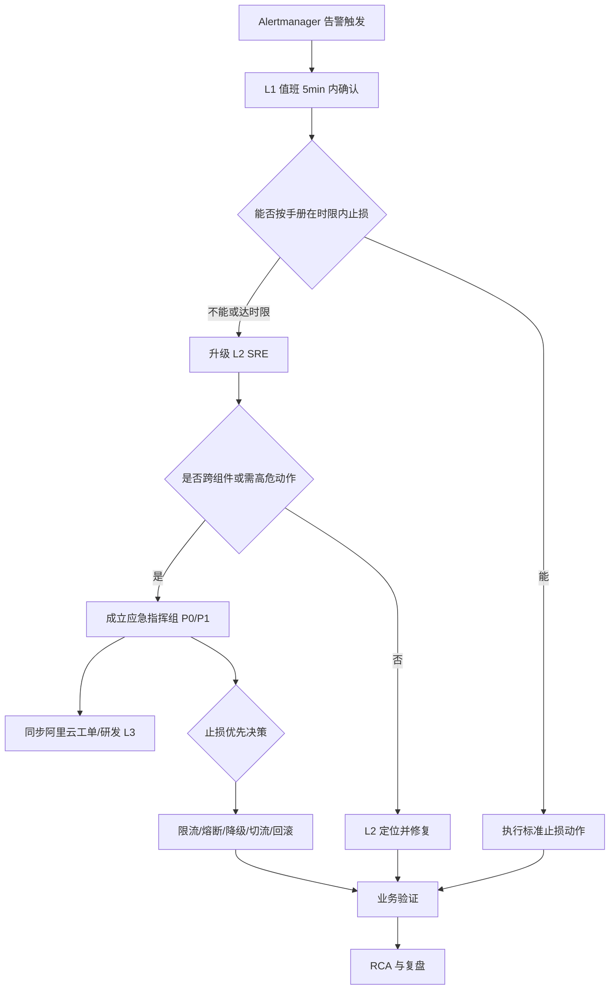
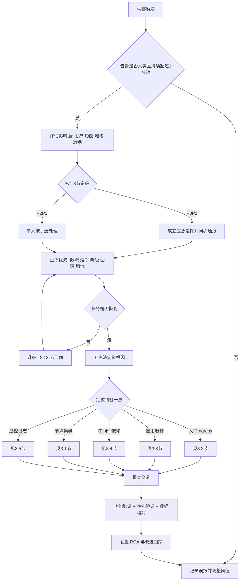

# 若依微服务项目部署学习手册 — 故障处理手册（企业级故障体系作为学习蓝本）

> 文档编号：RuoYi-Ops-03
> 版本：v1.0
> 适用系统：RuoYi-Cloud 3.6.5 企业级部署（阿里云 ACK 托管版 + 云中间件）
> 编制部门：平台运维组（SRE）
> 密级：内部公开
> 交叉引用：《01-系统架构方案》、《02-部署手册》

---

> **【学习环境说明】**
>
> 1. **本文档是学习蓝本**：内容完整取自企业级生产故障处理体系，供学习"发现 → 定位 → 止损 → 修复 → 复盘"整套故障处理流程使用，**它不是正式生产环境手册**。
> 2. **学习环境是单副本、中间件全部集群内单实例、且没有任何云产品**（无 RDS、无云 Redis、无 SLB、无 WAF、无 KMS、无 RRSA），因此文中一部分云侧命令（`aliyun` CLI、RDS/云 Redis/SLB 控制台操作、云工单）在学习环境**跑不通**，需改用等价的集群内命令（`kubectl exec`、`mysql`、`redis-cli`、Nacos OpenAPI）。
> 3. 生产与学习环境的**统一差异说明**（现象差异表、最小演练集、选做与只读清单、排障入口替换表、阈值调整建议、危险动作铁律）见本文件 **§1.7「学习模式说明」**。
> 4. 学习总览与两天学习计划见《00-总览与实施计划》；部署步骤见《02-部署手册》；架构原理见《01-系统架构方案》。
> 5. ⚠️ **跑危险动作前先确认这是按量付费的实验集群**；**不要在任何真实环境执行本手册第 4 章的高危命令**。

---

## 1. 手册使用说明

### 1.1 适用范围

本手册适用于 RuoYi-Cloud 3.6.5 在阿里云 ACK 托管版集群上的生产环境故障处置，覆盖从基础设施、Kubernetes 平台、Ingress 接入、微服务应用、中间件、可观测性到安全网络的全链路。环境事实基线如下（排查时必须结合这些事实，不得按通用互联网经验臆断）：

| 维度 | 事实基线 |
| --- | --- |
| Kubernetes | ACK 托管版，Kubernetes 1.28.9-aliyun.1，containerd 运行时，Terway 网络插件，kube-proxy 采用 IPVS 模式 |
| 节点 OS | Rocky Linux 9.3，三可用区 cn-hangzhou-h / cn-hangzhou-i / cn-hangzhou-j |
| 业务命名空间 | `ruoyi-prod`：ruoyi-gateway(8080)、ruoyi-auth(9200)、ruoyi-modules-system(9201)、ruoyi-modules-gen(9202)、ruoyi-modules-job(9203)、ruoyi-modules-file(9300)、ruoyi-nginx 前端(80) |
| 中间件命名空间 | `ruoyi-middleware`：nacos 3 节点(8848/9848/9849，MySQL 存储)；可选自建 mysql(3306)/redis(6379)。**主方案为阿里云 RDS MySQL 8.0 高可用版 + 云数据库 Redis 7.0** |
| 可观测命名空间 | `ruoyi-monitoring`：sentinel-dashboard(8858)、skywalking-oap 3 副本(11800/12800)、skywalking-ui(8080)、prometheus(9090)、alertmanager(9093)、grafana(3000) |
| 日志命名空间 | `ruoyi-logging`：elasticsearch 7.17.21 三节点(9200/9300)、kibana(5601)、filebeat DaemonSet |
| 接入命名空间 | `ruoyi-ingress`：Nginx Ingress Controller（备选 ALB Ingress） |
| 域名 | 前端 `ruoyi.example.com`；网关 `api.ruoyi.example.com`；管控台 `nacos/sentinel/skywalking/kibana/grafana/alert.example.com`（仅内网可达） |
| 镜像仓库 | ACR 企业版 `registry.cn-hangzhou.aliyuncs.com/ruoyi-prod` |
| 服务发现与配置 | Nacos 2.2.3，命名空间 `ruoyi-prod`，`DEFAULT_GROUP` |
| 限流熔断 | Sentinel 1.8.6，规则持久化到 Nacos |
| 链路追踪 | SkyWalking 9.4.0，ES 存储，javaagent 注入 |
| 日志链路 | 容器 stdout + `/opt/ruoyi/logs`，Filebeat DaemonSet 采集入 ES |

**关键端口速记（排障高频）**：Nacos 主端口 8848，**客户端 gRPC 9848**（= 8848+1000），**服务端 gRPC 9849**（= 8848+1001）。9848/9849 未放通是"注册不上 Nacos"的头号原因。

> **命名约定**：前端组件的 K8s 资源名、Service 名与镜像名统一为 `ruoyi-nginx`（镜像内运行 Nginx 1.24，静态资源构建自若依前端工程 `ruoyi-ui`）；文档中出现的 `ruoyi-ui/dist`、`ruoyi-ui/.env.production` 等为源码工程路径，非集群资源名。

### 1.2 读者对象

| 角色 | 使用重点 | 建议先读 |
| --- | --- | --- |
| 一线值班工程师（L1） | 告警确认、影响面评估、标准止损动作、升级判定 | 第 2 章、第 3 章、第 5 章、第 4.3 节 |
| 二线运维/SRE（L2） | 全量场景定位与修复、变更与回滚 | 第 2 章、第 3 章、第 4 章 |
| 应用研发（L3） | 应用层根因、JVM/线程/连接池、代码级修复 | 3.3、3.4.5、3.7、第 6 章 |
| 中间件/DBA | MySQL/Redis/ES/Nacos 深度处置 | 3.4、3.5.4、2.3 |
| 技术负责人/指挥 | 故障分级、升级路径、沟通与复盘 | 1.3、1.4、4.1、第 6 章 |

### 1.3 故障分级与响应/恢复时限

分级以**业务影响面**为唯一判定依据，不以技术复杂度判定。

| 级别 | 定义 | 典型示例 | 响应时限 | 恢复/止损时限 | 通报层级 | 复盘要求 |
| --- | --- | --- | --- | --- | --- | --- |
| P0 | 全站不可用或核心资金/数据链路中断，影响全部用户 | 网关全挂、集群级 502、RDS 主库不可写、Nacos 全集群宕机、误删生产库/配置 | ≤ 5 分钟 | ≤ 30 分钟（先止损） | 立即：值班→SRE 负责人→技术总监→CTO；15 分钟内拉应急群+电话会议 | 24h 内初版 RCA，3 工作日内正式复盘 |
| P1 | 核心功能大面积不可用或性能严重劣化，影响 >30% 用户 | 某核心微服务全副本 CrashLoop、登录成功率 <90%、接口 P99 > 5s、ES 集群 red | ≤ 10 分钟 | ≤ 60 分钟 | 立即：值班→SRE 负责人→技术总监 | 48h 内初版 RCA，5 工作日内复盘 |
| P2 | 非核心功能异常或部分用户受影响 | 定时任务不执行、文件上传失败、Kibana/Grafana 不可用、单可用区节点异常 | ≤ 30 分钟 | ≤ 4 小时 | 值班群通报，SRE 负责人知悉 | 5 工作日内简版复盘 |
| P3 | 单点告警、无用户感知、有冗余承接 | 单 Pod 重启、CK 告警、单节点磁盘 75%、证书 20 天后到期 | ≤ 2 小时 | ≤ 24 小时（或转变更窗口处理） | 工单系统记录 | 纳入月度汇总分析 |

**升级触发条件（任一满足即升级）**：

1. 达到本级恢复时限仍未止损，自动升一级；
2. 影响面在处置过程中扩大（如单 AZ → 多 AZ）；
3. 需要执行高危动作（`kubectl drain`、`scale down 至 0`、`DROP/DELETE` 类操作、回滚数据库）；
4. 根因超出值班人员技能栈，或 15 分钟内无有效假设；
5. 涉及数据一致性、资金、合规、疑似安全入侵。

### 1.4 升级路径与通知矩阵



| 通知对象 | 渠道 | 触发级别 | 内容要点 | 时限 |
| --- | --- | --- | --- | --- |
| L1 值班 | 电话 + 企业微信值班群 | P0-P3 | 告警原文、影响面初判、已执行动作 | 告警后 5 分钟 |
| L2 SRE | 电话 + 应急群 | P0-P1 | 现象、已排查证据、所需支援 | 确认后 5 分钟内 |
| 技术总监/CTO | 电话 | P0 | 影响面、止损方案、预计恢复时间 | 确认后 10 分钟内 |
| 产品/客服 | 应急群 | P0-P1 | 用户侧话术、影响功能清单 | 确认后 15 分钟内 |
| 阿里云工单 | 控制台工单 + 专属钉钉群 | 涉及云产品（SLB/RDS/Redis/ACK 托管组件） | 实例 ID、时间点、traceId、现象截图 | 判定云侧责任后 10 分钟内 |
| 全公司 | 邮件 + 公告 | P0 恢复后 | 故障简报（现象/影响/根因初判/后续） | 恢复后 2 小时内 |

### 1.5 值班与交接模板

**值班要求**：7×24 双人值守（主值 + 备值），主值携带笔记本电脑与 4G 热点，具备 ACK 控制台、堡垒机、告警平台、应急群全部权限；每班开始前完成 §7.1 健康检查清单。

#### 1.5.1 交接班记录模板（复制使用）

```markdown
## 交接班记录
- 班次：____（日期 09:00 ~ 次日 09:00）  交班人：____  接班人：____
- 当前系统状态：□ 正常 □ 降级运行 □ 故障未闭环
## 一、进行中的故障/工单
| 编号 | 级别 | 现象摘要 | 已执行动作 | 当前状态 | 下一步与责任人 |
| --- | --- | --- | --- | --- | --- |
| INC-____ | P_ |  |  | □处理中 □观察中 |  |
## 二、变更与风险
| 变更单 | 内容 | 执行时间 | 风险点 | 需重点观察的指标 |
| --- | --- | --- | --- | --- |
## 三、待办与定时任务
- [ ] 事项 / 截止时间 / 责任人
## 四、遗留容量与隐患
- 集群资源水位：CPU __% / MEM __% ；节点磁盘最高水位 __%（节点名：____）
- RDS 连接数 ___/___ ；Redis 内存 ___/___
- 证书到期：ruoyi.example.com ____ 天
## 五、交接确认
交班人签字：____  接班人签字：____  时间：____
```

#### 1.5.2 故障处理时间线记录模板（P0/P1 强制）

```markdown
# 故障时间线（UTC+8）
| 时间 | 事件/动作 | 执行人 | 证据（命令输出/截图/traceId） | 结果 |
| --- | --- | --- | --- | --- |
| 10:03 | Alertmanager 告警 GatewayHighErrorRate | 系统 | 告警 ID 8812 | 已通知 |
| 10:05 | L1 确认，业务侧 502 比例 62% | 张三 | 截图 | 影响面评估完成 |
| 10:07 | 执行 kubectl get pod -n ruoyi-ingress | 张三 | 输出见附件 A | ingress-nginx 0/3 Running |
| 10:12 | 升级 L2，成立应急组 | 张三 | 群记录 | 指挥：李四 |
| 10:20 | 执行止损：重启 ingress-nginx 副本 | 李四 | 见 §3.2.1 | 502 降至 3% |
| 10:26 | 业务验证通过（登录/下单/查询） | 王五 | 见 §7.2 | 宣布恢复 |
```

### 1.6 修订记录

| 版本 | 日期 | 修订人 | 修订内容 | 审核人 |
| --- | --- | --- | --- | --- |
| v0.9 | 2024-11-05 | SRE 组 | 初稿：集群、业务、中间件三大类合计 38 个场景 | |
| v1.0 | 2024-12-10 | SRE 组 | 补齐至 60+ 场景；新增报错速查表 72 条；补充安全与容量章节；统一风险标注规范 | |
| v1.1 | 待定 | | 按季度演练结果修订（见 §6.5） | |

### 1.7 学习模式说明（单副本现象、最小演练集与只读清单）

> 本节只做**学习用途的补充说明**：不替代、不修改前文任何内容。前文所有阈值、命令、场景与脚本均按企业级生产口径**原样保留**，请先按生产口径理解"应该怎么做"，再用本节把动作改造成学习环境**能真的跑通**的样子。
>
> **学习基线（LB）**：集群 `ack-ruoyi-lab`，单可用区 `cn-hangzhou-j`，节点池 `np-lab` = `ecs.c7.xlarge`（4C8G）×3、**按量付费**；命名空间仍为 `ruoyi-prod` / `ruoyi-middleware` / `ruoyi-monitoring` / `ruoyi-logging` / `ruoyi-ingress`（学习时只建前三个即可）。**所有业务微服务与全部中间件副本数均为 1**：gateway / auth / system / gen / job / file / nginx / nacos / mysql / redis / sentinel / skywalking-oap / skywalking-ui / elasticsearch / kibana / prometheus / grafana / alertmanager 全部 1 副本，filebeat 仍为 DaemonSet（3 节点）。**所有中间件都跑在集群内单实例**：MySQL `mysql:8.0` StatefulSet 单实例 + 50GiB ESSD；Redis `redis:7` 单实例 + 20GiB；Nacos 2.2.3 **standalone 单机模式**（配置存 MySQL）；Elasticsearch **单节点 `discovery.type=single-node`**（索引副本数必须为 0）、heap 2g。**没有 RDS、没有云 Redis、没有 SLB、没有 WAF、没有 KMS、没有 RRSA**。访问方式：Ingress 用 `<EIP/公网IP>.nip.io` 或 hosts 绑定 `ruoyi.lab.local`，TLS 自签；管控台（Nacos / Kibana / Grafana / SkyWalking UI）统一用 `kubectl port-forward`。告警只有钉钉 / 企业微信个人机器人 webhook，没有短信、电话、值班系统。

#### 1.7.1 学习环境事实与"现象差异"表

下表是"为什么我按文档操作，结果和文档写的不一样"的标准答案：先读"生产行为"，再读"学习环境行为"，最后一列是最容易被误判为故障的情形。

| # | 生产行为 | 学习环境行为 | 你能学到什么 | 别误判为故障 |
| --- | --- | --- | --- | --- |
| 1 | 业务服务 3 副本、跨节点分布，删 Pod / `drain` 时业务无感 | **全部 1 副本**：删 Pod / `drain` 节点时服务会**真的中断数十秒** | "副本数 = 可用性"最直观的一课：中断时长 ≈ 重建 + 就绪探针时间 | 删 Pod 后接口短暂 502 / 连接拒绝是**预期现象**，不是自愈失效 |
| 2 | 3 节点以上，`drain` 时 Pod 被调度到其它节点 | 只有 3 个节点，若无可调度节点则 `drain` 后 Pod 卡 `Pending`（`0/3 nodes are available`） | 学会 `cordon → 确认可中断 → drain → uncordon` 的顺序，以及 PDB 的作用 | `Pending` 不等于调度器坏了：先看有没有可调度节点，再 `uncordon` 或临时加第二台节点 |
| 3 | Nacos 3 节点集群，有选举 / Raft / 脑裂场景 | Nacos 是 **standalone 单机**：没有集群选举、脑裂、Raft 多数派场景 | 但"Nacos 重启期间所有服务心跳失败""配置读不到导致启动失败""9848 端口不通"**完全照样发生** | 重启 Nacos 后各服务日志报心跳失败 / 注册失败，是单点重启的必然结果 |
| 4 | ES 3 节点，可练副本分片恢复、跨节点重分配 | ES **单节点 `discovery.type=single-node`**：索引副本数必须为 0，集群健康只能是 green（副本 0）或 yellow / red（磁盘、分片问题） | **不能练副本分片恢复**；但磁盘水位与 `read-only`、分片分配失败依然会触发 | yellow 在这个环境里多来自"分片未分配 / 磁盘水位"，不要一律当成"副本没分配" |
| 5 | RDS 主备、云 Redis 主从，有切换与 `READONLY` 场景 | MySQL / Redis 均为**集群内单实例**：没有主备切换、没有 `READONLY` 报错场景（可用 `REPLICAOF` 人为制造） | 连接数满、慢 SQL、锁等待、磁盘满、时区问题**照样发生，必须练** | 没有切换事件时不要去找"切换记录"，先查连接数、慢日志、锁等待 |
| 6 | 有 RDS / Redis / KMS / VPC / SLB 控制台与 `aliyun` CLI | **一切云产品都不存在**：所有 `aliyun` CLI 排障命令（RDS / Redis / KMS / VPC 等）只作了解、跑不通 | 把"云侧操作"一一映射为集群内命令：`kubectl exec` 进 MySQL / Redis Pod、`mysql`、`redis-cli`、Nacos OpenAPI | 命令 `command not found` 或云 API 鉴权失败是**环境没有云产品**，不是你的权限方案错了 |
| 7 | Prometheus / Grafana / Kibana 双副本 | 三者均为**单副本**：重启期间监控面板与日志检索会短暂不可用 | 学会"监控自身不可用时如何用命令行兜底"（§7.1、§7.5） | 监控组件重启期间的面板 502、日志检索报错、告警空窗是预期现象 |

#### 1.7.2 最小演练集（必做 5 个）

每个演练 20–40 分钟，标准不是"跑通命令"，而是能完整说出"现象 → 定位命令 → 根因 → 修复 → 验证"。动手前请先读 §1.7.6 的三条铁律。

| # | 演练名 | 对应本手册章节 | 制造方法（一句话） | 观察什么 | 通过标准 | 预计耗时 |
| --- | --- | --- | --- | --- | --- | --- |
| 1 | 删除业务 Pod，观察自愈与短暂中断 | §3.3 业务微服务类（§3.3.1–§3.3.4）、§2.2 五步法 | `kubectl delete pod <ruoyi-modules-system Pod> -n ruoyi-prod` | Pod 重建耗时、接口中断秒数、`Endpoints` 变化、`RESTARTS`、探针就绪时间 | 能解释"为什么单副本必然中断"，并能从 §4.3 手段 6（摘除故障实例）/ 手段 11（重启 Pod）中选出正确动作 | 20 分钟 |
| 2 | 把 `system` 服务探针改错，制造 `CrashLoopBackOff` 并修复 | §3.3.4 探针失败导致反复重启、§3.3.1 CrashLoopBackOff | 先 `kubectl get deploy ruoyi-modules-system -n ruoyi-prod -o yaml > bak.yaml`，再把 liveness / readiness 的 `path` 改成不存在的 `/actuator/nope` | 事件 `Liveness probe failed`、`Back-off restarting failed container`、`RESTARTS` 快速增长、`Last State` | 能按 §3.3.4 判读"探针过激 / 路径错误 / 依赖慢"，并用 `kubectl rollout undo deploy/ruoyi-modules-system -n ruoyi-prod` 或改回探针恢复 | 30 分钟 |
| 3 | 制造 Nacos 重启 / `9848` 端口不可达导致注册失败并修复 | §3.3.7 注册不上 Nacos、§3.4.16 Nacos 403 / 9848-9849 端口不通、§3.4.1 Nacos 节点掉线 | `kubectl rollout restart sts/nacos -n ruoyi-middleware`；或临时把 Nacos Service 的 9848 端口改错 | 各服务日志 `NacosException`、心跳失败、`dial tcp ...:9848: i/o timeout`、Nacos 实例列表为空 | 能说出 8848 / 9848 / 9849 各自作用，并给出"放通端口 / 依赖恢复后重新注册"的修复路径 | 30 分钟 |
| 4 | `drain` 一台节点（先加第二台节点），观察 Pod 迁移与 PDB 行为 | §3.1 集群与节点类（§3.1.1 节点 NotReady、§3.1.4、§3.1.5）、§4.3 手段 8 | 先把节点池临时扩到 4 个节点保证有地方迁移，再 `kubectl drain <node> --ignore-daemonsets --delete-emptydir-data` | `kubectl get pdb -n ruoyi-prod` 的 `ALLOWED DISRUPTIONS`、Pod 迁移过程、出现 `Pending` 的原因 | 能说明 PDB 为什么要留 `minAvailable`，并完整走一遍 `cordon → drain → 验证 → uncordon` | 40 分钟 |
| 5 | 制造一次 MySQL 连接数打满或慢 SQL 并定位修复 | §3.4.2 MySQL 连接数满、§3.4.3 MySQL 慢 SQL、§3.3.11 数据库连接池耗尽 | 用 `kubectl exec` 进 mysql Pod 后开一批空闲会话，或执行一条无索引的慢查询 | `Too many connections`、`Threads_connected` 曲线、`SHOW PROCESSLIST`、慢日志、应用侧 `HikariPool ... request timed out` | 能判断"是连接泄漏、副本过多还是池配置过大"，并说出止损动作（杀空闲连接 / 降副本 / 收紧连接池） | 40 分钟 |

#### 1.7.3 选做演练（4 个）与只读浏览清单

**选做演练（有时间再做，各 20–40 分钟；制造前同样遵守 §1.7.6）**

| # | 演练名 | 对应本手册章节 | 制造方法（一句话） | 为什么值得做 |
| --- | --- | --- | --- | --- |
| 1 | ES 磁盘水位触发 `read-only` | §3.5.5 Elasticsearch 磁盘水位导致写入只读、§3.5.4 | 往 ES 单节点数据盘灌水或用低水位设置把磁盘水位压低，再写入索引 | 单节点 ES 最容易复现的真实故障：写入全失败，且必须知道怎么解锁只读 |
| 2 | Prometheus 告警规则触发并收到钉钉 | §3.5.6 Prometheus 存储满 / target down / 告警未发送、§7.3 | 加一条"必然为真"的测试告警规则或把阈值调紧，等 Alertmanager 推送 | 打通"告警规则 → Alertmanager → 钉钉机器人"整条链路，验证告警真的到人 |
| 3 | SkyWalking 无数据（agent 未挂载） | §3.5.2 SkyWalking UI 无数据 / Trace 断链、§3.5.1 | 去掉某个 Deployment 的 agent 挂载或 `JAVA_TOOL_OPTIONS` 后重启该服务 | 学会区分"服务其实正常、只是没有 Trace"这类最容易被忽略的可观测性故障 |
| 4 | 内存 limit 过小导致 `OOMKilled` | §3.3.1 CrashLoopBackOff（OOMKilled）、§3.3.6 JVM OOM / FullGC 频繁 | 把 `ruoyi-modules-system` 的 `limits.memory` 临时改小（如 512Mi）并触发一次接口压测 | 亲手制造 137 / OOMKilled，再用 §3.3.6 的 `jmap -histo`、GC 日志看现场，比读十遍文档有用 |

**只读浏览清单（不必在实验环境复现，理解"生产该怎么办"即可）**

| # | 场景 | 对应本手册章节 | 为什么只读 |
| --- | --- | --- | --- |
| 1 | 跨可用区（AZ）级故障与切流 | §3.1.15 可用区级故障 | 学习环境是单可用区，没有第二个 AZ 可切流 |
| 2 | RDS 主备切换导致连接中断 | §3.4.5 MySQL / RDS 主备切换 | 学习环境 MySQL 是集群内单实例，没有主备 |
| 3 | 云 Redis 主从切换与 `READONLY` | §3.4.11 Redis 主从切换与只读报错 READONLY | 学习环境 Redis 是单实例（可读该节了解现象与判读思路） |
| 4 | KMS 密钥禁用导致 Secret 解密失败 | §3.6.6 KMS 密钥禁用 | 学习环境没有 KMS，也没有 ACK 加密 Secret / KMS 信封加密 |
| 5 | RRSA / RAM 权限不足 | §3.6.3 RAM 权限不足导致操作失败 | 学习环境没有 RRSA，也没有云 OpenAPI 调用链 |
| 6 | WAF / 云安全组误拦 | §3.6.1 安全组规则误拦 | 学习环境没有 WAF，也没有云侧安全组策略（只有节点最简规则） |
| 7 | 跨地域灾备与 DNS 切流 | §4.3 手段 12（切换 DNS）、§3.2.8 域名解析异常 | 只有一个集群、一个入口，没有备用通道可切 |
| 8 | 疑似入侵 / 挖矿排查 | §3.6.7 疑似入侵 / 挖矿排查 | 需要云安全中心、云审计日志等云侧数据源 |

#### 1.7.4 学习环境的排障入口替换表

原则：**"生产用什么"照原文理解，"学习环境用什么"照本表执行**；同一件事的判读方法与命令仍以对应章节原文为准。

| # | 生产用什么 | 学习环境用什么 | 对应章节 |
| --- | --- | --- | --- |
| 1 | RDS 控制台（会话、慢日志、参数、主备） | `kubectl exec -it mysql-0 -n ruoyi-middleware -- mysql -uroot -p`；`SHOW PROCESSLIST`、`SHOW ENGINE INNODB STATUS`、慢日志在 Pod 内查 | §3.4.2–§3.4.6 |
| 2 | 云监控（RDS / Redis / ECS 指标曲线） | Prometheus + Grafana：`kubectl port-forward svc/prometheus 9090:9090`、`kubectl port-forward svc/grafana 3000:3000` | §2.4、§3.7.1 |
| 3 | SLS / 云日志服务 | Kibana：`kubectl port-forward svc/kibana 5601:5601`（索引由 filebeat 采集），兜底用 `kubectl logs` | §3.5.7、§3.5.8 |
| 4 | SLB 健康检查与后端管理 | Ingress 注解（`nginx.ingress.kubernetes.io/*`）、`kubectl describe ingress`、`kubectl get endpoints` | §3.2.1、§3.2.4 |
| 5 | ARMS / 链路追踪控制台 | SkyWalking UI：`kubectl port-forward svc/skywalking-ui 8080:8080` | §3.5.2 |
| 6 | KMS 控制台与密钥策略 | 无 KMS：`kubectl get secret`、`kubectl describe secret`，关注 Secret 是否缺失或被误删 | §3.6.6、§3.6.5 |
| 7 | ACR 控制台与仓库凭据 | `kubectl get secret <acr-secret> -n ruoyi-prod -o yaml`（解码 `.dockerconfigjson`）；节点上 `crictl pull` 复现 | §3.6.4、§3.1.10 |
| 8 | 云 Redis 控制台（内存、连接数、慢日志） | `kubectl exec -it redis-0 -n ruoyi-middleware -- redis-cli`：`INFO`、`SLOWLOG GET`、`CLIENT LIST` | §3.4.8–§3.4.13 |
| 9 | 云侧工单 / 值班电话升级通道 | 无工单：用 §3 场景章节 + 第 5 章速查表自查，用 §7.5 一键采集脚本留证 | §2.2、§7.5 |
| 10 | 云解析（DNS）与云证书服务 | hosts 绑定 `ruoyi.lab.local` 或用 `<EIP>.nip.io`；证书用 `openssl` 自签并更新 Secret | §3.2.3、§3.2.8 |

#### 1.7.5 学习环境的阈值调整建议

学习环境只有 3 台 4C8G 节点、所有组件单副本，**直接沿用生产阈值会出现"怎么压都不告警"**。建议按下表临时调整，目的是**更容易触发、便于观察**，这是**学习建议，不是生产建议**，禁止回流到生产环境。

| # | 指标 | 生产阈值（原文，见 §2.4、§7.3） | 学习建议阈值 | 为什么这样调 |
| --- | --- | --- | --- | --- |
| 1 | 节点系统盘 / 数据盘水位 | >75% 预警、>85% 严重 | **60% / 75%** | 节点盘容量小、水位涨得快，60% 就能完整练一遍清理动作 |
| 2 | Pod 重启次数 | 1 小时 ≥3 次（`PodRestartFrequent`）；`PodCrashLoopBackOff` 持续 3 分钟 | **10 分钟 ≥2 次；`CrashLoopBackOff` 持续 1 分钟** | 单副本下重启即中断，越早发现越好（等价的更紧口径即"3 分钟 2 次"） |
| 3 | 接口 P99（网关聚合） | >1s 预警、>3s 严重 | **800ms / 2s** | 3×4C8G 单副本的正常抖动就接近 1s，调低才看得见劣化趋势；若你自建了 500ms 这类更紧阈值，学习环境反而应放宽到 **1s** |
| 4 | JVM 堆使用率 | >75% 预警、>85% 严重 | **80% / 90%**（想专门练 OOM 时保持 75%，改为把 `-Xmx` 调小） | 单副本 heap 小、GC 频繁，75% 容易长期常亮造成告警疲劳 |
| 5 | CPU 限流比（throttled periods） | >10% 预警、>25% 严重 | **5% / 15%** | 4C8G 节点极易限流，调低才能更早观察 §3.3.5 的现象 |
| 6 | DB 连接数使用率 | >70% 预警、>85% 严重 | **60% / 75%** | 单实例 `max_connections` 较小，70% 已经很接近真实风险 |
| 7 | ES 磁盘水位（单节点） | 告警 >80% / >85%；ES watermark 85% / 90% / 95% | **70% / 80%；watermark 70% / 80% / 90%** | 单节点 ES 盘小，调低才能复现 §3.5.5 的索引 `read-only` |
| 8 | MySQL 慢 SQL（>1s）条数 | >5 / >20 条每分钟 | **>1 / >5 条每分钟** | 单实例基线低，容易观察到 §3.4.3 的定位链路 |
| 9 | 告警持续时长（`for`） | 多为 3 / 5 / 10 分钟 | **1 / 2 / 5 分钟** | 实验节奏快，缩短等待时间便于"制造 → 告警 → 修复"闭环 |

> 调整原则一句话：**资源类阈值调紧**（磁盘、内存、CPU、连接数）以便更容易触发；**延迟类阈值放宽**（P99、慢查询等待）因为小规格单副本的天然抖动本就更大。

#### 1.7.6 做危险动作前的三条铁律（学习环境专用）

前文第 4 章的高危命令在学习环境**同样会造成真实中断与数据丢失**，动手前必须过以下三条：

1. **确认 kubeconfig 指向实验集群**：先执行 `kubectl config current-context`（应指向 `ack-ruoyi-lab` 对应的上下文），不确定就先 `kubectl config get-contexts`，再用 `kubectl config use-context <lab-context>` 切换；上下文不对**不要**敲任何 `delete` / `drain` / `scale`。
2. **高危命令一律先干跑或先看现场**：能干跑的先 `--dry-run=client`（如 `kubectl apply --dry-run=client -f xx.yaml`、`kubectl drain <node> --dry-run=client ...`）；不能干跑的先 `kubectl describe` 或用 `kubectl get <资源> -o yaml > bak.yaml` 留底，再动手。
3. **`delete` / `drain` / `scale 0` / `FLUSHALL` 之前先确认"这个环境里没有别人的东西"**：学习环境里可能同时有其它实验数据，中间件又都是单实例，误删 Nacos 配置、MySQL 库或 Redis 数据就要重装。动手前先 `kubectl get all -n ruoyi-prod`、`redis-cli DBSIZE` 之类确认影响范围，并**优先选择可逆动作**（改注解、改探针、`rollout undo`）。

---

## 2. 通用排查方法论与工具速查

### 2.1 标准排查流程

六个阶段固定顺序执行，**严禁跳步**：在影响面未评估完成前就动手，是造成二次故障的第一大原因。

| 阶段 | 目标 | 关键动作 | 输出物 | 时限（P0） |
| --- | --- | --- | --- | --- |
| ① 告警确认 | 剔除误报，确认真实性 | 查 Alertmanager 状态与持续时间、Grafana 曲线、多源交叉验证 | 确认/误报结论 | 3 分钟 |
| ② 影响面评估 | 界定用户、功能、地域、数据影响 | 看入口 5xx 比例与 QPS、看核心接口成功率、看是否有数据写入失败 | 影响面一句话结论 | 5 分钟 |
| ③ 止损优先 | 恢复可用性优先于根因 | 执行第 4.3 节止损手段（限流/降级/切流/回滚/重启） | 业务可用性恢复 | 30 分钟 |
| ④ 定位根因 | 在止损后进行，避免带病深挖 | 按五步法逐层收敛：入口→网关→应用→依赖 | 根因假设与验证证据 | — |
| ⑤ 修复验证 | 根本修复并验证 | 变更执行、回滚预案、功能与性能双验证 | 验证通过记录 | — |
| ⑥ 复盘 | 沉淀改进 | 按第 6 章 RCA 模板输出，跟踪改进项 | RCA 报告 + 改进清单 | 24h/3 天 |



**排查纪律（十条）**：

1. 先只读、后写入。任何 `delete`/`scale`/`drop` 前必须先采集现场证据（`kubectl describe`、`logs --previous`、`jstack`、`jmap`）。
2. 只改一个变量。同时改多个配置将无法归因。
3. 记录时间戳。所有关键动作记录到 §1.5.2 时间线。
4. 优先用现成只读 API（Nacos/ES/Redis 自带 API）而非重启服务。
5. 怀疑数据问题时**立即停止写入**（切只读/摘流量），不要先分析。
6. 生产禁止直接 `kubectl edit` 长期生效，必须在 GitOps 仓库改后同步，否则下次发布被覆盖。
7. 涉及节点操作（`drain`/`cordon`）必须先确认 PDB 与副本冗余。
8. 云产品优先查阿里云健康事件与工单，别自己死磕。
9. 处置过程全程留痕，命令与输出入工单附件。
10. 恢复后观察 30 分钟再宣布闭环，防抖动。

### 2.2 K8s 排障五步法

**顺序固定：get → describe → events → logs → exec/debug。** 每一步的用途不可互换：`get` 看状态，`describe` 看原因，`events` 看时间序，`logs` 看应用，`exec` 看现场。

#### 2.2.1 五步法命令与判读

| 步骤 | 命令（只读） | 判读要点 |
| --- | --- | --- |
| ① get | `kubectl get pods -o wide -n ruoyi-prod` | STATUS 非 Running、READY 分子分母不等、RESTARTS 持续增长、NODE 分布是否集中在单 AZ |
| ② describe | `kubectl describe pod <pod> -n ruoyi-prod` | 看 `Last State`（OOMKilled/Error）、`Events` 尾部、`Limits/Requests`、探针配置 |
| ③ events | `kubectl get events -n ruoyi-prod --sort-by=.lastTimestamp \| tail -40` | FailedScheduling、FailedMount、Unhealthy、BackOff 的首次发生时间 |
| ④ logs | `kubectl logs <pod> -n ruoyi-prod --since=30m`；崩溃前 `--previous` | 异常堆栈首行 Caused by、连接超时目标地址、配置项缺失 |
| ⑤ exec/debug | `kubectl exec -it <pod> -n ruoyi-prod -- sh`；无 shell 用 `kubectl debug` | 进程、端口、DNS、文件权限、JVM 运行时状态 |

#### 2.2.2 常用命令速查表

| 用途 | 命令 | 说明 |
| --- | --- | --- |
| 全量 Pod 分布 | `kubectl get pods -o wide -n ruoyi-prod` | 含 IP 与节点，快速看是否单节点堆积 |
| 按重启次数排序 | `kubectl get pods -n ruoyi-prod --sort-by='.status.containerStatuses[0].restartCount'` | 定位反复重启者 |
| 看资源占用 | `kubectl top pod -n ruoyi-prod --containers` / `kubectl top node` | 需 metrics-server；对比 limit 判断限流风险 |
| 详情 | `kubectl describe pod <pod> -n ruoyi-prod` | 事件与探针失败原因 |
| 当前日志 | `kubectl logs <pod> -n ruoyi-prod --since=15m --timestamps` | 带时间戳便于对齐时间线 |
| 崩溃前日志 | `kubectl logs <pod> -n ruoyi-prod --previous` | CrashLoopBackOff 必用 |
| 多容器 | `kubectl logs <pod> -c <container> -n ruoyi-prod` | sidecar 场景 |
| 标签批量 | `kubectl logs -l app=ruoyi-gateway -n ruoyi-prod --all-containers --prefix` | 多副本聚合，带 Pod 前缀 |
| 进入容器 | `kubectl exec -it <pod> -n ruoyi-prod -- bash` | 业务镜像通常有 bash；无则 `sh` |
| 临时调试容器 | `kubectl debug -it <pod> -n ruoyi-prod --image=nicolaka/netshoot:latest --target=<container> -- bash` | 共享进程命名空间，可看目标进程网络 |
| 事件排序 | `kubectl get events -A --sort-by=.lastTimestamp \| tail -50` | 全局视角 |
| 文件互拷 | `kubectl cp ruoyi-prod/<pod>:/opt/ruoyi/logs/error.log ./error.log` | 注意大文件先压缩 |
| 调度失败详情 | `kubectl describe pod <pod> -n ruoyi-prod \| sed -n '/Events/,$p'` | 看 Insufficient cpu/memory、taint |
| 节点状态 | `kubectl get nodes -o wide`；`kubectl describe node <node>` | 看 Conditions 与 Allocated resources |
| 节点排空（⚠️） | `kubectl drain <node> --ignore-daemonsets --delete-emptydir-data` | 见 §3.1.1 风险与回滚 |
| 回填节点 | `kubectl uncordon <node>` | drain 后恢复调度 |
| 命名空间资源 | `kubectl get resourcequota,limitrange -n ruoyi-prod` | Pod Pending 的常见元凶 |
| HPA 状态 | `kubectl get hpa -n ruoyi-prod`；`kubectl describe hpa <hpa> -n ruoyi-prod` | 看当前/目标副本与指标可用性 |
| PDB | `kubectl get pdb -n ruoyi-prod` | drain 前必查 |
| 服务端点 | `kubectl get endpoints -n ruoyi-prod` | Endpoints 为空 = 无就绪 Pod |
| Ingress 规则 | `kubectl get ingress -A -o wide`；`kubectl describe ingress <name> -n ruoyi-prod` | 路由丢失先看这里 |

#### 2.2.3 网络排查命令

| 场景 | 命令（在目标 Pod 或 netshoot 内执行） |
| --- | --- |
| DNS 解析 | `nslookup ruoyi-modules-system.ruoyi-prod.svc.cluster.local`、`dig +short api.ruoyi.example.com @100.100.2.136` |
| DNS 耗时 | `dig ruoyi-auth.ruoyi-prod.svc.cluster.local +noall +stats`（关注 Query time，>5s 命中 ndots 问题） |
| 端口连通 | `nc -zv ruoyi-modules-system 9201`、`curl -sv --max-time 3 http://ruoyi-auth:9200/actuator/health` |
| 本机监听 | `ss -lntp`、`netstat -anp \| grep 8080` |
| 连接状态统计 | `ss -s`、`ss -tn state established '( dport = :9848 )' \| wc -l` |
| 抓包 | `tcpdump -i eth0 -nn -c 100 port 9848`、`tcpdump -i any -nn host 10.0.1.23 and port 3306` |
| 路由与网关 | `ip route`、`ip -br addr`、`tracepath 100.100.2.136` |
| HTTP 细节 | `curl -o /dev/null -s -w '%{http_code} %{time_total} %{time_connect}\n' http://api.ruoyi.example.com/actuator/health` |
| 容器内 DNS 配置 | `cat /etc/resolv.conf`（关注 `options ndots:5` 与 search 域） |
| IPVS 规则（节点上） | `ipvsadm -Ln \| grep -A3 <ClusterIP>`、`ipvsadm -Lnc`（看连接数） |

#### 2.2.4 临时排障 Pod 完整 YAML

```yaml
# 用途：集群内网络/DNS/DB/Redis 连通性排查；⚠️ 排查完成后必须删除，避免长期驻留特权容器
apiVersion: v1
kind: Pod
metadata:
  name: debug-toolbox
  namespace: ruoyi-prod
  labels:
    app: debug-toolbox
    purpose: troubleshooting
spec:
  restartPolicy: Never
  nodeName: ""            # 可选：指定到问题节点，如 cn-hangzhou.i-xxxx
  hostNetwork: false       # 需看宿主机网络时改 true
  dnsPolicy: ClusterFirst
  tolerations:             # 便于调度到有污点的节点
    - key: node-role.kubernetes.io/master
      operator: Exists
      effect: NoSchedule
    - key: node.kubernetes.io/not-ready
      operator: Exists
      effect: NoExecute
      tolerationSeconds: 30
  containers:
    # 容器1：网络全能工具箱（nslookup/dig/tcpdump/ip/ss/curl/nc/traceroute）
    - name: netshoot
      image: nicolaka/netshoot:latest
      command: ["sleep", "infinity"]
      resources:
        requests: { cpu: 50m, memory: 64Mi }
        limits:   { cpu: 500m, memory: 256Mi }
      securityContext:
        capabilities:
          add: ["NET_ADMIN", "NET_RAW"]   # tcpdump 所需
    # 容器2：DNS 专项（dnsutils：dig/nslookup/host）
    - name: dnsutils
      image: registry.cn-hangzhou.aliyuncs.com/ruoyi-prod/dnsutils:1.0
      command: ["sleep", "infinity"]
      resources:
        requests: { cpu: 20m, memory: 32Mi }
        limits:   { cpu: 200m, memory: 128Mi }
    # 容器3：MySQL 客户端（对齐 RDS MySQL 8.0）
    - name: mysql-client
      image: registry.cn-hangzhou.aliyuncs.com/ruoyi-prod/mysql-client:8.0
      command: ["sleep", "infinity"]
      env:
        - name: MYSQL_PWD
          valueFrom:
            secretKeyRef:
              name: ruoyi-db-secret
              key: mysql-password
      resources:
        requests: { cpu: 20m, memory: 32Mi }
        limits:   { cpu: 200m, memory: 128Mi }
    # 容器4：Redis 客户端（对齐云 Redis 7.0）
    - name: redis-client
      image: registry.cn-hangzhou.aliyuncs.com/ruoyi-prod/redis-client:7.0
      command: ["sleep", "infinity"]
      resources:
        requests: { cpu: 20m, memory: 32Mi }
        limits:   { cpu: 200m, memory: 128Mi }
```

创建与清理：

```bash
kubectl apply -f debug-toolbox.yaml
kubectl exec -it debug-toolbox -n ruoyi-prod -c netshoot -- bash
# ⚠️ 风险等级：低（仅排查）；用后必须删除，否则占用资源且扩大攻击面
kubectl delete pod debug-toolbox -n ruoyi-prod
```

### 2.3 各中间件排查命令速查

#### 2.3.1 Nacos 2.2.3

| 用途 | 命令 | 预期输出/判读 |
| --- | --- | --- |
| 集群节点列表 | `curl -s 'http://nacos-0.nacos.ruoyi-middleware:8848/nacos/v1/ns/operator/servers'` | `servers` 数组应含 3 节点且 `state: UP`；缺节点即掉线 |
| 服务列表 | `curl -s 'http://nacos:8848/nacos/v1/ns/service/list?pageNo=1&pageSize=100&namespaceId=ruoyi-prod&groupName=DEFAULT_GROUP'` | `doms` 含 ruoyi-gateway/ruoyi-auth/ruoyi-modules-* 共 7 个服务 |
| 实例健康 | `curl -s 'http://nacos:8848/nacos/v1/ns/instance/list?serviceName=ruoyi-modules-system&namespaceId=ruoyi-prod&groupName=DEFAULT_GROUP'` | 每个实例 `healthy:true`、`enabled:true`；缺失或 healthy:false 说明心跳/健康检查异常 |
| 指标 | `curl -s http://nacos:8848/nacos/actuator/metrics/nacos_monitor \| jq` | 看 `configCount`、`getConfig`、`longPolling` |
| 集群健康 | `curl -s http://nacos:8848/nacos/actuator/health` | `{"status":"UP"}` |
| 配置查询 | `curl -s 'http://nacos:8848/nacos/v1/cs/configs?dataId=ruoyi-gateway-prod.yml&group=DEFAULT_GROUP&tenant=ruoyi-prod'` | 返回 YAML 内容；空返回即配置丢失 |
| 鉴权登录 | `curl -s -X POST 'http://nacos:8848/nacos/v1/auth/login' -d 'username=nacos&password=***'` | 返回 `accessToken`；403 表示鉴权开启但凭据错 |
| 9848 连通 | `nc -zv nacos.ruoyi-middleware.svc.cluster.local 9848` | `succeeded!`；超时即 gRPC 不通（注册失败根因） |
| 日志 | `kubectl logs nacos-0 -n ruoyi-middleware --tail=200 \| grep -Ei 'error|exception'` | 看 Raft/一致性异常、DB 连接异常 |

#### 2.3.2 MySQL / RDS MySQL 8.0

| 用途 | 命令 | 判读 |
| --- | --- | --- |
| 连接数 | `SHOW STATUS LIKE 'Threads_connected'; SHOW VARIABLES LIKE 'max_connections';` | 使用率 >80% 预警，>90% 立即处置 |
| 活跃会话 | `SELECT id,user,host,db,command,time,state,LEFT(info,120) FROM information_schema.processlist WHERE command!='Sleep' ORDER BY time DESC LIMIT 20;` | 长事务/慢查询来源 |
| 按 IP 聚合连接 | `SELECT SUBSTRING_INDEX(host,':',1) ip, COUNT(*) c FROM information_schema.processlist GROUP BY ip ORDER BY c DESC;` | 定位连接池泄漏的应用 |
| 慢 SQL 开关 | `SHOW VARIABLES LIKE 'slow_query_log%'; SHOW VARIABLES LIKE 'long_query_time';` | RDS 建议用控制台"慢日志"页 |
| 锁等待 | `SELECT * FROM performance_schema.data_lock_waits\G` | 阻塞链 |
| 锁详情 | `SELECT ENGINE_TRANSACTION_ID,OBJECT_NAME,LOCK_TYPE,LOCK_MODE,LOCK_STATUS FROM performance_schema.data_locks LIMIT 30;` | 行锁/表锁 |
| 长事务 | `SELECT trx_id,trx_state,trx_started,TIMESTAMPDIFF(SECOND,trx_started,NOW()) secs,trx_mysql_thread_id FROM information_schema.innodb_trx ORDER BY secs DESC LIMIT 10;` | >60s 需关注 |
| 终止会话（⚠️） | `KILL <id>;` | 见 §3.4.2 风险说明 |
| 主从延迟（RDS 只读实例） | `SHOW SLAVE STATUS\G` 看 `Seconds_Behind_Master`；RDS 用控制台"主备/只读延迟" | >30s 影响读一致性 |
| 磁盘/表空间 | `SELECT table_schema, ROUND(SUM(data_length+index_length)/1024/1024,1) mb FROM information_schema.tables GROUP BY table_schema ORDER BY mb DESC;` | 定位膨胀表 |
| binlog 增长 | `SHOW BINARY LOGS;`、`SHOW VARIABLES LIKE 'binlog_expire_logs_seconds';` | 默认 7 天，突增说明大事务/写放大 |
| 时区 | `SELECT @@global.time_zone, @@session.time_zone, NOW();` | 应为 `+08:00`，否则时间字段偏移 8 小时 |

#### 2.3.3 Redis 7.0

| 用途 | 命令 | 判读 |
| --- | --- | --- |
| 概览 | `redis-cli -h <host> -a '***' info` | 看 `used_memory_human`、`maxmemory`、`evicted_keys`、`rejected_connections` |
| 客户端 | `redis-cli info clients` | `connected_clients` 接近 `maxclients`（默认 10000）即连接满 |
| 命中率 | `redis-cli info stats \| grep keyspace` | `keyspace_hit_rate` < 80% 考虑缓存设计 |
| 慢查询 | `redis-cli slowlog get 20` | 单命令 >10ms 需优化 |
| 大 key | `redis-cli --bigkeys` | ⚠️ 会遍历全库（`--bigkeys` 用 SCAN 相对安全，但大实例耗时）；关注 >10MB |
| 热 key | `redis-cli --hotkeys`（需 LFU 策略） | 热点 key 造成单分片压力 |
| 集群状态 | `redis-cli -c cluster info`；`redis-cli -c cluster nodes` | `cluster_state:ok`、16384 槽全覆盖、无 fail 节点 |
| 主从 | `redis-cli info replication` | `role:master`、`connected_slaves`、`master_link_status:up` |
| 哨兵 | `redis-cli -p 26379 sentinel master mymaster` | 主节点地址与 quorum |
| 内存策略 | `redis-cli config get maxmemory-policy` | 应为 `allkeys-lru` 或 `volatile-lru`，禁止 `noeviction` 用于缓存 |
| 持久化 | `redis-cli info persistence` | `rdb_last_bgsave_status:ok`、`aof_last_write_status:ok` |
| 键数量 | `redis-cli dbsize` | 与业务预期量级比对 |

#### 2.3.4 Elasticsearch 7.17.21

| 用途 | 命令 | 判读 |
| --- | --- | --- |
| 集群健康 | `curl -s 'http://es:9200/_cluster/health?pretty'` | status、`unassigned_shards`、`active_shards_percent_as_number` |
| 分片分布 | `curl -s 'http://es:9200/_cat/shards?v&h=index,shard,prirep,state,unassigned.reason,node' \| grep UNASSIGNED` | unassigned 原因分类 |
| 索引列表 | `curl -s 'http://es:9200/_cat/indices?v&s=store.size:desc' \| head -30` | 找膨胀索引（如 skywalking_*、filebeat-*） |
| 节点状态 | `curl -s 'http://es:9200/_nodes/stats/jvm,fs,os?pretty'` | JVM heap 使用率、磁盘 available_percent |
| 磁盘分配决策 | `curl -s 'http://es:9200/_cluster/allocation/explain?pretty'` | 分片无法分配的准确原因 |
| 只读索引解锁（⚠️） | `curl -X PUT 'http://es:9200/_all/_settings' -H 'Content-Type: application/json' -d '{"index.blocks.read_only_allow_delete": null}'` | 见 §3.5.4 风险 |
| 水位配置 | `curl -s 'http://es:9200/_cluster/settings?flat_settings&pretty'` | `cluster.routing.allocation.disk.watermark.*` |
| ILM 状态 | `curl -s 'http://es:9200/_ilm/status'`、`curl -s 'http://es:9200/_ilm/explain/skywalking_*?pretty'` | `operation_mode: RUNNING`；explain 看卡在哪一步 |
| 线程池拒绝 | `curl -s 'http://es:9200/_cat/thread_pool?v&h=node_name,name,active,queue,rejected'` | rejected >0 说明写入压力超限 |
| 分片数统计 | `curl -s 'http://es:9200/_cat/indices?v&h=index,pri,rep,docs.count' \| awk '{s+=$2+$3} END {print s}'` | 每 GB 堆对应分片数建议 <20 |
| 快照仓库 | `curl -s 'http://es:9200/_snapshot/_all?pretty'`；`curl -s 'http://es:9200/_snapshot/<repo>/_all?pretty'` | 快照成功时间 |

#### 2.3.5 Java 层（容器内 JVM）

| 用途 | 命令 | 说明 |
| --- | --- | --- |
| 找 PID | `jcmd -l` / `ps -ef \| grep java` | 容器内通常 PID=1 |
| 线程栈 | `jstack -l 1 > /opt/ruoyi/logs/jstack_$(date +%s).txt` | 连续采 3 次间隔 5s，判断死锁/阻塞 |
| 死锁检测 | `jstack -l 1 \| grep -A 30 'Found one Java-level deadlock'` | 直接给死锁链 |
| 堆直方图 | `jmap -histo:live 1 \| head -30` | ⚠️ `:live` 触发 Full GC，生产慎用；先 `jmap -histo 1` |
| 堆转储 | `jmap -dump:format=b,file=/opt/ruoyi/logs/heap.hprof 1` | ⚠️ 会 STW 数秒至数十秒，仅在已决定止损时执行 |
| GC 统计 | `jstat -gcutil 1 1000 20` | 看 O（老年代）%是否持续上涨、FGC 次数增速 |
| GC 原因 | `jstat -gccause 1 1000 10` | `GCC` 列显示触发原因（Allocation Failure / Metadata GC Threshold） |
| 运行时诊断 | `jcmd 1 VM.flags`、`jcmd 1 GC.heap_info`、`jcmd 1 Thread.print`、`jcmd 1 VM.native_memory summary` | jcmd 优于 jmap，开销更低 |
| 火焰图 | Arthas：`dashboard`、`thread -n 5`、`profiler start/stop`、`trace com.ruoyi..*Service * '#cost>200'` | 需镜像内置 arthas-boot 或临时挂载 |
| 内存泄漏快照 | `jcmd 1 GC.class_histogram > /opt/ruoyi/logs/histo.txt` | 两次间隔 5 分钟对比实例数增量 |

**容器内取 heap dump 到挂载卷（关键操作，避免 dump 撑爆容器可写层导致 Pod 被驱逐）**：

```bash
# 1) 确认容器已挂载可写卷（/opt/ruoyi/logs 必须是 emptyDir 或 NAS/PVC，不能是容器可写层）
kubectl exec -it ruoyi-modules-system-0 -n ruoyi-prod -- df -h /opt/ruoyi/logs
# 预期：Filesystem 显示为 挂载卷（如 192.168.x.x:/ruoyi-logs 或 /dev/vdb），而非 overlay

# 2) 预留空间校验（heap dump ≈ 堆最大值的 1.0~1.3 倍）
kubectl exec -it ruoyi-modules-system-0 -n ruoyi-prod -- sh -c "cat /sys/fs/cgroup/memory.max 2>/dev/null || cat /sys/fs/cgroup/memory/memory.limit_in_bytes"
# 3) 生成 dump（⚠️ 风险：STW，接口将短暂阻塞，建议先摘流量）
kubectl exec -it ruoyi-modules-system-0 -n ruoyi-prod -- \
  sh -c "jcmd 1 GC.heap_dump /opt/ruoyi/logs/heap-\$(hostname)-\$(date +%Y%m%d%H%M).hprof"
# 4) 拷出并压缩（先压缩再拷，减少 kubectl cp 中断风险）
kubectl cp ruoyi-prod/ruoyi-modules-system-0:/opt/ruoyi/logs/heap-xxx.hprof ./heap-xxx.hprof
# 5) 分析：MAT / jhat 替代（jvisualvm、Eclipse MAT dominator tree）
```

**OOM 现场保留三件套（必须同时采集，否则无法定位）**：`jstack`（线程）、`jmap -histo`（对象分布）、GC 日志（`-Xlog:gc*:file=/opt/ruoyi/logs/gc.log`）。

### 2.4 关键指标阈值速查表

| 类别 | 指标 | 预警阈值 | 严重阈值 | 对应告警名 | 处置章节 |
| --- | --- | --- | --- | --- | --- |
| 节点 | CPU 使用率（5 分钟均值） | >70% | >85% | NodeHighCPU | 3.7.1 |
| 节点 | 内存使用率 | >75% | >85% | NodeHighMemory | 3.1.3 |
| 节点 | 系统盘使用率 | >75% | >85% | NodeDiskPressure | 3.1.2 |
| 节点 | 数据盘使用率（/var/lib/containerd） | >75% | >85% | NodeDiskUsageHigh | 3.1.14 |
| 节点 | NotReady 时长 | >1 分钟 | >3 分钟 | NodeNotReady | 3.1.1 |
| 节点 | 时间偏移（chronyd） | >50ms | >200ms | NodeClockSkew | 3.1.6 |
| Pod | 重启次数（1 小时） | ≥3 | ≥5 | PodRestartFrequent | 3.3.1 |
| Pod | CPU 限流比（throttled periods） | >10% | >25% | ContainerCPUThrottling | 3.3.5 |
| Pod | 内存使用 / limit | >80% | >90% | ContainerMemoryNearLimit | 3.3.1 |
| JVM | 堆使用率 | >75% | >85% | JvmHeapHigh | 3.3.6 |
| JVM | Full GC 次数（10 分钟） | >3 | >10 | JvmFullGCFrequent | 3.3.6 |
| JVM | Full GC 单次耗时 | >1s | >3s | JvmFullGCSlow | 3.3.6 |
| 应用 | 接口 P99（网关聚合） | >1s | >3s | ApiP99High | 3.7.4 |
| 应用 | HTTP 5xx 比例 | >1% | >5% | GatewayHighErrorRate | 3.3.11 |
| 应用 | 注册到 Nacos 实例数 | 少于期望副本 | 缺 50% 以上 | NacosInstanceMissing | 3.3.7 |
| DB | 连接数使用率 | >70% | >85% | DBConnectionsHigh | 3.3.11/3.4.2 |
| DB | 慢 SQL（>1s）每分钟 | >5 | >20 | DBSlowQueryHigh | 3.4.2 |
| DB | 主备延迟 | >10s | >60s | DBReplicaLagHigh | 3.4.2 |
| DB | 磁盘使用率 | >75% | >85% | DBStorageHigh | 3.4.2 |
| Redis | 内存使用 / maxmemory | >75% | >90% | RedisMemoryHigh | 3.4.3 |
| Redis | 连接数 | >70% maxclients | >85% | RedisConnectionsHigh | 3.4.3 |
| Redis | 命中率 | <90% | <80% | RedisHitRateLow | 3.4.3 |
| Redis | 慢命令（>10ms）每分钟 | >10 | >50 | RedisSlowlogHigh | 3.4.3 |
| ES | 集群状态 | yellow | red | ESClusterNotGreen | 3.5.4 |
| ES | JVM heap 使用率 | >75% | >85% | ESJvmHeapHigh | 3.5.4 |
| ES | 磁盘使用率（watermark 低水位 85%/高水位 90%/洪泛 95%） | >80% | >85% | ESDiskHigh | 3.5.4 |
| ES | 写入线程池 rejected | >0 | >100/min | ESWriteRejected | 3.5.4 |
| ES | unassigned 分片 | >0 持续 10 分钟 | >总分片 5% | ESUnassignedShards | 3.5.4 |
| SkyWalking | OAP 堆使用率 | >75% | >85% | SWOapHeapHigh | 3.5.1 |
| SkyWalking | 写入 ES 失败率 | >1% | >5% | SWEsWriteFail | 3.5.1 |
| Prometheus | 存储使用率 | >70% | >85% | PromStorageHigh | 3.5.2 |
| Prometheus | target down 数 | ≥1 | ≥3 | PromTargetDown | 3.5.2 |
| Nacos | 集群健康节点数 | <3 | <2 | NacosClusterDegraded | 3.4.1 |
| Ingress | 5xx 比例 | >1% | >5% | IngressHigh5xx | 3.2.1 |
| Ingress | 上游响应时间 P99 | >2s | >5s | IngressUpstreamSlow | 3.2.3 |
| 证书 | 剩余有效期 | <30 天 | <7 天 | CertExpiringSoon | 3.2.3 |
| 容量 | 集群 CPU 分配率 | >70% | >85% | ClusterAllocatableCPUHigh | 3.7.1 |
| 容量 | ENI/IP 使用率 | >70% | >85% | TerwayIPExhausted | 3.1.7 |

---

## 3. 故障场景手册

**统一模板说明**：每个场景按「现象描述 / 影响范围 / 可能原因 / 快速定位步骤 / 解决方案（临时止损 + 根本修复） / 验证方法 / 预防措施 / 关联告警」八段式给出。所有命令默认在具备 `kubectl` 与集群 kubeconfig 的堡垒机上执行；标注 ⚠️ 的为高危命令，必须阅读其「前置条件 / 影响 / 回滚」后再执行。风险等级定义：

| 等级 | 含义 | 审批要求 |
| --- | --- | --- |
| 🟢 低 | 只读查询、无状态变更 | 值班人员自主执行 |
| 🟡 中 | 重启单副本、改配置、加注解 | 值班人员执行并记录工单 |
| 🔴 高 | 影响多副本/节点/数据/全站 | 需 L2 或指挥确认，P0 期间由指挥授权 |

### 3.1 集群与节点类

> **【学习环境差异】**
> - 学习环境只有 **3 个节点、单可用区 `cn-hangzhou-j`**：没有跨 AZ 调度空间，§3.1.15（可用区级故障）、§3.1.11（节点池扩容失败 / 配额库存）以**阅读**为主（节点池缩容、配额类场景同理）。
> - `drain` 之前**必须先有第二台可调度节点**（临时扩容节点池，或先 `uncordon`），否则 Pod 会卡在 `Pending`（`0/3 nodes are available`）——这本身就是必须学会的场景，也是 §1.7.2 的必做演练 4。
> - 节点 NotReady 场景**仍必须亲手练**：可直接在节点上 `systemctl stop kubelet` 制造（命令见 §3.1.1），并观察它如何连带出现 §3.1.4（containerd）、§3.1.5（kubelet）的现象。
> - 节点磁盘类场景（§3.1.12 系统盘写满、§3.1.14 `/var/lib/containerd` 写满、§3.1.2 DiskPressure）在 3 台小盘节点上很容易复现，值得练；副本为 1 时这些压力会更快显性化。

#### 3.1.1 节点 NotReady

**现象描述**：`kubectl get nodes` 显示某节点 `NotReady`；该节点上 Pod 的 `STATUS` 变为 `Unknown`，5 分钟后（默认 `node-monitor-grace-period` 40s + `pod-eviction-timeout` 300s）Pod 被驱逐并重建；Grafana 节点面板无数据。

**影响范围**：取决于节点上 Pod 分布。若为 `ruoyi-prod` 承载节点，单服务副本数下降；若同 AZ 多节点同时 NotReady，可能引发服务级不可用（P0/P1）。ACK 托管版控制面不可见，但故障节点上的 kubelet 与网络插件故障会直接冲击 Pod 网络。

**可能原因**：① 节点宕机/重启（宿主机故障、OOM、内核 panic）；② kubelet 进程异常或无法连接 API Server；③ containerd 挂死；④ 节点网络中断（Terway ENI 异常、安全组误改）；⑤ 节点磁盘满导致 kubelet 停止上报；⑥ 时钟严重偏移导致证书校验失败；⑦ 节点被 `cordon` 或被手工停机。

**快速定位步骤（🟢 只读）**：

1. `kubectl get nodes -o wide` —— 确认 NotReady 节点名与 AZ（`topology.kubernetes.io/zone`）。
2. `kubectl describe node <node> | sed -n '/Conditions/,$p'` —— 看 `Ready=False` 的 `Reason` 与 `Message`：`KubeletNotReady`/`NetworkUnavailable`/`DiskPressure`。
3. `kubectl get events -A --sort-by=.lastTimestamp | grep <node> | tail -30` —— 看 `NodeNotReady`、`NodeHasInsufficientMemory`。
4. 通过 ECS 控制台或跳板确认实例状态：`aliyun ecs DescribeInstances --InstanceIds '["i-xxx"]' | jq '.Instances.Instance[0].Status'`（预期 `Running`；`Stopped` 说明主机已关机）。
5. 从堡垒机测 kubelet 端口：`nc -zv <node-ip> 10250`（预期 `succeeded`；超时说明 kubelet 或安全组异常）。
6. SSH 到节点（若可登录）检查：`systemctl status kubelet --no-pager`、`journalctl -u kubelet -n 100 --no-pager`。

**解决方案**：

*临时止损（🟡 中）*：若节点短期不可恢复，先确认业务副本冗余，然后驱逐并隔离。

```bash
# 前置条件：确认 PDB 允许、目标节点上 Pod 已有其他副本存活；PDB 见 kubectl get pdb -n ruoyi-prod
kubectl cordon <node>                                  # 🔴 停止新调度（可回滚：uncordon）
kubectl drain <node> --ignore-daemonsets --delete-emptydir-data --force --grace-period=60
kubectl get pods -n ruoyi-prod -o wide | grep <node>    # 预期：无业务 Pod 残留
kubectl uncordon <node>                                 # 恢复后回填（回滚动作）
```

> ⚠️ **风险等级 🔴 高**。影响：节点上 Pod 全部重建，未挂 PVC 的本地临时数据丢失；若副本数=1 将造成该服务中断。回滚：`kubectl uncordon <node>`（仅恢复调度，已销毁 Pod 不可逆）。

*根本修复*：按原因分类处理——主机故障则提交阿里云工单更换/重启实例；kubelet 异常执行 `systemctl restart kubelet`；containerd 挂死见 §3.1.4；磁盘满见 §3.1.2/§3.1.14；时钟偏移见 §3.1.6。

**验证方法**：`kubectl get nodes` 全部 `Ready`；`kubectl get pods -n ruoyi-prod -o wide` 各服务副本数与期望一致且分布跨 AZ；访问 `https://api.ruoyi.example.com/actuator/health` 返回 `{"status":"UP"}`。

**预防措施**：节点池跨三 AZ 均匀分布，每服务副本数 ≥2 且配置 `topologySpreadConstraints`；配置节点 NotReady 告警 1 分钟触发；节点定期健康巡检与 kubelet 重启演练。

**关联告警**：`NodeNotReady`、`NodeUnreachable`、`PodEvictedFrequent`。

#### 3.1.2 节点磁盘压力 DiskPressure

**现象描述**：`kubectl describe node <node>` 出现 `DiskPressure=True`，`kubectl get nodes` 的 STATUS 带 `DiskPressure` 标记；新 Pod 无法调度到该节点，已运行 Pod 可能被 `Evicted`，事件显示 `The node had condition: [DiskPressure]`，节点上出现 `The node was low on resource: ephemeral-storage`。

**影响范围**：该节点不可接纳新 Pod；HPA 扩容时新副本无法调度；已有 Pod 若使用 emptyDir 超限会被驱逐，影响 `ruoyi-prod` 中日志卷较大的服务（如 ruoyi-modules-gen、ruoyi-modules-file）。

**可能原因**：① 容器日志未限制（`/var/lib/containerd` 或 `/var/log/pods` 膨胀）；② 镜像堆积未清理（`kubelet --image-gc-high-threshold` 默认 85%）；③ Pod 写 emptyDir 未限大小（如日志写满）；④ 系统盘被 `/opt/ruoyi/logs` hostPath 写满；⑤ 内核日志/审计日志暴涨；⑥ 挂载点异常导致统计错误。

**快速定位步骤（🟢 只读）**：

1. `kubectl describe node <node> | grep -A5 'Conditions'` → 确认 `DiskPressure=True` 与 `KubeletHasDiskPressure` 消息。
2. `kubectl get events -A --field-selector reason=Evicted --sort-by=.lastTimestamp | tail -20` → 确认驱逐的 Pod 与原因。
3. SSH 上节点逐层定位（只读）：

```bash
df -hT | sort -k5 -hr | head -10                       # 预期：找出 >85% 的挂载点
du -sh /var/lib/containerd/* 2>/dev/null | sort -hr | head
du -sh /var/log/pods/* 2>/dev/null | sort -hr | head -10
du -sh /opt/ruoyi/logs/* 2>/dev/null | sort -hr | head -10   # hostPath 日志目录
journalctl --disk-usage
crictl images | wc -l ; crictl ps -a | wc -l
find / -xdev -type f -size +1G -exec ls -lh {} \; 2>/dev/null | head
```

**解决方案**：

*临时止损（🟡 中）*：

```bash
# 1) 清理未使用镜像（预期释放数 GB；风险：仅删无引用镜像，业务不受影响）
crictl rma $(crictl images -q) --force   # 慎用：会删除全部镜像，仅限紧急且允许重拉
# 更安全做法：只清 dangling/老镜像
crictl images | awk 'NR>1 && $2=="<none>" {print $3}' | xargs -r crictl rmi
# 2) 清理已退出日志与旧 Pod 目录（风险低，建议先确认时间戳）
find /var/log/pods -type f -name "*.log.*" -mtime +3 -delete
# 3) 截断超大容器日志（⚠️ 不要 rm 正在写的文件）
truncate -s 0 /var/log/pods/<ns>_<pod>_<uid>/<container>/0.log
# 4) 清理 hostPath 日志（先压缩归档到 OSS 再删）
tar -czf /tmp/logs-$(date +%F).tgz /opt/ruoyi/logs/ruoyi-modules-gen/*.log.2024-* && \
  aliyun oss cp /tmp/logs-$(date +%F).tgz oss://ruoyi-archive/ && rm -f /opt/ruoyi/logs/*.log.2024-*
```

> ⚠️ **风险等级 🟡 中**。影响：误删日志将丢失排障证据；`crictl rma` 全删会在下次拉取时产生镜像拉取风暴。回滚：日志不可恢复（归档在 OSS 可取回）；镜像自动重拉。

*根本修复*：为所有容器配置日志轮转（kubelet `containerLogMaxSize=100Mi`、`containerLogMaxFiles=5`）；限制 emptyDir 大小（`sizeLimit: 2Gi`）；`/opt/ruoyi/logs` 改用 NAS/PVC 并配置 ILM 清理；为节点池扩容数据盘并开启镜像自动清理。

**验证方法**：`kubectl describe node <node> | grep DiskPressure` 无 True；`kubectl get nodes` STATUS 仅 `Ready`；磁盘水位 <75%；在节点上成功调度新 Pod（`kubectl run diskcheck --image=busybox --restart=Never -- sleep 10`）。

**预防措施**：磁盘水位双阈值告警（75%/85%）；DaemonSet 定期清理脚本；限制容器日志与 emptyDir；纳入每日巡检 §7.1。

**关联告警**：`NodeDiskPressure`、`NodeDiskUsageHigh`、`PodEvicted`、`ContainerLogTooLarge`。

#### 3.1.3 节点内存压力与 Pod 驱逐

**现象描述**：`kubectl describe node <node>` 出现 `MemoryPressure=True`；事件中出现 `Evicted` 且 Message 为 `The node was low on resource: memory. Threshold quantity: 100Mi, available: 50Mi`；Pod 被 `kubelet` 按 QoS 顺序（BestEffort → Burstable → Guaranteed）驱逐；SSH 上看到 `Out of memory: Killed process ... (java)`。

**影响范围**：被驱逐 Pod 重建期间服务抖动；若集中在同一服务的多个副本，会造成服务不可用；JVM 服务（ruoyi-modules-*）内存受限时同时可能出现容器 OOMKilled。

**可能原因**：① 应用堆内存配置超过 limit（`-Xmx` 大于 `limits.memory`）；② Node.js/Java 未设 `-XX:MaxMetaspaceSize`、线程数过多导致堆外内存超限；③ 单节点部署密度过高，requests 之和远小于实际使用；④ 其他 DaemonSet（Filebeat/Node Exporter）内存泄漏；⑤ 缓存/大文件处理（ruoyi-modules-file）瞬间吃满内存。

**快速定位步骤（🟢 只读）**：

1. `kubectl top node` → 看 MEMORY(%) 与 MEMORY(bytes)，对比 Allocatable。
2. `kubectl describe node <node> | grep -A20 'Allocated resources'` → Requests/Limits 之和是否已接近 Allocatable（通常 Requests 之和超过 100% 即过度分配）。
3. `kubectl top pod -A --sort-by=memory | head -20` → 定位内存大户。
4. `kubectl get events -A --field-selector reason=Evicted --sort-by=.lastTimestamp | tail -20`。
5. 节点上确认 OOM 记录：`dmesg -T | grep -i -E 'oom|killed process' | tail -20`。
6. 容器内确认是否 OOMKilled：`kubectl get pod <pod> -n ruoyi-prod -o jsonpath='{.status.containerStatuses[*].lastState.terminated.reason}'`（预期出现 `OOMKilled`）。

**解决方案**：

*临时止损（🟡 中）*：

```bash
# 方案A：把高内存服务副本匀到其他节点（风险低）
kubectl scale deploy ruoyi-modules-file -n ruoyi-prod --replicas=3   # 回滚：改回原值
kubectl get pods -n ruoyi-prod -o wide | grep ruoyi-modules-file

# 方案B：给热点 Pod 临时提限（触发重建；⚠️ 中风险，注意节点剩余可分配）
kubectl set resources deploy/ruoyi-modules-system -n ruoyi-prod \
  --limits=memory=3Gi --requests=memory=2Gi            # 回滚：set resources 回原值
```

> ⚠️ **风险等级 🟡 中**。影响：`set resources` 触发滚动重启，若新 limit 超过节点可分配则新 Pod Pending。回滚：重新 `set resources` 为原值并观察。

*根本修复*：统一 JVM 参数与 limit 关系（`-Xmx` ≤ 0.7 × limit，预留 Metaspace/线程栈/直接内存）；关闭不必要的堆外缓存；对 `ruoyi-modules-file` 的大文件操作改为流式处理；为关键服务设 Guaranteed QoS。

**验证方法**：`kubectl top node` 各节点内存 <80%；`kubectl get events -A --field-selector reason=Evicted` 近 1 小时无新增；`kubectl get pods -n ruoyi-prod` RESTARTS 不再增长。

**预防措施**：内存水位告警（75%/85%）；Pod 全部设置 requests/limits；每季度做一次资源画像与错峰调整；开启 `kube-reserved`/`system-reserved` 预留。

**关联告警**：`NodeHighMemory`、`PodEvicted`、`ContainerOOMKilled`。

#### 3.1.4 containerd / 运行时异常

**现象描述**：节点上 Pod 卡在 `ContainerCreating` 或反复 `ContainerStatusUnknown`；`kubectl describe pod` 事件报 `failed to create containerd task: ... connection error: desc = "transport: Error while dialing dial unix /run/containerd/containerd.sock: connect: connection refused"`、`rpc error: code = DeadlineExceeded` 或 `no such file or directory`；节点上 `crictl ps` 报 `connect: connection refused`；`systemctl status containerd` 显示 `failed` 或 `activating (auto-restart)`。

**影响范围**：该节点上所有 Pod 无法创建/重启；已有运行容器通常继续运行但无法被 kubelet 管理（无法探针、无法删除），一旦故障即无法自愈；严重时节点 NotReady（P1/P0）。

**可能原因**：① containerd 进程崩溃（磁盘满、OOM、配置错误）；② containerd 配置文件 `/etc/containerd/config.toml` 被错误修改；③ 数据盘挂载丢失导致 `/var/lib/containerd` 不可写；④ Docker/containerd 镜像仓库配置缺 ACR 凭据；⑤ 内核/存储驱动异常（overlayfs、devicemapper）；⑥ 句柄/线程数达上限；⑦ SELinux 或 AppArmor 拦截。

**快速定位步骤（🟢 只读）**：

1. `kubectl describe pod <pod> -n ruoyi-prod | sed -n '/Events/,$p'` → 记录 create task 失败原文。
2. 节点上：`systemctl status containerd --no-pager -l`、`journalctl -u containerd -n 200 --no-pager | grep -Ei 'error|panic|fatal'`。
3. `crictl info | head -30`（预期输出 runtime 信息；报连接拒绝即 socket 故障）。
4. `df -h /var/lib/containerd`（预期可用 >10%）；`ls -l /run/containerd/containerd.sock`（预期存在且为 socket）。
5. `ulimit -n`、`cat /proc/sys/fs/file-nr`（file-nr 第一列接近上限说明句柄耗尽）。
6. `systemctl cat containerd | head -40` 与 `git diff` 对比基线配置。

**解决方案**：

*临时止损（🔴 高）*：

```bash
# 前置条件：已 cordon 且 drain 该节点（见3.1.1），确认业务已由其他副本承接
kubectl cordon <node>
kubectl drain <node> --ignore-daemonsets --delete-emptydir-data --force
# 节点上重启运行时（⚠️ 会导致该节点所有容器重启，若未 drain 将直接中断服务）
ssh <node> 'systemctl restart containerd && sleep 10 && systemctl is-active containerd && crictl ps | wc -l'
# 若 containerd 无法启动且配置损坏：回退配置后重启
ssh <node> 'cp /etc/containerd/config.toml /etc/containerd/config.toml.bak.$(date +%s) && git -C /etc/containerd checkout config.toml && systemctl restart containerd'
kubectl uncordon <node>
```

> ⚠️ **风险等级 🔴 高**。影响：重启 containerd 会重启该节点所有容器（含 DaemonSet），未 drain 会导致业务中断；若 drain 未完成则可能同时丢失副本。回滚：`systemctl restart containerd` 幂等；恢复 `config.toml.bak` 或重新 `uncordon`。

*根本修复*：修复磁盘（§3.1.14）；升级/回退 containerd 版本与 ACK 基线对齐；修正 ACR 凭据配置；调整 `LimitNOFILE=1048576`；若为内核/存储层问题提交阿里云工单并更换节点。

**验证方法**：`crictl info` 正常返回；`kubectl get nodes` Ready；在节点上新建临时 Pod 成功（`kubectl run rtcheck --image=busybox --restart=Never -- sleep 5 -o wide` 并确认调度到该节点）；`kubectl get pods -n ruoyi-prod` 全部 Running。

**预防措施**：禁止手工改动节点运行时配置（统一由 ACK 节点池初始化脚本管理）；containerd 进程存活监控与自动重启告警；数据盘挂载点与 `/var/lib/containerd` 容量告警；节点池使用 ACK 推荐镜像版本。

**关联告警**：`ContainerRuntimeDown`、`NodeNotReady`、`PodStuckContainerCreating`、`ContainerRestartLoop`。

#### 3.1.5 kubelet 异常

**现象描述**：节点 Ready，但 Pod 无法被正常管理：`kubectl get pods` 显示 `READY 0/1` 而容器实际运行；探针长期 `Unhealthy`；`kubectl describe node` 的 `Conditions` 反复切换；节点事件出现 `Kubelet stopped posting node status`、`Failed to update node status`。节点上 `systemctl status kubelet` 为 `activating (auto-restart)` 或反复重启计数增长。

**影响范围**：`ruoyi-prod` 中该节点上服务无法被探针与优雅重启管理；HPA 副本数统计失真；节点可能被判定 NotReady 进而触发驱逐（见 §3.1.1）。

**可能原因**：① 证书过期（kubelet 客户端证书轮转失败）；② kubelet 配置 PLEG 异常（`PLEG is not healthy`，常由运行时挂死导致）；③ `/var/lib/kubelet` 磁盘满或 inode 耗尽；④ kubelet 与 API Server 网络不通（安全组、SLB 后端）；⑤ 节点 CPU 长时间 100%（kubelet 被饿死）；⑥ kubelet 参数被误改。

**快速定位步骤（🟢 只读）**：

1. `kubectl get node <node> -o jsonpath='{.status.conditions[*].message}'` → 关键错误原文。
2. 节点上：`systemctl status kubelet`、`journalctl -u kubelet -n 300 --no-pager | grep -Ei 'pleg|error|failed|x509|expired'`。
3. 证书检查：`openssl x509 -in /var/lib/kubelet/pki/kubelet-client-current.pem -noout -dates`（**预期** `notAfter` 在未来，通常 1 年有效期并自动轮转；已过期即根因）。
4. 检查磁盘与 inode：`df -h /var/lib/kubelet; df -i /var/lib/kubelet`。
5. 检查 PLEG：`journalctl -u kubelet | grep -c 'PLEG is not healthy'`（>0 说明运行时或存储层慢）。
6. 检查到 API Server 连通：`curl -k -m 3 https://<apiserver-vip>:6443/healthz`。

**解决方案**：

*临时止损（🟡 中）*：

```bash
# 1) kubelet 重启（风险：不影响已运行容器，但会重新计算状态；通常幂等安全）
ssh <node> 'systemctl restart kubelet && sleep 20 && systemctl is-active kubelet'
kubectl get node <node> -w      # 预期 30-60s 内恢复 Ready
# 2) 若 PLEG 不健康，先重启 containerd（见3.1.4，需 drain）
# 3) 临时降低 kubelet 压力：暂停非关键 DaemonSet
kubectl -n ruoyi-logging scale ds/filebeat --replicas=0   # ⚠️ 临时，影响日志采集；回滚改回3
```

> ⚠️ **风险等级 🟡 中**。影响：重启 kubelet 期间节点状态上报中断，Pod 不会被驱逐（<5 分钟）；暂停 Filebeat 会丢日志。回滚：`systemctl restart kubelet` 可重复执行；Filebeat 副本改回原值。

*根本修复*：证书过期则删除 `/var/lib/kubelet/pki/kubelet-client-current.pem` 并重启 kubelet 触发重新签发（ACK 托管集群建议走官方流程或工单）；PLEG 异常则修复运行时与存储；`/var/lib/kubelet` 空间不足则清理旧 Pod 目录并扩容数据盘。

**验证方法**：`systemctl is-active kubelet` → `active`；`kubectl get node <node>` → `Ready`；`kubectl describe node <node> | grep -c 'PLEG is not healthy'` 为 0；新建 Pod 在该节点正常运行。

**预防措施**：kubelet 生效时长与 PLEG 健康度纳入节点监控；证书剩余有效期告警；禁止手工修改 `/var/lib/kubelet/config.yaml`；节点池基线由 ACK 托管配置。

**关联告警**：`KubeletDown`、`KubeletPLEGUnhealthy`、`KubeletCertExpiring`、`NodeNotReady`。

#### 3.1.6 节点时间不同步导致证书/TLS 失败

**现象描述**：服务间调用报 `javax.net.ssl.SSLHandshakeException: PKIX path validation failed: java.security.cert.CertPathValidatorException: validity check failed`；访问 Nacos/ES 报 `certificate is not yet valid` 或 `certificate has expired`；K8s 侧报 `x509: certificate has expired or is not yet valid`；日志时间戳与真实时间相差数分钟，导致排障时间线错乱；Filebeat 采集的日志 `@timestamp` 漂移。

**影响范围**：跨节点 TLS 调用失败（Nacos 9848 gRPC、ES HTTPS、RDS SSL）；K8s ServiceAccount Token 校验失败导致 Pod 无法访问 API Server；日志与链路时间轴错位，影响故障定位。

**可能原因**：① 节点 `chronyd` 未运行或无法访问 NTP 源；② NTP 源被安全组拦截（UDP 123）；③ 手工修改系统时间；④ 宿主机时间漂移（虚拟化时钟问题）；⑤ 时区配置不一致（`Asia/Shanghai` vs UTC）导致应用显示时间偏移但实际同步正常。

**快速定位步骤（🟢 只读）**：

1. 批量检查所有节点时间偏移：

```bash
for n in $(kubectl get nodes -o name | cut -d/ -f2); do
  echo -n "$n: "; timeout 8 ssh -o StrictHostKeyChecking=no $n \
    'chronyc tracking 2>/dev/null | awk "/System time/{print \$4,\$5,\$6}"; date +%F\ %T\ %Z' || echo "ssh-fail"
done
```
**预期**：所有节点 `System time` 偏移 <50ms，`date` 时区一致（`CST`/`+0800`）。

2. 单节点细查：`ssh <node> 'timedatectl; chronyc sources -v; chronyc tracking'`。
3. 检查 NTP 同步状态：`ssh <node> 'systemctl status chronyd --no-pager; chronyc waitsync 5 0 0.05 5'`。
4. 确认时间差对业务的实际影响：对比 `kubectl exec -it <pod> -n ruoyi-prod -- date` 与 `date`。
5. 应用侧报错匹配：`kubectl logs -l app=ruoyi-auth -n ruoyi-prod --since=10m | grep -i -E 'certificate|not yet valid|SSLHandshake|Token'`。

**解决方案**：

*临时止损（🟡 中）*：

```bash
# 前置条件：cordon 节点（避免新 Pod 调度到时间不准的节点）
kubectl cordon <node>
# 立即校时（风险：时间跳变会让正在运行的 TLS 会话短暂异常，Java 定时任务可能触发）
ssh <node> 'chronyc makestep || ntpdate -u ntp.aliyun.com'   # 回滚：无需回滚，时间为单调收敛
ssh <node> 'systemctl restart chronyd && sleep 5 && chronyc tracking'
kubectl uncordon <node>
# 校验应用是否需要重启（证书缓存/Session Token 已按错误时间签发）
kubectl rollout restart deploy/ruoyi-auth -n ruoyi-prod      # ⚠️ 触发滚动重启
```

> ⚠️ **风险等级 🟡 中**。影响：时间向前跳变会导致定时任务（ruoyi-modules-job）重复/漏触发；向后跳变可能造成 Redis TTL 与 Token 异常。回滚：校时不可回滚，须评估任务补偿。

*根本修复*：统一节点 NTP 配置指向阿里云内网 NTP（`ntp.cloud.aliyuncs.com`、`ntp1-4.cloud.aliyuncs.com`），并放通 UDP 123 安全组；将时区统一为 `Asia/Shanghai`；应用镜像内 JVM 时区固定 `-Duser.timezone=Asia/Shanghai`。

**验证方法**：所有节点 `chronyc tracking` 的 `Leap status` 为 `Normal`、偏移 <10ms；`date` 输出时区一致；TLS 调用恢复（`kubectl exec` 内 `curl -sv https://nacos.example.com:8848/nacos/actuator/health` 无证书报错）；日志时间戳与告警时间吻合。

**预防措施**：节点时间偏移监控（>50ms 告警）；NTP 源双活配置；系统盘镜像固化时区；禁止业务侧手工 `date -s`。

**关联告警**：`NodeClockSkew`、`TLSHandshakeFailureHigh`、`AuthTokenInvalidSpike`。

#### 3.1.7 Terway ENI/IP 耗尽导致 Pod 无法创建

**现象描述**：新建 Pod 长时间 `ContainerCreating`，事件报 `failed to allocate for range 0: no IP addresses available in range set: 172.20.5.0/24`、`plugin type="terway" failed (add): assign eni failed: InsufficientEniCount` 或 `failed to assign ip: no available ip in eni`；HPA 扩容后新副本长时间 Pending；节点 `Allocatable` 中 `pods` 已用满。

**影响范围**：新 Pod 无法启动（滚动发布卡住、HPA 扩容失效、故障恢复无法补副本），此时任何"重启即可恢复"的止损手段都会失效，业务降级风险极高。

**可能原因**：① 节点 ENI 数量或单 ENI 辅助 IP 达上限（ECS 实例规格限制）；② 交换机/VPC 网段 IP 剩余不足；③ Terway 配置的 `max_pool_size`/预热池过大或过小；④ IP 回收滞后（Pod 快速创建销毁）；⑤ 节点池规格过小（如 ecs.c6.large 仅支持少量 ENI IP）；⑥ 误配 `eniip_virtual_type` 或 `ipvlan` 模式。

**快速定位步骤（🟢 只读）**：

1. `kubectl describe pod <pending-pod> -n ruoyi-prod | sed -n '/Events/,$p'` → 抓 IP 分配失败原文。
2. `kubectl get nodes -o json | jq -r '.items[] | "\(.metadata.name) pods=\(.status.allocatable.pods) used=\(.status.capacity.pods)"'`。
3. `kubectl get pods -A -o wide | awk '{print $8}' | sort | uniq -c | sort -nr | head` → 各节点 Pod 密度。
4. 查看 Terway 指标与日志：

```bash
kubectl -n kube-system get pods -l app=terway-eniip -o wide
kubectl -n kube-system logs -l app=terway-eniip --tail=200 | grep -Ei 'ip|eni|pool|exhaust'
# 以 DaemonSet 形式统计每节点 IP 池
kubectl -n kube-system exec <terway-pod> -- terway-cli pool show 2>/dev/null || \
kubectl -n kube-system logs <terway-pod> | grep -c 'insufficient'
```

5. VPC 侧核对网段剩余：`aliyun vpc DescribeVSwitches --RegionId cn-hangzhou | jq '.VSwitches.VSwitch[] | {VSwitchId, CidrBlock, AvailableIpAddressCount}'`（**预期** AvailableIpAddressCount 远大于"最大 Pod 数×1.2"）。

**解决方案**：

*临时止损（🟡 中）*：

```bash
# 1) 释放僵尸 IP：重启 Terway DaemonSet 触发 IP 回收（⚠️ 影响该节点网络，Pod 不断网但新 Pod 创建短暂受阻）
kubectl -n kube-system rollout restart ds/terway-eniip
# 2) 临时把副本压到可调度范围（⚠️ 降低冗余）
kubectl scale deploy ruoyi-modules-gen -n ruoyi-prod --replicas=1    # 回滚：恢复为原值
# 3) 把 Pod 调度到 IP 充足节点：给 Deployment 加 nodeAffinity 或临时删除热点节点上的 Pod
kubectl delete pod <pod-on-full-node> -n ruoyi-prod      # ⚠️ 触发重建，可能仍落在同节点
```

> ⚠️ **风险等级 🟡 中**。影响：重启 Terway 会使该节点 Pod 网络短暂中断（亚秒级抖动，长连接可能重连）；降副本降低可用性。回滚：`rollout undo`/改回副本数；Terway 重启为幂等操作。

*根本修复*：扩容 VSwitch 网段（新增辅助网段）；将节点池换成 ENI 配额更大的规格（如 ecs.g7.2xlarge：ENI 数 6、单 ENI 辅助 IP 20）；调大 Terway 预热池（`eniip.max_pool_size`）；合并小规格节点池；对批量创建场景做并发限速。

**验证方法**：`kubectl get pods -n ruoyi-prod` 全部 Running 且无 ContainerCreating；连续创建 10 个测试 Pod 成功（`kubectl create deployment ipcheck --image=busybox --replicas=10 -- sleep 300`）；VPC 控制台 VSwitch 可用 IP >30%。

**预防措施**：ENI/IP 使用率告警（70%/85%）；节点池规格准入标准（每节点至少支持 Pod 数 = 单节点最大 Pod 数 ×1.5）；HPA 上限与 IP 容量对齐；发布前做容量预检（§7.5）。

**关联告警**：`TerwayIPExhausted`、`PodContainerCreatingStuck`、`FailedScheduling`。

#### 3.1.8 CoreDNS 解析异常（含 ndots 与 5s 超时经典问题）

**现象描述**：应用日志大量 `java.net.UnknownHostException: ruoyi-modules-system` 或 `Name or service not known`；接口偶发 5xx 且延迟呈现**精确 ~5 秒**台阶（`context deadline exceeded` 出现在 5000ms）；`kubectl exec` 内 `nslookup` 超时；SkyWalking 显示大量 5s 的 DNS 段耗时。

**影响范围**：Pod 间服务调用失败或高频 5s 抖动；Nacos 客户端连接超时；新增 Pod 无法解析依赖；对外域名解析失败会导致支付/短信等外部调用失败。

**可能原因**：① CoreDNS 副本不足或被打满（QPS 超限、CPU 限流）；② `ndots:5` + search 域导致外部域名先做 5 次无谓查询；③ dnsPolicy 配置错误；④ 上游 DNS（100.100.2.136/138）不可达；⑤ CoreDNS ConfigMap 被改坏（如删除了 `forward . /etc/resolv.conf`）；⑥ conntrack 表满导致 UDP DNS 丢包；⑦ NetworkPolicy 阻断 UDP/TCP 53。

**快速定位步骤（🟢 只读）**：

1. `kubectl -n kube-system get pods -l k8s-app=kube-dns -o wide`；`kubectl -n kube-system top pod -l k8s-app=kube-dns`（**预期** CPU 远低于 limit；接近 limit 即被限流）。
2. `kubectl -n kube-system logs -l k8s-app=kube-dns --tail=100 | grep -Ei 'error|timeout|SERVFAIL|REFUSED'`。
3. 在业务 Pod 内实测：

```bash
kubectl exec -it <pod> -n ruoyi-prod -- cat /etc/resolv.conf
# 预期：nameserver 169.254.x.x 或 CoreDNS ClusterIP + options ndots:5
kubectl exec -it <pod> -n ruoyi-prod -- sh -c \
  'time nslookup ruoyi-modules-system.ruoyi-prod.svc.cluster.local; time nslookup www.aliyun.com'
# 判读：内部域名应 <10ms；外部域名若 ~5s 则命中 ndots 问题
kubectl exec -it <pod> -n ruoyi-prod -- dig api.ruoyi.example.com +noall +stats | grep 'Query time'
```

4. 用 netshoot 复测并抓包（§2.2.4）：

```bash
kubectl exec -it debug-toolbox -n ruoyi-prod -c netshoot -- dig @<coredns-clusterip> kubernetes.default.svc.cluster.local
kubectl exec -it debug-toolbox -n ruoyi-prod -c netshoot -- tcpdump -i any -nn port 53 -c 30
```

5. 节点 conntrack：`ssh <node> 'cat /proc/sys/net/netfilter/nf_conntrack_count; cat /proc/sys/net/netfilter/nf_conntrack_max'`（接近即满）。

**解决方案**：

*临时止损（🟡 中）*：

```bash
# 1) 扩容 CoreDNS（风险低）
kubectl -n kube-system scale deploy coredns --replicas=4      # 回滚：改回 2
# 2) 提升 CoreDNS 资源（⚠️ 触发滚动重启，DNS 有短暂抖动）
kubectl -n kube-system set resources deploy/coredns \
  --requests=cpu=200m,memory=256Mi --limits=cpu=1000m,memory=512Mi
# 3) 应用侧临时提高解析缓存（Java）：在启动参数加
#    -Dnetworkaddress.cache.ttl=60 -Dnetworkaddress.cache.negative.ttl=10
# 4) ndots 优化：在 Pod spec 中显式指定
#    dnsConfig:
#      options: [{name: ndots, value: "2"}]
```

> ⚠️ **风险等级 🟡 中**。影响：CoreDNS 滚动重启期间出现秒级解析失败，长连接不受影响；`ndots:2` 对形如 `a.b.c.d` 的内部全限定名无影响，但短名（`ruoyi-auth`）解析仍走 search 域，需保证 Service 短名依赖存在。回滚：资源与副本改回原值。

*根本修复*：为所有业务 Pod 显式设置 `dnsConfig.options ndots:2`；对高频外部调用（如支付、短信）在应用配置中改用**全限定域名（末尾加点）** `api.thirdparty.com.` 彻底规避 search 域；CoreDNS 开启 `cache 30`、`autopath` 或 NodeLocal DNSCache；调整 `nf_conntrack_max`。

**验证方法**：`dig www.aliyun.com +stats` 的 `Query time` < 50ms；`kubectl exec` 内反复解析 100 次无失败（`for i in $(seq 100); do nslookup ruoyi-auth >/dev/null || echo FAIL; done`）；应用日志 5s 延迟消失，接口 P99 回落。

**预防措施**：CoreDNS 副本数 ≥ 2 且与节点数同量级；DNS 延迟与失败率告警（P99 >100ms）；统一 dnsConfig 到所有 Deployment 模板；外部域名一律使用 FQDN。

**关联告警**：`CoreDNSLatencyHigh`、`DNSResolutionFailure`、`ApiP99High`。

#### 3.1.9 NAT / SNAT 端口耗尽

**现象描述**：应用访问外部地址（短信、支付、OSS）报 `java.net.BindException: Cannot assign requested address`、`connect timed out`；节点上 `ss -s` 显示 `timewait` 数量巨大（数万）；公网 NAT 网关 `SnatConnectionCount` 或 `PortAllocatedError` 指标告警；`kubectl logs` 中出现大量 `Failed to connect to <external-ip> port 443: Connection timed out`。

**影响范围**：所有需要出公网/出 VPC 的调用失败（第三方对接、短信验证码、文件上传到 OSS），表现为功能级不可用（P1）。

**可能原因**：① 单 ECS 通过 NAT 网关 SNAT 时源端口耗尽（每个 IP 约 65535 端口，TIME_WAIT 占用）；② 应用未复用 HTTP 长连接（每次请求新建连接）；③ NAT 网关未配置 SNAT 弹性公网 IP 池（单 IP 承载过多）；④ 短连接高频调用（如健康检查、心跳）造成端口快速消耗；⑤ `net.ipv4.tcp_tw_reuse` 未开启。

**快速定位步骤（🟢 只读）**：

1. 节点上：`ss -s`（**预期** `timewait` 数千以内；>30000 即风险）；`ss -tan state time-wait | wc -l`。
2. 按目标聚合：`ss -tan | awk '{print $5}' | cut -d: -f1 | sort | uniq -c | sort -nr | head` — 定位被高频访问的外部 IP。
3. 内核参数：`sysctl net.ipv4.ip_local_port_range net.ipv4.tcp_tw_reuse net.netfilter.nf_conntrack_count`（**预期** `32768 60999`、`tcp_tw_reuse=1`）。
4. 云侧核对：`aliyun vpc DescribeNatGateways`；控制台查看 NAT 网关监控的 `会话连接数`、`端口分配失败数`。
5. 应用侧确认连接复用：`kubectl logs <pod> -n ruoyi-prod | grep -c 'Connection timed out'`；检查 HTTP 客户端是否使用连接池。

**解决方案**：

*临时止损（🟡 中）*：

```bash
# 1) 开启端口复用与扩大端口范围（节点级，风险低但影响面为整个节点）
ssh <node> 'sysctl -w net.ipv4.tcp_tw_reuse=1 net.ipv4.ip_local_port_range="10240 65535"'
echo 'net.ipv4.tcp_tw_reuse=1' | sudo tee /etc/sysctl.d/99-ruoyi-net.conf   # 持久化
# 2) 紧急降端口压力：把高频非核心出网调用降频或临时关闭
kubectl -n ruoyi-prod set env deploy/ruoyi-modules-job SMS_ENABLED=false   # ⚠️ 功能降级
# 3) 扩 NAT 网关 SNAT IP 池（云侧操作，秒级生效）
aliyun vpc ModifyNatGatewayAttribute --NatGatewayId ngw-xxx --SnatIpPoolSize 5
```

> ⚠️ **风险等级 🟡 中**。影响：`sysctl` 变更立即作用于新连接，对已有连接无影响；临时关闭短信等功能会造成业务功能缺失，需业务方确认。回滚：`sysctl -w net.ipv4.tcp_tw_reuse=0`；`set env` 改回原值。

*根本修复*：应用侧统一使用连接池（`HttpClient` 复用 + Keep-Alive），设置 `Connection: keep-alive`；NAT 网关挂载多个 EIP 并配置 SNAT 条目；高流量服务改为经 VPC 内网访问阿里云服务（OSS/短信走内网 Endpoint）；必要时使用 PrivateLink。

**验证方法**：`ss -s` 的 `timewait` 降至 10000 以下；`curl -sv https://dysmsapi.aliyuncs.com` 从 Pod 内成功；业务侧短信发送成功率恢复 100%；NAT 网关端口分配失败数为 0。

**预防措施**：NAT 端口使用率告警；应用 HTTP 客户端强制连接池并纳入 Code Review 检查项；出网流量走内网 Endpoint 的比例纳入架构评审。

**关联告警**：`NatPortExhausted`、`ExternalCallFailureHigh`、`NodeTimeWaitHigh`。

#### 3.1.10 镜像拉取慢或失败

**现象描述**：Pod 事件 `Failed to pull image "registry.cn-hangzhou.aliyuncs.com/ruoyi-prod/ruoyi-gateway:v1.3.2": rpc error: code = DeadlineExceeded desc = failed to pull and unpack image: failed to resolve reference: failed to do request: Head "https://registry.cn-hangzhou.aliyuncs.com/v2/ruoyi-prod/ruoyi-gateway/manifests/v1.3.2": dial tcp 100.x.x.x:443: i/o timeout`；或成功但耗时 >2 分钟，滚动发布超时；`ImagePullBackOff` 与 `ErrImagePull` 交替出现。

**影响范围**：发布卡住（Deployment 卡在 `ProgressDeadlineExceeded`）、故障恢复无法启动新副本，直接影响恢复能力（P1/P0）。

**可能原因**：① 节点出网带宽不足或跨地域拉取；② 未使用 ACR VPC 内网地址（`registry-vpc.cn-hangzhou.aliyuncs.com`）；③ 安全组未放通 ACR 域名/IP；④ ACR 限流或仓库配额；⑤ 镜像层过大（单层 >1GB）；⑥ 未配置镜像加速或未预热；⑦ DNS 解析 ACR 域名失败（叠加 §3.1.8）。

**快速定位步骤（🟢 只读）**：

1. `kubectl describe pod <pod> -n ruoyi-prod | sed -n '/Events/,$p'` → 记录拉取失败原文与耗时。
2. 节点上直接验证：

```bash
ssh <node> 'crictl pull registry-vpc.cn-hangzhou.aliyuncs.com/ruoyi-prod/ruoyi-gateway:v1.3.2'
# 预期：数秒至数十秒完成；超时/i-o timeout 即网络问题
ssh <node> 'time curl -sI https://registry-vpc.cn-hangzhou.aliyuncs.com/v2/ | head -3'
ssh <node> 'dig +short registry.cn-hangzhou.aliyuncs.com'
```

3. 检查当前镜像地址是否内网：`kubectl get deploy ruoyi-gateway -n ruoyi-prod -o jsonpath='{.spec.template.spec.containers[*].image}'`（**预期**含 `registry-vpc`）。
4. ACR 侧检查：控制台"访问凭证/访问控制"是否限制了 VPC；`aliyun cr GetInstanceEndpoint`。
5. 镜像体积：`aliyun cr GetRepository` / 本地 `docker images --format '{{.Size}}'`（**预期** <500MB；>1GB 需分层优化）。

**解决方案**：

*临时止损（🟡 中）*：

```bash
# 1) 切到 VPC 内网地址（⚠️ 触发滚动重启）
kubectl set image deploy/ruoyi-gateway -n ruoyi-prod \
  ruoyi-gateway=registry-vpc.cn-hangzhou.aliyuncs.com/ruoyi-prod/ruoyi-gateway:v1.3.2
# 回滚：kubectl rollout undo deploy/ruoyi-gateway -n ruoyi-prod
# 2) 在问题节点预热镜像（不影响业务）
ssh <node> 'crictl pull registry-vpc.cn-hangzhou.aliyuncs.com/ruoyi-prod/ruoyi-gateway:v1.3.2'
# 3) 提高拉取超时（节点 kubelet 侧，ACK 托管需工单或节点池配置）
#    image-pull-progress-deadline / registry-qps 由 ACK 节点池参数控制
```

> ⚠️ **风险等级 🟡 中**。影响：`set image` 触发滚动更新，若新镜像不可拉取则发布卡住，需 `rollout undo`。回滚：`kubectl rollout undo`（镜像层已在节点上时回滚极快）。

*根本修复*：全局改用 `registry-vpc.cn-hangzhou.aliyuncs.com`（VPC 内网免流量费且快）；开启 ACR 镜像加速/按需加载；镜像瘦身（多阶段构建、`jre` 基础镜像、合并层、`alpine`）；配置 ACR 与 ACK 的免密组件（aliyun-acr-credential-helper）自动注入拉取凭据；大规模发布前预先在各节点拉取新版本（预热 Job）。

**验证方法**：`crictl pull` 在 30 秒内完成；`kubectl rollout status deploy/ruoyi-gateway -n ruoyi-prod` 返回 `successfully rolled out`；发布期间 `kubectl get pods` 无 `ImagePullBackOff`。

**预防措施**：发布流水线强制使用 VPC 内网地址；镜像体积门禁（>800MB 阻断）；节点镜像预热流水线；ACR 拉取失败率告警。

**关联告警**：`ImagePullBackOff`、`DeployProgressDeadlineExceeded`、`ACRPullLatencyHigh`。

#### 3.1.11 节点池扩容失败（配额/库存）

**现象描述**：集群自动伸缩（cluster-autoscaler）或手工扩容节点池失败，事件/Pod 长时间 `Pending` 且 `FailedScheduling`；ACK 事件或伸缩日志出现 `InsufficientInstanceCapacity`、`InvalidResourceType.NotSupported`、`QuotaExceeded`、`Zone.NotAvailable`；30 分钟后仍无新节点加入。

**影响范围**：集群算力饱和，HPA 扩容无效，发布与故障恢复均受阻；若在突发流量期间发生，将直接演变为 P1/P0 容量故障。

**可能原因**：① ECS 规格在指定可用区无库存（尤其 GPU/大规格）；② 账号 ECS/ENI/EIP 配额不足；③ 竞价实例被回收；④ 节点池绑定的交换机 IP 不足或安全组不存在；⑤ 伸缩组最大实例数已达上限；⑥ 自定义镜像/启动脚本错误导致节点加入失败后回滚；⑦ KMS 密钥禁用导致系统盘加密失败。

**快速定位步骤（🟢 只读）**：

1. `kubectl get pods -A | grep Pending`；`kubectl describe pod <pod> | grep -A10 Events` → `0/6 nodes are available: 6 Insufficient cpu`。
2. ACK 控制台"节点池 → 伸缩活动"查看失败原因；或 `aliyun cs DescribeClusterNodePoolDetail --ClusterId xxx --NodepoolId np-xxx`。
3. 配额检查：`aliyun ecs DescribeAccountAttributes --RegionId cn-hangzhou | jq '.AccountAttributeItems[] | select(.AttributeName=="InstanceType")'`。
4. 库存检查：`aliyun ecs DescribeAvailableResource --RegionId cn-hangzhou --ZoneId cn-hangzhou-i --DestinationResource InstanceType --InstanceType ecs.g7.2xlarge`。
5. 事件里查节点加入失败：`kubectl get events -A --sort-by=.lastTimestamp | grep -Ei 'node|scaling' | tail -20`。
6. 检查交换机 IP：见 §3.1.7 步骤 5。

**解决方案**：

*临时止损（🟡 中）*：

```bash
# 1) 降低对特定规格的依赖：允许跨规格/跨 AZ（⚠️ 影响调度分布）
aliyun cs ModifyClusterNodePool --ClusterId xxx --NodepoolId np-xxx \
  --ScalingGroup '{"multi_az_policy":"COST_OPTIMIZED"}'
# 2) 紧急释放空间：驱逐低优先级工作负载（⚠️ 影响非核心服务）
kubectl -n ruoyi-logging scale deploy/kibana --replicas=0         # 回滚改回1
kubectl -n ruoyi-monitoring scale deploy/grafana --replicas=0     # 回滚改回1
# 3) 提交阿里云工单申请配额/库存（并行进行）
```

> ⚠️ **风险等级 🟡 中**。影响：关闭 Kibana/Grafana 仅影响可观测（期间排障依赖 CLI）；跨规格策略可能引入性能不均。回滚：副本数改回原值。

*根本修复*：节点池配置多规格多 AZ（提高命中率）；提前申请配额提升；关键节点池预留 20% 冗余容量；对无库存规格改换同代同规格族（如 `ecs.g7` → `ecs.g6`）；使用 ACK 的"弹性伸缩 + 预留实例"组合。

**验证方法**：`kubectl get nodes` 有新节点 Ready；`kubectl get pods -A | grep -c Pending` 为 0；`kubectl top nodes` CPU 分配率 <70%；HPA 能成功扩容（`kubectl describe hpa` 的 `Events` 出现 `SuccessfulRescale`）。

**预防措施**：容量水位告警（CPU 分配率 >70% 提前扩容）；每周核对配额与库存趋势；大促前做压测+预留；避免单一规格依赖。

**关联告警**：`ClusterAutoscalerFailed`、`FailedScheduling`、`ClusterAllocatableCPUHigh`、`QuotaExceeded`。

#### 3.1.12 系统盘写满

**现象描述**：节点上 `df -h /` 显示 100%；`kubectl describe node` 出现 `DiskPressure=True`；Pod 报 `no space left on device`；kubelet/containerd 日志写入失败并报 `failed to write ... no space left on device`；`journalctl` 无法写入；SSH 登录后 shell 提示 `-bash: cannot create temp file for here-document: No space left on device`。

**影响范围**：节点级联故障——kubelet/containerd 报错 → NotReady → Pod 驱逐；`/opt/ruoyi/logs` 若在系统盘则日志丢失；服务在新节点重建期间抖动。

**可能原因**：① `/var/log/pods` 与容器 stdout 日志未轮转；② journald 日志无上限；③ containerd 镜像/快照层堆积；④ `/opt/ruoyi/logs` hostPath 写满系统盘；⑤ 应用写入临时文件（导出 Excel、上传临时文件）未清理；⑥ 备份/归档脚本误写本地；⑦ 内核崩溃转储（kdump）文件。

**快速定位步骤（🟢 只读）**：

1. `ssh <node> 'df -hT /; df -i /'` → 区分空间不足还是 inode 耗尽。
2. 逐层定位（同 §3.1.2 步骤 3），重点是：`du -sh /var/log/journal /var/log/pods /var/lib/containerd /opt/ruoyi/logs /var/crash 2>/dev/null`。
3. 找大文件与已删除但被占用的文件：

```bash
find / -xdev -type f -size +500M -printf '%s %p\n' 2>/dev/null | sort -nr | head
lsof +L1 2>/dev/null | awk '$7>1073741824 {print $1,$2,$7,$9}' | head   # 句柄未释放的大文件
```

4. 确认容器日志大小：`du -sh /var/log/pods/* | sort -hr | head -10`。

**解决方案**：

*临时止损（🔴 高）*：

```bash
# 1) 清理 journald（风险低）
ssh <node> 'journalctl --vacuum-size=500M && journalctl --disk-usage'
# 2) 清理旧 Pod 日志目录（仅删已终止 Pod 的目录）
ssh <node> 'find /var/log/pods -maxdepth 1 -type d -mtime +2 -exec du -sh {} \; | sort -hr | head'
# 3) 截断超大日志（⚠️ 不要 rm 正在写的文件，否则空间不释放）
ssh <node> 'find /var/log/pods -name "0.log" -size +500M -exec truncate -s 100M {} \;'
# 4) 清理 containerd 悬空镜像与未使用快照
ssh <node> 'crictl rmi $(crictl images -q | sort -u | head -50)'   # ⚠️ 需确认镜像可重拉
# 5) 归档并删除业务日志（先传 OSS）
ssh <node> 'tar -czf /tmp/ruoyi-logs.tgz /opt/ruoyi/logs/*.log.* && aliyun oss cp /tmp/ruoyi-logs.tgz oss://ruoyi-archive/ && rm -f /opt/ruoyi/logs/*.log.* /tmp/ruoyi-logs.tgz'
```

> ⚠️ **风险等级 🔴 高**。影响：误删正在写入的日志文件会导致空间不释放且日志丢失（必须用 `truncate`）；批量删镜像可能造成后续拉取风暴；删除业务日志将丢失证据。回滚：日志从 OSS 归档恢复；镜像自动重拉。

*根本修复*：kubelet 配置 `containerLogMaxSize=100Mi/containerLogMaxFiles=5`；journald 配置 `SystemMaxUse=2G`；`/opt/ruoyi/logs` 迁移至 NAS/PVC 并从系统盘解耦；为节点池扩容系统盘至 ≥120GB 并额外挂载数据盘承载 `/var/lib/containerd`；应用临时文件目录设 TTL 清理 CronJob。

**验证方法**：`df -h /` 使用率 <70%；`kubectl describe node` 无 DiskPressure；Pod 正常调度；应用日志正常写入（`kubectl logs <pod> --tail=5`）。

**预防措施**：系统盘水位 75%/85% 双阈值告警；每日定时清理 DaemonSet；日志目录与系统盘分离；镜像与日志清理脚本纳入配置管理。

**关联告警**：`NodeDiskUsageHigh`、`NodeDiskPressure`、`NoSpaceLeftOnDevice`。

#### 3.1.13 节点 DNS/网络插件（Terway）Pod 异常

**现象描述**：`kubectl -n kube-system get pods` 显示 `terway-eniip-xxxx` 或 `terway-controlplane` 非 Running（CrashLoopBackOff）；同节点上多个业务 Pod 网络不通（同节点 Pod 互相 `curl` 超时）；新 Pod 报 `plugin type="terway" failed (add)`。

**影响范围**：该节点 Pod 网络整体异常，跨节点通信失败；滚动发布卡住；`ruoyi-prod` 中同 AZ 多副本可能同时受影响。

**可能原因**：① Terway 版本与 ACK/内核不兼容；② Terway 对 API Server（ACK 托管）访问被安全组或 RAM 权限拦截；③ 节点 ENI 达到上限（叠加 §3.1.7）；④ 节点上 `ipset`/`iptables` 规则被误清；⑤ Terway 配置（ConfigMap `eni-config`）错误；⑥ 节点 kubelet 证书问题导致 Terway 无法监听 Pod 事件。

**快速定位步骤（🟢 只读）**：

1. `kubectl -n kube-system get pods -o wide | grep -E 'terway|kube-proxy'`。
2. `kubectl -n kube-system logs <terway-pod> --tail=200 | grep -Ei 'error|fail|panic|eni'`。
3. `kubectl -n kube-system describe pod <terway-pod> | sed -n '/Events/,$p'`。
4. 节点上核对网络规则与 ENI：

```bash
ssh <node> 'ip -br addr | head -20; ip rule | head; iptables -t nat -S | wc -l; ipset list 2>/dev/null | head'
ssh <node> 'ls /var/run/eni/ 2>/dev/null | head; cat /var/run/eni/eni.json 2>/dev/null | head -20'
```

5. 同节点 Pod 间连通性：在 netshoot 内 `kubectl exec -it debug-toolbox -n ruoyi-prod -c netshoot -- ping -c2 <同节点Pod-IP>`（预期通；不通即节点网络平面异常）。

**解决方案**：

*临时止损（🔴 高）*：

```bash
# 前置条件：cordon + drain 节点，业务已由其他副本承担
kubectl cordon <node>
kubectl drain <node> --ignore-daemonsets --delete-emptydir-data --force
kubectl -n kube-system delete pod <terway-pod-on-node>       # ⚠️ 重建 Pod（DaemonSet 自动拉回）
kubectl get pod -n kube-system -o wide | grep <node>          # 预期 1-2 分钟内 Running
kubectl uncordon <node>
# 若仍失败：节点级重启 terway 与 kube-proxy 容器
ssh <node> 'crictl ps | grep terway | awk "{print \$1}" | xargs -r crictl stop'
```

> ⚠️ **风险等级 🔴 高**。影响：重启 Terway 会使该节点 Pod 网络中断数秒到数十秒，长连接断裂；未 drain 时业务直接受损。回滚：DaemonSet 自动重建；`kubectl uncordon` 恢复调度。

*根本修复*：升级 Terway 到 ACK 推荐版本；核对 `eni-config` ConfigMap 与节点池基线一致；修复 ENI 配额（§3.1.7）；将节点从异常可用区/规格池剔除并重新初始化。

**验证方法**：Terway 与 kube-proxy Pod 全部 Running 且 RESTARTS 稳定；同节点与跨节点 Pod 互 ping 通；`curl` 服务 ClusterIP 返回 200；业务接口成功率恢复。

**预防措施**：kube-system 关键 DaemonSet 可用性告警；Terway 版本纳入版本基线管理；网络插件变更走变更评审与灰度。

**关联告警**：`TerwayPodNotRunning`、`KubeProxyDown`、`PodNetworkUnreachable`。

#### 3.1.14 `/var/lib/containerd` 数据盘写满

**现象描述**：容器运行时目录所在数据盘 100%，Pod 报 `failed to create containerd task: ... no space left on device`；已有容器运行正常但无法新建/重启；`crictl` 操作报 `write ... no space left on device`；节点 `DiskPressure=True`。

**影响范围**：该节点丧失 Pod 创建与重启能力（发布、故障自愈、HPA 全部失效）；若发生于滚动发布中，可能造成新旧版本混合运行。

**可能原因**：① 镜像层堆积（多版本迭代未清理）；② 容器可写层膨胀（应用往容器内写日志/临时文件）；③ containerd 快照未回收（Pod 频繁创建销毁）；④ 磁盘本身偏小（<100GB）而镜像总量大；⑤ 日志与镜像同盘共存。

**快速定位步骤（🟢 只读）**：

1. `ssh <node> 'df -hT /var/lib/containerd; du -sh /var/lib/containerd/io.containerd.content.v1.content /var/lib/containerd/io.containerd.snapshotter.v1.overlayfs'`。
2. `crictl images | awk '{print $4}' | head`；统计镜像数与总大小：`crictl images -q | wc -l`。
3. 找可写层大户：

```bash
ssh <node> 'du -sh /var/lib/containerd/io.containerd.snapshotter.v1.overlayfs/snapshots/* 2>/dev/null | sort -hr | head -10'
ssh <node> 'crictl ps -a --no-trunc | head -20'
```

4. 确认应用是否往容器内写数据：`kubectl exec <pod> -n ruoyi-prod -- du -sh /opt/ruoyi/logs /tmp 2>/dev/null`（若 `/opt/ruoyi/logs` 未挂载卷则写可写层，属于配置缺陷）。

**解决方案**：

*临时止损（🟡 中）*：

```bash
# 1) 清理未使用镜像（⚠️ 先确认所有镜像可从 ACR 重拉）
ssh <node> 'crictl rmi --prune'
# 2) 删除已退出容器（安全）
ssh <node> 'crictl rm $(crictl ps -a -q --state exited) 2>/dev/null | tail -3'
# 3) 清理悬空快照需谨慎：优先通过 kubelet 的 imagefs GC 阈值触发
ssh <node> 'systemctl restart kubelet && sleep 30 && df -h /var/lib/containerd'
# 4) 若为容器可写层膨胀：重建该 Pod 以释放可写层（⚠️ 会重启服务）
kubectl delete pod <fat-pod> -n ruoyi-prod
```

> ⚠️ **风险等级 🟡 中**。影响：`rmi --prune` 删除无引用镜像，后续拉取需网络（已切内网影响小）；`delete pod` 触发重建并可能落到其他节点。回滚：镜像自动重拉；Pod 由控制器自动重建。

*根本修复*：数据盘扩至 ≥200GB；kubelet 设置 `imageGCHighThresholdPercent=80`、`imageGCLowThresholdPercent=70`；所有应用日志目录必须挂载卷（严禁写容器可写层）；镜像瘦身与版本收敛（保留最近 5 个 tag，旧 tag 定时清理）。

**验证方法**：`df -h /var/lib/containerd` <70%；`crictl pull` 成功；节点上新建 Pod 成功；`kubectl get pods -n ruoyi-prod` 无 ContainerCreating。

**预防措施**：数据盘水位告警；镜像保留策略自动化；应用启动即校验日志目录为挂载卷（启动脚本加入 `mountpoint -q /opt/ruoyi/logs || exit 1` 严格模式可选）。

**关联告警**：`NodeDiskUsageHigh`、`ContainerRuntimeDiskFull`、`ImageGCTriggered`。

#### 3.1.15 可用区（AZ）级故障：单 AZ 承载过高

**现象描述**：某可用区（如 cn-hangzhou-i）整体异常（ECS 大规模故障、AZ 网络抖动、VSwitch 异常），该 AZ 节点批量 NotReady，同 AZ 的多个服务副本同时消失；集群整体 CPU/内存水位骤升（剩余 AZ 节点承接余量）；接口 5xx 与 P99 恶化。

**影响范围**：跨 AZ 部署的副本问题不大（自动重建），但**若某服务副本集中在单 AZ 则直接不可用**；剩余节点资源不足将引发连锁 OOM/驱逐（P0）。

**可能原因**：① 阿里云 AZ 级故障（需查健康事件）；② 集群节点池未跨 AZ 均衡，副本数少且集中；③ `topologySpreadConstraints`/反亲和未配置；④ VSwitch IP 耗尽导致无法在健康 AZ 扩容。

**快速定位步骤（🟢 只读）**：

1. `kubectl get nodes -L topology.kubernetes.io/zone` → 统计各 AZ Ready/NotReady。
2. `kubectl get pods -n ruoyi-prod -o wide --sort-by=.spec.nodeName` → 逐服务统计副本 AZ 分布（关键：是否有服务在某 AZ 承载 100%）。
3. 阿里云健康事件：控制台"事件中心"或 `aliyun ecs DescribeInstanceStatus`。
4. 剩余容量：`kubectl top nodes`；`kubectl describe node <healthy-node> | grep -A10 'Allocated resources'`。
5. 入口视角：Ingress 5xx 比例与受影响后端：`kubectl -n ruoyi-ingress logs -l app.kubernetes.io/name=ingress-nginx --tail=200 | grep -E ' 50[0-9] ' | head`。

**解决方案**：

*临时止损（🔴 高）*：

```bash
# 1) 立即扩容健康 AZ 节点池（云侧，秒级提交、分钟级生效）
aliyun cs ScaleOutCluster --ClusterId xxx --count 3   # 或 ACK 控制台调整节点池数量
# 2) 强制把副本调度到健康 AZ（⚠️ 可能造成滚动重启）
kubectl patch deploy ruoyi-gateway -n ruoyi-prod --type merge -p '{
 "spec":{"template":{"spec":{
   "affinity":{"nodeAffinity":{"requiredDuringSchedulingIgnoredDuringExecution":{
     "nodeSelectorTerms":[{"matchExpressions":[{"key":"topology.kubernetes.io/zone","operator":"NotIn","values":["cn-hangzhou-i"]}]}]}}}}}}}'
# 回滚：kubectl rollout undo deploy/ruoyi-gateway -n ruoyi-prod
# 3) 降级非核心功能保核心
kubectl -n ruoyi-monitoring scale deploy/kibana --replicas=0        # 仅示例
kubectl -n ruoyi-logging scale deploy/kibana --replicas=0
# 4) 入口层限流保护（Nginx Ingress 注解，⚠️ 会影响真实用户）
kubectl annotate ingress ruoyi-api -n ruoyi-prod \
  nginx.ingress.kubernetes.io/limit-rps=200 --overwrite
```

> ⚠️ **风险等级 🔴 高**。影响：强制反亲和会引发大批 Pod 重建并集中到健康 AZ，可能二次打满资源；限流会拒绝正常请求。回滚：`rollout undo` / 删除注解 / 副本数恢复。

*根本修复*：所有 Deployment 配置 `topologySpreadConstraints`（`maxSkew: 1`，`topologyKey: topology.kubernetes.io/zone`）；每服务副本数 ≥ 2×AZ 数（即 ≥6，最低每 AZ 2 个）；节点池三 AZ 等量；容量预留 30% 应对单 AZ 失效；演练单 AZ 故障切换（见 §6.5）。

**验证方法**：各服务副本在三 AZ 均衡（每个 AZ ≥1）；接口成功率恢复；`kubectl get pods -n ruoyi-prod | grep -v Running | wc -l` 为 0；压测确认健康 AZ 承载能力足够。

**预防措施**：AZ 分布巡检（每日）；容量水位与 AZ 冗余告警；上线前强制 `topologySpreadConstraints` 准入（OPA/Kyverno 策略）；单 AZ 故障演练每半年一次。

**关联告警**：`NodeNotReady`（批量）、`ZoneAvailabilityDrop`、`ClusterAllocatableCPUHigh`、`ApiErrorRateHigh`。

### 3.2 Ingress 与接入类

> **【学习环境差异】**
> - 学习环境**没有 SLB / CLB，也没有 WAF**：外部访问是"EIP / 公网 IP + `.nip.io`"或 hosts 绑定 `ruoyi.lab.local`，因此 §3.2.4（SLB / CLB 健康检查失败）在本环境**只读了解**；等价排障对象是 Ingress 注解与 `kubectl describe ingress` / `kubectl get endpoints`。
> - TLS 是**自签证书**：浏览器提示证书不受信任、`curl` 报 `x509: certificate signed by unknown authority`、`certificate is not yet valid` 都是**正常现象**，不等于 §3.2.3 的证书过期故障；用 `curl -k` 或把自签 CA 导入信任库即可。
> - Ingress Controller 是**单副本**（生产 3 副本）：§3.2.1 的"扩容并重启控制器"在学习环境会**真的中断数秒到数十秒**，属预期现象；重启期间看到 502 上升，不要误判为后端服务故障。
> - §3.2.8（域名解析异常）改为验证 hosts 绑定与 `<EIP>.nip.io` 是否指向当前 EIP，不再有云解析 TTL、切流到备用入口这类动作。

#### 3.2.1 Ingress Controller Pod 异常导致全站 502

**现象描述**：用户访问 `https://ruoyi.example.com` 与 `https://api.ruoyi.example.com` 返回 `502 Bad Gateway`（Nginx 默认错误页，非 Spring 错误页）；SLB 健康检查失败导致后端摘除，甚至返回 `504`；`kubectl -n ruoyi-ingress get pods` 显示 0/3 Running 或频繁重启；Ingress 日志出现 `connect() failed (111: Connection refused) while connecting to upstream` 或 `no live upstreams`。

**影响范围**：**全站不可用**（P0）。前端静态资源、网关 API、所有管控台域名同时受影响。

**可能原因**：① ingress-nginx 副本数不足或被驱逐（节点故障/资源不足）；② ConfigMap 被错误修改（如 `allow-snippet-annotations`、`proxy-body-size` 语法错误）导致 reload 失败退出；③ 上游 Service Endpoints 为空导致 502（此时是业务侧问题，见 §3.3.10）；④ 证书 Secret 缺失导致启动失败；⑤ `admission webhook` 不可用导致控制器崩溃；⑥ 与 Terway/IPVS 结合下的 conntrack 问题；⑦ SLB 后端权重/健康检查配置错误。

**快速定位步骤（🟢 只读）**：

1. `kubectl -n ruoyi-ingress get pods -o wide` → 副本数、重启次数、节点分布。
2. `kubectl -n ruoyi-ingress describe pod <ingress-pod> | sed -n '/Events/,$p'` → 抓 `Back-off restarting failed container`、`OOMKilled`。
3. `kubectl -n ruoyi-ingress logs <ingress-pod> --tail=200` → 关注 `Error reloading NGINX`、`invalid`、`exit status`。
4. `kubectl -n ruoyi-ingress logs <ingress-pod> --previous | tail -50`（已崩溃时必用）。
5. 判断是否上游问题：

```bash
kubectl get endpoints -n ruoyi-prod ruoyi-gateway-svc          # 预期有 IP 列表
kubectl get svc -n ruoyi-prod ruoyi-gateway-svc -o wide        # 确认 ClusterIP 与端口 8080
kubectl exec -n ruoyi-ingress <ingress-pod> -- curl -s -o /dev/null -w '%{http_code}\n' http://ruoyi-gateway-svc.ruoyi-prod:8080/actuator/health
# 预期 200；若 000/连接拒绝 → 上游故障，转 3.3.10；若 200 但外部 502 → 控制器自身问题
```

6. 检查配置语法：`kubectl -n ruoyi-ingress get cm ingress-nginx-controller -o yaml | head -60`；与 Git 基线 diff。

**解决方案**：

*临时止损（🔴 高）*：

```bash
# 1) 扩容并重启控制器（⚠️ 期间可能出现秒级 502）
kubectl -n ruoyi-ingress scale deploy ingress-nginx-controller --replicas=4
kubectl -n ruoyi-ingress rollout restart deploy ingress-nginx-controller
kubectl -n ruoyi-ingress rollout status deploy ingress-nginx-controller --timeout=180s
# 2) 若配置损坏导致 reload 失败：回滚 ConfigMap 后重启
kubectl -n ruoyi-ingress get cm ingress-nginx-controller -o yaml > /tmp/cm-bad.yaml   # 留证
kubectl apply -f git-repo/ingress-nginx/configmap.yaml                                 # 回滚
kubectl -n ruoyi-ingress rollout restart deploy ingress-nginx-controller
# 3) 备选：临时切换到 ALB Ingress 承接流量（DNS 切换，见 3.2.8 与 4.3.11）
```

> ⚠️ **风险等级 🔴 高**。影响：控制器重启期间所有 Ingress 流量短暂失败（秒级）；ConfigMap 回滚会撤销近期所有注解变更。回滚：`kubectl rollout undo statefulset`/`deploy`；ConfigMap 保留 `/tmp/cm-bad.yaml` 以备复原。

*根本修复*：副本数 ≥ 3 且跨 AZ 反亲和；资源 requests/limits 合理（`cpu 1/2`、`memory 512Mi/1Gi`）；启用 PDB（`minAvailable: 2`）；ConfigMap 走 GitOps 并经 `nginx -t` 校验；为控制器配置 `--enable-ssl-passthrough` 等参数前先评审；配置就绪探针确保 reload 完成才接流量。

**验证方法**：`kubectl -n ruoyi-ingress get pods` 全部 `1/1 Running`；`curl -s -o /dev/null -w '%{http_code}' https://ruoyi.example.com` 返回 `200`；`curl https://api.ruoyi.example.com/actuator/health` 返回 `{"status":"UP"}`；SLB 控制台后端健康检查全部正常。

**预防措施**：控制器副本 ≥3 + PDB + 反亲和；配置变更灰度（先改 staging）；`nginx.conf` 语法校验流水线；Ingress 层 5xx 比例与控制器可用性告警（1 分钟触发）；入口双通道（Nginx Ingress + ALB）预案与年检。

**关联告警**：`IngressHigh5xx`、`IngressControllerPodDown`、`SLBUnhealthyBackend`。

#### 3.2.2 Ingress 404 / 路由丢失

**现象描述**：访问 `https://api.ruoyi.example.com/system/user/list` 返回 Nginx 的 `404 Not Found`（Nginx 错误页），或访问 `https://ruoyi.example.com/` 返回 404；同一域名部分路径正常、部分 404；部署后出现"新版功能 404"。

**影响范围**：按路径划分的功能不可用；若为网关路由丢失则是全 API 级（P1）；若是前端静态资源 404 则页面白屏（P1）。

**可能原因**：① Ingress 资源被误删或未随版本同步；② `pathType: Prefix` 与 `ImplementationSpecific` 差异导致匹配失败；③ 路由重写注解（`rewrite-target`）错误导致路径不匹配；④ Service 名称/端口写错（指向不存在的 Service）；⑤ 前端 Nginx 配置的 history 模式回退缺失（刷新子路由 404）；⑥ 多 Ingress 冲突（同一 host+path 被后创建者覆盖）；⑦ 网关内部路由（Nacos 配置的 `spring.cloud.gateway.routes`）丢失。

**快速定位步骤（🟢 只读）**：

1. `kubectl get ingress -A -o wide` → 确认 Ingress 存在、CLASS 正确、HOSTS 匹配。
2. `kubectl describe ingress ruoyi-api -n ruoyi-prod` → 看 Rules、Annotations（重点 `rewrite-target`、`use-regex`）、Events。
3. 校验后端是否存在：

```bash
kubectl get svc -n ruoyi-prod | grep -E 'ruoyi-gateway|ruoyi-nginx'
kubectl get endpoints -n ruoyi-prod ruoyi-gateway-svc
# 预期 Endpoints 有地址；为空则是 upstream 配置与 Service 不匹配
```

4. 在控制器内查看实际生成配置：

```bash
kubectl -n ruoyi-ingress exec <ingress-pod> -- cat /etc/nginx/nginx.conf | grep -A15 'server_name api.ruoyi.example.com'
# 预期：location 与 proxy_pass 指向正确的 upstream；缺失说明 Ingress 未生效
```

5. 网关路由检查（若 Ingress 正常但 404 来自 Spring）：`kubectl logs -l app=ruoyi-gateway -n ruoyi-prod --tail=100 | grep -i 'RouteDefinition\|404'`；Nacos 中核对 `ruoyi-gateway-prod.yml` 的 routes 是否含目标服务。
6. 前端刷新 404：`kubectl exec <nginx-pod> -n ruoyi-prod -- cat /etc/nginx/conf.d/default.conf | grep -A3 'try_files'`（**预期** `try_files $uri $uri/ /index.html;`）。

**解决方案**：

*临时止损（🟡 中）*：

```bash
# 1) Ingress 缺失：从 GitOps 仓库重新 apply（风险低，幂等）
kubectl apply -f git-repo/ingress/ruoyi-api-ingress.yaml
# 2) 前端 history 回退缺失：热修 Nginx 配置
kubectl -n ruoyi-prod exec <nginx-pod> -- sh -c \
  'sed -i "s|location / {|location / { try_files \$uri \$uri/ /index.html;|" /etc/nginx/conf.d/default.conf && nginx -s reload'
# ⚠️ 容器重建后失效，需同步到镜像/ConfigMap；回滚：重启 Pod 恢复原配置
# 3) 网关路由临时补齐：在 Nacos 修改配置并发布（见 3.3.9）
```

> ⚠️ **风险等级 🟡 中**。影响：`nginx -s reload` 对已有连接平滑，但热修配置在 Pod 重建后丢失，必须落库到 Git。回滚：`kubectl delete pod <nginx-pod>` 重建恢复镜像内配置。

*根本修复*：Ingress 与网关路由纳入 GitOps 单一来源；`pathType` 统一为 `Prefix/ImplementationSpecific` 并在流水线校验；Service 名称端口用 Helm 模板变量避免硬编码；前端镜像统一 history 回退配置；禁止多团队直接改生产 Ingress（加准入校验）。

**验证方法**：`curl -I https://api.ruoyi.example.com/actuator/health` 返回 `HTTP/2 200`；前端子路由直接刷新（如 `/system/user`）返回 200；自动化用例（§7.2）全绿。

**预防措施**：路由配置变更走评审 + 自动化用例覆盖；Ingress 变更后自动探测（发布后 smoke test 覆盖关键路径）；404 比例告警。

**关联告警**：`Ingress4xxSpike`、`FrontendPageLoadFailure`、`GatewayRouteNotFound`。

#### 3.2.3 证书过期或 HTTPS 握手失败

**现象描述**：浏览器报 `NET::ERR_CERT_DATE_INVALID`、`您的连接不是私密连接`；`curl -v https://api.ruoyi.example.com` 报 `SSL certificate problem: certificate has expired`；服务侧调用报 `unable to find valid certification path to requested target`；移动端 App 报网络异常。

**影响范围**：全站 HTTPS 不可用（P0）；若仅管控台证书过期，则为 P2（内网）。

**可能原因**：① TLS 证书（Secret）未续期或续期后未更新；② cert-manager 自动续期失败（ACME 挑战失败、DNS 记录未生效）；③ 证书链不完整（缺中间 CA）；④ 证书与域名不匹配（SAN 缺 `api.ruoyi.example.com`）；⑤ 密钥算法过时（SHA-1/RSA 1024）被现代浏览器拒绝；⑥ 时钟偏移（叠加 §3.1.6）导致校验失败；⑦ 上传证书后未 reload Ingress。

**快速定位步骤（🟢 只读）**：

1. 外部实测：`curl -vI https://api.ruoyi.example.com 2>&1 | grep -E 'subject|issuer|expire|SSL'`。
2. 精确到期时间：`echo | openssl s_client -connect api.ruoyi.example.com:443 -servername api.ruoyi.example.com 2>/dev/null | openssl x509 -noout -dates -subject -issuer`（**预期** `notAfter` 在未来 >30 天）。
3. 检查 Secret：`kubectl -n ruoyi-prod get secret ruoyi-tls -o jsonpath='{.data.tls\.crt}' | base64 -d | openssl x509 -noout -dates`。
4. cert-manager 状态（若使用）：

```bash
kubectl get certificate -A ; kubectl describe certificate ruoyi-tls -n ruoyi-prod | tail -20
kubectl get certificaterequest,order,challenge -A | head
kubectl -n cert-manager logs deploy/cert-manager --tail=100 | grep -Ei 'error|failed'
```

5. 检查 Ingress 是否引用了正确 Secret：`kubectl get ingress -A -o jsonpath='{range .items[*]}{.metadata.namespace}/{.metadata.name}: {.spec.tls[*].secretName}{"\n"}{end}'`。

**解决方案**：

*临时止损（🔴 高）*：

```bash
# 1) 快速替换证书（前置条件：已从 CA 获取新证书 fullchain.pem + privkey.pem）
kubectl -n ruoyi-prod create secret tls ruoyi-tls \
  --cert=fullchain.pem --key=privkey.pem --dry-run=client -o yaml | kubectl apply -f -
# 2) 触发控制器 reload（⚠️ 秒级抖动）
kubectl -n ruoyi-ingress rollout restart deploy ingress-nginx-controller
# 3) 极端情况临时降级 HTTP（⚠️ 违反安全基线，仅 P0 应急并由指挥授权）
#    在 SLB 上保持 80→443 跳转；不建议长期开放 80 承载业务
```

> ⚠️ **风险等级 🔴 高**。影响：Secret 替换立即生效，若证书链不完整会导致部分客户端仍失败；重启控制器有秒级抖动；开放 HTTP 违反安全合规。回滚：`kubectl apply` 旧 Secret YAML（提前备份 `kubectl get secret ruoyi-tls -o yaml > tls-bak.yaml`）。

*根本修复*：改用 cert-manager + DNS-01（阿里云 DNS Webhook）自动续期，续期提前 30 天；统一证书管理与到期告警（30/14/7 天）；在网关与 Nginx 层统一使用完整证书链；建立证书轮换 SOP（§3.6.5）。

**验证方法**：`openssl s_client` 显示新 `notAfter`；`curl -I` 返回 200 且无 SSL 警告；浏览器无告警；`kubectl get certificate` 状态 `Ready=True` 且 `RenewalTime` 已更新。

**预防措施**：证书到期告警（30/14/7/1 天，多级）；自动续期失败告警；证书字段纳入配置巡检（域名、链、算法）；每年做一次证书轮换演练。

**关联告警**：`CertExpiringSoon`、`CertExpired`、`HttpsHandshakeFailureHigh`。

#### 3.2.4 SLB / CLB 健康检查失败

**现象描述**：阿里云 SLB（CLB）控制台后端服务器组显示 `异常`；客户端间歇 `502/504` 或完全不可访问；SLB 日志/监控显示 `UnhealthyBackendCount > 0`；Ingress 侧日志却显示服务正常（说明健康检查路径配置不当）。

**影响范围**：被摘除的后端导致入口容量下降，若全部后端异常则全站不可用（P0）。

**可能原因**：① 健康检查端口/路径配置错误（如检查 443 但用 HTTP、路径返回非 200）；② 检查间隔过短 + 超时过短，正常抖动被判定失败；③ 后端 Pod 未就绪（探针未过）；④ 安全组未放通 SLB 健康检查源段（100.64.0.0/10）；⑤ Ingress 只监听特定 host，健康检查用 IP 访问导致 404；⑥ `externalTrafficPolicy: Local` 与 SLB 后端节点不匹配导致无本地 Endpoint。

**快速定位步骤（🟢 只读）**：

1. 从集群外模拟健康检查：

```bash
curl -s -o /dev/null -w '%{http_code} %{time_total}\n' -H 'Host: api.ruoyi.example.com' http://<ingress-node-ip>:80/actuator/health
# 预期 200；404 说明需要 Host 头，健康检查应改带 Host 或改路径
```

2. 检查 Service 类型与流量策略：`kubectl -n ruoyi-ingress get svc ingress-nginx-controller -o yaml | grep -E 'type:|externalTrafficPolicy|nodePort|healthCheckNodePort'`。
3. 检查节点上 NodePort 监听与可达性：`ssh <node> 'ss -lntp | grep -E ":30080|:30443"'`；`nc -zv <node-ip> 30080`。
4. SLB 控制台核对：监听端口、后端端口、健康检查路径/超时/阈值；`aliyun slb DescribeHealthStatus --LoadBalancerId lb-xxx | jq '.BackendServers.BackendServer[] | {ServerId, Port, Status}'`。
5. 安全组核对：入方向是否允许 `100.64.0.0/10` 访问 NodePort 段。
6. Ingress Pod 就绪与 Endpoint：`kubectl get endpoints -n ruoyi-ingress ingress-nginx-controller`。

**解决方案**：

*临时止损（🟡 中）*：

```bash
# 1) 调整健康检查为带 Host 的路径（云侧操作，秒级生效）
aliyun slb SetBackendServers ...   # 或在控制台把健康检查改为 TCP:30080 临时兜底
# 2) 确保 Ingress Pod 就绪（见 3.2.1）
kubectl -n ruoyi-ingress rollout status deploy ingress-nginx-controller
# 3) 若 SLB 后端漏了部分节点：在控制台/API 补齐所有 Worker 节点（⚠️ 变更期间流量再均衡）
```

> ⚠️ **风险等级 🟡 中**。影响：健康检查策略调整为 TCP 会降低故障识别灵敏度（可能把半死后端保留在池中）；后端节点增删会触发连接重建。回滚：恢复原健康检查配置（保留变更前截图/配置）。

*根本修复*：统一健康检查为 HTTP + `Host` 头 + `/healthz`（Ingress 控制器自带 `/healthz` 返回 200）；超时 ≥5s、间隔 ≥5s、不健康阈值 ≥3；SLB 后端自动同步节点池（ACK 的 CCM 组件已支持）；安全组精确放通；使用 ALB Ingress 时由托管托管健康检查接管。

**验证方法**：`DescribeHealthStatus` 所有后端 `Normal`；连续 10 次外部请求全部 200；SLB 监控 `UnhealthyBackendCount=0`；故障演练（手工停一个 Ingress Pod）后 30 秒内自动摘除并恢复。

**预防措施**：SLB 后端健康状态告警；健康检查配置纳入 IaC 管理防止手工漂移；Ingress 层至少 3 副本跨 AZ；季度性入口故障演练。

**关联告警**：`SLBUnhealthyBackend`、`IngressHigh5xx`、`NodePortUnreachable`。

#### 3.2.5 WebSocket 断开

**现象描述**：前端消息推送/通知功能反复断连重连，浏览器控制台报 `WebSocket connection to 'wss://api.ruoyi.example.com/ws/xxx' failed: Error during WebSocket handshake: Unexpected response code: 400/502`；连接建立后 60 秒空闲即断开；Nginx Ingress 日志出现 `upstream prematurely closed connection` 或 `client closed connection`。

**影响范围**：实时消息、在线状态、审批提醒等依赖长连接的功能不可用或体验严重劣化（P2/P1）。

**可能原因**：① Ingress 缺少 WebSocket 升级头透传（`Upgrade`/`Connection`）；② 代理读超时（`proxy-read-timeout` 默认 60s）过短；③ SLB 四层会话超时（默认 900s 但有连接空闲回收）；④ 后端网关未正确处理 `Upgrade` 或路由未配置 ws 路径；⑤ 网关/应用侧连接数上限；⑥ 客户端心跳间隔大于服务端空闲超时；⑦ `sessionAffinity` 导致的连接漂移。

**快速定位步骤（🟢 只读）**：

1. 用命令行验证握手：

```bash
curl -i -N -H "Connection: Upgrade" -H "Upgrade: websocket" \
  -H "Sec-WebSocket-Version: 13" -H "Sec-WebSocket-Key: dGhlIHNhbXBsZSBub25jZQ==" \
  https://api.ruoyi.example.com/ws/notify
# 预期：HTTP/1.1 101 Switching Protocols
# 若 400 → 升级头未透传；若 502 → 上游不可达；若 200 → 后端未实现 ws 端点
```

2. 检查 Ingress 注解：`kubectl get ingress -n ruoyi-prod ruoyi-api -o jsonpath='{.metadata.annotations}' | tr ',' '\n' | grep -iE 'timeout|websocket|upgrade|buffer'`。
3. 检查控制器全局配置：`kubectl -n ruoyi-ingress get cm ingress-nginx-controller -o yaml | grep -E 'proxy-read-timeout|proxy-send-timeout|upstream-keepalive'`。
4. 后端确认：`kubectl logs -l app=ruoyi-gateway -n ruoyi-prod --tail=200 | grep -iE 'websocket|upgrade|101'`。
5. SLB 侧：确认监听为四层 TCP（HTTPS 卸载在 Ingress）还是七层；七层需开启 WebSocket 支持或改用四层。

**解决方案**：

*临时止损（🟡 中）*：

```bash
# 1) 为 Ingress 增加超时与缓冲注解（⚠️ 触发 reload，秒级抖动）
kubectl annotate ingress ruoyi-api -n ruoyi-prod \
  nginx.ingress.kubernetes.io/proxy-read-timeout=3600 \
  nginx.ingress.kubernetes.io/proxy-send-timeout=3600 \
  nginx.ingress.kubernetes.io/proxy-buffering=off --overwrite
# 2) 若为控制器全局问题：更新 ConfigMap 后重启
kubectl -n ruoyi-ingress edit cm ingress-nginx-controller   # 设置 proxy-read-timeout: "3600"
kubectl -n ruoyi-ingress rollout restart deploy ingress-nginx-controller
```

> ⚠️ **风险等级 🟡 中**。影响：注解变更触发 reload，长连接会被重建（客户端需自动重连）；`proxy-buffering=off` 会增加后端连接占用。回滚：删除注解（`kubectl annotate ingress ... nginx.ingress.kubernetes.io/proxy-read-timeout-`）。

*根本修复*：Ingress 统一配置 WebSocket 超时与 `proxy-buffering: off`；客户端心跳间隔 < 30s 且小于服务端 idle 超时；网关层配置合理的 `maxConnections`；SLB 使用四层 TCP 且开启会话保持；应用侧连接断开自动重连并携带游标续传。

**验证方法**：`curl` 握手返回 `101`；浏览器 Network 面板中 ws 连接持续 >10 分钟未断；断网重连后消息不丢（续传验证）；`kubectl logs` 无 `prematurely closed`。

**预防措施**：WebSocket 专项回归用例；长连接数量与断连率监控；心跳与超时参数集中配置管理（服务端与客户端同源）。

**关联告警**：`WebSocketHandshakeFailure`、`WebSocketDisconnectRateHigh`。

#### 3.2.6 大文件上传 413 / 502

**现象描述**：`ruoyi-modules-file` 上传附件时返回 `413 Request Entity Too Large`（Nginx 页面）或 `502 Bad Gateway`；前端提示上传失败；小文件正常、大文件（>1MB）失败；日志中 Nginx 报 `client intended to send too large body`。

**影响范围**：文件上传/导入（Excel 批量导入、附件、图片）功能不可用（P1/P2）。

**可能原因**：① 默认 `proxy-body-size` 为 1m，未按需调大；② 应用侧 Spring 的 `spring.servlet.multipart.max-file-size` 限制；③ 网关上 `spring.cloud.gateway` 的 `max-in-memory-size`；④ 上传超时（默认 60s）导致 502/504；⑤ NAS/PVC 挂载空间不足或只读（叠加 §3.3.13）；⑥ 请求体经多跳（SLB→Ingress→网关→服务）时缓冲配置不一致。

**快速定位步骤（🟢 只读）**：

1. 复现并确认返回层：

```bash
dd if=/dev/urandom of=/tmp/big.bin bs=1M count=20
curl -i -X POST -F 'file=@/tmp/big.bin' https://api.ruoyi.example.com/file/upload -H "Authorization: Bearer <token>"
# 预期判读：413 来自 Nginx（body 限制）；502/504 来自上游（超时或后端异常）；400 来自应用参数校验
```

2. 检查 Ingress 注解：`kubectl get ingress -n ruoyi-prod -o yaml | grep -i proxy-body-size`。
3. 检查应用配置：`kubectl -n ruoyi-prod get cm ruoyi-file-config -o yaml 2>/dev/null | grep -iE 'multipart|max-file-size|max-request-size'`；或查 Nacos 配置 `ruoyi-file-prod.yml`。
4. 检查存储可写性：`kubectl exec <file-pod> -n ruoyi-prod -- sh -c 'df -h /opt/ruoyi/uploadPath; touch /opt/ruoyi/uploadPath/.wtest && echo writable && rm -f /opt/ruoyi/uploadPath/.wtest'`。
5. 控制器与后端日志：`kubectl -n ruoyi-ingress logs <pod> --tail=100 | grep -E '413|too large|upstream timed out'`。

**解决方案**：

*临时止损（🟡 中）*：

```bash
# 1) 提高 Ingress body 限制（按业务最大值，建议 100m；⚠️ 会增加内存与带宽占用）
kubectl annotate ingress ruoyi-api -n ruoyi-prod \
  nginx.ingress.kubernetes.io/proxy-body-size=100m \
  nginx.ingress.kubernetes.io/proxy-request-buffering=off \
  nginx.ingress.kubernetes.io/proxy-read-timeout=600 --overwrite
# 2) 提高应用限制（Nacos 配置变更，需应用支持热更新或重启）
#    spring.servlet.multipart.max-file-size: 100MB
#    spring.servlet.multipart.max-request-size: 100MB
# 3) 网关内存缓冲（避免大文件在网关耗尽内存）
#    spring.cloud.gateway.httpclient.max-in-memory-size: 50MB  # 或改为流式转发
kubectl rollout restart deploy ruoyi-modules-file -n ruoyi-prod   # ⚠️ 触发重启
```

> ⚠️ **风险等级 🟡 中**。影响：放大 body 限制会增加后端内存压力，`proxy-body-size` 过大时恶意请求可打满内存（务必同时配置限流与鉴权）；重启会中断正在进行的上传。回滚：删除注解 / 配置改回原值并重启。

*根本修复*：大文件走**直传 OSS**（前端申请 STS 临时凭证后直传，不经网关），仅小文件走后端；网关对 file 路由使用流式转发并限制单请求大小；统一在 IaC 中定义 `proxy-body-size`（如 100m）避免遗漏；上传接口独立超时与限流策略。

**验证方法**：20MB/100MB 文件上传成功返回 200 与文件 URL；下载可正常打开（校验 MD5）；`kubectl logs` 无 `413`/`upstream timed out`；LimitsRange 内应用内存无异常上涨。

**预防措施**：上传大小上限写入接口契约与前端校验；上传失败率与耗时 P99 告警；大文件走 OSS 直传作为架构规范（详见《01-系统架构方案》第 3 章（总体架构设计））。

**关联告警**：`FileUploadFailureHigh`、`Ingress413Spike`、`IngressUpstreamSlow`。

#### 3.2.7 限流注解误伤

**现象描述**：正常用户被限流，返回 `503 Service Temporarily Unavailable`（Nginx 的 limit 响应）或 `429`；现象具有"集中出现、来源 IP 分布正常、并发稍高即触发"的特征；Ingress 日志出现 `limiting requests, excess: 3.2 by zone "ruoyi-api"`；业务侧抱怨特定功能不可用但接口本身健康。

**影响范围**：被限流的功能对合法用户不可用，属于"技术止损手段反噬"（P1/P2），大促期间尤为危险。

**可能原因**：① `limit-rps`/`limit-rpm` 阈值按单 IP 设置但用户经 NAT/代理共享出口 IP（企业内网、运营商 NAT）；② 前端并发请求（首屏 20+ 请求）瞬时超过阈值；③ 重试逻辑放大请求量；④ 阈值变更未评估；⑤ 与 Sentinel 限流叠加（双限流导致总阈值远低于预期）。

**快速定位步骤（🟢 只读）**：

1. 确认限流来源：

```bash
kubectl -n ruoyi-ingress logs <pod> --tail=300 | grep -i 'limiting requests' | tail -20
# 预期输出示例：limiting requests, excess: 20.000 by zone "ruoyi-prod-ruoyi-api", client: 203.0.113.7
```

2. 查注解与 ConfigMap：`kubectl get ingress -A -o jsonpath='{range .items[*]}{.metadata.name}: {.metadata.annotations.nginx\.ingress\.kubernetes\.io/limit-rps}{"\n"}{end}'`；`kubectl -n ruoyi-ingress get cm ingress-nginx-controller -o yaml | grep -E 'limit-(rps|rpm|connections|burst)'`。
3. 区分是否 Sentinel 限流：`curl -i https://api.ruoyi.example.com/xxx` 响应体若为 `Blocked by Sentinel: FlowException` 则是 Sentinel（见 §3.5.3）。
4. 统计来源 IP 分布：`kubectl -n ruoyi-ingress logs <pod> --since=10m | grep -o 'client: [0-9.]*' | sort | uniq -c | sort -nr | head`（**判读**：单个 IP 巨量 → 可能是 NAT 出口或爬虫）。
5. 核对业务峰值 QPS：Grafana 看该接口实际 QPS 与阈值对比。

**解决方案**：

*临时止损（🟡 中）*：

```bash
# 1) 临时放宽或摘除限流注解（⚠️ 失去保护，须先确认后端容量足够）
kubectl annotate ingress ruoyi-api -n ruoyi-prod nginx.ingress.kubernetes.io/limit-rps- 
kubectl annotate ingress ruoyi-api -n ruoyi-prod nginx.ingress.kubernetes.io/limit-rpm-
# 2) 改为按连接数/更大突发桶
kubectl annotate ingress ruoyi-api -n ruoyi-prod \
  nginx.ingress.kubernetes.io/limit-rps=200 \
  nginx.ingress.kubernetes.io/limit-burst-multiplier=5 --overwrite
# 3) 对内网/白名单 IP 取消限流
kubectl annotate ingress ruoyi-api -n ruoyi-prod \
  nginx.ingress.kubernetes.io/limit-whitelist=10.0.0.0/8 --overwrite
```

> ⚠️ **风险等级 🟡 中**。影响：放宽限流后若遇真实攻击，后端可能被打穿；`limit-whitelist` 使用 `X-Forwarded-For` 判断，存在伪造风险。回滚：重新加回原注解（保留原值记录）。

*根本修复*：限流策略改为**分层**——入口层只做粗粒度总保护（按 host 总量而非单 IP），业务层用 Sentinel 按接口/用户维度限流；对 NAT 出口场景使用 `limit-rps` + `limit-whitelist` 或按 Cookie/Token 维度（Ingress 层可用 Lua snippet 或改用 WAF）；压测确定阈值并留 2 倍余量；前端减少首屏并发（合并接口）。

**验证方法**：被误伤用户重试成功；压力测试下（如 1.5 倍峰值）无 429/503；`grep -c 'limiting requests'` 归零或仅对异常 IP 生效；核心接口成功率恢复 99.9%。

**预防措施**：限流阈值变更走评审并记录在案；限流触发量与来源 IP Top10 告警；区分内外部来源的策略；大促前专项复核限流阈值。

**关联告警**：`IngressRateLimitedSpike`、`ApiErrorRateHigh`、`SentinelFlowBlockHigh`。

#### 3.2.8 域名解析异常

**现象描述**：用户无法访问 `ruoyi.example.com`，报 `DNS_PROBE_FINISHED_NXDOMAIN` 或解析到过期 IP；内网访问 `nacos.example.com` 超时；部分地域用户正常、部分异常（多地解析不一致）；变更 SLB 后 TTL 未生效导致流量打到旧入口。

**影响范围**：按解析范围决定：公网域名异常为全站不可用（P0）；内网管控台异常为 P2。

**可能原因**：① DNS 记录被误改/误删（阿里云云解析）；② 域名到期或未实名导致解析被暂停；③ 解析记录指向已释放的 SLB/EIP；④ 公网 DNS 未备案导致 80/443 被拦截；⑤ 内网私有 Zone（PrivateZone）未绑定 VPC 或记录缺失；⑥ TTL 过长导致变更滞后；⑦ 客户端本地 DNS 缓存/运营商 DNS 污染；⑧ DNSSEC 配置错误导致解析失败。

**快速定位步骤（🟢 只读）**：

1. 多解析器交叉验证：

```bash
dig +short ruoyi.example.com @223.5.5.5
dig +short ruoyi.example.com @8.8.8.8
dig +short ruoyi.example.com @100.100.2.136   # 阿里云内网 DNS
# 预期三者一致且指向当前 SLB VIP；不一致 → 缓存或配置问题
dig ruoyi.example.com +noall +answer +ttlid
```

2. 权威解析确认：`dig +trace ruoyi.example.com | tail -20`。
3. 云解析核对：`aliyun alidns DescribeDomainRecords --DomainName ruoyi.example.com | jq '.DomainRecords.Record[] | {RR,Type,Value,TTL,Status}'`。
4. 内网 Zone：`aliyun pvtz DescribeZoneRecords --ZoneId xxx`；确认 PrivateZone 已关联 VPC。
5. 确认目标 SLB 存活：`aliyun slb DescribeLoadBalancers --LoadBalancerId lb-xxx | jq '.LoadBalancers.LoadBalancer[0].LoadBalancerStatus'`（预期 `active`；`inactive` 说明欠费或释放）。
6. 本地缓存对比：`nslookup ruoyi.example.com 1.1.1.1` 与浏览器无痕模式访问。

**解决方案**：

*临时止损（🟡 中）*：

```bash
# 1) 修正解析记录（云侧，TTL 建议先降为 60 秒以便快速回滚）
aliyun alidns UpdateDomainRecord --RecordId xxx --RR "@" --Type A \
  --Value <当前SLB-VIP> --TTL 60
# 2) 若 SLB 已不可用：把解析切到备用入口（如 ALB）
# 3) 紧急止血：在本地 hosts 或内网 DNS 临时指向备用入口（⚠️ 仅缓解特定环境）
```

> ⚠️ **风险等级 🟡 中**。影响：解析变更受 TTL 影响，生效时间不可控（变更前应已把 TTL 降至 60s）；短 TTL 会增加权威 DNS QPS。回滚：把记录改回原值（保留变更前记录导出 `aliyun alidns DescribeDomainRecords > dns-bak.json`）。

*根本修复*：启用云解析"全局流量管理（GTM）"实现多入口健康检查与自动切换；建立解析变更审批与自动备份；公网域名提前完成备案；内网管控台统一用 PrivateZone 并纳入 IaC；关键域名 TTL 平日 300s、变更前 60s。

**验证方法**：`dig @223.5.5.5 +short` 与 `dig @8.8.8.8 +short` 一致；`curl -I https://ruoyi.example.com` 200；多地探测（阿里云"云监控-站点监控"或第三方）全部正常；内网 `nslookup nacos.example.com` 命中 PrivateZone。

**预防措施**：域名与解析记录纳入变更管理与每日巡检；域名到期与记录变动告警；多入口探测（每 1 分钟，多地）；解析变更必须有回滚快照。

**关联告警**：`DomainResolutionFailure`、`SiteProbeFailure`、`SLBInactive`。

### 3.3 业务微服务类

> **【学习环境差异】**
> - 所有业务微服务均为 **1 副本**：本节中任何"删 Pod / 重启 Pod 看自愈"的操作都会造成**真实的中断（数十秒）**，而不是生产 3 副本时的"业务无感"。
> - 这正是练习"**副本数 = 可用性**"的机会：请刻意记录"从删除到接口恢复"的秒数，并把它与 §4.3 手段 6（摘除故障实例）、手段 11（重启 Pod）的适用条件对应起来。
> - 想做**零中断**实验：操作前把副本临时调到 2——`kubectl scale deploy ruoyi-modules-system -n ruoyi-prod --replicas=2`（**临时实验用**，练完请改回 1 副本，避免与单副本学习基线混淆），并用 `kubectl get pods -n ruoyi-prod -w` 观察。
> - §3.3.14（定时任务重复执行）在单副本下不会复现：要复现需临时把 `ruoyi-modules-job` 扩到 2 副本，观察完立刻改回 1。
> - 注册中心是 Nacos **standalone 单机**：§3.3.7（注册不上 Nacos）与 §3.3.8（服务间调用 503）会因"Nacos 重启"频繁出现，属于必练场景（见 §1.7.2 演练 3）。

> 本节所有命令中的 `<pod>` 请先用 `kubectl get pods -n ruoyi-prod -o wide` 获取真实名称。服务与端口对照：ruoyi-gateway 8080、ruoyi-auth 9200、ruoyi-modules-system 9201、ruoyi-modules-gen 9202、ruoyi-modules-job 9203、ruoyi-modules-file 9300、ruoyi-nginx 80。

#### 3.3.1 CrashLoopBackOff（分场景：OOMKilled）

**现象描述**：`kubectl get pods -n ruoyi-prod` 显示 `CrashLoopBackOff`，`RESTARTS` 快速增长；事件为 `Back-off restarting failed container ruoyi-modules-system`；`kubectl describe pod` 的 `Last State: Terminated, Reason: OOMKilled, Exit Code: 137`；节点 `dmesg` 出现 `Out of memory: Killed process ... java`。

**影响范围**：该服务副本全部崩溃时服务不可用（P1）；若仅部分副本崩溃，容量下降并可能触发 HPA 抖动。

**可能原因**：① `-Xmx` 超过容器 `limits.memory`；② 堆外内存（Metaspace、直接内存、线程栈）超限；③ 内存泄漏（缓存无上限、大结果集全量加载）；④ 突发大数据查询/导出；⑤ limit 设置过小（如 1Gi 运行 Spring Cloud 全栈）；⑥ 代码中 `OutOfMemoryError` 前未被捕获。

**快速定位步骤（🟢 只读）**：

1. `kubectl get pod <pod> -n ruoyi-prod -o jsonpath='{.status.containerStatuses[*].lastState}'` → 确认 `reason: OOMKilled`。
2. `kubectl describe pod <pod> -n ruoyi-prod | grep -E 'Limits|Requests|Last State|Reason|Exit Code'` → 记下 limit 与 Xmx。
3. 崩溃前日志：`kubectl logs <pod> -n ruoyi-prod --previous --tail=200 | grep -iE 'OutOfMemory|heap space|GC overhead|Metaspace'`。
4. 核对 JVM 参数：`kubectl get deploy ruoyi-modules-system -n ruoyi-prod -o jsonpath='{.spec.template.spec.containers[0].args}'` 与 env `JAVA_OPTS`（**预期** `-Xmx` ≤ 0.7×limit）。
5. 观察运行期内存曲线：`kubectl top pod <pod> -n ruoyi-prod --containers`（**预期** RSS < 85% limit）；Grafana `container_memory_working_set_bytes` 是否锯齿上升。
6. 节点级确认：`ssh <node> 'dmesg -T | grep -i "killed process" | tail -5'`。

**解决方案**：

*临时止损（🟡 中）*：

```bash
# 1) 抬高内存 limit（同时保证节点有余量；⚠️ 触发滚动重启）
kubectl set resources deploy/ruoyi-modules-system -n ruoyi-prod \
  --limits=memory=4Gi --requests=memory=3Gi
kubectl rollout status deploy/ruoyi-modules-system -n ruoyi-prod --timeout=180s
# 回滚：kubectl set resources deploy/... --limits=memory=2Gi --requests=memory=1Gi
# 2) 若同时需临时降低堆压力：调小 Xmx（需改 Deployment env，会重启）
kubectl set env deploy/ruoyi-modules-system -n ruoyi-prod \
  JAVA_OPTS="-Xms2g -Xmx2500m -XX:+UseG1GC -XX:MaxMetaspaceSize=384m -XX:MaxDirectMemorySize=256m"
# 3) 扩容副本分摊流量（缓解单副本压力）
kubectl scale deploy ruoyi-modules-system -n ruoyi-prod --replicas=4    # 回滚：改回原值
```

> ⚠️ **风险等级 🟡 中**。影响：`set resources`/`set env` 触发滚动重启，服务短暂容量下降；limit 提升可能超出节点可分配导致 Pending。回滚：还原资源与 env 原值，或 `kubectl rollout undo deploy/ruoyi-modules-system -n ruoyi-prod`。

*根本修复*：统一 JVM 基线（`-Xms=-Xmx=0.6×limit`，`MaxMetaspaceSize=0.15×limit`，`MaxDirectMemorySize=0.1×limit`，G1GC + `-XX:+HeapDumpOnOutOfMemoryError -XX:HeapDumpPath=/opt/ruoyi/logs`）；定位泄漏点（见 §3.3.6 堆转储流程）；大导出改用分页/流式；缓存加容量上限（Caffeine/Redis）。

**验证方法**：`kubectl get pods -n ruoyi-prod | grep ruoyi-modules-system` 无重启且 `RESTARTS` 在 30 分钟内不增长；`kubectl top pod` 内存稳定在 70% 以下；`kubectl get pod -o jsonpath='{.status.containerStatuses[*].lastState.terminated.reason}'` 为空；接口功能验证通过。

**预防措施**：`ContainerMemoryNearLimit`（80%/90%）告警；JVM 参数由统一 ConfigMap 管理并在 CI 校验 limit 关系；压测按 1.5 倍峰值验证内存；`HeapDumpOnOutOfMemoryError` 强制开启并把 dump 写到挂载卷。

**关联告警**：`ContainerOOMKilled`、`PodRestartFrequent`、`JvmHeapHigh`。

#### 3.3.2 CrashLoopBackOff（配置缺失）

**现象描述**：Pod 启动数秒即退出，日志首行报 `java.lang.IllegalArgumentException: Could not resolve placeholder 'spring.datasource.url' in value "${spring.datasource.url}"`、`Caused by: com.alibaba.nacos.api.exception.NacosException: config not found, dataId=ruoyi-modules-system-prod.yml` 或 `Failed to configure a DataSource: 'url' attribute is not specified`；Exit Code 1。

**影响范围**：服务完全不可用（P1）；若为发布引入，则影响面为新版本涉及的所有服务。

**可能原因**：① Nacos 中配置缺失/被误删（dataId、group、namespace 任一不匹配）；② ConfigMap/Secret 未创建或键名错误；③ 环境变量拼写错误；④ 配置中心地址（`NACOS_ADDR`）错误导致读不到配置；⑤ 配置项类型错误（如字符串写入数字）；⑥ 灰度环境误用生产配置。

**快速定位步骤（🟢 只读）**：

1. `kubectl logs <pod> -n ruoyi-prod --previous --tail=100` → 抓 `Could not resolve placeholder` 或 `config not found`。
2. 确认配置存在：

```bash
curl -s 'http://nacos.ruoyi-middleware.svc.cluster.local:8848/nacos/v1/cs/configs?dataId=ruoyi-modules-system-prod.yml&group=DEFAULT_GROUP&tenant=ruoyi-prod' | head -20
# 预期：返回 YAML；空即配置缺失
curl -s 'http://nacos:8848/nacos/v1/cs/configs?search=blur&dataId=&group=&pageNo=1&pageSize=50&tenant=ruoyi-prod' | jq '.pageItems[].dataId'
```

3. 核对应用读取的 dataId/group/namespace：`kubectl get deploy <deploy> -n ruoyi-prod -o jsonpath='{.spec.template.spec.containers[0].env}' | tr ',' '\n' | grep -iE 'nacos|profile|dataid'`。
4. 核对 ConfigMap/Secret：

```bash
kubectl get cm,secret -n ruoyi-prod | grep -E 'ruoyi|nacos'
kubectl get cm ruoyi-common-config -n ruoyi-prod -o jsonpath='{.data}' | tr ',' '\n' | head -20
```

5. 校验最新变更（最可能原因）：`kubectl rollout history deploy/<deploy> -n ruoyi-prod`；对比 Nacos 配置历史版本（Nacos 控制台"配置管理-历史版本"）。

**解决方案**：

*临时止损（🟡 中）*：

```bash
# 1) 回滚到上一个可用版本（最快止损）
kubectl rollout undo deploy/ruoyi-modules-system -n ruoyi-prod
kubectl rollout status deploy/ruoyi-modules-system -n ruoyi-prod --timeout=180s
# 2) 若为配置丢失：从 Nacos 历史版本恢复（控制台操作）或从 Git 备份导入
curl -X POST 'http://nacos:8848/nacos/v1/cs/configs' \
  -d 'dataId=ruoyi-modules-system-prod.yml&group=DEFAULT_GROUP&tenant=ruoyi-prod&type=yaml' \
  --data-urlencode content@./ruoyi-modules-system-prod.yml.bak
# ⚠️ 覆盖式写入，务必确认 content 为正确版本；回滚：再次导入旧版本
# 3) 若为 ConfigMap 缺失：补建
kubectl apply -f git-repo/config/ruoyi-modules-system-config.yaml
kubectl rollout restart deploy/ruoyi-modules-system -n ruoyi-prod
```

> ⚠️ **风险等级 🟡 中**。影响：`rollout undo` 会退回上一个版本（可能丢失近期修复）；配置覆盖写入无二次确认，需先导出当前值留证。回滚：`rollout undo` 再执行一次（回到原版本）；配置可反向导入。

*根本修复*：配置纳入 Git 仓库并通过 CI 同步到 Nacos（禁止控制台直改生产）；发布前配置预检（必填项 schema 校验）；启动时对关键配置做 fail-fast 校验并输出缺失清单；Nacos 开启配置变更审计与多环境隔离。

**验证方法**：`kubectl get pods -n ruoyi-prod` 该服务 `1/1 Running` 且 RESTARTS 不增长；`kubectl logs --tail=20` 出现 `Started RuoYiSystemApplication in x seconds`；接口 `curl https://api.ruoyi.example.com/system/config/list` 返回 200。

**预防措施**：发布流水线加入"配置存在性 + 必填项"门禁；Nacos 配置导出每日备份到 OSS；配置变更走审批；关键配置项变更后自动冒烟。

**关联告警**：`PodCrashLoopBackOff`、`NacosConfigMissing`、`DeployUnavailable`。

#### 3.3.3 CrashLoopBackOff（依赖未就绪）

**现象描述**：Pod 反复重启或长时间不 Ready，日志报 `com.alibaba.nacos.api.exception.NacosException: failed to req API:/nacos/v1/ns/instance after all servers([nacos:8848]) tried: Connection refused`、`Caused by: java.net.ConnectException: Connection refused`、`com.mysql.cj.jdbc.exceptions.CommunicationsException: Communications link failure`、`io.lettuce.core.RedisConnectionException: Unable to connect to localhost:6379`；退出码 1 或 Ready 探针持续失败。

**影响范围**：依赖不可用导致服务无法启动，可能是"雪崩式"——依赖恢复后所有服务同时启动造成依赖二次冲击（P1）。

**可能原因**：① 依赖服务尚未就绪（发布顺序错误，如先起业务后起 Nacos）；② 依赖地址/端口配置错误（含 §3.3.7 的 9848 问题）；③ 依赖侧连接数满或限流（§3.4.2/§3.4.3）；④ 网络策略/安全组阻断；⑤ 依赖超时设置过短（依赖冷启动慢）；⑥ 依赖服务处于维护/故障中。

**快速定位步骤（🟢 只读）**：

1. `kubectl logs <pod> -n ruoyi-prod --previous --tail=150 | grep -E 'Caused by|Connection refused|timeout'`。
2. 逐依赖验证连通（在 debug-toolbox 中执行，见 §2.2.4）：

```bash
kubectl exec -it debug-toolbox -n ruoyi-prod -c netshoot -- sh -c '
  nc -zv nacos.ruoyi-middleware.svc.cluster.local 8848;
  nc -zv nacos.ruoyi-middleware.svc.cluster.local 9848;
  nc -zv rm-xxxx.mysql.rds.aliyuncs.com 3306;
  nc -zv r-xxxx.redis.rds.aliyuncs.com 6379'
# 预期全部 succeeded；某项失败即为根因
```

3. 依赖侧健康：`curl -s http://nacos:8848/nacos/actuator/health`；`kubectl get pods -n ruoyi-middleware -o wide`。
4. 核对应用配置中的依赖地址：`kubectl get cm <config> -n ruoyi-prod -o yaml | grep -E 'url:|host:|addr'`。
5. 检查依赖侧连接数是否满：MySQL `SHOW STATUS LIKE 'Threads_connected'`；Redis `redis-cli info clients`。
6. 检查 NetworkPolicy 与安全组：`kubectl get networkpolicy -A`；`aliyun ecs DescribeSecurityGroups`。

**解决方案**：

*临时止损（🟡 中）*：

```bash
# 1) 依赖未就绪时，先把业务副本缩到 0，待依赖恢复后统一拉起（避免重启风暴）
kubectl scale deploy ruoyi-modules-system -n ruoyi-prod --replicas=0     # ⚠️ 服务中断，需指挥授权
# 依赖恢复后：
kubectl scale deploy ruoyi-modules-system -n ruoyi-prod --replicas=3
# 2) 延长启动容忍：确保 startupProbe 存在（见 3.3.4）
# 3) 提升依赖客户端超时与重试（Nacos 配置变更）
#    spring.cloud.nacos.discovery.fail-fast=false
#    spring.cloud.nacos.config.timeout=10000
```

> ⚠️ **风险等级 🟡 中**。影响：缩到 0 期间该服务完全不可用（若为网关/认证服务则为 P0 级影响）；批量拉起可能再次冲击依赖。回滚：`kubectl scale` 改回原副本数。

*根本修复*：启动顺序编排（Nacos → 业务 → 网关）；应用增加对依赖的指数退避重试与就绪门控（依赖不可用时不接流量）；依赖侧连接池与超时基线统一；关键依赖（Nacos）做三节点高可用。

**验证方法**：`kubectl get pods -n ruoyi-prod` 全部 Running 且 READY 1/1；Nacos 控制台服务列表中实例健康；`curl` 依赖接口成功；应用日志无 `Connection refused`。

**预防措施**：Chart 中定义依赖顺序与 `initContainer` 等待依赖就绪；发布使用"依赖先行"的分阶段策略；依赖不可用触发"启动失败"专项告警并抑制重复告警。

**关联告警**：`PodCrashLoopBackOff`、`NacosInstanceMissing`、`DBConnectionFailureHigh`。

#### 3.3.4 探针失败导致反复重启

**现象描述**：`kubectl describe pod` 事件反复出现 `Liveness probe failed: Get "http://10.0.1.23:9201/actuator/health": context deadline exceeded (Client.Timeout exceeded while awaiting headers)` 与 `Killing container ... Reason: Liveness probe failure`；RESTARTS 缓慢增长（每 3-10 分钟一次）；服务实际可用但被杀死（"假死判定"）；JVM 启动需 60 秒但 `initialDelaySeconds` 仅 20 秒。

**影响范围**：服务容量被反复重置（每次重启期间不可用），接口间歇性 503；滚动发布无法完成（`ProgressDeadlineExceeded`）。

**可能原因**：① `livenessProbe` 超时/阈值过激（`timeoutSeconds: 1`、`failureThreshold: 3`）；② 缺少 `startupProbe` 导致启动期被判定失败；③ JVM 启动慢（加载大量配置/连接 Nacos 超时）；④ 健康检查端点本身依赖下游（DB/Redis），下游抖动导致判死；⑤ 节点负载高导致探针请求排队超时；⑥ `initialDelaySeconds` 小于实际启动时间。

**快速定位步骤（🟢 只读）**：

1. `kubectl describe pod <pod> -n ruoyi-prod | grep -A3 -E 'Liveness|Readiness|Startup'` → 查看完整探针配置。
2. `kubectl describe pod <pod> -n ruoyi-prod | grep -E 'Killing|Unhealthy' | tail -10` → 统计判死频率。
3. 实测健康端点耗时：

```bash
kubectl exec -it debug-toolbox -n ruoyi-prod -c netshoot -- sh -c \
 'for i in 1 2 3 4 5; do curl -o /dev/null -s -w "%{http_code} %{time_total}\n" http://<pod-ip>:9201/actuator/health; done'
# 预期：200 且 <200ms；若某次 0.9s 以上 + timeoutSeconds=1 → 探针过激
```

4. 启动耗时：`kubectl logs <pod> -n ruoyi-prod | grep -E 'Started RuoYi.*Application in'`（**预期** 记录启动秒数）。
5. 检查健康端点是否含下游检查：`curl -s http://<pod-ip>:9201/actuator/health | jq` 看 `components.db`/`components.redis` 状态。

**解决方案**：

*临时止损（🟡 中）*：

```bash
# 1) 调宽探针（推荐同时加 startupProbe；⚠️ 触发滚动重启）
kubectl patch deploy ruoyi-modules-system -n ruoyi-prod --type=strategic -p '{
 "spec":{"template":{"spec":{"containers":[{
  "name":"ruoyi-modules-system",
  "startupProbe":{"httpGet":{"path":"/actuator/health","port":9201},"failureThreshold":30,"periodSeconds":5,"timeoutSeconds":3},
  "livenessProbe":{"httpGet":{"path":"/actuator/health/liveness","port":9201},"initialDelaySeconds":0,"periodSeconds":10,"timeoutSeconds":5,"failureThreshold":3},
  "readinessProbe":{"httpGet":{"path":"/actuator/health/readiness","port":9201},"periodSeconds":10,"timeoutSeconds":5,"failureThreshold":2}
 }]}}}}'
# 回滚：kubectl rollout undo deploy/ruoyi-modules-system -n ruoyi-prod
# 2) 确认 actuator 端点已暴露（liveness/readiness 需 management.endpoint.health.probes.enabled=true）
curl -s http://<pod-ip>:9201/actuator/health/liveness
# 3) 极端情况临时摘除 liveness（⚠️ 失去自愈能力，仅用于争取时间）
kubectl patch deploy ruoyi-modules-system -n ruoyi-prod --type=json \
  -p='[{"op":"remove","path":"/spec/template/spec/containers/0/livenessProbe"}]'
```

> ⚠️ **风险等级 🟡 中**。影响：补丁触发滚动重启且需同步到 GitOps 仓库，否则下次发布被覆盖；摘除 liveness 后进程死锁无法自愈。回滚：`kubectl rollout undo` 或重新 apply 仓库清单。

*根本修复*：探针基线统一——`startupProbe`（`failureThreshold: 30, periodSeconds: 5`）+ `livenessProbe`（`timeoutSeconds ≥5, failureThreshold ≥3`）+ `readinessProbe` 分离；健康端点区分 liveness（仅进程存活）与 readiness（依赖检查）；JVM 启动优化（延迟初始化、减少同步外部调用）；节点配额充足避免探针排队。

**验证方法**：`kubectl get pods -n ruoyi-prod` RESTARTS 在 30 分钟内不增长；`kubectl describe pod | grep -c 'Unhealthy'` 为 0；`kubectl rollout status` 成功；模拟下游抖动（临时阻断 DB）后 Pod 仅不 Ready 而不重启。

**预防措施**：探针参数写入平台基线 Chart 并由准入策略校验（禁止 `timeoutSeconds: 1`）；启动耗时纳入发布报告；下游依赖抖动时抑制 liveness 判死（改为 readiness 摘流量）。

**关联告警**：`ProbeFailure`、`PodRestartFrequent`、`DeployProgressDeadlineExceeded`。

#### 3.3.5 CPU 限流（throttling）导致接口 RT 抖高

**现象描述**：接口 P99 周期性抖动（如每 10 秒尖峰一次），平均 QPS 未变；Grafana `container_cpu_cfs_throttled_periods_total / container_cpu_cfs_periods_total` >20%；`kubectl describe pod` 无重启；`cadvisor` 指标显示 `nr_throttled` 持续增长；业务侧表现为"偶发慢，重试即快"。

**影响范围**：用户可感知的响应变慢（P1/P2）；若发生在网关/认证服务，会造成全站体验劣化；HPA 因 CPU 指标被限流掩盖而无法准确扩容。

**可能原因**：① `limits.cpu` 设置过小（如 500m 运行 Spring Cloud 服务）；② JVM 启动/GC 线程需要瞬时多核；③ CPU 密集任务（导出 Excel、加解密、正则回溯）；④ 节点超卖导致 `cpu.shares` 竞争；⑤ `requests` 与 `limits` 差距过大导致 CFS 配额紧张；⑥ 单副本承载过高 QPS。

**快速定位步骤（🟢 只读）**：

1. 查看限流指标（PromQL）：

```bash
# 在 Grafana/Prometheus 查询该 Pod 的限流比例
# rate(container_cpu_cfs_throttled_periods_total{pod=~"ruoyi-modules-system.*"}[5m])
#   / rate(container_cpu_cfs_periods_total{pod=~"ruoyi-modules-system.*"}[5m])
```

2. 或直接查 cgroup（只读）：

```bash
kubectl exec <pod> -n ruoyi-prod -- sh -c 'cat /sys/fs/cgroup/cpu.stat 2>/dev/null || cat /sys/fs/cgroup/cpu/cpu.stat'
# 预期判读：nr_throttled / nr_periods 比例 >10% 即明显限流；throttled_usec 持续增长
```

3. 资源对比：`kubectl top pod -l app=ruoyi-modules-system -n ruoyi-prod --containers` 与 limit 对比（**预期** CPU 使用接近 limit）。
4. 节点竞争：`kubectl top node`；`kubectl describe node <node> | grep -A10 'Allocated resources'`（Requests 之和 >100% 为超卖）。
5. 定位 CPU 消耗点：`jcmd <pid> Thread.print | grep -c RUNNABLE`；Arthas `profiler start` + `profiler stop --format html` 或 `thread -n 5`。

**解决方案**：

*临时止损（🟡 中）*：

```bash
# 1) 提高 CPU limit（⚠️ 触发滚动重启，注意节点可分配余量）
kubectl set resources deploy/ruoyi-modules-system -n ruoyi-prod \
  --limits=cpu=2 --requests=cpu=1     # 回滚：改回原值
# 2) 扩容副本以摊薄单副本负载（最快见效，无重启）
kubectl scale deploy ruoyi-modules-system -n ruoyi-prod --replicas=5   # 回滚：改回原值
# 3) 临时降低非核心任务频率（如导出、统计任务）
kubectl -n ruoyi-prod set env deploy/ruoyi-modules-job XXL_JOB_ENABLED=false   # ⚠️ 任务停跑
```

> ⚠️ **风险等级 🟡 中**。影响：提 limit 可能超出节点余量导致 Pod Pending；扩副本消耗 IP 与内存；停任务需业务确认并补跑。回滚：还原资源、副本、env。

*根本修复*：按压测结果设定 requests（P95 使用量）+ limits（2×requests）；对 CPU 密集操作拆分为独立服务或异步队列；JVM 使用 G1/ZGC 降低 GC 争抢；节点池按 CPU 画像选型（c 系列 vs g 系列）；开启 HPA 时使用自定义指标（QPS/RT）而非仅 CPU。

**验证方法**：Grafana 限流比例 <5%；接口 P99 回落至基线（<500ms）且无周期性尖峰；`cpu.stat` 的 `nr_throttled` 增速接近 0；压测 1.5 倍峰值下无 5xx。

**预防措施**：`ContainerCPUThrottling >10%` 告警；`requests` 与 `limits` 比例纳入准入策略（禁止 1:10 之类的极端值）；每季度资源画像复盘。

**关联告警**：`ContainerCPUThrottling`、`ApiP99High`、`NodeHighCPU`。

#### 3.3.6 JVM OOM / FullGC 频繁

**现象描述**：日志出现 `java.lang.OutOfMemoryError: Java heap space` 或 `GC overhead limit exceeded` 或 `Metaspace`；`jstat -gcutil` 显示老年代使用率长期 >90%、FGC 次数快速增长；接口 RT 呈锯齿状恶化，Prometheus `jvm_gc_pause_seconds_sum` 上升；SkyWalking 显示 GC 时间占比高。

**影响范围**：服务响应慢直至不可用（P1）；若发生在网关/认证服务则为全站级影响。

**可能原因**：① 内存泄漏（静态集合缓存、ThreadLocal 未清理、监听器未注销）；② 大对象/大结果集（`SELECT *` 全表加载、超大 Excel 导出）；③ 缓存无上限（本地 Map 当缓存）；④ Metaspace 泄漏（动态生成类、热部署）；⑤ 堆参数不合理（Xmx 过小或 Xms≠Xmx 导致反复扩缩）；⑥ 频繁创建短生命周期大对象导致 GC 压力。

**快速定位步骤（🟢 只读，按序采集三件套）**：

```bash
# 1) GC 趋势（1 秒一次共 20 次；关注 O% 与 FGC 增速）
kubectl exec <pod> -n ruoyi-prod -- jstat -gcutil 1 1000 20
# 预期判读：O 稳定 <70%、FGC 在 20 秒内不增长为健康
# 2) GC 原因
kubectl exec <pod> -n ruoyi-prod -- jstat -gccause 1 1000 10
# 3) 对象直方图（⚠️ 不带 :live，低开销）
kubectl exec <pod> -n ruoyi-prod -- jmap -histo 1 | head -30
# 预期判读：关注 ruoyi 包下自定义对象实例数异常增长
# 4) 线程快照，判断是否有大量阻塞导致对象堆积
kubectl exec <pod> -n ruoyi-prod -- jstack -l 1 | head -60
# 5) 两次直方图对比（间隔 5 分钟）定位增长对象
kubectl exec <pod> -n ruoyi-prod -- sh -c 'jcmd 1 GC.class_histogram > /opt/ruoyi/logs/h1.txt'
sleep 300
kubectl exec <pod> -n ruoyi-prod -- sh -c 'jcmd 1 GC.class_histogram > /opt/ruoyi/logs/h2.txt; diff <(head -40 /opt/ruoyi/logs/h1.txt) <(head -40 /opt/ruoyi/logs/h2.txt) | head -40'
```

**解决方案**：

*临时止损（🟡 中）*：

```bash
# 1) 保留现场：堆转储到挂载卷（⚠️ STW 数秒~数十秒，先摘流量更稳妥）
kubectl exec <pod> -n ruoyi-prod -- sh -c \
  'jcmd 1 GC.heap_dump /opt/ruoyi/logs/heap-$(hostname)-$(date +%H%M).hprof'
kubectl cp ruoyi-prod/<pod>:/opt/ruoyi/logs/heap-xxx.hprof ./heap.hprof
# 2) 滚动重启释放内存（⚠️ 治标；逐副本重启避免全量中断）
kubectl rollout restart deploy/ruoyi-modules-system -n ruoyi-prod
kubectl rollout status deploy/ruoyi-modules-system -n ruoyi-prod --timeout=300s
# 3) 若为缓存导致：清空该服务的 Redis 缓存键（⚠️ 影响命中率，需评估穿透）
#    redis-cli --scan --pattern 'sys_dict:*' | head -1000 | xargs -r redis-cli del
# 4) 扩副本分摊（无重启，快速缓解）
kubectl scale deploy ruoyi-modules-system -n ruoyi-prod --replicas=4
```

> ⚠️ **风险等级 🟡 中**。影响：heap dump 占用磁盘与该进程暂停；`rollout restart` 逐副本重启期间容量下降；清理缓存可能引发 DB 穿透。回滚：重启本身可重复；缓存自动回填；副本数可还原。

*根本修复*：用 MAT 分析 hprof 的 dominator tree 定位泄漏根因并修复代码；本地缓存改用 Caffeine 并设 `maximumSize`/`expireAfterAccess`；大查询分页+流式；统一 JVM 参数（`-Xms=-Xmx`、G1、`-XX:MaxMetaspaceSize`、`-XX:+HeapDumpOnOutOfMemoryError`）；开启 GC 日志落盘分析。

**验证方法**：`jstat -gcutil` 中 O% <70%、FGC 30 分钟增长 <3 次；Grafana 堆曲线平稳无持续上升；接口 P99 恢复基线；连续观察 2 小时无 OOM 日志。

**预防措施**：JVM 专项告警（堆 75%/85%、FGC 频率与耗时）；每月查看 GC 日志趋势；压测包含长稳测试（≥4 小时）以暴露泄漏；缓存容量评审纳入设计规范。

**关联告警**：`JvmHeapHigh`、`JvmFullGCFrequent`、`JvmFullGCSlow`、`ApiP99High`。

#### 3.3.7 注册不上 Nacos

**现象描述**：Nacos 控制台"服务列表"中该服务实例数少于期望副本，或实例为不健康；应用日志出现 `NacosException: failed to req API:/nacos/v1/ns/instance after all servers([nacos:8848]) tried`、`client not connected, current status:STARTING`、`Server check fail, please check server nacos is available ,port 9848`、`com.alibaba.nacos.api.exception.NacosException: <html>...403 Forbidden...`；网关调用该服务报 503（`Unable to find instance for ruoyi-modules-system`）。

**影响范围**：服务虽运行但不可被调用（等效不可用，P1）；注册中心数据不一致会导致流量打向已下线实例（错误率上升）。

**可能原因**：① **9848 gRPC 端口未放通**（Nacos 2.x 客户端必须能连 9848，安全组/NetworkPolicy 遗漏）；② 命名空间/group 不匹配（应用配 `ruoyi-prod`，服务注册到 `public`）；③ 鉴权开启但未配置用户名密码，返回 403；④ 心跳超时（网络抖动、`preserved.heart.beat.timeout` 过短）；⑤ 健康检查端点不可达导致实例被标不健康；⑥ Nacos 集群节点间数据不一致（§3.4.1）；⑦ `spring.cloud.nacos.discovery.ip` 配错导致注册了容器内错误 IP；⑧ 客户端版本与 Nacos 2.2.3 不兼容。

**快速定位步骤（🟢 只读）**：

1. 查实例列表与健康状态：

```bash
curl -s 'http://nacos.ruoyi-middleware.svc.cluster.local:8848/nacos/v1/ns/instance/list?serviceName=ruoyi-modules-system&namespaceId=ruoyi-prod&groupName=DEFAULT_GROUP' | jq '.hosts[] | {ip,port,healthy,enabled,metadata}'
# 预期：与 kubectl get pods 副本数一致且 healthy=true
```

2. 应用日志定位具体错误：

```bash
kubectl logs -l app=ruoyi-modules-system -n ruoyi-prod --tail=300 | grep -iE 'nacos|register|9848|403'
```

3. 从 Pod 内验证 9848 连通（关键步骤）：

```bash
kubectl exec -it debug-toolbox -n ruoyi-prod -c netshoot -- sh -c '
  nc -zv nacos.ruoyi-middleware.svc.cluster.local 8848;
  nc -zv nacos.ruoyi-middleware.svc.cluster.local 9848;
  nc -zv nacos.ruoyi-middleware.svc.cluster.local 9849'
# 预期全部 succeeded；9848 失败即根因（安全组/NetworkPolicy/SLB 只放通 8848）
```

4. 核对命名空间与鉴权参数：

```bash
kubectl get deploy ruoyi-modules-system -n ruoyi-prod -o jsonpath='{.spec.template.spec.containers[0].env}' | tr ',' '\n' | grep -iE 'nacos|namespace|username|password'
# 预期：NACOS_NAMESPACE=ruoyi-prod、group=DEFAULT_GROUP、username/password 有值
```

5. 服务端侧确认：`kubectl logs nacos-0 -n ruoyi-middleware --tail=200 | grep -iE 'grpc|9848|auth'`。
6. 检查注册 IP 是否正确：`kubectl get pod <pod> -n ruoyi-prod -o jsonpath='{.status.podIP}'` 与实例列表中的 IP 对比。

**解决方案**：

*临时止损（🟡 中）*：

```bash
# 1) 放通 9848/9849（云侧安全组，秒级生效）
aliyun ecs AuthorizeSecurityGroup --SecurityGroupId sg-xxx --IpProtocol tcp \
  --PortRange 9848/9849 --SourceCidrIp 172.20.0.0/16
# 2) 若为鉴权 403：补齐应用凭据（Nacos 配置热更新优先，否则重启）
kubectl set env deploy/ruoyi-modules-system -n ruoyi-prod \
  NACOS_USERNAME=nacos NACOS_PASSWORD='***'      # ⚠️ 触发滚动重启；凭据勿明文入库
# 3) 临时把实例手动置为可用（⚠️ 仅应急，健康状态会再次被覆盖）
curl -X PUT 'http://nacos:8848/nacos/v1/ns/instance' \
  -d 'serviceName=ruoyi-modules-system&ip=<pod-ip>&port=9201&namespaceId=ruoyi-prod&enabled=true&healthy=true&ephemeral=false'
# 4) 重启单副本触发重新注册
kubectl delete pod <pod> -n ruoyi-prod
```

> ⚠️ **风险等级 🟡 中**。影响：安全组变更影响整个 VPC 的入向规则（需确认最小授权）；临时把实例置为 healthy 会把可能真不健康的实例纳入流量。回滚：删除安全组规则；实例状态由心跳自动纠正。

*根本修复*：安全组与 NetworkPolicy 统一放通 8848/9848/9849（从节点与 Pod 网段）；命名空间与 group 固化到配置基线；Nacos 鉴权凭据走 Secret 注入而非明文 env；客户端心跳与超时参数对齐 Nacos 2.2.3 推荐值；Nacos 集群三节点 + VIP；应用注册 IP 使用 Pod IP 并确保与实际监听一致。

**验证方法**：实例列表数量 = 副本数且全部 healthy；`nc -zv ... 9848` 成功；网关调用该服务返回 200（`curl https://api.ruoyi.example.com/system/user/list` 带 token）；Nacos 控制台服务详情页心跳正常。

**预防措施**：网络策略变更检查清单包含 9848/9849；实例数与副本数一致性告警（偏差 >0 持续 2 分钟）；Nacos 客户端版本纳入基线管理；变更后自动校验注册状态。

**关联告警**：`NacosInstanceMissing`、`NacosInstanceUnhealthy`、`ServiceUnavailable503`。

#### 3.3.8 服务间调用 503 / 负载均衡失效

**现象描述**：服务 A 调用服务 B 报 `feign.FeignException$ServiceUnavailable: [503] during [GET] to [http://ruoyi-modules-system/system/user/1]`、`com.netflix.loadbalancer.ClientException: Load balancer does not have available server for client: ruoyi-modules-system`、`org.springframework.cloud.client.ServiceInstanceNotFoundException`；现象具有"部分请求失败"特征（如 3 副本中 1 个异常）；网关日志出现 503。

**影响范围**：依赖该服务的功能成功率下降（P1/P2）；负载均衡失效可能造成单副本过载。

**可能原因**：① 实例列表中包含不健康实例（注册中心未及时摘除）；② 健康检查（readiness）未生效，流量打到未就绪 Pod；③ 连接池/线程池问题导致部分实例不可用；④ Nacos 推送延迟（客户端缓存旧列表）；⑤ Ribbon/Spring Cloud LoadBalancer 缓存未刷新；⑥ 副本数不足或 HPA 缩容过激；⑦ 某个副本 Pod 网络异常（叠加 §3.1.13）。

**快速定位步骤（🟢 只读）**：

1. 统计失败分布（判断是否单实例问题）：

```bash
kubectl logs -l app=ruoyi-gateway -n ruoyi-prod --since=10m | grep -E '503|Unavailable' | tail -20
kubectl logs -l app=ruoyi-modules-gen -n ruoyi-prod --since=10m | grep -i 'ruoyi-modules-system' | grep -ciE '503|refused|timeout'
```

2. 实例列表与健康状态：见 §3.3.7 步骤 1；同时 `kubectl get pods -n ruoyi-prod -o wide | grep ruoyi-modules-system` 对比 Pod IP。
3. 逐实例直连测试（关键）：

```bash
for ip in $(kubectl get pods -l app=ruoyi-modules-system -n ruoyi-prod -o jsonpath='{.items[*].status.podIP}'); do
  echo -n "$ip: "; kubectl exec debug-toolbox -n ruoyi-prod -c netshoot -- \
    curl -s -o /dev/null -w '%{http_code} %{time_total}\n' --max-time 3 http://$ip:9201/actuator/health
done
# 预期全部 200；出现 000/超时即锁定故障实例
```

4. 检查 Service 与 Endpoints：`kubectl get endpoints ruoyi-modules-system -n ruoyi-prod -o yaml | grep -A20 subsets`。
5. 检查客户端负载均衡缓存（Nacos 推送日志）：`kubectl logs <pod> --tail=200 | grep -iE 'nacos.*(push|update|instance)'`。

**解决方案**：

*临时止损（🟡 中）*：

```bash
# 1) 摘除故障实例：给该 Pod 打标签使其不就绪（优雅，推荐）
kubectl exec <bad-pod> -n ruoyi-prod -- sh -c 'curl -s -X POST http://localhost:9201/actuator/service-registry?status=DOWN'
# 或直接删除（由控制器重建到可能健康节点；⚠️ 重建期间并入其他副本承载）
kubectl delete pod <bad-pod> -n ruoyi-prod
# 2) 提升副本冗余以摊薄影响
kubectl scale deploy ruoyi-modules-system -n ruoyi-prod --replicas=4
# 3) 缩短 Nacos 摘除时间（服务端配置，⚠️ 全局影响）
#    nacos.naming.clean.rite.enable / 客户端心跳超时参数调整需评审
```

> ⚠️ **风险等级 🟡 中**。影响：标记 DOWN 会立即摘除实例（业务流量减少）；删除 Pod 触发重建期间容量下降。回滚：`?status=UP` 恢复注册；Pod 自动重建。

*根本修复*：所有服务配置 readiness 探针（含依赖检查），确保不就绪不接流量；Spring Cloud LoadBalancer 使用 `HealthCheckServiceInstanceListSupplier`；Nacos 心跳与超时参数按 2.x 推荐值；网关配置重试（仅幂等接口）与熔断降级；副本数保证 N-1 冗余。

**验证方法**：连续 5 分钟调用无 503（`for i in $(seq 50); do curl -s -o /dev/null -w '%{http_code}\n' https://api.ruoyi.example.com/system/user/list; done | sort | uniq -c`）；实例列表与副本数一致且全 healthy；Grafana 各副本 QPS 均衡（偏差 <30%）。

**预防措施**：`ServiceUnavailable503` 与实例健康偏差告警；readiness 探针强制纳入准入；每季度做单副本故障演练验证 LB 摘除。

**关联告警**：`ServiceUnavailable503`、`FeignErrorRateHigh`、`LoadBalancerUnbalanced`。

#### 3.3.9 网关 404 路由丢失

**现象描述**：`curl -i https://api.ruoyi.example.com/system/user/list` 返回 Spring Boot 的 `{"timestamp":"...","status":404,"error":"Not Found","path":"/system/user/list"}`（注意：是 Spring 的 JSON 404，不是 Nginx 的 HTML 404）；网关日志出现 `No RouteDefinition found for path: /system/user/list` 或 `RoutePredicateHandlerMapping: 404 NOT_FOUND`；新上线服务全部 404。

**影响范围**：涉及路由的所有 API 不可用（P1）；若路由配置整体失效则全 API 不可用（P0）。

**可能原因**：① Nacos 中网关配置（`ruoyi-gateway-prod.yml`）的 `routes` 缺失或格式错误；② 新服务未在网关配置中加路由；③ `Path` 断言与服务实际 `context-path` 不匹配；④ 配置变更后网关未刷新（`@RefreshScope`/`spring.cloud.gateway` 需监听 Nacos）；⑤ StripPrefix 配置错误导致路径被裁剪；⑥ 网关配置被回滚覆盖；⑦ JSON/YAML 缩进错误导致 `routes` 解析为空。

**快速定位步骤（🟢 只读）**：

1. 确认是网关层 404：响应体为 Spring JSON 且无 `server: nginx` 特征；`curl -i` 观察 `Server` 头。
2. 查看实际生效路由（需开启 actuator gateway 端点）：

```bash
kubectl exec <gateway-pod> -n ruoyi-prod -- curl -s http://localhost:8080/actuator/gateway/routes | jq -r '.[].route_id' | head -20
# 预期：包含 ruoyi-system、ruoyi-gen、ruoyi-job、ruoyi-file、ruoyi-auth 等
# 若返回 404/空 → 端点未开启或路由为空
```

3. 核对 Nacos 配置：

```bash
curl -s 'http://nacos:8848/nacos/v1/cs/configs?dataId=ruoyi-gateway-prod.yml&group=DEFAULT_GROUP&tenant=ruoyi-prod' | grep -A6 'routes:'
# 预期：每个服务一条 - id: ruoyi-system / uri: lb://ruoyi-modules-system / predicates: Path=/system/**
```

4. 检查网关日志与配置刷新：

```bash
kubectl logs -l app=ruoyi-gateway -n ruoyi-prod --tail=300 | grep -iE 'RouteDefinition|refresh|nacos.*config|404'
```

5. 对比 Nacos 历史版本：控制台"配置管理 → 历史版本"，确认最近一次变更内容与时间。
6. 确认目标服务已注册：见 §3.3.7 步骤 1。

**解决方案**：

*临时止损（🟡 中）*：

```bash
# 1) 回滚 Nacos 网关配置到上个版本（控制台历史版本一键回滚，秒级生效可热刷新）
#    或从 Git 备份重新发布
curl -X POST 'http://nacos:8848/nacos/v1/cs/configs' \
  -d 'dataId=ruoyi-gateway-prod.yml&group=DEFAULT_GROUP&tenant=ruoyi-prod&type=yaml' \
  --data-urlencode content@./ruoyi-gateway-prod.yml.bak
# ⚠️ 覆盖式写入；回滚：再次导入变更前内容
# 2) 若热刷新未生效，滚动重启网关（⚠️ 影响全站入口，逐副本）
kubectl rollout restart deploy/ruoyi-gateway -n ruoyi-prod
kubectl rollout status deploy/ruoyi-gateway -n ruoyi-prod --timeout=300s
# 3) 临时直连后端绕过网关验证服务本身正常
kubectl exec debug-toolbox -n ruoyi-prod -c netshoot -- \
  curl -s -o /dev/null -w '%{http_code}\n' http://ruoyi-modules-system:9201/system/user/list
```

> ⚠️ **风险等级 🟡 中**。影响：配置覆盖写入立即影响全部 API 路由；重启网关期间入口不可用（必须逐副本且有就绪探针）。回滚：再次导入旧内容；`rollout undo`。

*根本修复*：网关路由配置纳入 Git 并做 schema 校验（CI 阶段 `yaml lint` + 必填字段断言）；服务上线流程包含"注册 + 网关路由 + 前端菜单"三件套检查清单；开启 `spring.cloud.gateway` 配置监听并验证热刷新；生产禁止在控制台直接编辑配置（开启 Nacos 鉴权 + 审计）。

**验证方法**：`/actuator/gateway/routes` 包含期望路由；`curl` 各服务代表接口全部 200；前端页面功能正常（自动化用例覆盖）；Nacos 配置版本与 Git 一致。

**预防措施**：路由配置变更后自动冒烟（每服务 1 个探针接口）；`GatewayRouteNotFound` 告警；配置变更审批与双人复核。

**关联告警**：`GatewayRouteNotFound`、`ApiErrorRateHigh`、`NacosConfigChanged`。

#### 3.3.10 网关 502 / 504

**现象描述**：`https://api.ruoyi.example.com/...` 返回 `{"status":502,"error":"Bad Gateway"}` 或 `{"status":504,"error":"Gateway Timeout"}`；网关日志出现 `io.netty.channel.AbstractChannel$AnnotatedConnectException: Connection refused: /10.0.1.23:9201`、`reactor.netty.http.client.PrematureCloseException`、`io.netty.handler.timeout.ReadTimeoutException`、`org.springframework.cloud.gateway.support.TimeoutException`、`PoolAcquireTimeoutException: Pool#acquire(Duration) has been pending for more than the configured timeout`。

**影响范围**：由后端服务不可达/慢导致特定功能 502/504，若网关连接池耗尽则全站 502（P0/P1）。

**可能原因**：① 后端服务无就绪实例（Endpoints 空）；② 后端 Pod 重启/未监听端口；③ 后端处理超时（慢 SQL、外部调用慢）；④ 网关 HTTP 客户端连接池耗尽（默认 500，高并发下不足）；⑤ 响应体过大/流式处理异常；⑥ 网关与后端网络问题（EPHEMERAL 端口耗尽、IPVS 规则异常）；⑦ 后端 OOM/线程池打满拒绝连接。

**快速定位步骤（🟢 只读）**：

1. 抓网关错误原文并分类：

```bash
kubectl logs -l app=ruoyi-gateway -n ruoyi-prod --since=10m | grep -oE 'Connection refused|ReadTimeoutException|PoolAcquireTimeoutException|PrematureCloseException' | sort | uniq -c
# 预期判读：Connection refused → 后端无实例/端口错；ReadTimeout → 后端慢；PoolAcquireTimeout → 连接池不足
```

2. 定位具体后端 IP：

```bash
kubectl logs -l app=ruoyi-gateway -n ruoyi-prod --since=10m | grep -oE '/(10|172|192)\.[0-9.]+:[0-9]+' | sort | uniq -c | sort -nr | head
kubectl get pods -n ruoyi-prod -o wide | grep <该IP>      # 确认属于哪个服务/Pod
```

3. 检查 Endpoints 与实例注册：`kubectl get endpoints -n ruoyi-prod`；Nacos 实例列表（§3.3.7）。
4. 直连后端验证慢还是死：见 §3.3.8 步骤 3。
5. 网关连接池现状（需 actuator/metrics）：`kubectl exec <gw-pod> -n ruoyi-prod -- curl -s http://localhost:8080/actuator/metrics/reactor.netty.connection.provider.active.connections`。
6. 后端线程/连接池状态：`jstack 1 | grep -c 'http-nio'`；DB 连接池指标（§3.3.11）。

**解决方案**：

*临时止损（🟡 中）*：

```bash
# 1) 后端无实例：扩容后端（快速恢复可用性）
kubectl scale deploy ruoyi-modules-system -n ruoyi-prod --replicas=4
kubectl rollout status deploy/ruoyi-modules-system -n ruoyi-prod --timeout=180s
# 2) 后端慢：临时调大网关超时（Nacos 配置热更新，⚠️ 会累积慢请求占用连接）
#    spring.cloud.gateway.httpclient.response-timeout: 30s
# 3) 连接池不足：调大连接池（Nacos 配置，需重启或支持热更新）
#    spring.cloud.gateway.httpclient.pool.max-connections: 2000
#    spring.cloud.gateway.httpclient.pool.acquire-timeout: 10000
kubectl rollout restart deploy/ruoyi-gateway -n ruoyi-prod   # ⚠️ 逐副本，入口会抖动
# 4) 对非核心接口临时降级（返回缓存/默认值），减少后端压力
```

> ⚠️ **风险等级 🟡 中**。影响：放大超时会加重后端堆积形成恶性循环（必须先确认后端瓶颈已缓解）；重启网关影响全站入口（秒级抖动×副本数）。回滚：配置改回并重启；`rollout undo`。

*根本修复*：后端接口超时基线（网关 10s、业务 5s、DB 3s）；网关连接池按峰值 QPS×平均耗时估算并压测验证；慢接口专项优化（§3.7.4/§3.7.5）；对非幂等接口禁用自动重试；配置熔断降级返回友好错误而非 502。

**验证方法**：连续压测 5 分钟 5xx <0.1%；网关日志无 `PoolAcquireTimeoutException`；后端各副本 QPS 均衡；`curl -w '%{time_total}'` 的 P99 <1s。

**预防措施**：网关 5xx 与连接池使用率告警；接口超时基线与压测纳入发布门禁；后端线程池/连接池指标常态化监控。

**关联告警**：`GatewayHighErrorRate`、`GatewayUpstreamTimeout`、`PoolAcquireTimeout`。

#### 3.3.11 数据库连接池耗尽

**现象描述**：接口大面积报 `org.springframework.transaction.CannotCreateTransactionException: Could not open JPA EntityManager for transaction`、`HikariPool-1 - Connection is not available, request timed out after 30000ms`、`java.sql.SQLTransientConnectionException: HikariPool-1 - Connection is not available`、`Too many connections`；`kubectl logs` 中 Hikari 报 `HikariPool-1 - Pool stats (total=20, active=20, idle=0, waiting=35)`；接口 RT 骤升且集中在依赖 DB 的接口。

**影响范围**：该服务全部 DB 相关功能不可用（P1）；若 RDS `max_connections` 达上限，则**所有服务**受影响（P0）。

**可能原因**：① 连接泄漏（未关闭 Connection/未在 finally 释放）；② 慢 SQL 长期占用连接；③ 事务过大/过长（批量操作未分批）；④ 连接池配置过小（`maximum-pool-size` < 并发量×平均持有时间）；⑤ 多副本各自持有池导致 RDS 总连接数被吃满；⑥ RDS 实例规格限制 `max_connections`；⑦ 主备切换导致旧连接不可用且未及时重建；⑧ 长事务持锁阻塞。

**快速定位步骤（🟢 只读）**：

1. 应用侧连接池状态：

```bash
kubectl exec <pod> -n ruoyi-prod -- curl -s http://localhost:9201/actuator/metrics/hikaricp.connections.active
kubectl exec <pod> -n ruoyi-prod -- curl -s http://localhost:9201/actuator/metrics/hikaricp.connections.pending
# 预期：active < maximum-pool-size 且 pending = 0
kubectl logs <pod> -n ruoyi-prod --tail=100 | grep -E 'HikariPool|Connection is not available'
```

2. DB 侧连接分布（定位谁在占）：

```sql
SELECT SUBSTRING_INDEX(host,':',1) AS ip, COUNT(*) AS conns
FROM information_schema.processlist GROUP BY ip ORDER BY conns DESC;
SHOW STATUS LIKE 'Threads_connected';
SHOW VARIABLES LIKE 'max_connections';
-- 预期：单 IP 连接数 ≈ 副本数 × maximum-pool-size；总量 < 80% max_connections
```

3. 找长事务与阻塞：

```sql
SELECT trx_mysql_thread_id, TIMESTAMPDIFF(SECOND, trx_started, NOW()) AS secs, trx_state, LEFT(trx_query,100) AS q
FROM information_schema.innodb_trx ORDER BY secs DESC LIMIT 10;
-- 预期：secs < 10；>60 即为根因
```

4. 慢 SQL：RDS 控制台"慢日志明细"或 `SELECT * FROM mysql.slow_log ORDER BY start_time DESC LIMIT 20`（若开启）。
5. 线程栈确认阻塞点：`jstack 1 | grep -B2 -A10 'HikariPool'`；统计等待线程数 `jstack 1 | grep -c 'waiting for connection'`。
6. 核对池配置：`kubectl get cm <config> -n ruoyi-prod -o yaml | grep -iE 'maximum-pool-size|connection-timeout|max-lifetime'`。

**解决方案**：

*临时止损（🟡 中）*：

```bash
# 1) 扩容服务副本会加剧连接压力 → 正确做法是先降副本或提高池但降低副本，使总连接数受控
kubectl scale deploy ruoyi-modules-system -n ruoyi-prod --replicas=2   # ⚠️ 降低容量
# 2) 终止长事务会话释放连接（⚠️ 高风险：会回滚该事务，可能造成数据不一致，需指挥授权）
mysql -h rm-xxx.mysql.rds.aliyuncs.com -u ruoyi -p -e \
  "SELECT CONCAT('KILL ',id,';') FROM information_schema.processlist WHERE command!='Sleep' AND time>120;" \
  | grep KILL | mysql -h rm-xxx.mysql.rds.aliyuncs.com -u ruoyi -p
# 3) 提高 RDS 连接上限（云侧，⚠️ 需评估实例规格，规格不足需升配）
# 4) 临时扩大连接池（Nacos 配置 + 重启，注意 RDS 总连接预算）
#    spring.datasource.druid.max-active / hikari maximum-pool-size
```

> ⚠️ **风险等级 🔴 高**。影响：`KILL` 会回滚未提交事务（可能导致业务数据不完整）、可能使应用报错；降副本降低处理能力；升配需重启实例（连接闪断）。回滚：无法回滚已 KILL 的事务，需业务侧补偿；副本数可还原。

*根本修复*：连接池总预算公式 `RDS max_connections × 0.6 ≥ Σ(副本数 × maximum-pool-size)`；排查并修复连接泄漏（用 `p6spy`/Druid 监控或代码审计）；慢 SQL 优化与索引补充；`max-lifetime` 小于云侧空闲超时避免使用被回收连接；主备切换后开启连接有效性检测（`connection-test-query`/`validation-timeout`）。

**验证方法**：`hikaricp.connections.pending` 为 0；Hikari 日志无告警；`Threads_connected` < 70% `max_connections`；接口成功率恢复 100%；压测 1.5 倍峰值无连接等待。

**预防措施**：连接池 active/pending 使用率告警；RDS 连接数与慢 SQL 告警；每月巡检连接泄漏（对比池配置与 DB 实际连接）；大事务代码评审门禁。

**关联告警**：`DBConnectionsHigh`、`HikariPoolExhausted`、`ApiErrorRateHigh`、`DBSlowQueryHigh`。

#### 3.3.12 线程池打满

**现象描述**：接口响应变慢或超时但 CPU 不高；日志出现 `java.util.concurrent.RejectedExecutionException: Task java.util.concurrent.FutureTask@xxx rejected from java.util.concurrent.ThreadPoolExecutor@xxx[Running, pool size = 200, active threads = 200, queued tasks = 1000, completed tasks = ...]`；`jstack` 显示大量线程处于 `WAITING (parking)` 或 `TIMED_WAITING` 且集中在同一阻塞点（如 HTTP 调用、DB 查询）；Tomcat 线程数达 `server.tomcat.threads.max`（默认 200）。

**影响范围**：该服务并发处理能力归零，表现为接口超时/502（P1）；异步任务堆积可能导致任务丢失。

**可能原因**：① 下游依赖慢导致工作线程被长期占用；② 线程池配置过小或队列过大（掩盖问题并堆积内存）；③ 线程泄漏（每次请求新建线程池未关闭）；④ 同步调用外部接口无超时（默认永不超时）；⑤ 死锁（`jstack` 可见）；⑥ 大量耗时任务（导出/同步）与在线请求共用同一池。

**快速定位步骤（🟢 只读）**：

1. 抓线程快照并统计：

```bash
kubectl exec <pod> -n ruoyi-prod -- sh -c 'jstack -l 1 > /opt/ruoyi/logs/jstack1.txt'
kubectl exec <pod> -n ruoyi-prod -- sh -c 'grep -c "^\"http-nio" /opt/ruoyi/logs/jstack1.txt; grep -c "pool-" /opt/ruoyi/logs/jstack1.txt'
# 预期：http-nio 线程数 ≤ 200；若贴上限且多为 WAITING/TIMED_WAITING 即为打满
```

2. 定位阻塞点（等待栈聚合）：`grep -A12 'http-nio-9201-exec' jstack1.txt | grep -E 'at (com|java|sun)' | awk '{print $2}' | sort | uniq -c | sort -nr | head`（**预期** 出现具体阻塞方法，如 `SocketInputStream.read`、`HikariPool.getConnection`）。
3. 连续两次快照（间隔 10s）对比同一阻塞栈是否持续存在。
4. 死锁检测：`jstack -l 1 | grep -A30 'Found one Java-level deadlock'`。
5. Tomcat 线程指标：`curl -s http://localhost:9201/actuator/metrics/tomcat.threads.busy`（接近 max 即打满）。
6. 关联下游：若阻塞在 DB → §3.3.11；若阻塞在 HTTP → 查被调服务与超时配置。

**解决方案**：

*临时止损（🟡 中）*：

```bash
# 1) 扩容副本迅速分摊（首选，无重启）
kubectl scale deploy ruoyi-modules-system -n ruoyi-prod --replicas=5
# 2) 重启异常副本释放被占用线程（⚠️ 会中断该副本正在处理的请求）
kubectl rollout restart deploy/ruoyi-modules-system -n ruoyi-prod
# 3) 调大 Tomcat 线程数（治标，需重启；注意与 DB 连接池匹配避免连锁）
kubectl set env deploy/ruoyi-modules-system -n ruoyi-prod \
  JAVA_OPTS="-Xms2g -Xmx3g -Dserver.tomcat.threads.max=400 -Dserver.tomcat.accept-count=200"
# 4) 若为外部调用无超时导致：临时关闭该功能开关
kubectl set env deploy/ruoyi-modules-system -n ruoyi-prod THIRD_PARTY_SYNC_ENABLED=false   # ⚠️ 功能停用
```

> ⚠️ **风险等级 🟡 中**。影响：加大线程数会放大 DB 连接与内存压力（必须同步检查连接池）；重启中断在途请求。回滚：环境变量与副本数还原。

*根本修复*：所有外部调用设置连接/读超时（Feign `connectTimeout/readTimeout`、HttpClient `setConnectTimeout`）；异步任务与在线请求线程池隔离（各自独立池 + 明确拒绝策略）；线程池参数按"平均耗时 × 目标 QPS"计算并压测；避免在大线程池上做阻塞 IO；拆分耗时任务到 ruoyi-modules-job 异步执行。

**验证方法**：`tomcat.threads.busy` 峰值 < 70% max；`jstack` 中 http 线程无长期 WAITING；接口 P99 恢复基线；`RejectedExecutionException` 日志归零。

**预防措施**：线程池使用率与拒绝次数告警；外部调用超时配置纳入代码规范与静态检查；压测覆盖慢依赖场景（模拟下游 3s 延迟）。

**关联告警**：`ThreadPoolRejected`、`ApiP99High`、`ServiceUnavailable503`。

#### 3.3.13 文件上传下载失败（存储路径、权限、NAS 挂载）

**现象描述**：上传成功但下载 404，或上传直接失败；日志报 `java.io.FileNotFoundException: /opt/ruoyi/uploadPath/upload/2024/12/10/xxx.jpg (No such file or directory)`、`java.nio.file.AccessDeniedException: /opt/ruoyi/uploadPath/upload/xxx`、`java.io.IOException: Read-only file system`、`mount: mounting 192.168.x.x:/ruoyi-upload on /opt/ruoyi/uploadPath failed: Connection timed out`；多副本场景下 A 副本上传、B 副本下载 404。

**影响范围**：附件/图片/导入导出功能不可用（P1/P2）；多副本共享存储不一致会导致"随机 404"，极难排查。

**可能原因**：① 多副本使用各自 emptyDir（非共享存储）；② NAS（阿里云 NAS）挂载失败或权限（UID/GID 不匹配，容器内非 root）；③ PVC 未绑定或容量满；④ 挂载点目录不存在或宿主机路径错误；⑤ 文件服务目录被误配为容器内路径（写容器可写层）；⑥ 前端直传 OSS 与后端下载路径不一致；⑦ 存储配额（NAS 容量型）已满。

**快速定位步骤（🟢 只读）**：

1. 确认挂载与可写性（对每个副本都查）：

```bash
for p in $(kubectl get pods -l app=ruoyi-modules-file -n ruoyi-prod -o name); do
  echo "== $p"; kubectl exec ${p#pod/} -n ruoyi-prod -- sh -c \
   'mount | grep -E "uploadPath|nas" ; df -h /opt/ruoyi/uploadPath; touch /opt/ruoyi/uploadPath/.t && echo WRITABLE && rm -f /opt/ruoyi/uploadPath/.t';
done
# 预期：每副本均显示 NAS/PVC 挂载、WRITABLE；缺失或只读即根因
```

2. 校验是否共享（关键）：在副本 A 创建文件，在副本 B 查询：

```bash
kubectl exec <podA> -n ruoyi-prod -- sh -c 'echo probe-$(date +%s) > /opt/ruoyi/uploadPath/probe.txt'
kubectl exec <podB> -n ruoyi-prod -- cat /opt/ruoyi/uploadPath/probe.txt
# 预期：B 能读到相同内容；读不到 → 存储未共享（多副本 404 根因）
kubectl exec <podA> -n ruoyi-prod -- rm -f /opt/ruoyi/uploadPath/probe.txt
```

3. 检查 PVC 状态：`kubectl get pvc -n ruoyi-prod`；`kubectl describe pvc ruoyi-upload-pvc -n ruoyi-prod`（预期 `Bound`）。
4. 检查事件：`kubectl get events -n ruoyi-prod --sort-by=.lastTimestamp | grep -iE 'mount|nas|volume' | tail -10`。
5. 检查应用配置的存储路径与 profile：`curl -s 'http://nacos:8848/nacos/v1/cs/configs?dataId=ruoyi-file-prod.yml&group=DEFAULT_GROUP&tenant=ruoyi-prod' | grep -A3 'profile\|path'`。
6. NAS 侧：`aliyun nas DescribeFileSystems`；确认容量与权限组（`DescribeAccessRules`）。

**解决方案**：

*临时止损（🟡 中）*：

```bash
# 1) 挂载失败导致写容器层（临时应急）：改为单副本并落盘本地（⚠️ 降低可用性）
kubectl scale deploy ruoyi-modules-file -n ruoyi-prod --replicas=1
# 2) 权限问题（NAS 挂载后 root squash / UID 不匹配）：在挂载卷上修正属主
kubectl exec <pod> -n ruoyi-prod -- sh -c 'id; ls -ld /opt/ruoyi/uploadPath'
# 需在 NAS 侧把 access rule 的 squash 调整为 no_squash 或统一 UID/GID（云侧操作）
# 3) 若为容量满：清理历史文件并扩容 NAS（云侧）
#    先归档：kubectl exec <pod> -- tar -czf /tmp/old.tgz /opt/ruoyi/uploadPath/upload/2023 && 上传 OSS 后删除
# 4) 若为多副本不一致：临时将 file 服务改为单副本 + Sticky Session（前端已用 nginx 反代时按 IP 哈希）
```

> ⚠️ **风险等级 🟡 中**。影响：单副本降低可用性；NAS 权限调整为 no_squash 会放宽安全约束（需安全评审）；删除文件不可恢复（必须归档）。回滚：副本数还原；`access rule` 恢复原设置；归档文件可从 OSS 取回。

*根本修复*：统一使用阿里云 NAS（Extreme/通用型）PVC 挂载到所有副本；或用 OSS 作为唯一存储（推荐：前端直传 + 后端签名 URL 下载），彻底消除共享文件系统依赖；构建镜像时确保目录属主与运行用户一致（`chown -R 1000:1000`）；容量与 IOPS 纳入监控；上传路径使用统一配置项（禁止多处硬编码）。

**验证方法**：每个副本 `mount | grep uploadPath` 显示 NAS；跨副本读写一致；上传→下载→删除全流程成功（自动化用例）；`df -h` 使用率 <75%。

**预防措施**：存储依赖强制 NAS/OSS（禁止 emptyDir 承载业务数据，准入策略校验）；挂载与权限纳入部署后检查清单（详见《02-部署手册》第 4.3 节（部署清单与存储挂载））；存储容量与 inode 告警。

**关联告警**：`FileUploadFailureHigh`、`VolumeMountFailed`、`PVCNotBound`、`NasCapacityHigh`。

#### 3.3.14 定时任务重复执行（多副本）

**现象描述**：同一定时任务（如每日对账、数据同步）在短时间内执行 2-3 次（副本数=3）；日志同一时间戳在多个 Pod 出现相同任务名；下游系统收到重复数据/重复短信；`ruoyi-modules-job` 日志出现 `任务执行多次`；数据库中产生重复记录。

**影响范围**：数据重复/错乱（P1），可能触发下游对账差异与客户投诉；批量任务重复执行可能压垮 DB。

**可能原因**：① XXL-Job/Quartz 在**多副本各自调度**而非集中调度（未接入调度中心或未配置单实例）；② 未使用分布式锁（Redis 锁/DB 锁）；③ 调度中心配置了多个执行器实例但路由策略为"轮询/分片广播"而任务本身不可并行；④ `@Scheduled` 在多副本环境直接使用（经典错误）；⑤ 集群模式下 Quartz 未开启 `isClustered=true`；⑥ 任务超时导致调度中心判定失败并重试，而实际仍在执行（无幂等）。

**快速定位步骤（🟢 只读）**：

1. 确认副本数与调度方式：

```bash
kubectl get deploy ruoyi-modules-job -n ruoyi-prod -o jsonpath='{.spec.replicas}'; echo
kubectl get pods -l app=ruoyi-modules-job -n ruoyi-prod -o wide
kubectl get deploy ruoyi-modules-job -n ruoyi-prod -o yaml | grep -iE 'xxl|schedule|quartz|job' | head
```

2. 统计重复执行证据（按任务名+时间聚合）：

```bash
kubectl logs -l app=ruoyi-modules-job -n ruoyi-prod --since=2h | grep -oE '任务[:：][a-zA-Z0-9_]+ 开始' | sort | uniq -c | sort -nr | head
# 或按 traceId 统计：多次执行会产生不同 traceId 但相同业务参数
```

3. 检查是否接入 XXL-Job 与路由策略：访问 `http://xxl-job-admin:8080/xxl-job-admin`（若部署）查执行器与任务路由策略（**预期**：`第一个/一致性HASH`，非"轮询"；或使用"分片广播"但任务支持分片）。
4. 检查分布式锁实现：`kubectl exec <pod> -- grep -r "tryLock\|setIfAbsent" /app 2>/dev/null | head`；Redis 中锁键是否存在：`redis-cli --scan --pattern 'lock:job:*' | head`。
5. 检查任务执行时长：任务耗时 > 调度周期会导致叠加执行。
6. 核对是否有 `@Scheduled`：`kubectl logs -l app=ruoyi-modules-job -n ruoyi-prod | grep -c 'Scheduled'`。

**解决方案**：

*临时止损（🟡 中）*：

```bash
# 1) 瞬时止血：将任务服务缩为单副本（⚠️ 单点，且任务服务同时可能承载其他功能）
kubectl scale deploy ruoyi-modules-job -n ruoyi-prod --replicas=1
# 2) 或在调度中心暂停问题任务（推荐，影响最小）
#    XXL-Job 控制台 → 任务管理 → 停止（回滚：重新启动）
# 3) 清理已产生的重复数据（⚠️ 高风险，需业务确认与备份）
#    mysqldump 备份后按唯一键去重；严禁无备份直接 DELETE
```

> ⚠️ **风险等级 🟡 中**。影响：单副本期间该服务无冗余；暂停任务会造成数据延迟；去重操作涉及生产数据（必须备份+评审+双人复核）。回滚：副本恢复；任务重新启动；数据从备份还原。

*根本修复*：统一接入 XXL-Job（或 Quartz 集群模式 `org.quartz.jobStore.isClustered=true`）由调度中心单点触发；所有任务实现幂等（唯一业务键 + `INSERT ... ON DUPLICATE KEY` 或状态机校验）；关键任务加分布式锁（Redis `SET key val NX PX` 或 Redisson）；任务执行超时与并发控制（`@DisallowConcurrentExecution`）；禁止在多副本 Deployment 中使用 `@Scheduled`（CI 静态检查）。

**验证方法**：连续 3 个调度周期内每任务仅执行 1 次（日志与 DB 记录计数比对）；副本数=3 时仍不重复；去重后数据量与业务期望一致；下游系统无重复告警。

**预防措施**：多副本环境的调度规范写入研发手册并加代码检查；任务幂等性纳入代码评审 checklist；任务执行次数与耗时监控告警；上线前在 2 副本环境验证。

**关联告警**：`JobDuplicateExecution`、`JobExecutionFailed`、`JobTimeout`。

#### 3.3.15 Feign / Sentinel 熔断误触发

**现象描述**：接口返回 `Blocked by Sentinel: FlowException` 或 `DegradeException`；`Sentinel 控制台` 显示某资源的"降级/熔断"统计激增；业务报"部分请求被拒绝"但后端服务实际健康；错误率曲线在熔断后呈现"整体 5xx 但后端成功率 100%"的矛盾现象；`feign.RetryableException` 与熔断叠加造成雪崩。

**影响范围**：被误熔断的功能不可用（P1/P2），且熔断状态会自我强化（拒绝请求→错误率不降→持续熔断）。

**可能原因**：① 熔断阈值过严（如慢调用比例 >10%、RT >500ms）；② 统计窗口与业务特征不匹配（大促/批量场景误判）；③ 下游真实慢但已被限流保护，熔断提前触发；④ Sentinel 规则被误改/误发布（规则在 Nacos 中被覆盖）；⑤ 规则未持久化，重启后加载了默认（错误）规则；⑥ 集群流控 token server 不可用导致规则失效或全拒绝；⑦ 异常比例统计包含了业务预期异常（如参数校验失败）；⑧ 超时设置不一致（Feign 超时 1s 而下游 P99 1.2s）。

**快速定位步骤（🟢 只读）**：

1. 确认熔断来源与资源名：

```bash
kubectl logs -l app=ruoyi-modules-gen -n ruoyi-prod --since=10m | grep -iE 'Blocked by Sentinel|DegradeException|FlowException' | tail -20
```

2. 查当前生效规则（规则存于 Nacos）：

```bash
curl -s 'http://nacos:8848/nacos/v1/cs/configs?dataId=sentinel-ruoyi-modules-gen-flow-rules&group=RUOYI_SENTINEL_GROUP&tenant=ruoyi-prod' | jq
curl -s 'http://nacos:8848/nacos/v1/cs/configs?dataId=sentinel-ruoyi-modules-gen-degrade-rules&group=RUOYI_SENTINEL_GROUP&tenant=ruoyi-prod' | jq
# 预期：与预期阈值一致；对比 Git 基线找差异
```

3. Sentinel 控制台核对（`http://sentinel.example.com`）：查看目标资源的 QPS、拒绝数、RT 曲线与规则列表。
4. 区分是流控还是熔断：`FlowException` = 限流；`DegradeException` = 熔断降级。
5. 核对下游真实健康：`kubectl get pods -n ruoyi-prod`；直连后端测 RT（§3.3.8 步骤 3）。
6. 检查 token server（若用集群流控）：`kubectl logs sentinel-dashboard-xxx -n ruoyi-monitoring | grep -i 'token server'`。

**解决方案**：

*临时止损（🟡 中）*：

```bash
# 1) 放宽或临时移除熔断规则（Sentinel 控制台或直接改 Nacos 规则，秒级生效）
curl -X POST 'http://nacos:8848/nacos/v1/cs/configs' \
  -d 'dataId=sentinel-ruoyi-modules-gen-degrade-rules&group=RUOYI_SENTINEL_GROUP&tenant=ruoyi-prod&type=json' \
  --data-urlencode 'content=[]'
# ⚠️ 清空降级规则=失去保护，须确认下游容量充足；回滚：重新导入原规则
# 2) 若为超时不匹配：调整 Feign 超时（Nacos 配置 + 重启）
#    feign.client.config.default.connectTimeout: 3000
#    feign.client.config.default.readTimeout: 10000
# 3) 扩容下游以降低真实超时
kubectl scale deploy ruoyi-modules-system -n ruoyi-prod --replicas=5
```

> ⚠️ **风险等级 🟡 中**。影响：移除熔断后下游故障会直接传导（需确认下游已恢复）；改超时可能延长线程占用。回滚：从 Git/历史版本恢复规则 JSON；超时改回。

*根本修复*：规则由 Git 管理并自动同步 Nacos（禁止控制台直改生产）；阈值基于压测与历史 P99 设定（慢调用比例、RT 阈值留 1.5 倍余量）；熔断与限流分层（入口总量限流 + 内部接口熔断）；业务异常与系统异常分离统计；启用规则持久化（`sentinel-datasource-nacos`）并校验推送日志；定期演练熔断恢复（半开状态验证）。

**验证方法**：`Blocked by Sentinel` 日志下降至基线；Sentinel 控制台资源 QPS 恢复正常且无 Degrade 状态；接口成功率 99.9%；规则与 Git 基线 diff 为空。

**预防措施**：Sentinel 规则变更审批与审计；熔断触发次数告警（突增即排查）；规则持久化有效性纳入季度演练（重启服务验证规则仍生效）。

**关联告警**：`SentinelDegradeTriggered`、`SentinelFlowBlockHigh`、`ApiErrorRateHigh`。

#### 3.3.16 跨域问题

**现象描述**：浏览器控制台报 `Access to XMLHttpRequest at 'https://api.ruoyi.example.com/system/user/list' from origin 'https://ruoyi.example.com' has been blocked by CORS policy: No 'Access-Control-Allow-Origin' header is present on the requested resource.`；预检请求 `OPTIONS` 返回 403/404/405；带 Cookie 的请求报 `The value of the 'Access-Control-Allow-Origin' header in the response must not be the wildcard '*' when the request's credentials mode is 'include'`。

**影响范围**：前端页面功能大面积不可用（浏览器端），但接口直连正常（P1）；表现为"页面空白/请求失败"。

**可能原因**：① 网关未配置 CORS（Spring Cloud Gateway 全局配置缺失）；② 网关配置了 `allowedOrigins: "*"` 且开启 `allowCredentials: true`（非法组合）；③ Nginx 层重复添加 CORS 头导致重复（`Access-Control-Allow-Origin` 出现两次）；④ 预检请求被路由断言拦截（未放行 OPTIONS）；⑤ 前端与后端域名不一致（跨站）导致 Cookie SameSite 限制；⑥ Ingress 层 `enable-cors` 注解与后端冲突；⑦ 认证过滤器在 OPTIONS 请求上返回 401。

**快速定位步骤（🟢 只读）**：

1. 命令行验证预检与实际请求：

```bash
curl -i -X OPTIONS https://api.ruoyi.example.com/system/user/list \
  -H 'Origin: https://ruoyi.example.com' \
  -H 'Access-Control-Request-Method: GET' \
  -H 'Access-Control-Request-Headers: authorization,content-type'
# 预期：HTTP/1.1 200 且含
#   Access-Control-Allow-Origin: https://ruoyi.example.com
#   Access-Control-Allow-Methods: GET,POST,PUT,DELETE,OPTIONS
#   Access-Control-Allow-Credentials: true
curl -i https://api.ruoyi.example.com/system/user/list -H 'Origin: https://ruoyi.example.com' | grep -i 'access-control'
```

2. 检查响应头是否重复：

```bash
curl -sI https://api.ruoyi.example.com/actuator/health -H 'Origin: https://ruoyi.example.com' | grep -ci 'access-control-allow-origin'
# 预期 1；>1 说明 Nginx 与网关重复添加
```

3. 定位是哪一层加的：分别直连网关（集群内）与经 Ingress 访问对比：

```bash
kubectl exec debug-toolbox -n ruoyi-prod -c netshoot -- \
  curl -sI http://ruoyi-gateway-svc:8080/actuator/health -H 'Origin: https://ruoyi.example.com' | grep -i access-control
kubectl -n ruoyi-ingress get cm ingress-nginx-controller -o yaml | grep -iE 'enable-cors|add_header'
kubectl get ingress -A -o jsonpath='{range .items[*]}{.metadata.name}: {.metadata.annotations.nginx\.ingress\.kubernetes\.io/enable-cors}{"\n"}{end}'
```

4. 检查网关 CORS 配置：`curl -s 'http://nacos:8848/nacos/v1/cs/configs?dataId=ruoyi-gateway-prod.yml&group=DEFAULT_GROUP&tenant=ruoyi-prod' | grep -A12 -i 'globalcors\|cors'`。
5. 检查认证过滤器是否拦截 OPTIONS：`kubectl logs -l app=ruoyi-gateway -n ruoyi-prod --tail=200 | grep -i 'OPTIONS'`。

**解决方案**：

*临时止损（🟡 中）*：

```bash
# 1) 在 Ingress 层开启 CORS（快速止血；⚠️ 与后端配置可能重复，需二选一）
kubectl annotate ingress ruoyi-api -n ruoyi-prod \
  nginx.ingress.kubernetes.io/enable-cors="true" \
  nginx.ingress.kubernetes.io/cors-allow-origin="https://ruoyi.example.com" \
  nginx.ingress.kubernetes.io/cors-allow-credentials="true" \
  nginx.ingress.kubernetes.io/cors-allow-methods="GET, POST, PUT, DELETE, OPTIONS" \
  nginx.ingress.kubernetes.io/cors-allow-headers="Authorization,Content-Type,X-Requested-With" --overwrite
# 回滚：kubectl annotate ingress ruoyi-api -n ruoyi-prod nginx.ingress.kubernetes.io/enable-cors-
# 2) 修正网关 CORS 配置（Nacos 热更新）
#    spring.cloud.gateway.globalcors.cors-configurations.'[/**]':
#      allowedOrigins: "https://ruoyi.example.com"
#      allowedMethods: "GET,POST,PUT,DELETE,OPTIONS"
#      allowCredentials: true
#      maxAge: 3600
# 3) 确保预检放行（网关过滤器顺序调整或 Security 放行 OPTIONS）
```

> ⚠️ **风险等级 🟡 中**。影响：双层 CORS 会导致浏览器报"重复头"错误，必须确认只由一层生成；`allowCredentials + 通配 origin` 会被浏览器拒绝。回滚：删除注解/配置改回。

*根本修复*：CORS 只在**一层**处理（推荐网关统一处理，Ingress 不开启）；`allowedOrigins` 明确列举生产域名（禁止 `*` + credentials）；生产环境尽量同域部署（用路径区分，如 `ruoyi.example.com/api/*`）从根本上规避跨域；Cookie 使用 `SameSite=Lax`+ `Secure`；CORS 配置纳入自动化回归用例。

**验证方法**：`curl -i -X OPTIONS` 返回 200 且头完整；浏览器无 CORS 报错；前端登录、列表、导出全流程可用；响应头中 `Access-Control-Allow-Origin` 恰好 1 个。

**预防措施**：CORS 配置纳入 GitOps 与回归测试；禁止在生产使用通配符 origin；域名规划层面尽量同域（详见《01-系统架构方案》第 3 章）。

**关联告警**：`FrontendApiFailureHigh`、`PreflightRequestFailure`。

### 3.4 中间件类

> **【学习环境差异】**
> - Nacos 是 **standalone 单机模式**、MySQL / Redis 是**集群内单实例**，且**没有 RDS、没有云 Redis**：§3.4.5（主备切换）、§3.4.11（`READONLY`）、§3.4.12（集群槽位异常）、§3.4.18（Nacos 存储 MySQL 主备切换）以及集群选举 / 脑裂 / Raft 多数派等场景**只读了解**，无法真复现。
> - 但下列场景在学习环境**照样发生且必须练**：Nacos 重启期间心跳失败、9848 / 9849 端口不通与鉴权 403（§3.4.16）、配置丢失或误删（§3.4.15）、配置推送不生效（§3.4.17）；MySQL 连接数满（§3.4.2）、慢 SQL（§3.4.3）、锁等待与死锁（§3.4.4）、磁盘满与大事务（§3.4.6）、时区问题（§3.4.7）；Redis 内存打满与淘汰策略（§3.4.9）、慢查询与阻塞命令（§3.4.13）。
> - 想人为看一次 Redis 只读报错：可在单实例上执行 `redis-cli REPLICAOF <host> <port>` 把它临时变成只读副本，复现 §3.4.11 的 `READONLY You can't write against a read only replica`，练完必须执行 `redis-cli REPLICAOF NO ONE` 恢复为主节点。
> - 所有"云侧操作"改为集群内命令：进 MySQL 用 `kubectl exec -it mysql-0 -n ruoyi-middleware -- mysql -uroot -p`，Redis 用 `redis-cli`，Nacos 用 OpenAPI（对照 §2.3 各中间件排查命令速查）。

#### 3.4.1 Nacos 节点掉线 / 脑裂

**现象描述**：`curl 'http://nacos:8848/nacos/v1/ns/operator/servers'` 返回的 `servers` 数组中某节点 `state: DOWN` 或缺失；Nacos 控制台"集群管理 → 节点列表"显示 3 节点中有 1 个不可用；日志出现 `com.alibaba.nacos.core.cluster.MemberChangeListener` 频繁成员变更、`raft peer ... not found`、`java.util.concurrent.TimeoutException: Wait for Raft to complete in 3000 ms`；配置推送时客户端出现 `Server check fail, please check server ... is available`。脑裂表现为不同客户端拿到的服务列表不一致（部分实例只能被部分调用方看到）。

**影响范围**：Nacos 2.x 依赖 Raft（配置）与 Distro（服务）一致性；两节点存活仍可读写（quorum 2/3），但**若 Raft 失去多数派则配置无法写入**，导致配置发布失败与部分实例注册异常；脑裂会造成流量打向错误实例（P0/P1）。

**可能原因**：① 集群节点间网络抖动或安全组阻断（8848/9848/9849 与 Raft 端口未全放通）；② 节点 JVM OOM 或 GC 长暂停导致心跳超时（§3.4.1 场景 3）；③ Nacos 存储 MySQL 主备切换后连接中断（§3.4.1 场景 11）；④ 节点时间不同步导致 Raft 选举异常（§3.1.6）；⑤ `cluster.conf` 配置不一致或含过期 IP；⑥ 节点被单独重启而集群仍在运行（重启期间成为少数派）；⑦ 资源不足（CPU 限流/内存不足）导致处理慢。

**快速定位步骤（🟢 只读）**：

1. 集群成员与状态：

```bash
for i in 0 1 2; do
  echo "== nacos-$i"; kubectl exec nacos-$i -n ruoyi-middleware -- \
    curl -s 'http://localhost:8848/nacos/v1/ns/operator/servers' | jq -c '.servers[] | {ip,port,state,lastRefreshTime}'
done
# 预期：三节点均 state=UP 且 lastRefreshTime 为近期
```

2. Raft 状态与一致性：`kubectl logs nacos-0 -n ruoyi-middleware --tail=300 | grep -iE 'raft|leader|election|majority'`。
3. 集群内部连通性（节点间必须全通）：

```bash
for t in 1 2; do for p in 8848 9848 9849 7848; do
  echo -n "nacos-0 -> nacos-$t:$p "; kubectl exec nacos-0 -n ruoyi-middleware -- \
   sh -c "timeout 3 nc -zv nacos-$t.nacos.ruoyi-middleware 2>&1 | tail -1"; done; done
# 预期全部成功；失败即网络/安全组问题（7848 为 Raft 通信端口）
```

4. 资源与 GC：`kubectl top pod -n ruoyi-middleware -l app=nacos`；`kubectl exec nacos-0 -n ruoyi-middleware -- jstat -gcutil 1 1000 5`。
5. 配置一致性抽查（对比各节点返回）：

```bash
for i in 0 1 2; do echo -n "nacos-$i: "; kubectl exec nacos-$i -n ruoyi-middleware -- \
  curl -s 'http://localhost:8848/nacos/v1/cs/configs?dataId=ruoyi-gateway-prod.yml&group=DEFAULT_GROUP&tenant=ruoyi-prod' | md5sum; done
# 预期三节点 md5 一致；不一致即数据不一致（脑裂表现）
```

6. 节点系统时间对比（§3.1.6）与 `cluster.conf` 内容：`kubectl exec nacos-0 -n ruoyi-middleware -- cat /home/nacos/conf/cluster.conf`。

**解决方案**：

*临时止损（🔴 高）*：

```bash
# 1) 单节点异常：重启该节点（⚠️ 三节点中重启一个不影响 quorum；绝对禁止同时重启 2 个）
kubectl delete pod nacos-2 -n ruoyi-middleware
kubectl rollout status statefulset/nacos -n ruoyi-middleware --timeout=300s
# 回滚：StatefulSet 自动重建，无需回滚；若重建失败需检查 PVC
# 2) 网络/安全组问题：放通集群内 7848/8848/9848/9849（云侧）
aliyun ecs AuthorizeSecurityGroup --SecurityGroupId sg-xxx --IpProtocol tcp \
  --PortRange 7848/7848 --SourceCidrIp 172.20.0.0/16
aliyun ecs AuthorizeSecurityGroup --SecurityGroupId sg-xxx --IpProtocol tcp \
  --PortRange 8848/8849 --SourceCidrIp 172.20.0.0/16
# 3) 脑裂且多数派可用：等待 Raft 自动恢复；若持续不一致，按"从健康节点重建数据"流程处理（见根本修复）
# 4) 极端情况：临时把客户端指向单一健康节点（降级可用）
#    spring.cloud.nacos.discovery.server-addr=nacos-0.nacos.ruoyi-middleware:8848
```

> ⚠️ **风险等级 🔴 高**。影响：重启节点期间该节点承载的客户端会短暂断连（Nacos 2.x 客户端会自动重连其他节点，通常数十秒）；同时重启两个节点将导致集群不可写。回滚：Pod 由 StatefulSet 重建；安全组规则可删除。

*根本修复*：三节点跨 AZ 部署 + StatefulSet 稳定网络标识（`nacos-0/1/2`）；`cluster.conf` 与 K8s 服务名保持一致；JVM 参数按 §3.4.1 场景 3 调整；Nacos 存储使用 RDS 高可用并配置连接池与重试；监控节点间 RTT 与 Raft 选举次数；定期演练单节点重启。

**验证方法**：三节点全 UP 且三节点配置 md5 一致；`nc` 集群内部端口全通；配置发布成功且被客户端刷新（`kubectl logs` 出现 `refresh config`）；服务实例数 = 副本数。

**预防措施**：Nacos 集群健康告警（节点数 <3 立即告警）；集群内部端口连通性巡检（每日）；禁止同时重启多节点的操作规程；Nacos 版本统一并禁止热升级。

**关联告警**：`NacosClusterDegraded`、`NacosInstanceMissing`、`NacosConfigPushFailed`。

#### 3.4.2 MySQL / RDS：连接数满

**现象描述**：应用报 `java.sql.SQLNonTransientConnectionException: Data source rejected establishment of connection, message from server: "Too many connections"`、`java.sql.SQLTransientConnectionException: HikariPool-1 - Connection is not available, request timed out after 30000ms`；RDS 控制台连接数监控达 `max_connections` 上限；`SHOW STATUS LIKE 'Threads_connected'` 接近上限；新连接被拒绝，老连接可用（表现为部分请求成功）。

**影响范围**：所有依赖该 RDS 实例的服务受影响（P0/P1），因为实例级连接上限是共享资源。

**可能原因**：① 应用连接池 `maximum-pool-size × 副本数` 之和超过 RDS `max_connections`；② 连接泄漏（见 §3.3.11）；③ 慢 SQL/长事务占用连接（占用时间越长，瞬时需求越高）；④ HPA 自动扩容使副本数激增（连接数线性放大）；⑤ RDS 规格偏小（如 2 核 4G 的 max_connections 通常仅数百）；⑥ 主备切换后旧连接未释放；⑦ 其他系统共用实例（非预期连接来源）。

**快速定位步骤（🟢 只读）**：

```sql
-- 1) 当前连接数与上限
SHOW STATUS LIKE 'Threads_connected';      -- 预期 < 80% max_connections
SHOW VARIABLES LIKE 'max_connections';
SHOW STATUS LIKE 'Threads_running';        -- 预期 < 50（活跃执行数）
SHOW STATUS LIKE 'Max_used_connections';   -- 历史峰值，判断是否长期高位
-- 2) 连接来源分布（定位大户应用与 Pod）
SELECT SUBSTRING_INDEX(host,':',1) AS ip, user, db, COUNT(*) AS conns, SUM(command='Sleep') AS sleeping
FROM information_schema.processlist GROUP BY ip,user,db ORDER BY conns DESC LIMIT 20;
-- 3) 长事务与长连接持有者
SELECT id,user,host,db,command,time,state,LEFT(info,80) info
FROM information_schema.processlist WHERE command<>'Sleep' ORDER BY time DESC LIMIT 20;
```

再核对应用侧池配置与副本数：

```bash
kubectl get deploy -n ruoyi-prod -o custom-columns='NAME:.metadata.name,REPLICAS:.spec.replicas' 2>/dev/null || \
  kubectl get deploy -n ruoyi-prod
kubectl get cm ruoyi-common-config -n ruoyi-prod -o yaml 2>/dev/null | grep -iE 'maximum-pool-size|max-active'
curl -s 'http://nacos:8848/nacos/v1/cs/configs?dataId=ruoyi-common-prod.yml&group=DEFAULT_GROUP&tenant=ruoyi-prod' | grep -iE 'pool|druid|hikari' 
# 计算总预算：Σ(副本数 × 池大小) 应 ≤ max_connections × 0.6
```

**解决方案**：

*临时止损（🟡 中）*：

```bash
# 1) 降低副本数以减少总连接（⚠️ 牺牲容量；优先降非核心服务如 gen/job）
kubectl scale deploy ruoyi-modules-gen -n ruoyi-prod --replicas=1
kubectl scale deploy ruoyi-modules-job -n ruoyi-prod --replicas=1
# 2) 终止空闲与超时连接（⚠️ 高风险：KILL 会回滚事务；sleep 连接相对安全）
mysql -h rm-xxx -u ruoyi -p -e "SELECT CONCAT('KILL ',id,';') FROM information_schema.processlist \
  WHERE command='Sleep' AND time>600;" | grep KILL | mysql -h rm-xxx -u ruoyi -p
# 3) 云侧提升 max_connections（RDS 参数修改，⚠️ 需重启生效或按规格调整）
aliyun rds ModifyParameter --DBInstanceId rm-xxx --Parameters '[{"Key":"max_connections","Value":"2000"}]'
# 4) 升级 RDS 规格（云侧，会主备切换，连接闪断）
aliyun rds ModifyDBInstanceSpec --DBInstanceId rm-xxx --DBInstanceClass rds.mysql.c1.large
```

> ⚠️ **风险等级 🔴 高**。影响：`KILL Sleep` 连接一般安全但会强制应用重建连接（瞬时抖动）；`KILL` 活跃事务会回滚；参数修改可能需要重启实例（连接全部中断，业务需重试）；规格升级触发主备切换（30 秒级不可用）。回滚：参数改回原值；规格降回（需再次切换）。

*根本修复*：按公式统一连接预算并写入配置基线：`Σ(副本数 × 池大小) + 预留 20% ≤ max_connections`；HPA 上限与连接预算联动（`maxReplicas × 池大小` 不得超限）；修复连接泄漏；慢 SQL 优化；RDS 开启"连接池代理"或使用数据库代理（RDS 数据库代理可复用后端连接）；对多服务共用实例进行拆分。

**验证方法**：`Threads_connected` < 60% 上限并保持 30 分钟；应用 Hikari pending=0；接口成功率 100%；HPA 扩容后连接数仍在上限内。

**预防措施**：RDS 连接数使用率告警（70%/85%）；连接预算表纳入架构文档并每季度复核；`max_used_connections` 趋势纳入周报；压测包含自动扩容场景（验证连接预算）。

**关联告警**：`DBConnectionsHigh`、`TooManyConnections`、`HikariPoolExhausted`。

#### 3.4.3 MySQL / RDS：慢 SQL

**现象描述**：接口 RT 周期性升高且与 DB 耗时正相关；SkyWalking 链路中 DB span 耗时 >1s；RDS 慢日志持续出现记录（`# Query_time: 3.245  Lock_time: 0.001 Rows_sent: 10  Rows_examined: 1250000`）；`SHOW PROCESSLIST` 常见 `Sending data` / `Copying to tmp table` 状态。

**影响范围**：涉及慢查询的接口大面积变慢（P1/P2）；慢 SQL 会连锁引发连接数满（§3.4.2）与线程池打满（§3.3.12）。

**可能原因**：① 缺索引或索引失效（函数包裹列、隐式类型转换、前导模糊 `%xx`）；② 深分页（`LIMIT 1000000,10`）；③ 大表 JOIN 无驱动条件；④ 统计信息过期导致执行计划劣化；⑤ 数据量增长超预期（日志表/操作记录表未分区未归档）；⑥ 批量导出/统计任务与在线业务争抢资源；⑦ 分库分表缺失（单表上亿）；⑧ 锁等待导致 Query_time 虚高（实际是等待）。

**快速定位步骤（🟢 只读）**：

```sql
-- 1) 当前慢查询与状态
SELECT id,time,state,LEFT(info,200) FROM information_schema.processlist
WHERE command<>'Sleep' ORDER BY time DESC LIMIT 10;
-- 2) 执行计划（对可疑 SQL 逐条分析，预期 type 不为 ALL、rows 不巨大）
EXPLAIN SELECT * FROM sys_user WHERE user_name LIKE '%zhang%';    -- 预期：type=ALL（需改索引设计）
EXPLAIN ANALYZE SELECT u.user_id,u.user_name FROM sys_user u JOIN sys_dept d ON u.dept_id=d.dept_id WHERE d.dept_name='研发部';
-- 3) 索引使用情况（MySQL 8.0）
SELECT * FROM sys.schema_unused_indexes LIMIT 10;
SELECT object_name, index_name, count_star, count_read FROM performance_schema.table_io_waits_summary_by_index_usage
WHERE object_schema='ruoyi' ORDER BY count_read DESC LIMIT 10;
-- 4) 表规模与碎片
SELECT table_name, table_rows, ROUND(data_length/1024/1024) data_mb, ROUND(index_length/1024/1024) idx_mb
FROM information_schema.tables WHERE table_schema='ruoyi' ORDER BY data_length DESC LIMIT 10;
```

结合 RDS 控制台"慢日志明细"按 `Query_time` 排序，取 Top 5 SQL；再从 SkyWalking 链路确认哪个接口对应。

**解决方案**：

*临时止损（🟡 中）*：

```sql
-- 1) 紧急加索引（⚠️ 大表加索引会造成 IO 压力与锁等待，建议业务低峰 + ALGORITHM=INPLACE）
ALTER TABLE sys_oper_log ADD INDEX idx_oper_time (oper_time), ALGORITHM=INPLACE, LOCK=NONE;
-- 回滚：ALTER TABLE sys_oper_log DROP INDEX idx_oper_time;
-- 2) 提升并发度（云侧或参数）
SET GLOBAL innodb_thread_concurrency=0;   -- 交由 MySQL 自适应
-- 3) 临时限流/降级慢接口（应用侧开关或入口限流，见 3.2.7/3.3.15）
```

```bash
# 4) 临时把统计类查询切到只读实例（应用侧配置动态数据源，需评审）
#    spring.datasource.slave.url=jdbc:mysql://rr-xxx.mysql.rds.aliyuncs.com:3306/ruoyi
```

> ⚠️ **风险等级 🟡 中**。影响：大表 DDL 可能造成主备延迟与短暂锁等待（MySQL 8.0 Online DDL 多数场景可并发）；切只读实例存在主备延迟导致读到旧数据（业务需能容忍）。回滚：`DROP INDEX`；数据源切回主库。

*根本修复*：慢 SQL 按"加索引 → 改写 SQL → 归档/分区 → 拆分"顺序治理；禁止在生产使用 `%xxx%` 前导模糊（改用 ES 或 `LIKE 'xxx%'` + 倒排表）；深分页改为游标分页（`WHERE id > last_id LIMIT 20`）；日志类表按月分区 + 归档到 OSS；操作日志异步写入（MQ/批量）；开启慢日志阈值 1s 并每日巡检 Top SQL。

**验证方法**：RDS 慢日志条数下降 90% 以上；接口 P99 恢复基线；`EXPLAIN` 显示 `type=range/ref` 且 `rows` 显著下降；DB CPU 使用率下降。

**预防措施**：SQL 上线前 `EXPLAIN` 评审（研发规范强制）；每日慢 SQL 报告与责任人跟踪；大表增长趋势告警（行数/容量）；每季度索引有效性复核。

**关联告警**：`DBSlowQueryHigh`、`ApiP99High`、`DBConnectionsHigh`。

#### 3.4.4 MySQL / RDS：锁等待与死锁

**现象描述**：应用报 `com.mysql.cj.jdbc.exceptions.MySQLTransactionRollbackException: Deadlock found when trying to get lock; try restarting transaction`、`java.sql.SQLTransactionRollbackException: Lock wait timeout exceeded; try restarting transaction`；接口偶发失败且集中在批量更新/并发审批场景；`SHOW ENGINE INNODB STATUS` 的 `LATEST DETECTED DEADLOCK` 段有记录；部分请求长期挂起（数十秒）。

**影响范围**：涉及同一数据行的并发操作失败（P1/P2）；若锁等待时间超过连接池与网关超时，则表现为大面积超时。

**可能原因**：① 事务中加锁顺序不一致（A 先锁表 1 再锁表 2，B 反之）；② 大事务长时间未提交（批量更新未分批）；③ 缺少索引导致行锁升级为表锁/大量行锁（`UPDATE ... WHERE 无索引列` 全表扫描加锁）；④ `SELECT ... FOR UPDATE` 用于非必要场景；⑤ 分布式事务跨库加锁；⑥ 隔离级别为 RR 时间隙锁（gap lock）导致插入冲突；⑦ 应用层超时后未回滚，长事务持有锁。

**快速定位步骤（🟢 只读）**：

```sql
-- 1) 锁等待关系与阻塞源
SELECT * FROM performance_schema.data_lock_waits\G
-- 预期：可看到 REQUESTING/BLOCKING 的 ENGINE_TRANSACTION_ID
-- 2) 锁详情
SELECT ENGINE_TRANSACTION_ID, THREAD_ID, OBJECT_SCHEMA, OBJECT_NAME, INDEX_NAME,
       LOCK_TYPE, LOCK_MODE, LOCK_STATUS, LOCK_DATA
FROM performance_schema.data_locks WHERE OBJECT_SCHEMA='ruoyi' LIMIT 40;
-- 3) 事务与持有者
SELECT trx_id, trx_state, trx_started, TIMESTAMPDIFF(SECOND,trx_started,NOW()) secs,
       trx_mysql_thread_id thd, trx_rows_locked, LEFT(trx_query,120) q
FROM information_schema.innodb_trx ORDER BY secs DESC LIMIT 10;
-- 4) 最近死锁详情（RDS 需有权限；否则用 RDS 控制台"死锁日志"）
SHOW ENGINE INNODB STATUS\G   -- 关注 LATEST DETECTED DEADLOCK 段落
-- 5) 对应会话正在执行的 SQL
SELECT id,user,host,db,time,state,LEFT(info,200) FROM information_schema.processlist
WHERE id IN (SELECT trx_mysql_thread_id FROM information_schema.innodb_trx);
```

**解决方案**：

*临时止损（🔴 高）*：

```sql
-- 1) 终止阻塞源事务（⚠️ 会回滚该事务，务必确认其业务影响）
KILL <blocking_thread_id>;
-- 回滚：不可回滚，依赖业务重试或补偿
-- 2) 临时提高锁等待超时（缓解报错但会加长挂起时间，慎用）
SET GLOBAL innodb_lock_wait_timeout=50;   -- 默认 50s；不建议继续调大
```

```bash
# 3) 应用侧：对死锁异常实施有限重试（需代码支持，短期可在配置中开启重试开关）
# 4) 若为大事务导致：临时停掉批量任务
kubectl -n ruoyi-prod set env deploy/ruoyi-modules-job BATCH_SYNC_ENABLED=false
```

> ⚠️ **风险等级 🔴 高**。影响：`KILL` 强制回滚，可能导致部分数据未提交（需业务补偿）；调大 `innodb_lock_wait_timeout` 会拖长请求挂起并占用连接。回滚：`KILL` 不可逆；参数可改回。

*根本修复*：统一加锁顺序（按主键升序更新）；批量更新分批提交（每批 500-1000 行）；为 `WHERE` 条件列建索引避免锁扩散；缩小事务边界（事务内不做远程调用、不做耗时计算）；对死锁高发业务实现幂等重试（3 次 + 退避）；长期方案是热点数据拆分（分片/队列串行化）。

**验证方法**：`data_lock_waits` 查询无长期等待；应用日志中 `Deadlock found`/`Lock wait timeout` 归零；批量任务耗时正常且无失败；接口成功率 100%。

**预防措施**：`Lock wait timeout` 与死锁次数告警；批量任务分批规范纳入代码评审；热点行更新改用队列串行或乐观锁（版本号）；每月分析死锁日志。

**关联告警**：`DBDeadlockDetected`、`DBLockWaitTimeout`、`ApiErrorRateHigh`。

#### 3.4.5 MySQL / RDS：主备切换导致连接中断

**现象描述**：RDS 控制台产生"主备切换"事件；应用瞬时大量报错 `com.mysql.cj.jdbc.exceptions.CommunicationsException: Communications link failure`、`The last packet successfully received from the server was xxx milliseconds ago`、`java.net.SocketException: Connection reset`、`No operations allowed after connection closed`；约 30-90 秒后自愈；若连接池未配置校验则持续报错（连接池持有废弃连接）。

**影响范围**：切换窗口内所有 DB 相关操作失败（P1）；若连接池未做有效性检测，会持续报错直至连接被替换（可能数分钟）。

**可能原因**：① RDS 主动主备切换（升配、版本升级、故障切换）；② RDS 主库故障自动切换；③ 云侧维护窗口；④ 代理/连接地址使用主库直连地址而非集群地址（`rm-xxx` 会随切换更新 DNS，但连接已断）；⑤ 连接池 `maxLifetime` 大于云侧空闲超时（使用代理时常见）；⑥ 应用未开启 `autoReconnect`/校验查询；⑦ 客户端 DNS 缓存未刷新导致连到旧 IP。

**快速定位步骤（🟢 只读）**：

1. 确认切换事件：RDS 控制台"日志管理 → 事件日志"或 `aliyun rds DescribeEvents --RegionId cn-hangzhou`。
2. 抓应用错误时间与切换时间对齐：

```bash
kubectl logs -l app=ruoyi-modules-system -n ruoyi-prod --since=30m | grep -E 'Communications link failure|Connection reset|No operations allowed' | head -20
```

3. 确认当前主库地址与连接地址类型：

```bash
nslookup rm-xxxx.mysql.rds.aliyuncs.com
mysql -h rm-xxxx.mysql.rds.aliyuncs.com -u ruoyi -p -e 'SELECT @@hostname, @@read_only, @@version;'
# 预期：@@read_only=0（主库）；若为 1 说明应用连到了只读实例
```

4. 检查连接池配置：

```bash
curl -s 'http://nacos:8848/nacos/v1/cs/configs?dataId=ruoyi-common-prod.yml&group=DEFAULT_GROUP&tenant=ruoyi-prod' | grep -iE 'max-lifetime|validation|test-while-idle|keepalive|autoReconnect'
# 预期：maxLifetime < 云侧空闲超时；testWhileIdle=true 或 validationQuery 已配置
```

5. 确认是否已自愈：`kubectl exec <pod> -- curl -s http://localhost:9201/actuator/health | jq '.components.db.status'`（**预期** `UP`）。

**解决方案**：

*临时止损（🟡 中）*：

```bash
# 1) 若未自愈：滚动重启应用以重建连接（⚠️ 逐副本，避免全量中断）
kubectl rollout restart deploy/ruoyi-modules-system -n ruoyi-prod
kubectl rollout status deploy/ruoyi-modules-system -n ruoyi-prod --timeout=300s
# 2) 开启连接有效性检测（Nacos 配置热更新）
#    spring.datasource.hikari.connection-test-query=SELECT 1
#    spring.datasource.hikari.validation-timeout=3000
#    spring.datasource.hikari.keepalive-time=60000
#    spring.datasource.hikari.max-lifetime=1200000   # 20 分钟，小于云侧空闲回收
# 3) 若使用只读实例读业务：临时把所有读流量切回主库（⚠️ 主库压力上升）
#    spring.datasource.slave.enabled=false
```

> ⚠️ **风险等级 🟡 中**。影响：重启期间容量下降；切回主库会增加主库负载（可能触发连接数上限，需同步检查 §3.4.2）。回滚：配置改回；副本自愈。

*根本修复*：应用统一使用 RDS **集群地址/代理地址**（`rm-xxx` 或数据库代理 `rwsplit`），由云侧屏蔽切换；连接池配置 `maxLifetime` < 云侧空闲超时、开启 `keepaliveTime` 与校验查询；业务层对瞬时连接异常实现重试（幂等接口）；对关键写操作增加"重试 + 幂等键"；关注 RDS 维护窗口并提前公告。

**验证方法**：应用日志无 `Communications link failure`；`/actuator/health` 的 db 状态 `UP`；压测下连接稳定；下一次切换演练（可在测试环境用 `SwitchDBInstanceHA`）后自动恢复 <60 秒。

**预防措施**：RDS 事件订阅与告警（切换、维护、故障）；连接池参数纳入配置基线并季度复核；切换演练纳入年度计划；订阅阿里云健康事件以便提前感知。

**关联告警**：`DBFailoverDetected`、`DBConnectionFailureHigh`、`ApiErrorRateHigh`。

#### 3.4.6 MySQL / RDS：磁盘空间满 / 大事务 / binlog 增长

**现象描述**：应用写入报 `java.sql.SQLException: Error writing file '/rdsdbdata/tmp/...' (Errcode: 28 - No space left on device)`、`The table 'xxx' is full`；RDS 控制台磁盘使用率 100% 并告警；实例被锁定为只读（部分版本）导致所有写入失败；binlog 目录快速膨胀；大事务（如批量更新 100 万行）导致 binlog 单文件数十 GB、主备延迟飙升。

**影响范围**：**实例级写入不可用**（P0）；若为只读锁定，读取仍可用但所有写业务失败。

**可能原因**：① 数据/索引持续增长无归档（日志表、操作记录、定时任务日志）；② binlog 保留时间过长（`binlog_expire_logs_seconds` 默认 7 天）或大事务导致单文件巨大；③ 临时表/排序文件占用（大查询 `filesort`、`tmp_table_size` 溢出到磁盘）；④ undo 表空间膨胀（长事务）；⑤ 未清理的历史备份/审计表；⑥ 大事务（批量 DELETE/DML）导致 binlog 激增与复制延迟；⑦ 云盘容量偏小未扩容。

**快速定位步骤（🟢 只读）**：

```sql
-- 1) 库/表容量排行
SELECT table_schema, ROUND(SUM(data_length+index_length)/1024/1024/1024,2) AS gb
FROM information_schema.tables GROUP BY table_schema ORDER BY gb DESC;
SELECT table_name, ROUND((data_length+index_length)/1024/1024/1024,2) gb, table_rows
FROM information_schema.tables WHERE table_schema='ruoyi' ORDER BY (data_length+index_length) DESC LIMIT 15;
-- 2) 大表可归档量（示例：操作日志）
SELECT MIN(oper_time) oldest, MAX(oper_time) newest, COUNT(*) total FROM sys_oper_log;
SELECT COUNT(*) FROM sys_oper_log WHERE oper_time < DATE_SUB(NOW(), INTERVAL 6 MONTH);
-- 3) binlog 与 undo
SHOW BINARY LOGS;                                  -- 预期总大小可控；异常增长说明大事务
SHOW VARIABLES LIKE 'binlog_expire_logs_seconds';  -- 预期 604800（7天）或更短
SELECT COUNT(*) FROM information_schema.innodb_trx;-- 长事务指示
-- 4) 临时文件与排序
SHOW STATUS LIKE 'Created_tmp_disk_tables';        -- 高值说明大量磁盘临时表
```

云侧：RDS 控制台"监控与报警 → 磁盘空间"；`aliyun rds DescribeDBInstancePerformance --Key MySQL_DataDiskUsed`。

**解决方案**：

*临时止损（🔴 高）*：

```bash
# 1) 扩容云盘（云侧，秒级提交，通常在线生效）
aliyun rds ModifyDBInstanceSpec --DBInstanceId rm-xxx --DBInstanceStorage 500
# 2) 清理 binlog（云侧，⚠️ 会破坏基于 binlog 的恢复能力，须确认无订阅/同步依赖）
aliyun rds PurgeDBInstanceLog --DBInstanceId rm-xxx
# 3) 归档历史数据（⚠️ 删除生产数据，必须备份+评审+低峰执行+分批）
#    步骤：导出 → 校验 → 分批删除（每批 5000 行，间隔 sleep）→ 收缩空间
mysqldump -h rm-xxx -u ruoyi -p ruoyi sys_oper_log --where="oper_time < '2024-01-01'" > oper_log_2023.sql
# 校验行数后分批删除：
DELETE FROM sys_oper_log WHERE oper_time < '2024-01-01' ORDER BY oper_log_id LIMIT 5000;
-- 重复执行直至影响行数 0；注意控制批间隔避免主备延迟
# 4) 终止长事务释放 undo（⚠️ 高风险）
SELECT CONCAT('KILL ',trx_mysql_thread_id,';') FROM information_schema.innodb_trx
WHERE TIMESTAMPDIFF(SECOND,trx_started,NOW()) > 600;
```

> ⚠️ **风险等级 🔴 高**。影响：扩容在线生效但费用上升；清理 binlog 后无法基于旧 binlog 做时间点恢复；删除历史数据不可逆（必须备份到 OSS 并校验）；`KILL` 回滚事务。回滚：数据从备份恢复（耗时长）；binlog 无法恢复。

*根本修复*：数据生命周期管理（日志表按月分区 + 定期 `DROP PARTITION`，比 DELETE 快且不产生大事务）；大表归档到 OSS/冷存储；业务侧限制批量操作规模（分批 + 限速）；`binlog_expire_logs_seconds` 按备份策略设为合理值；磁盘水位双阈值告警并预留 30% 增长空间；每季度容量预测。

**验证方法**：RDS 磁盘使用率 <70%；写入功能正常；`SHOW BINARY LOGS` 总大小稳定；主备延迟 <1s；大事务消失（`innodb_trx` 无超长事务）。

**预防措施**：磁盘水位告警（75%/85%/90%）；分区表与归档 Job 自动化；binlog 增长趋势监控；批量 DML 代码评审（限制单次影响行数与执行时间）。

**关联告警**：`DBStorageHigh`、`DBBinlogGrowthFast`、`DBReplicaLagHigh`。

#### 3.4.7 MySQL / RDS：时区问题

**现象描述**：业务时间字段比实际时间早/晚 8 小时；`create_time` 与告警时间不一致；定时任务在错误的本地时间触发（如"每日 0 点任务"在北京时间 8 点执行）；报表按日期统计的边界错误；`SELECT NOW()` 返回值与 `date` 命令不同。

**影响范围**：数据时间语义错误（P1/P2），影响对账、报表、审计合规；修复需数据订正，成本高。

**可能原因**：① RDS 参数 `time_zone` 为 UTC 而应用按 `Asia/Shanghai` 解析；② JDBC URL 缺少 `serverTimezone`（MySQL 8.0 驱动要求）；③ 容器时区为 UTC（镜像未设 `TZ`）而 JVM 默认取容器时区；④ `-Duser.timezone` 未设置；⑤ 应用混用 `java.util.Date` 与 `LocalDateTime` 导致偏移；⑥ ECS/RDS 维护后参数被重置；⑦ 历史数据已写入错误时区（需订正）。

**快速定位步骤（🟢 只读）**：

```sql
SELECT @@global.time_zone, @@session.time_zone, NOW(), UTC_TIMESTAMP(), UNIX_TIMESTAMP();
-- 预期：+08:00 或 Asia/Shanghai，且 NOW() 与北京时间一致
SHOW VARIABLES LIKE '%time_zone%';
SELECT id, create_time FROM sys_user ORDER BY user_id DESC LIMIT 3;   -- 与当前时间对比
```

```bash
# 应用容器内时间与时区
kubectl exec <pod> -n ruoyi-prod -- sh -c 'date; cat /etc/timezone 2>/dev/null; java -XshowSettings:properties -version 2>&1 | grep -E "user.timezone|java.version"'
# 预期：date 显示 CST/+0800；user.timezone=Asia/Shanghai
# JDBC URL 检查
curl -s 'http://nacos:8848/nacos/v1/cs/configs?dataId=ruoyi-common-prod.yml&group=DEFAULT_GROUP&tenant=ruoyi-prod' | grep -i 'jdbc:mysql'
# 预期包含 serverTimezone=Asia/Shanghai（或 timezone=Asia/Shanghai）
```

**解决方案**：

*临时止损（🟡 中）*：

```sql
-- 1) 会话级快速修正（仅影响当前会话，测证用）
SET time_zone = '+08:00';
-- 2) 全局参数修正（RDS 参数，⚠️ 需评估影响；建议在低峰并重启连接池生效）
--    云侧：aliyun rds ModifyParameter --DBInstanceId rm-xxx --Parameters '[{"Key":"time_zone","Value":"+08:00"}]'
```

```bash
# 3) 应用侧统一时区（Nacos 配置 + 重启，⚠️ 触发滚动重启）
kubectl set env deploy/ruoyi-modules-system -n ruoyi-prod TZ=Asia/Shanghai
kubectl set env deploy/ruoyi-modules-system -n ruoyi-prod \
  JAVA_OPTS="-Xms2g -Xmx3g -Duser.timezone=Asia/Shanghai"
# 4) JDBC URL 补 serverTimezone（Nacos 配置热更新后需重启连接池）
```

> ⚠️ **风险等级 🟡 中**。影响：修改全局 `time_zone` 会影响所有连接的时间函数结果，历史数据不会自动改变（可能出现新旧数据混用不一致）；重启期间容量下降。回滚：参数改回 `SYSTEM`；环境变量删除。

*根本修复*：全链路统一 `Asia/Shanghai`——镜像设置 `TZ`、JVM `-Duser.timezone`、JDBC `serverTimezone`、RDS `time_zone=+08:00`；字段类型统一（推荐 `DATETIME` 存储本地时间，或统一 `TIMESTAMP` + UTC 但需全链一致）；对已产生的错误数据制定订正方案（离线核对 + 分批 `UPDATE`，需业务确认）；时间处理统一使用 `LocalDateTime`/`OffsetDateTime`，禁止混用。

**验证方法**：`SELECT NOW()`、容器 `date`、应用写入的 `create_time` 三者一致（误差 <2s）；定时任务在预期北京时间触发；报表日期边界正确；新增数据时间正确。

**预防措施**：时区配置纳入配置基线与部署检查清单（详见《02-部署手册》第 4.1 节（镜像构建：时区与 JAVA_OPTS））；新增服务必须继承统一 `JAVA_OPTS`；数据校验 Job 每日比对"最新记录时间与当前时间差"。

**关联告警**：`DataTimeSkewDetected`、`JobTriggerTimeMismatch`。

#### 3.4.8 Redis：连接数满

**现象描述**：应用报 `io.lettuce.core.RedisConnectionException: Unable to connect to xxx:6379`、`redis.clients.jedis.exceptions.JedisConnectionException: Could not get a resource from the pool`、`ERR max number of clients reached`；Redis `INFO clients` 的 `connected_clients` 接近 `maxclients`；`INFO stats` 的 `rejected_connections` 增长；缓存相关功能失败并可能击穿到 DB。

**影响范围**：缓存失效导致 DB 压力骤增（可能引发连锁 P0，见 §3.4.10）；依赖 Redis 的功能（登录 token、验证码、限流）不可用。

**可能原因**：① 应用连接池（Lettuce/Jedis）配置过小或过大（超过云侧 maxclients）；② 连接泄漏（未关闭连接、`RedisTemplate` 使用不当）；③ 副本数×池大小超限；④ 云 Redis 规格限制 `maxclients`（如标准版 10000）；⑤ 短连接模式（每次新建连接，未用连接池/未用 Lettuce 共享连接）；⑥ 慢命令/阻塞命令使连接被长期占用（`KEYS *`、`HGETALL` 大 key）；⑦ 主从切换后旧连接堆积。

**快速定位步骤（🟢 只读）**：

```bash
redis-cli -h r-xxxx.redis.rds.aliyuncs.com -a '***' info clients
# 预期：connected_clients < 70% maxclients；blocked_clients=0
redis-cli -h r-xxx -a '***' config get maxclients
redis-cli -h r-xxx -a '***' info stats | grep -E 'rejected_connections|total_connections_received|expired_keys'
# 按客户端来源分布（云 Redis 支持 client list）
redis-cli -h r-xxx -a '***' client list | awk '{print $2}' | cut -d= -f2 | cut -d: -f1 | sort | uniq -c | sort -nr | head
redis-cli -h r-xxx -a '***' client list | awk '{print $18}' | sort | uniq -c | sort -nr | head   # cmd 分布
# 长连接占用（idle 时间大但仍占用）
redis-cli -h r-xxx -a '***' client list | awk '{print $6, $18}' | sort -k1 -nr | head
```

应用侧：

```bash
kubectl get cm ruoyi-common-config -n ruoyi-prod -o yaml 2>/dev/null | grep -iE 'lettuce|jedis|max-active|max-idle|maxTotal'
kubectl get deploy -n ruoyi-prod -o wide
```

**解决方案**：

*临时止损（🟡 中）*：

```bash
# 1) 释放僵尸连接（⚠️ 会断开所有客户端连接，应用需自动重连；建议先确认应用有重连能力）
redis-cli -h r-xxx -a '***' client kill type normal
# 更安全：只杀空闲超过 300 秒的连接
redis-cli -h r-xxx -a '***' client list | awk '$6>300 {print $1}' | cut -d= -f2 | \
  xargs -r -I{} redis-cli -h r-xxx -a '***' client kill id {}
# 2) 降低非核心服务副本以减少连接
kubectl scale deploy ruoyi-modules-gen -n ruoyi-prod --replicas=1
# 3) 云侧提升 maxclients（部分规格支持参数调整；或升配）
aliyun rds ModifyParameter --DBInstanceId r-xxx --Parameters '[{"Key":"maxclients","Value":"20000"}]'
# 4) 应用侧调小池但确保够用（Nacos 配置 + 重启）
#    spring.data.redis.lettuce.pool.max-active: 32
#    spring.data.redis.lettuce.pool.max-idle: 16
#    spring.data.redis.lettuce.pool.min-idle: 4
```

> ⚠️ **风险等级 🟡 中**。影响：`client kill` 会导致瞬时业务报错（连接重建期间），Lettuce 自动重连通常数百毫秒；调整池参数需重启。回滚：池参数改回；连接自动重建。

*根本修复*：连接预算与 DB 同理（`Σ(副本数×池大小) ≤ maxclients×0.6`）；Lettuce 使用共享连接（默认 `shareNativeConnection=true`）避免每命令一连接；杜绝短连接模式；禁止在生产执行阻塞命令（`KEYS`、`FLUSHALL`、大 `HGETALL`），用 `SCAN` 替代；连接池配置基线统一。

**验证方法**：`connected_clients` < 60% `maxclients` 并稳定；`rejected_connections` 不再增长；应用无 `Could not get a resource from the pool`；缓存命中率恢复。

**预防措施**：Redis 连接数与拒绝数告警；连接预算表与 DB 一并管理；禁止阻塞命令纳入研发规范（代码扫描）；每季度复核池参数。

**关联告警**：`RedisConnectionsHigh`、`RedisRejectedConnections`、`CacheHitRateLow`。

#### 3.4.9 Redis：内存打满与 maxmemory 淘汰策略

**现象描述**：`INFO memory` 显示 `used_memory` 接近 `maxmemory`；云监控显示内存使用率 100%；应用写入报 `OOM command not allowed when used memory > 'maxmemory'`；`INFO stats` 的 `evicted_keys` 快速增长（大量 key 被淘汰）导致缓存命中率骤降、DB 压力上升；或 `evicted_keys` 为 0 但写入被拒绝（策略为 `noeviction`）。

**影响范围**：缓存能力退化 → DB 压力上升（可能连锁 P0）；写缓存操作失败导致功能异常（P1）。

**可能原因**：① 业务写入量增长超容量；② 无过期时间的 key 大量堆积（`SET` 未设 TTL）；③ 大 key（单 key 数十 MB）占用；④ 内存碎片率过高（`mem_fragmentation_ratio` >1.5）；⑤ 数据未做冷热分离（全量数据当缓存）；⑥ 淘汰策略配置不当（`noeviction` 导致写入拒绝；`volatile-lru` 但 key 无 TTL 导致不可淘汰）；⑦ 主从复制缓冲区或 AOF 重写占用额外内存。

**快速定位步骤（🟢 只读）**：

```bash
redis-cli -h r-xxx -a '***' info memory
# 预期：used_memory/maxmemory < 80%；mem_fragmentation_ratio 1~1.5
redis-cli -h r-xxx -a '***' config get maxmemory maxmemory-policy
# 预期策略：allkeys-lru 或 volatile-lru（缓存场景）；noeviction 仅用于持久化场景
redis-cli -h r-xxx -a '***' info stats | grep -E 'evicted_keys|keyspace_hits|keyspace_misses'
# 计算命中率：hits/(hits+misses)，预期 >90%
redis-cli -h r-xxx -a '***' --bigkeys
# 预期：无 >10MB 的 key；大 key 是内存与延迟双杀
redis-cli -h r-xxx -a '***' dbsize
# 抽样统计无 TTL 的 key（SCAN 分批，勿用 KEYS）
redis-cli -h r-xxx -a '***' --scan --count 1000 | head -20 | while read k; do
  echo -n "$k ttl="; redis-cli -h r-xxx -a '***' ttl "$k"; done
```

**解决方案**：

*临时止损（🔴 高）*：

```bash
# 1) 清理非核心缓存键（⚠️ 高风险：可能导致 DB 瞬间压力上升；务必先评估并可分批）
#    优先清理可重建的缓存，如字典、菜单、临时统计
redis-cli -h r-xxx -a '***' --scan --pattern 'sys_dict:*' --count 500 | \
  head -5000 | xargs -r -n 100 redis-cli -h r-xxx -a '***' del
# 严禁在生产使用 FLUSHALL/FLUSHDB（会清空登录态与全部缓存，可能直接引发 P0）
# 2) 调整淘汰策略（⚠️ 立即生效；noeviction → allkeys-lru 会开始淘汰数据）
redis-cli -h r-xxx -a '***' config set maxmemory-policy allkeys-lru
# 回滚：config set maxmemory-policy noeviction
# 3) 云侧扩容内存规格（云侧在线升配，⚠️ 可能触发主从切换，秒级闪断）
aliyun rds ModifyDBInstanceSpec --DBInstanceId r-xxx --DBInstanceClass redis.master.small.default  # 按实际规格
# 4) 临时降低写缓存频率（应用开关）
kubectl -n ruoyi-prod set env deploy/ruoyi-modules-gen CACHE_ENABLED=false   # ⚠️ 功能降级
```

> ⚠️ **风险等级 🔴 高**。影响：批量删除缓存会造成 DB 穿透压力（应在低峰并观察 DB）；改淘汰策略会导致缓存命中率短期下降；升配可能闪断。回滚：策略改回；缓存自动回填；升配不可逆（需另一次变更降配）。

*根本修复*：所有缓存键**必须设置 TTL**（规范 + 代码检查）；大 key 拆分（Hash 分片、List 分段）；容量规划按"峰值数据量 × 1.5"并预留碎片；冷热分离（热数据 Redis、冷数据 DB/OSS）；设置合理的 `maxmemory`（留 25% 给复制缓冲与碎片）；对 key 增长趋势监控与告警。

**验证方法**：`used_memory/maxmemory` < 70%；`evicted_keys` 增速恢复正常；命中率 >90%；DB QPS 与 RT 回到基线；应用无 `OOM command not allowed`。

**预防措施**：Redis 内存使用率（75%/90%）与淘汰速率告警；TTL 缺失检查纳入代码扫描；大 key 巡检（每周 `--bigkeys`）；容量增长趋势周报。

**关联告警**：`RedisMemoryHigh`、`RedisEvictionSpike`、`RedisHitRateLow`、`DBQPSSpike`。

#### 3.4.10 Redis：缓存穿透 / 雪崩

**现象描述**：DB QPS 在短时间内暴涨（数倍到数十倍），DB CPU 与连接数飙升，接口 RT 恶化甚至超时；Redis 命中率骤降（`keyspace_hit_rate` < 60%）但 Redis 本身资源正常；现象常由"大量缓存同时过期"（雪崩）或"查询不存在的 key"（穿透）触发；DB 慢日志出现大量同类查询。

**影响范围**：DB 成为瓶颈并连锁影响所有依赖 DB 的服务（P0 风险，尤其在大促或批量任务启动时）。

**可能原因**：① 大量 key 使用相同 TTL（整点过期）导致同时失效；② 缓存被批量清理（前一批处置导致，如删空缓存）；③ 恶意/异常请求查询不存在的 ID（穿透）；④ 热点 key 过期瞬间被高并发击穿（击穿）；⑤ 缓存服务重启/主从切换后空缓存；⑥ 缓存写入失败（内存满、连接失败）导致长期不回填。

**快速定位步骤（🟢 只读）**：

```bash
# 1) 确认命中率与 QPS
redis-cli -h r-xxx -a '***' info stats | grep -E 'keyspace_hits|keyspace_misses'
redis-cli -h r-xxx -a '***' info commandstats | grep -E 'cmdstat_get|cmdstat_hget' | head
# 2) DB 侧确认压力来源
mysql -h rm-xxx -u ruoyi -p -e "SHOW STATUS LIKE 'Queries'; SHOW STATUS LIKE 'Threads_running';"
mysql -h rm-xxx -u ruoyi -p -e "SELECT LEFT(digest_text,120) d, count_star, ROUND(avg_timer_wait/1e12,4) avg_s FROM performance_schema.events_statements_summary_by_digest ORDER BY count_star DESC LIMIT 10;"
# 3) 看 Grafana：Redis 命中率、DB QPS、接口 QPS 三曲线是否同步跳变
# 4) 检查是否有大批 key 同时过期（抽样 TTL 分布）
redis-cli -h r-xxx -a '***' --scan --pattern 'sys_*' --count 500 | head -100 | while read k; do
  redis-cli -h r-xxx -a '***' ttl "$k"; done | sort -n | uniq -c | head
# 预期：TTL 分散；若大量集中在同一数值（如 3600）则存在雪崩风险
```

**解决方案**：

*临时止损（🟡 中）*：

```bash
# 1) 入口限流保护 DB（最快见效，⚠️ 影响用户体验但保住系统）
kubectl annotate ingress ruoyi-api -n ruoyi-prod nginx.ingress.kubernetes.io/limit-rps=100 --overwrite
# 回滚：删除注解
# 2) 对非核心接口降级（返回兜底数据/提示）
kubectl -n ruoyi-prod set env deploy/ruoyi-modules-gen DEGRADE_MODE=true
# 3) 临时扩容 DB 只读能力（读多写少场景）：把查询切只读实例
#    spring.datasource.slave.enabled=true + slave.url=rr-xxx
# 4) 手工预热热点 key（防击穿）
redis-cli -h r-xxx -a '***' set sys_config:hot '<value>' EX 600
```

> ⚠️ **风险等级 🟡 中**。影响：限流会拒绝正常请求（须用 §3.2.7 经验设定阈值）；降级影响功能完整性；切只读存在延迟。回滚：注解删除、开关关闭、数据源切回。

*根本修复*：TTL 加随机抖动（`base + random(0, 300)`）避免同时过期；对不存在的查询缓存空值（`null` 短 TTL）或使用布隆过滤器；热点 key 使用逻辑过期 + 后台异步刷新（互斥重建）或本地缓存二级缓存；缓存层做熔断（Redis 不可用时降级为直连 DB 并限流）；DB 侧加兜底限流（数据库代理/连接数上限本身就是保护）；大促前做缓存预热。

**验证方法**：命中率回到 >90%；DB QPS 回落至基线；接口 RT 恢复；`sys_*` key 的 TTL 分布分散（无聚集）；异常 ID 查询不再打到 DB（可通过日志验证空值缓存命中）。

**预防措施**：缓存设计规范（TTL 抖动、空值缓存、热点保护）纳入评审；DB QPS 突增告警（阈值按基线 2 倍）；缓存命中率告警；大促前预热与全链路压测。

**关联告警**：`RedisHitRateLow`、`DBQPSSpike`、`DBSlowQueryHigh`、`ApiP99High`。

#### 3.4.11 Redis：主从切换与只读报错 READONLY

**现象描述**：应用写缓存报 `io.lettuce.core.RedisCommandExecutionException: READONLY You can't write against a read only replica.`；或 `redis.clients.jedis.exceptions.JedisDataException: READONLY`；云 Redis 控制台产生"主从切换/实例切换"事件；切换窗口内写入失败、读取正常。

**影响范围**：所有写缓存操作失败（P1）；若应用将 Redis 作为分布式锁/限流依赖，则可能导致重复执行或限流失效（叠加 §3.3.14）。

**可能原因**：① 云 Redis 主动主从切换（升配、维护、故障）；② 客户端连接到了只读实例（配置了只读地址做写操作）；③ 客户端 DNS/拓扑缓存未刷新，切换后仍连旧主节点（该节点已降级为从）；④ 集群模式下客户端拓扑未及时刷新（需 `MOVED` 重定向支持）；⑤ 使用了读写分离地址（`rwsplit`）而驱动未开启 `READONLY` 兼容模式；⑥ 客户端连接池未重建。

**快速定位步骤（🟢 只读）**：

```bash
# 1) 当前拓扑与角色
redis-cli -h r-xxx -a '***' info replication
# 预期：role:master / connected_slaves:1 / master_link_status:up
redis-cli -h r-xxx -a '***' -c cluster info    # 集群版
# 预期：cluster_state:ok
# 2) 确认连的是哪个地址
nslookup r-xxx.redis.rds.aliyuncs.com
nslookup rwsplit-xxx.redis.rds.aliyuncs.com   # 读写分离地址（写操作不应使用）
# 3) 应用错误时间与切换事件对齐
kubectl logs -l app=ruoyi-modules-system -n ruoyi-prod --since=30m | grep -c READONLY
# 4) 应用配置核对
curl -s 'http://nacos:8848/nacos/v1/cs/configs?dataId=ruoyi-common-prod.yml&group=DEFAULT_GROUP&tenant=ruoyi-prod' | grep -i 'redis' 
# 预期：写场景使用主地址 r-xxx；非读写分离地址
# 5) 云侧事件
aliyun rds DescribeEvents --RegionId cn-hangzhou | jq '.Events.Event[] | {EventTime,EventName}'
```

**解决方案**：

*临时止损（🟡 中）*：

```bash
# 1) 若应用误用读写分离地址：切回主地址（Nacos 配置 + 重启）
#    spring.data.redis.host=r-xxx.redis.rds.aliyuncs.com
kubectl rollout restart deploy/ruoyi-modules-system -n ruoyi-prod
# 2) 强制客户端刷新拓扑（重启应用副本，逐副本）
kubectl rollout restart deploy/ruoyi-modules-service -n ruoyi-prod
# 3) Lettuce 配置自动拓扑刷新（Nacos 配置）
#    spring.data.redis.lettuce.cluster.refresh.adaptive=true
#    spring.data.redis.lettuce.cluster.refresh.period=30s
# 4) 短时容错：对写缓存失败降级为直连 DB（应用开关）
```

> ⚠️ **风险等级 🟡 中**。影响：重启期间容量下降；降级直连 DB 会增加 DB 压力（须监控连接数）。回滚：配置改回；副本自愈。

*根本修复*：应用统一使用**主地址**做写操作，只读场景才用只读/读写分离地址；Lettuce 开启自适应拓扑刷新；对 `READONLY` 异常实现重试（重建连接后重试 1-2 次）；分布式锁实现需容忍 Redis 不可用（使用 Redisson 的看门狗 + 失败快速返回，而非静默成功）；切换演练（云侧 `SwitchInstanceHA`）纳入年度计划。

**验证方法**：应用日志无 `READONLY`；`info replication` 角色正确；写缓存与读缓存功能正常；分布式锁行为正确（任务不重复）；连接重建时间 <10 秒。

**预防措施**：Redis 事件订阅告警；读写地址使用规范写入配置基线；`READONLY` 异常计数告警；主从切换演练每半年一次。

**关联告警**：`RedisReadOnlyError`、`RedisFailoverDetected`、`RedisWriteFailureHigh`。

#### 3.4.12 Redis：集群槽位异常与所属节点故障

**现象描述**：集群版 Redis 报 `CLUSTERDOWN The cluster is down`、`CLUSTERDOWN Hash slot not served`、`MOVED 1234 10.0.1.9:6379`（客户端不支持重定向时报错）、`io.lettuce.core.RedisException: Cannot retrieve initial cluster partitions from initial URIs`；`cluster info` 显示 `cluster_state:fail`；槽位分布显示有槽位未覆盖（`cluster slots` 不完整）。

**影响范围**：集群可用性下降或完全不可用（P0/P1）；槽位缺失导致部分 key 不可读写。

**可能原因**：① 某分片主节点故障且从节点未完成故障转移；② 槽位迁移未完成（扩容/缩容中断）；③ 客户端未开启集群模式（用单机客户端连集群）；④ 网络分区导致节点间 gossip 通信失败；⑤ 节点配置 `cluster-require-full-coverage=yes` 时任一槽位不可用即整体 fail；⑥ 大 key 导致迁移阻塞。

**快速定位步骤（🟢 只读）**：

```bash
redis-cli -h r-xxx -a '***' -c cluster info
# 预期：cluster_state:ok / cluster_slots_assigned:16384 / cluster_known_nodes:N / cluster_size:N
redis-cli -h r-xxx -a '***' -c cluster nodes
# 预期：每行 master 且 slave 关联正常，无 fail? 或 handshake 状态节点
redis-cli -h r-xxx -a '***' -c cluster slots | head -20
# 预期：槽位区间连续覆盖 0-16383，无空洞
# 客户端配置核对
curl -s 'http://nacos:8848/nacos/v1/cs/configs?dataId=ruoyi-common-prod.yml&group=DEFAULT_GROUP&tenant=ruoyi-prod' | grep -iE 'cluster|nodes|sentinel'
# 预期：cluster.nodes 含全部节点、max-redirects 合理
```

**解决方案**：

*临时止损（🟡 中）*：

```bash
# 1) 若为客户端模式配错：改为集群模式并重启
#    spring.data.redis.cluster.nodes=r-xxx:6379,r-xxx:6379,...
#    spring.data.redis.cluster.max-redirects=3
kubectl rollout restart deploy/ruoyi-modules-system -n ruoyi-prod
# 2) 提交阿里云工单处理槽位/节点异常（云托管集群不建议自行 cluster 命令干预）
aliyun rds DescribeDBInstanceAttribute --DBInstanceId r-xxx | jq '.Items.DBInstanceAttribute[0].DBInstanceStatus'
# 预期 Running；若为其他状态需云侧介入
# 3) 降级：临时切到本地缓存或直连 DB（应用开关），保全业务
```

> ⚠️ **风险等级 🟡 中**。影响：重启与配置切换会导致短暂不可用；降级直连 DB 加重 DB 压力。回滚：配置还原；Cloud 侧修复后恢复。**严禁在云托管实例上执行 `cluster reset`/`cluster forget` 等命令**（可能导致数据丢失）。

*根本修复*：客户端使用集群模式并配置完整的节点列表与重定向；云侧开启自动故障转移（多副本）；容量规划避免频繁扩缩容；监控槽位覆盖率与节点状态；应用侧对 `MOVED`/`ASK` 由驱动自动处理（Lettuce 支持），禁止自行实现重定向。

**验证方法**：`cluster_state:ok`、槽位 16384 全覆盖；应用读写正常无 `CLUSTERDOWN`；压测通过；故障演练（云侧模拟节点故障）后自动恢复 <30 秒。

**预防措施**：集群状态与槽位覆盖率告警；禁止手工 cluster 管理命令（纳入平台禁区）；客户端配置基线统一；年度容灾演练。

**关联告警**：`RedisClusterDown`、`RedisSlotNotCovered`、`RedisNodeFailure`。

#### 3.4.13 Redis：慢查询与阻塞命令

**现象描述**：Redis 整体延迟升高（`INFO` 的 `latency_percentiles` 或云监控 P99 >10ms）；应用报 `io.lettuce.core.RedisCommandTimeoutException: Command timed out after 3 second(s)`；`slowlog` 中出现耗时数十毫秒到数秒的命令；现象周期性出现（如每次导出/统计任务执行时）；`blocked_clients` 上升。

**影响范围**：所有依赖 Redis 的功能变慢或超时（P1）；慢命令会阻塞单线程 Redis，影响面广（Redis 单线程模型下"一个慢命令拖垮全部"）。

**可能原因**：① 大 key 操作（`HGETALL` 大 Hash、`LRANGE` 大 List、`DEL` 大 key）；② `KEYS *`、`FLUSHALL`、`SMEMBERS` 大数据集；③ `ZRANGE` 大范围查询；④ Lua 脚本执行时间过长；⑤ 大量 key 同时过期导致过期删除阻塞；⑥ AOF rewrite / RDB save / 主从全量同步引起 IO 阻塞；⑦ 内存碎片整理（activedefrag）占用 CPU；⑧ 网络带宽打满（大 key 传输）。

**快速定位步骤（🟢 只读）**：

```bash
redis-cli -h r-xxx -a '***' slowlog get 20
# 预期：单命令耗时 <10ms；出现 >50ms 即需定位调用方
redis-cli -h r-xxx -a '***' slowlog len
redis-cli -h r-xxx -a '***' info commandstats | sort -t= -k3 -nr | head -10
# 关注 usec_per_call 高的命令（如 hgetall、keys、smembers）
redis-cli -h r-xxx -a '***' --bigkeys          # 找大 key
redis-cli -h r-xxx -a '***' --hotkeys 2>/dev/null | head -20   # 需 LFU 策略
redis-cli -h r-xxx -a '***' info stats | grep -E 'instantaneous_ops_per_sec|blocked_clients|total_net_input_bytes'
redis-cli -h r-xxx -a '***' latency history event 2>/dev/null | tail -5   # 延迟事件
redis-cli -h r-xxx -a '***' info persistence | grep -E 'rdb_last_bgsave_status|aof_last_bgrewrite_status|rdb_changes'
```

**解决方案**：

*临时止损（🟡 中）*：

```bash
# 1) 停止触发慢命令的任务（最快见效）
kubectl -n ruoyi-prod set env deploy/ruoyi-modules-job STAT_EXPORT_ENABLED=false   # ⚠️ 功能停用
# 2) 拆分大 key（示例：把大 Hash 按维度拆分为多个 key；需应用改造，短期可先迁移）
#    先读后写：HGETALL 分批 HSCAN，写入新 key，切换后删除旧 key（⚠️ 删除大 key 用 UNLINK 异步）
redis-cli -h r-xxx -a '***' unlink <big-hash-key>
# 3) 调整应用超时与重试（避免线程长时间等待）
#    spring.data.redis.timeout=1000ms
# 4) 云侧临时升配/切换节点（云侧操作）
```

> ⚠️ **风险等级 🟡 中**。影响：停任务造成数据延迟；`UNLINK` 异步释放，不会阻塞但有内存峰值（`used_memory` 短暂上升）；超时调小会增加失败率（需应用有降级）。回滚：任务重启；大 key 从备份恢复（如需要）。

*根本修复*：禁止在生产使用 `KEYS`/`FLUSHALL`/大 `HGETALL`（代码扫描 + 平台禁用危险命令）；大 key 拆分（单个 value <10KB，集合元素 <5000）；使用 `SCAN`/`HSCAN`/`SSCAN` 分批遍历；Lua 脚本保证 O(1)-O(logN) 复杂度；避免批量 key 同时过期（TTL 抖动）；持久化在低峰执行并监控 IO。

**验证方法**：`slowlog` 中无 >10ms 命令；Redis P99 延迟 <5ms；应用无 `RedisCommandTimeoutException`；`blocked_clients=0`；接口 P99 恢复。

**预防措施**：Redis 慢日志与延迟告警（P99 >10ms）；每周大 key 巡检；危险命令禁用清单；应用侧 Redis 操作统一封装并加超时。

**关联告警**：`RedisSlowlogHigh`、`RedisLatencyHigh`、`ApiP99High`。

#### 3.4.14 Nacos：JVM OOM

**现象描述**：Nacos 节点日志出现 `java.lang.OutOfMemoryError: Java heap space`；Pod 频繁重启（`RESTARTS` 增长）或 `OOMKilled`；控制台无响应、配置发布失败、客户端心跳超时；`jstat` 显示老年代持续高位、FGC 频繁；Nacos 集群节点掉线（叠加 §3.4.1）。

**影响范围**：注册中心不可用 → 所有服务无法注册/发现、配置无法推送（**P0**，会连锁导致全站不可用）。

**可能原因**：① 堆内存设置过小（Nacos 默认 `-Xmx2g`，但大量服务与配置时不足）；② 配置数量/大小增长（大配置文件、历史版本堆积）；③ 客户端长连接数过多（每个客户端 2 条 gRPC 连接）；④ 服务实例数量大（Distro 数据在内存）；⑤ 内存泄漏（特定版本 bug）；⑥ 未限制 JVM Metaspace；⑦ 容器 limit 小于 JVM 需求导致被 OOMKilled（非堆 OOM）。

**快速定位步骤（🟢 只读）**：

```bash
# 1) Pod 状态与 OOM 证据
kubectl get pods -n ruoyi-middleware -l app=nacos
kubectl get pod nacos-0 -n ruoyi-middleware -o jsonpath='{.status.containerStatuses[*].lastState}'
# 2) JVM 状态（进入容器）
kubectl exec nacos-0 -n ruoyi-middleware -- jstat -gcutil 1 1000 10
# 预期：O% <75%，FGC 不快速增长
kubectl exec nacos-0 -n ruoyi-middleware -- jcmd 1 GC.heap_info
# 3) 对象分布（轻量）
kubectl exec nacos-0 -n ruoyi-middleware -- jmap -histo 1 | head -20
# 4) 数据规模评估
kubectl exec nacos-0 -n ruoyi-middleware -- sh -c \
 "curl -s 'http://localhost:8848/nacos/v1/cs/configs?search=accurate&pageNo=1&pageSize=1' | head -c 300"
kubectl exec nacos-0 -n ruoyi-middleware -- sh -c \
 "curl -s 'http://localhost:8848/nacos/v1/ns/service/list?pageNo=1&pageSize=1&namespaceId=ruoyi-prod' | head -c 200"
# 5) 客户端连接数
kubectl exec nacos-0 -n ruoyi-middleware -- sh -c 'ss -tn state established "( sport = :9848 )" | wc -l'
# 预期：连接数 ≈ 客户端实例数 × 2；异常高说明连接泄漏或客户端未复用
# 6) 日志确认
kubectl logs nacos-0 -n ruoyi-middleware --tail=200 | grep -iE 'OutOfMemory|heap|GC overhead'
```

**解决方案**：

*临时止损（🔴 高）*：

```bash
# 1) 抬升 JVM 堆与容器 limit（⚠️ 三节点需逐个滚动，严禁同时重启多节点）
kubectl set env statefulset/nacos -n ruoyi-middleware \
  JAVA_OPT="-Xms4g -Xmx4g -XX:MaxMetaspaceSize=512m -XX:+UseG1GC"
# 先扩 limit（StatefulSet 需 patch 资源）
kubectl patch statefulset nacos -n ruoyi-middleware --type=strategic -p '{
 "spec":{"template":{"spec":{"containers":[{"name":"nacos","resources":{
   "requests":{"cpu":"2","memory":"6Gi"},"limits":{"cpu":"4","memory":"8Gi"}}}]}}}}'
# 2) 逐个重启释放内存（⚠️ 每次仅一个节点，等待其重新加入集群）
kubectl delete pod nacos-0 -n ruoyi-middleware
kubectl wait --for=condition=Ready pod/nacos-0 -n ruoyi-middleware --timeout=300s
# 确认集群恢复后再操作 nacos-1、nacos-2
# 3) 清理历史配置版本（⚠️ Nacos 内置表，需谨慎；建议先备份数据库）
#    config_info_beta / his_config_info 表可按时间清理（保留 30 天）
```

> ⚠️ **风险等级 🔴 高**。影响：StatefulSet 滚动重启期间该节点不可用（客户端会切到其他节点，通常无感）；同时重启两节点将导致 Raft 失去多数派（**配置无法写入，服务发现退化**）。清理历史表可能删除回滚所需的配置版本。回滚：参数与资源可还原；历史版本删除不可逆（依赖 DB 备份）。

*根本修复*：按数据规模设定堆（服务数×实例数、配置数×大小评估）——生产 3 节点建议 `-Xmx4g~8g` + limit 为堆的 1.5 倍；开启 GC 日志与堆转储；限制单配置大小（<1MB，大配置拆分）；定期清理历史版本与无用命名空间；客户端配置连接复用（Nacos 2.x 已复用，避免多实例重复创建 client）；Nacos 与业务客户端版本对齐。

**验证方法**：三节点全 UP 且堆使用率 <70%；配置发布成功；客户端心跳正常（实例数=副本数）；连续观察 1 小时无 OOM 日志；`jstat` FGC 增长平缓。

**预防措施**：Nacos 堆使用率与 FGC 告警；每周巡检配置与实例数量增长；GC 日志归档分析；Nacos 专项容量评审（每季度）。

**关联告警**：`NacosOOMKilled`、`NacosClusterDegraded`、`NacosConfigPushFailed`。

#### 3.4.15 Nacos：配置丢失或误删 / 数据库连接满

**现象描述**：应用启动报 `config not found, dataId=xxx`；网关路由缺失（§3.3.9）；发布后所有服务配置回退到默认值；日志出现 `com.alibaba.nacos.api.exception.NacosException: <html><body><h1>503 Service Unavailable</h1>` 或 `nacos server is DOWN`；服务端日志中 MySQL 相关异常 `HikariPool-1 - Connection is not available`、`Communications link failure`（Nacos 存储 MySQL 连接满或中断）。

**影响范围**：配置丢失会导致服务回退/启动失败（P0/P1）；Nacos 存储 DB 异常会导致**配置无法读写与服务发现数据丢失**（P0）。

**可能原因**：① 控制台误删配置或命名空间（无审计习惯）；② 数据库（Nacos 存储 MySQL）故障/连接满/主备切换；③ `his_config_info` 与 `config_info` 不一致；④ Nacos 存储使用共享 RDS 且被其他系统连接占满；⑤ Nacos 集群脑裂后数据以少数派覆盖；⑥ 误执行 SQL 删除；⑦ 配置导入导出流程错误（覆盖了生产）。

**快速定位步骤（🟢 只读）**：

```bash
# 1) 配置是否存在
curl -s 'http://nacos:8848/nacos/v1/cs/configs?dataId=ruoyi-gateway-prod.yml&group=DEFAULT_GROUP&tenant=ruoyi-prod' | head -5
# 2) 命名空间是否还在
curl -s 'http://nacos:8848/nacos/v1/console/namespaces' | jq '.data[] | {namespace, namespaceShowName, configCount}'
# 3) 配置总数与增量
curl -s 'http://nacos:8848/nacos/v1/cs/configs?search=blur&pageNo=1&pageSize=100&tenant=ruoyi-prod' | jq '.totalCount'
# 4) 服务端日志与存储状态
kubectl logs nacos-0 -n ruoyi-middleware --tail=300 | grep -iE 'mysql|sql|connection|error|503'
kubectl exec nacos-0 -n ruoyi-middleware -- curl -s http://localhost:8848/nacos/actuator/health | jq
# 预期：{"status":"UP"}；若 DB 相关 DOWN 则存储异常
# 5) Nacos 存储 DB 连接数（直连该 RDS 实例查询）
mysql -h rm-nacos.mysql.rds.aliyuncs.com -u nacos -p -e "SHOW STATUS LIKE 'Threads_connected'; SELECT SUBSTRING_INDEX(host,':',1) ip, COUNT(*) FROM information_schema.processlist GROUP BY ip ORDER BY 2 DESC;"
# 预期：连接数 < 上限 60%，且来源主要是 3 个 Nacos 节点
```

**解决方案**：

*临时止损（🔴 高）*：

```bash
# 1) 配置误删：从历史版本恢复（Nacos 控制台"历史版本-回滚"，或 SQL 从 his_config_info 恢复）
#    SQL 方式（⚠️ 高风险，务必先备份 config_info 表）
mysqldump -h rm-nacos -u nacos -p nacos_config his_config_info > his_config_backup.sql
# 查询目标历史版本：
# SELECT id,data_id,group_id,tenant_id,content,op_type,gmt_modified FROM his_config_info
#  WHERE data_id='ruoyi-gateway-prod.yml' ORDER BY gmt_modified DESC LIMIT 5;
# 恢复为当前配置（示例，需人工核对 content 内容后再执行）
# UPDATE config_info SET content=(SELECT content FROM his_config_info WHERE id=<id>) WHERE data_id='ruoyi-gateway-prod.yml';
# 2) 若为存储 DB 连接满：紧急释放 Nacos 与其他系统的连接
mysql -h rm-nacos -u nacos -p -e "SELECT CONCAT('KILL ',id,';') FROM information_schema.processlist WHERE user<>'nacos' AND time>300;" | grep KILL | mysql -h rm-nacos -u nacos -p
# 3) Nacos 存储独立化：把 Nacos 存储从共享 RDS 迁到独立实例（需变更窗口，见根本修复）
```

> ⚠️ **风险等级 🔴 高**。影响：SQL 直改生产配置库风险极高（必须备份并双人复核）；`KILL` 他人连接会影响其他系统；恢复期间配置可能不一致。回滚：从 `mysqldump` 备份恢复表；配置历史版本可反复回滚。

*根本修复*：Nacos 配置纳入 Git 作为**唯一可信源**，控制台只读（开启鉴权并限制账号权限）；开启 Nacos 操作审计与告警（配置删除立即告警）；Nacos 使用**独立** RDS 实例（不与业务共用）并高可用；每日自动导出配置到 OSS 备份；建立"配置误删"应急手册与演练；严禁在生产控制台执行批量删除与命名空间删除。

**验证方法**：所有关键配置可读取且内容与 Git 一致；配置数恢复到预期；应用启动无 `config not found`；Nacos health `UP`；存储 DB 连接数 <60%。

**预防措施**：配置变更审批 + 审计日志；每日配置备份与恢复演练（每季度一次）；Nacos 存储独立与容量监控；命名空间与配置删除操作需二次确认（控制台权限收紧）。

**关联告警**：`NacosConfigMissing`、`NacosStorageDBDown`、`NacosConfigDeleted`。

#### 3.4.16 Nacos：鉴权报错 403 / 9848-9849 端口不通

**现象描述**：应用日志出现 `com.alibaba.nacos.api.exception.NacosException: <html><body><h1>403 Forbidden</h1>You don't have permission to access this resource.`、`user not found!`、`authorization failed`；或 `NacosException: Client not connected, current status:STARTING`、`Server check fail, please check server nacos is available, port 9848`、`failed to connect to server 10.0.1.9:9848`；服务注册失败、配置拉取失败。

**影响范围**：所有 Nacos 客户端功能失效 → 服务发现与配置中心不可用（P0/P1）。

**可能原因**：① Nacos 开启鉴权（`nacos.core.auth.enabled=true`）但应用未配置用户名/密码或权限不足；② `nacos.core.auth.plugin.nacos.token.secret.key` 未配置或各节点不一致；③ **9848/9849 gRPC 端口未放通**（安全组、NetworkPolicy、SLB 只映射了 8848）；④ 客户端版本低于 2.0 但服务端为 2.x（兼容问题）；⑤ `server-addr` 配置为域名但解析到错误 IP；⑥ 客户端使用 `nacos://` 前缀或端口写成 8848 但 gRPC 需 9848（2.x 客户端自动 +1000，若服务端自定义端口则需显式配置）；⑦ 服务端鉴权插件异常。

**快速定位步骤（🟢 只读）**：

```bash
# 1) 区分鉴权问题还是网络问题
kubectl logs -l app=ruoyi-modules-system -n ruoyi-prod --tail=100 | grep -iE '403|authorization|not connected|9848'
# 2) 网络连通性（关键）
kubectl exec -it debug-toolbox -n ruoyi-prod -c netshoot -- sh -c '
  nc -zv nacos.ruoyi-middleware.svc.cluster.local 8848;
  nc -zv nacos.ruoyi-middleware.svc.cluster.local 9848;
  nc -zv nacos.ruoyi-middleware.svc.cluster.local 9849'
# 预期全部 succeeded；9848 失败即端口未放通
# 3) 安全组与 NetworkPolicy 检查
aliyun ecs DescribeSecurityGroups --RegionId cn-hangzhou | jq '.SecurityGroups.SecurityGroup[] | {SecurityGroupId,Description}'
kubectl get networkpolicy -A
# 4) 服务端鉴权配置
kubectl exec nacos-0 -n ruoyi-middleware -- sh -c \
 'grep -E "auth.enabled|token.secret.key|identity" /home/nacos/conf/application.properties | sed "s/secret.key=.*/secret.key=***/"'
# 预期：三节点 auth.enabled 与 token secret 一致
# 5) 鉴权 API 验证
curl -s -X POST 'http://nacos:8848/nacos/v1/auth/login' -d 'username=nacos&password=***' | jq
# 预期：{"accessToken":"...","tokenTtl":18000,...}；403 表示凭据错误
# 6) 应用侧凭据配置
kubectl get deploy ruoyi-modules-system -n ruoyi-prod -o jsonpath='{.spec.template.spec.containers[0].env}' | tr ',' '\n' | grep -iE 'nacos|username|password'
```

**解决方案**：

*临时止损（🟡 中）*：

```bash
# 1) 放通 gRPC 端口（云侧安全组，秒级生效）
aliyun ecs AuthorizeSecurityGroup --SecurityGroupId sg-xxx --IpProtocol tcp --PortRange 9848/9849 --SourceCidrIp 172.20.0.0/16
# 同步检查 NetworkPolicy（若有阻断，临时放行）
kubectl get networkpolicy -A -o yaml | grep -A10 -i 'ports'
# 2) 补齐应用鉴权凭据（用 Secret 注入而非明文）
kubectl create secret generic nacos-auth -n ruoyi-prod \
  --from-literal=username=nacos --from-literal=password='***' --dry-run=client -o yaml | kubectl apply -f -
kubectl patch deploy ruoyi-modules-system -n ruoyi-prod --type=strategic -p '{
 "spec":{"template":{"spec":{"containers":[{"name":"ruoyi-modules-system","env":[
  {"name":"NACOS_USERNAME","valueFrom":{"secretKeyRef":{"name":"nacos-auth","key":"username"}}},
  {"name":"NACOS_PASSWORD","valueFrom":{"secretKeyRef":{"name":"nacos-auth","key":"password"}}}]}]}}}}'
# 3) 若临时需恢复可用性（不推荐长期）：关闭鉴权（⚠️ 严重降低安全性，仅内网+紧急+指挥授权）
kubectl exec nacos-0 -n ruoyi-middleware -- sh -c 'echo "nacos.core.auth.enabled=false" >> /home/nacos/conf/application.properties'
kubectl delete pod nacos-0 -n ruoyi-middleware        # 逐个重启生效
```

> ⚠️ **风险等级 🔴 高**。影响：关闭鉴权使任何内网可达者都能修改配置（配置即代码注入风险）；重启节点期间该节点不可用。回滚：恢复 `auth.enabled=true` 并逐个重启；凭据变更需同步所有服务。

*根本修复*：安全组与 NetworkPolicy 统一放通 8848/9848/9849 并纳入部署清单（详见《02-部署手册》第 1.2 节（安全组规则矩阵）、第 3.1 节（Nacos 端口放通））；鉴权强制开启并统一 `token.secret.key`（三节点一致，建议用 K8s Secret 挂载）；应用凭据统一由 Secret 注入；客户端版本与 Nacos 2.2.3 对齐；Nacos 通过内网域名访问（避免 IP 变更）。

**验证方法**：`nc -zv ... 9848` 成功；应用实例列表数量=副本数；配置拉取成功（`kubectl logs` 出现 `config loaded`）；`/nacos/v1/auth/login` 返回 token；无 403 日志。

**预防措施**：端口连通性纳入部署后必检清单；鉴权与凭据配置纳入基线审计；每季度做 Nacos 连通性全链路巡检；变更后自动校验注册状态。

**关联告警**：`NacosAuthFailure`、`NacosGrpcPortUnreachable`、`NacosInstanceMissing`。

#### 3.4.17 Nacos：配置推送不生效

**现象描述**：在 Nacos 控制台修改配置并发布后，应用行为未变；应用日志无 `refresh config`/`Refresh keys changed` 记录；`@RefreshScope` 注解的 Bean 未更新；网关路由变更后接口仍 404；文件服务路径变更后仍写旧路径；重启 Pod 后新配置生效（证明配置已写入但未推送）。

**影响范围**：变更"看似成功实则未生效"，可能导致发布失败、应急手段（如关闭开关）无效（P1/P2，风险极高因为会误导处置判断）。

**可能原因**：① 应用未引入 `spring-cloud-starter-alibaba-nacos-config` 或未开启自动刷新（`spring.cloud.nacos.config.refresh-enabled=false`）；② 配置未标注 `@RefreshScope`（静态注入的字段不会更新）；③ dataId/group/namespace 与应用读取的不一致（读到了另一份配置）；④ 长轮询（long polling）连接断开且未重连；⑤ 客户端版本与 Nacos 服务端不兼容导致监听失效；⑥ 应用本地缓存（`-Dnacos.config.cache` 目录）损坏；⑦ 配置发布到了错误的命名空间/环境。

**快速定位步骤（🟢 只读）**：

1. 确认服务端已保存新内容：

```bash
curl -s 'http://nacos:8848/nacos/v1/cs/configs?dataId=ruoyi-gateway-prod.yml&group=DEFAULT_GROUP&tenant=ruoyi-prod' | grep -n '<修改的关键字>'
# 预期：能搜到新关键字，说明服务端已更新
```

2. 确认客户端是否收到推送：

```bash
kubectl logs -l app=ruoyi-gateway -n ruoyi-prod --since=10m | grep -iE 'nacos|refresh|config.*changed|listener'
# 预期：出现 refresh/监听回调日志；无则推送未到达
```

3. 检查应用读取的 dataId/group/namespace：

```bash
kubectl get deploy ruoyi-gateway -n ruoyi-prod -o jsonpath='{.spec.template.spec.containers[0].env}' | tr ',' '\n' | grep -iE 'nacos|namespace|group|profile|dataid'
kubectl exec <pod> -n ruoyi-prod -- sh -c 'ls -l /home/ruoyi/nacos/config 2>/dev/null | head; ls -l /root/nacos/config 2>/dev/null | head'
# 客户端本地缓存目录（snapshot）：查看缓存的配置内容与时间戳
```

4. 检查长轮询与 gRPC 连接：

```bash
kubectl exec <pod> -n ruoyi-prod -- sh -c 'ss -tnp 2>/dev/null | grep -E "9848|8848" | head'
# 预期：存在到 Nacos 节点 9848 的 ESTABLISHED 连接
```

5. 对照生效值：`kubectl exec <pod> -n ruoyi-prod -- curl -s http://localhost:8080/actuator/env | jq '.propertySources[0].properties | keys' | head -20`（确认属性来源是否为 nacos）。

**解决方案**：

*临时止损（🟡 中）*：

```bash
# 1) 就地重启使其读最新配置（最快生效；⚠️ 滚动重启期间容量下降）
kubectl rollout restart deploy/ruoyi-gateway -n ruoyi-prod
kubectl rollout status deploy/ruoyi-gateway -n ruoyi-prod --timeout=300s
# 2) 清理客户端本地配置缓存（仅当怀疑缓存损坏；⚠️ 需进入容器删除，容器重启会重建）
kubectl exec <pod> -n ruoyi-prod -- sh -c 'rm -rf /home/ruoyi/nacos/config/* 2>/dev/null; echo cleaned'
# 3) 强制刷新（若暴露 actuator refresh 端点且已授权）
kubectl exec <pod> -n ruoyi-prod -- curl -s -X POST http://localhost:8080/actuator/refresh
```

> ⚠️ **风险等级 🟡 中**。影响：重启会中断该副本在途请求；删除本地缓存后若 Nacos 不可用将无法启动（须先确认 Nacos 健康）；`actuator/refresh` 仅刷新 `@RefreshScope` Bean，可能引发副作用（如重新初始化连接）。回滚：Pod 自动重建；缓存自动重新拉取。

*根本修复*：统一配置读取约定（dataId 命名规则、group、namespace 固化到配置基线）；需要动态生效的配置项显式加 `@RefreshScope`（或使用 `ConfigurableEnvironment` 监听）；发布后必须做"配置生效验证"（自动化断言关键属性值）；Nacos 客户端版本与 2.2.3 对齐；为配置变更开启监听日志便于审计。

**验证方法**：关键配置在应用侧生效（通过 actuator/env 或业务行为验证，如开关生效、路由可达）；日志出现 `Refresh keys changed`；无需重启即生效；配置生效验证用例纳入发布流水线。

**预防措施**：配置生效验证纳入发布必检项；`@RefreshScope` 使用规范写入研发手册；Nacos 配置变更后自动触发关联服务健康检查；定期巡检长轮询连接存活。

**关联告警**：`NacosConfigPushFailed`、`ConfigNotEffective`。

#### 3.4.18 Nacos：存储 MySQL 主备切换后异常

**现象描述**：Nacos 存储所用的 RDS MySQL 发生主备切换（§3.4.5）后，Nacos 报 `com.alibaba.nacos.api.exception.NacosException: Nacos Server not available`、服务端日志 `java.sql.SQLNonTransientConnectionException: Communications link failure`、`HikariPool - Connection is not available`；控制台配置列表加载失败或返回旧数据；配置发布报 `500 Internal Server Error`；服务发现（Distro 内存数据）仍可用但配置（Raft + DB）异常。

**影响范围**：配置中心不可用（无法发布/读取配置），新启动的服务无法拉配置（P0/P1）；已在运行的服务因本地缓存仍可用，但存在"新增副本起不来"的隐患。

**可能原因**：① Nacos 存储连接池持有废弃连接未及时清理；② 切换后新主库 IP 变化而连接未重建；③ `maxLifetime` 大于云侧空闲超时；④ RDS 只读锁定期间写入失败；⑤ Nacos 存储数据库被切换为只读实例（配置写失败）；⑥ 集群中部分节点连接新主库、部分仍连旧库，导致数据读取不一致。

**快速定位步骤（🟢 只读）**：

```bash
# 1) 确认 Nacos 存储连接状态（服务端日志）
kubectl logs nacos-0 -n ruoyi-middleware --tail=300 | grep -iE 'sql|jdbc|hikari|connection|read-only|readonly'
# 2) 三节点健康与配置一致性
for i in 0 1 2; do echo -n "nacos-$i health: "; kubectl exec nacos-$i -n ruoyi-middleware -- \
  curl -s http://localhost:8848/nacos/actuator/health; echo; done
for i in 0 1 2; do echo -n "nacos-$i cfg md5: "; kubectl exec nacos-$i -n ruoyi-middleware -- \
  curl -s 'http://localhost:8848/nacos/v1/cs/configs?dataId=ruoyi-gateway-prod.yml&group=DEFAULT_GROUP&tenant=ruoyi-prod' | md5sum; done
# 预期：health 均 UP 且 md5 一致；不一致说明节点连接了不同数据库
# 3) 存储 DB 角色确认
mysql -h rm-nacos.mysql.rds.aliyuncs.com -u nacos -p -e 'SELECT @@hostname, @@read_only;'
# 预期：@@read_only=0；为 1 说明连到了只读实例
# 4) 存储连接数
mysql -h rm-nacos.mysql.rds.aliyuncs.com -u nacos -p -e "SHOW STATUS LIKE 'Threads_connected';"
# 5) 云侧切换事件时间对齐
aliyun rds DescribeEvents --RegionId cn-hangzhou | jq '.Events.Event[] | select(.EventName|test("Failover|Switch"))'
```

**解决方案**：

*临时止损（🔴 高）*：

```bash
# 1) 逐个重启 Nacos 节点以重建数据库连接（⚠️ 严禁同时重启多节点）
kubectl delete pod nacos-0 -n ruoyi-middleware
kubectl wait --for=condition=Ready pod/nacos-0 -n ruoyi-middleware --timeout=300s
# 验证集群恢复后再操作下一个
# 2) 若 Nacos 存储地址使用了写死的旧 IP：更新为集群地址（推荐域名）
kubectl patch configmap nacos-config -n ruoyi-middleware --type merge -p \
 '{"data":{"mysql.host":"rm-nacos.mysql.rds.aliyuncs.com"}}'   # 按实际 ConfigMap 名调整
kubectl rollout restart statefulset/nacos -n ruoyi-middleware  # 会逐节点滚动，观察 quorum
```

> ⚠️ **风险等级 🔴 高**。影响：重启节点期间该节点不可用；若滚动过快导致同时仅剩 1 节点，Raft 将不可写（配置发布失败）。回滚：ConfigMap 改回；节点由 StatefulSet 重建。

*根本修复*：Nacos 存储使用 RDS **集群地址/代理**并对连接池做下述配置：`maxLifetime=1200000`（20 分钟，小于云侧空闲超时）、`keepaliveTime=60000`、`connectionTestQuery=SELECT 1`、`validationTimeout=3000`；Nacos 存储实例独立且高可用；订阅 RDS 事件并在切换后自动巡检 Nacos 健康（可做定时 Job）；把 Nacos 存储库纳入变更与备份管理（§3.4.15）。

**验证方法**：三节点 health 均 UP 且配置 md5 一致；配置发布成功（控制台发布并回读）；新启动 Pod 能正常拉取配置；存储连接数正常且无 `Communications link failure`。

**预防措施**：RDS 事件订阅 + 切换后自动巡检脚本；Nacos 存储连接池参数纳入配置基线；季度性切换演练；Nacos 存储与业务库物理隔离。

**关联告警**：`NacosStorageDBDown`、`NacosConfigPushFailed`、`DBFailoverDetected`。

### 3.5 监控与日志类

> **【学习环境差异】**
> - Elasticsearch 是**单节点 `discovery.type=single-node`**，索引副本数必须为 0：**不能练副本分片恢复**，集群健康只可能是 green（副本 0）或 yellow / red（磁盘水位、分片分配、写入只读）。
> - 磁盘水位与 `read-only` **依然会触发**（§3.5.5，是 §1.7.3 的选做演练 1）；§3.5.4（yellow / red）请结合"单节点下 yellow 的常见成因"判读，不要照搬 3 节点集群的结论。
> - Prometheus、Grafana、Kibana、SkyWalking OAP 全部是**单副本**（生产多为双副本）：它们重启期间**监控面板与日志检索会短暂不可用**，此时出现的指标断点、面板 502、`Kibana server is not ready yet`、告警空窗都属于**预期现象**，不要误判为被监控服务故障。
> - 兜底手段：监控自身不可用时改用命令行自证（§7.1 全量健康检查命令清单、§7.5 一键采集脚本），这也是 §3.5.6 的定位思路。

#### 3.5.1 SkyWalking：OAP OOM

**现象描述**：`kubectl get pods -n ruoyi-monitoring -l app=skywalking-oap` 显示副本频繁重启或 `OOMKilled`；OAP 日志出现 `java.lang.OutOfMemoryError: Java heap space`、`io.grpc.StatusRuntimeException: RESOURCE_EXHAUSTED: Queue is full`；UI 无数据或数据断流；`skywalking-oap` 的 `RESTART` 计数增长；节点内存压力上升。

**影响范围**：链路追踪整体不可用（P2/P3）；丢失故障期间的调用链证据（在 P0/P1 同时发生时严重影响定位能力）。

**可能原因**：① 堆内存过小（默认 512MB~2GB，而 3 副本承载全站 trace 量）；② 采样率过高（100% 采样产生海量 span）；③ 写入 ES 慢导致 OAP 内存中堆积（背压，见 §3.5.1 场景 Trace 断链）；④ 客户端 agent 版本与 OAP 不兼容导致解析异常；⑤ 大 span（超长 SQL/大请求体）占用内存；⑥ 分片/segment 缓冲配置不当；⑦ ES 磁盘水位导致写入阻塞，OAP 缓冲膨胀。

**快速定位步骤（🟢 只读）**：

```bash
# 1) Pod 状态与 OOM 证据
kubectl get pods -n ruoyi-monitoring -l app=skywalking-oap -o wide
kubectl describe pod <oap-pod> -n ruoyi-monitoring | grep -E 'Last State|Reason|Limits|Requests|OOMKilled'
# 2) JVM 与 GC
kubectl exec <oap-pod> -n ruoyi-monitoring -- jstat -gcutil 1 1000 10
# 预期：O% <75%；FGC 平稳
# 3) OAP 日志中的队列/写入异常
kubectl logs <oap-pod> -n ruoyi-monitoring --tail=300 | grep -iE 'queue|reject|es|bulk|OutOfMemory|timeout'
# 4) 写入 ES 的失败与延迟
kubectl exec <oap-pod> -n ruoyi-monitoring -- curl -s http://localhost:12800/internal/l7check
kubectl logs <oap-pod> -n ruoyi-monitoring --tail=200 | grep -ci 'bulk.*fail'
# 5) 数据量评估：trace 速率与采样率
kubectl exec <oap-pod> -n ruoyi-monitoring -- \
  curl -s 'http://localhost:12800/internal/metrics' 2>/dev/null | head -20 || echo 'metrics endpoint n/a'
# 6) ES 侧索引增长确认（见 3.5.4）
curl -s 'http://es:9200/_cat/indices/skywalking*?v&s=store.size:desc' | head
```

**解决方案**：

*临时止损（🟡 中）*：

```bash
# 1) 提高堆与 limit（⚠️ 触发滚动重启；先确认节点内存余量）
kubectl patch deploy skywalking-oap -n ruoyi-monitoring --type=strategic -p '{
 "spec":{"template":{"spec":{"containers":[{"name":"oap","env":[
   {"name":"JAVA_OPTS","value":"-Xms6g -Xmx6g -XX:+UseG1GC -XX:MaxDirectMemorySize=1g"}],
  "resources":{"requests":{"cpu":"2","memory":"8Gi"},"limits":{"cpu":"4","memory":"12Gi"}}}]}}}}'
# 2) 降低采样率（OAP 端或 agent 端，立即减少数据量）
#    agent 端：agent.sample_n_per_3_secs=200（限速）；OAP 端可调 sampleRate
kubectl set env deploy/skywalking-oap -n ruoyi-monitoring SW_SAMPLE_RATE=3000
# 3) 临时减少采集范围（关闭非核心服务的 agent）
kubectl set env deploy/ruoyi-modules-gen -n ruoyi-monitoring SW_AGENT_ENABLED=false 2>/dev/null || \
kubectl -n ruoyi-prod set env deploy/ruoyi-modules-gen JAVA_TOOL_OPTIONS=""   # ⚠️ 会重启且失去链路
```

> ⚠️ **风险等级 🟡 中**。影响：重启 OAP 期间链路数据丢失（分钟级）；降采样会降低证据密度；关闭 agent 导致该服务无链路。回滚：资源与采样参数还原；agent 参数恢复。

*根本修复*：按 trace 量规划 OAP 资源（建议 3 副本 × 8Gi，堆 6Gi）；开启**采样**（关键接口全采、其余 10%，用 `agent.sample_n_per_3_secs` 或 OAP 的采样策略）；缩短 trace 保留期（§3.5.1 ES 索引 ILM）；限制单 span 大小（关闭 `plugin.jdbc.trace_sql_parameters` 或截断）；ES 写入扩容并以写延迟为背压指标；agent 与 OAP 版本严格对齐（9.4.0）。

**验证方法**：`kubectl get pods -n ruoyi-monitoring -l app=skywalking-oap` 无重启且内存稳定 <80%；`jstat` FGC 平稳；UI 能看到实时 trace；ES 写入失败数为 0；连续观察 1 小时无 OOM。

**预防措施**：OAP 堆与 GC 告警；ES 写入延迟与 bulk 失败告警；采样率与数据量趋势月度评审；agent 版本纳管。

**关联告警**：`SWOapHeapHigh`、`SWOapOOMKilled`、`SWEsWriteFail`。

#### 3.5.2 SkyWalking：UI 无数据 / Trace 断链

**现象描述**：SkyWalking UI（`http://skywalking.example.com`）打开后服务列表为空或图表无数据；trace 查询不到或只有部分 span；跨服务调用链断裂（只看到 A 服务 span，看不到 B）；`kubectl logs` 中 agent 报 `TraceSegmentServiceClient - Failed to report ...`、`grpc: received message larger than max`、`ConnectException: Connection refused: skywalking-oap:11800`。

**影响范围**：可观测性缺失（P2/P3）；在故障处置中会拖慢根因定位（间接影响恢复时限）。

**可能原因**：① agent 无法连通 OAP（11800 gRPC 端口未通、DNS 解析失败）；② agent 版本与 OAP 不兼容（如 agent 8.x → OAP 9.x）；③ 采样导致部分 trace 缺失（非故障）；④ Trace 跨服务传播头丢失（网关/Feign 未透传 `sw8` header）；⑤ OAP 与 UI 时间窗口/时区不一致；⑥ ES 索引读取异常（§3.5.4）；⑦ UI 查询的存储配置错误；⑧ agent 未注入（JVM 启动参数缺 `-javaagent`）。

**快速定位步骤（🟢 只读）**：

```bash
# 1) agent 是否注入并连接到 OAP
kubectl exec <pod> -n ruoyi-prod -- ps -ef | grep -o 'javaagent:[^ ]*' | head -3
# 预期：显示 -javaagent:/opt/skywalking/agent/skywalking-agent.jar
kubectl logs <pod> -n ruoyi-prod --tail=200 | grep -iE 'skywalking|TraceSegment|grpc|11800'
# 2) 从业务 Pod 到 OAP 网络连通
kubectl exec -it debug-toolbox -n ruoyi-prod -c netshoot -- \
  nc -zv skywalking-oap.ruoyi-monitoring.svc.cluster.local 11800
# 预期 succeeded
# 3) OAP 侧是否收到数据（日志/指标）
kubectl logs -l app=skywalking-oap -n ruoyi-monitoring --tail=200 | grep -iE 'segment|trace|receive|error' | tail -10
# 4) UI 与 OAP 配置一致性
kubectl get cm -n ruoyi-monitoring | grep -i skywalking
kubectl exec deploy/skywalking-ui -n ruoyi-monitoring -- env | grep -i -E 'oap|SW_OAP'
# 预期：SW_OAP_ADDRESS 指向 skywalking-oap:12800
# 5) Trace 传播头检查（在网关与应用日志中查找 sw8）
kubectl logs -l app=ruoyi-gateway -n ruoyi-prod --tail=200 | grep -c 'sw8'
# 6) ES 中是否有数据（判断是采集问题还是存储问题）
curl -s 'http://es:9200/_cat/indices/skywalking*?v' | head
curl -s 'http://es:9200/skywalking_segment-*/_count'
# 预期：count > 0 且索引有近期写入
```

**解决方案**：

*临时止损（🟡 中）*：

```bash
# 1) 修复 agent 注入（⚠️ 需重启服务）
kubectl set env deploy/ruoyi-modules-system -n ruoyi-prod \
  JAVA_TOOL_OPTIONS="-javaagent:/opt/skywalking/agent/skywalking-agent.jar"
kubectl set env deploy/ruoyi-modules-system -n ruoyi-prod \
  SW_AGENT_NAME=ruoyi-modules-system SW_AGENT_COLLECTOR_BACKEND_SERVICES=skywalking-oap.ruoyi-monitoring:11800
kubectl rollout restart deploy/ruoyi-modules-system -n ruoyi-prod
# 2) 放通 11800/12800（安全组/NetworkPolicy）
aliyun ecs AuthorizeSecurityGroup --SecurityGroupId sg-xxx --IpProtocol tcp --PortRange 11800/11800 --SourceCidrIp 172.20.0.0/16
# 3) agent 版本不兼容：更换为 9.4.0 对应 agent（需重建镜像或挂载 InitContainer）
#    临时可先关闭该服务 agent 避免报错刷日志
# 4) 修复 UI 存储/OAP 地址配置（ConfigMap 变更 + 重启 UI）
kubectl -n ruoyi-monitoring rollout restart deploy/skywalking-ui
```

> ⚠️ **风险等级 🟡 中**。影响：`set env` 会触发滚动重启；agent 参数错误可能导致启动失败（务必先在单个副本验证）；关闭 agent 失去观测能力。回滚：`rollout undo` 或删除环境变量并重启。

*根本修复*：agent 通过 InitContainer 或基础镜像统一注入（版本与 OAP 9.4.0 对齐）；网关与 Feign 配置传播 `sw8`/`sw6` header（Spring Cloud Gateway 需 `forward` 全部头，默认已透传，注意 `RemoveRequestHeader` 配置）；统一时区（§3.4.7）；采样策略文档化（明确"部分 trace 缺失"为预期行为）；OAP/UI/ES 三者的地址与索引名集中配置。

**验证方法**：UI 服务列表出现全部服务且 QPS 非零；任意一次请求可查到完整跨服务链路（含网关→服务→DB span）；agent 日志无 `Failed to report`；ES `skywalking_segment-*` 索引持续增长。

**预防措施**：链路完整性纳入发布后验证清单（每次发布抽查 1 条 trace）；agent 版本与 OAP 版本一致性校验（准入）；11800 连通性纳入每日巡检；UI 无数据告警（服务列表为空持续 10 分钟）。

**关联告警**：`SWUiNoData`、`SWAgentReportFail`、`SWTraceBroken`。

#### 3.5.3 Sentinel：规则丢失 / 限流误杀 / Dashboard 异常

**现象描述**：（a）规则丢失：Sentinel Dashboard 中规则列表为空或重启后规则消失，应用不再限流；（b）限流误杀：正常流量被 `Blocked by Sentinel: FlowException` 拒绝；（c）集群流控 token server 不通：日志报 `Failed to connect to token server`、`FlowException` 频繁；（d）Dashboard 无法登录或无法拉取应用列表：页面报 `Failed to fetch apps`、登录 403。

**影响范围**：限流保护失效（可能引发下游雪崩，P1）或反噬（正常用户被拒，P1/P2）；集群流控失效导致分布式限流失效（叠加 §3.3.15）。

**可能原因**：① 规则未持久化（仅存 Dashboard 内存，重启即丢）；② 规则持久化到 Nacos 但 dataId/group/namespace 不匹配或 Nacos 不可用；③ 规则被误改（阈值过低、资源名写错导致覆盖到其他资源）；④ 集群流控 token server 未启动或端口未通（默认 8720 及 Dashboard 通信端口）；⑤ Dashboard 与应用之间鉴权不匹配（sentinel-dashboard 用户名密码与应用 clientIp 白名单）；⑥ Dashboard 到应用 IP 不可达（Pod IP 变化/多网络）；⑦ 应用未引入 transport 依赖导致无心跳。

**快速定位步骤（🟢 只读）**：

```bash
# 1) Dashboard 与 OAP 侧状态
kubectl get pods -n ruoyi-monitoring -l app=sentinel-dashboard -o wide
kubectl logs -l app=sentinel-dashboard -n ruoyi-monitoring --tail=200 | grep -iE 'token server|error|app.*connect'
# 2) 规则是否在 Nacos 中
curl -s 'http://nacos:8848/nacos/v1/cs/configs?dataId=sentinel-ruoyi-system-flow-rules&group=RUOYI_SENTINEL_GROUP&tenant=ruoyi-prod' | jq
# 预期：返回规则数组；空即规则未持久化/被覆盖
# 3) 应用侧规则生效情况（通过日志确认规则加载）
kubectl logs -l app=ruoyi-modules-system -n ruoyi-prod --tail=200 | grep -iE 'sentinel|flow rule|datasource|load'
# 预期：出现规则加载成功日志
# 4) 应用与 Dashboard 连通（Dashboard 需访问应用的 8719 端口）
kubectl exec -it debug-toolbox -n ruoyi-prod -c netshoot -- \
  sh -c 'nc -zv <pod-ip> 8719; nc -zv sentinel-dashboard.ruoyi-monitoring.svc.cluster.local 8858'
# 预期均 succeeded
# 5) 限流误杀取证：看被拒请求的资源名与规则
kubectl exec <pod> -n ruoyi-prod -- curl -s http://localhost:9201/actuator/sentinel | jq '.rules' 2>/dev/null | head -40
```

**解决方案**：

*临时止损（🟡 中）*：

```bash
# 1) 规则丢失：直接从 Git/备份重新推送到 Nacos（秒级生效，可热加载）
curl -X POST 'http://nacos:8848/nacos/v1/cs/configs' \
  -d 'dataId=sentinel-ruoyi-system-flow-rules&group=RUOYI_SENTINEL_GROUP&tenant=ruoyi-prod&type=json' \
  --data-urlencode content@./sentinel-flow.json.bak
# 回滚：导入变更前的内容
# 2) 限流误杀：提高阈值或临时清空规则（⚠️ 失去保护）
curl -X POST 'http://nacos:8848/nacos/v1/cs/configs' \
  -d 'dataId=sentinel-ruoyi-system-flow-rules&group=RUOYI_SENTINEL_GROUP&tenant=ruoyi-prod&type=json' \
  --data-urlencode 'content=[]'
# 3) token server 不通：放通端口并重启 Dashboard（⚠️ 集群流控期间退化为单机限流）
aliyun ecs AuthorizeSecurityGroup --SecurityGroupId sg-xxx --IpProtocol tcp --PortRange 8720/8720 --SourceCidrIp 172.20.0.0/16
kubectl -n ruoyi-monitoring rollout restart deploy/sentinel-dashboard
# 4) Dashboard 登录问题：重置凭据或检查白名单（⚠️ 涉及安全）
kubectl set env deploy/sentinel-dashboard -n ruoyi-monitoring \
  SENTINEL_DASHBOARD_AUTH_USERNAME=sentinel SENTINEL_DASHBOARD_AUTH_PASSWORD='***'
```

> ⚠️ **风险等级 🟡 中**。影响：清空规则使系统完全失去限流保护（须确认下游容量）；重启 Dashboard 会丢失未持久化的规则与统计数据；改凭据影响所有使用者。回滚：从备份导入规则；凭据改回。

*根本修复*：规则**必须**持久化到 Nacos（`sentinel-datasource-nacos`）并纳入 Git；规则发布走流水线而非控制台；资源名命名规范统一（`接口路径` 或 `类.方法`）避免误覆盖；集群流控部署专用 token server 并放通端口；Dashboard 关闭生产写入（只读）+ 开启鉴权；规则加载与推送纳入启动自检（启动时校验规则数量非零）。

**验证方法**：重启任一服务后规则仍生效（`/actuator/sentinel` 可查）；压测触发限流返回预期错误且正常流量通过；Dashboard 能拉取全部应用与规则；无 `token server` 报错。

**预防措施**：规则持久化与加载自检告警（规则数为 0 告警）；限流触发量与来源分布监控；规则变更审计；每季度规则有效性演练。

**关联告警**：`SentinelRuleMissing`、`SentinelFlowBlockHigh`、`SentinelTokenServerUnreachable`。

#### 3.5.4 Elasticsearch：集群 yellow / red

**现象描述**：`curl -s 'http://es:9200/_cluster/health?pretty'` 返回 `"status": "yellow"` 或 `"red"`，`unassigned_shards` > 0；Kibana 报 `Elasticsearch cluster is not ready`；日志写入失败；`_cat/shards` 显示 `UNASSIGNED` 分片及 `unassigned.reason`（如 `NODE_LEFT`、`ALLOCATION_FAILED`、`CLUSTER_RECOVERED`、`DISK_THRESHOLD_EXCEEDED`）。

**影响范围**：yellow 时写入仍可用（副本未分配，无冗余）；**red 时主分片未分配 → 部分索引不可读写**，影响日志查询与 SkyWalking 存储（P1/P2）。

**可能原因**：① 节点掉线或重启（分片未及时分配）；② 磁盘水位超过阈值（85% 低水位不再分配，90% 高水位开始迁移，95% 洪泛水位索引只读）；③ 分片分配被手动禁用（`cluster.routing.allocation.enable: none` 未恢复）；④ 分片数超过节点承载（`_cat/allocation` 不均）；⑤ 主分片损坏（`ALLOCATION_FAILED`）；⑥ 节点资源不足（heap/线程池拒绝）；⑦ ES 3 节点集群单节点故障导致副本无法分配。

**快速定位步骤（🟢 只读）**：

```bash
# 1) 集群健康总览
curl -s 'http://es:9200/_cluster/health?pretty' | jq '{status,number_of_nodes,active_primary_shards,active_shards,unassigned_shards,initializing_shards,relocating_shards}'
# 2) 未分配分片及原因
curl -s 'http://es:9200/_cat/shards?v&h=index,shard,prirep,state,unassigned.reason,node' | grep UNASSIGNED | head -20
# 3) 为什么无法分配（关键诊断）
curl -s 'http://es:9200/_cluster/allocation/explain?pretty' | jq '.unassigned_info, .can_allocate, .allocate_explanation, .node_allocation_decisions[0].deciders'
# 4) 磁盘与水位
curl -s 'http://es:9200/_cat/allocation?v&h=node,disk.avail,disk.used_percent,shards'
curl -s 'http://es:9200/_cluster/settings?flat_settings&pretty' | jq '.["persistent"], .["transient"]' | head -30
# 预期：disk.watermark.low=85%、high=90%、flood_stage=95%
# 5) 节点与 JVM
curl -s 'http://es:9200/_cat/nodes?v&h=name,heap.percent,ram.percent,cpu,load_1m,master'
curl -s 'http://es:9200/_nodes/stats/jvm?pretty' | jq '.nodes[].jvm.mem.heap_used_percent'
# 6) 分片总数与索引数
curl -s 'http://es:9200/_cat/indices?v&h=index,pri,rep,docs.count,store.size&s=store.size:desc' | head -20
curl -s 'http://es:9200/_cat/shards' | wc -l
```

**解决方案**：

*临时止损（🟡 中）*：

```bash
# 1) 恢复分片分配（若曾被禁用）
curl -X PUT 'http://es:9200/_cluster/settings' -H 'Content-Type: application/json' -d \
 '{"persistent":{"cluster.routing.allocation.enable":"all"}}'
# 2) 磁盘水位导致：临时扩容磁盘或下调水位（⚠️ 降低水位会加剧磁盘压力，仅作过渡）
curl -X PUT 'http://es:9200/_cluster/settings' -H 'Content-Type: application/json' -d \
 '{"transient":{"cluster.routing.allocation.disk.watermark.low":"90%","cluster.routing.allocation.disk.watermark.high":"93%","cluster.routing.allocation.disk.watermark.flood_stage":"96%"}}'
# 回滚：把三个水位恢复默认（85%/90%/95%）或删除该项
# 3) 解锁只读索引（磁盘低于洪泛水位后执行；⚠️ 必须先清理磁盘，否则很快再次只读）
curl -X PUT 'http://es:9200/_all/_settings' -H 'Content-Type: application/json' -d \
 '{"index.blocks.read_only_allow_delete": null}'
# 4) 删除过期索引释放空间（⚠️ 高风险：删除不可逆，须确认无合规保留要求）
curl -s 'http://es:9200/_cat/indices/filebeat-*?h=index,store.size&s=index' | head -20   # 先核对
curl -X DELETE 'http://es:9200/filebeat-2024.08.*'    # 仅删明确过期的索引
# 替代做法（更安全）：先关闭只读索引，再按 ILM 自动删除
```

> ⚠️ **风险等级 🔴 高**。影响：`_all/_settings` 会影响所有索引（含正在写入的），执行瞬间可能短暂影响写入；下调水位会让节点在磁盘更满时继续接收分片（有磁盘满风险）；`DELETE index` 不可恢复（必须先确认备份/快照与保留期）；删除历史日志会失去审计证据。回滚：设置可还原（`null`/默认值）；索引删除不可逆（依赖快照恢复）。

*根本修复*：为所有日志/SkyWalking 索引配置 ILM（hot→warm→delete，日志保留 15-30 天，trace 保留 7-15 天）；单分片大小控制 10-50GB（避免过多小分片，`_cat/shards` 总数 < 每 GB 堆 20 个分片）；按日滚动索引并使用 `rollover`；磁盘预留 30%、监控水位；扩容数据盘或增加节点；开启快照（SLM）到 OSS。

**验证方法**：`_cluster/health` 返回 `green`（或 yellow 但 unassigned=0 且为副本未分配的可接受态需评估）；`_cat/shards | grep UNASSIGNED` 为空；写入正常（`curl -X POST http://es:9200/test/_doc -d '{"a":1}'` 成功）；Kibana 可查询；磁盘使用率 <70%。

**预防措施**：集群状态（red/yellow 持续时长）、unassigned 分片数、磁盘水位、写入拒绝数四类告警；ILM 状态巡检；分片数与大小月度评审；快照成功率告警。

**关联告警**：`ESClusterNotGreen`、`ESUnassignedShards`、`ESDiskHigh`、`ESWriteRejected`。

#### 3.5.5 Elasticsearch：磁盘水位导致写入只读

**现象描述**：日志写入报 `ClusterBlockException[blocked by: [FORBIDDEN/12/index read-only / allow delete (api)]]`；`curl -X POST` 写入返回 403，响应体 `cluster_block_exception ... FORBIDDEN/12/index read-only / allow delete (api)`；Filebeat 与 SkyWalking OAP 报写入失败；ES 索引全部变为只读（`index.blocks.read_only_allow_delete: true`）。

**影响范围**：**日志与链路数据全部停止写入**（P1/P2）；Kibana 无新数据；SkyWalking UI 断流；这在故障排查期间会同时失去观测手段。

**可能原因**：① 磁盘使用率超过洪泛水位（默认 95%）触发 ES 自动只读保护；② 日志/链路索引无 ILM，数据无限增长；③ 快照/合并（merge）临时占用空间；④ 分片迁移过程占用额外空间；⑤ 节点磁盘规格偏小；⑥ 大量小索引未清理。

**快速定位步骤（🟢 只读）**：

```bash
# 1) 确认只读索引与磁盘
curl -s 'http://es:9200/_cat/indices?v&h=index,health,pri,rep,store.size,status' | grep -c 'read-only' 2>/dev/null
curl -s 'http://es:9200/_settings?pretty' | grep -B3 'read_only_allow_delete' | head -20
curl -s 'http://es:9200/_cat/allocation?v&h=node,disk.used_percent,disk.avail,shards'
# 预期：disk.used_percent < 85%
# 2) 洪泛水位配置确认
curl -s 'http://es:9200/_cluster/settings?flat_settings&pretty' | grep -i watermark
# 3) 找最大索引与可清理目标
curl -s 'http://es:9200/_cat/indices?v&h=index,store.size,docs.count&s=store.size:desc' | head -20
# 4) 日志写入失败证据
kubectl logs -l app=filebeat -n ruoyi-logging --tail=200 | grep -iE 'cluster_block|read-only|429|bulk'
kubectl logs -l app=skywalking-oap -n ruoyi-monitoring --tail=200 | grep -ci 'bulk.*fail'
```

**解决方案**：

*临时止损（🔴 高）*：

```bash
# 1) 紧急清理（先归档再删；⚠️ 删除不可逆）
# 1.1 归档到 OSS（推荐用 ES 快照而非直接删）
curl -X PUT 'http://es:9200/_snapshot/oss_repo/snap-$(date +%Y%m%d)?wait_for_completion=false' -H 'Content-Type: application/json' -d \
 '{"indices":"filebeat-2024.10.*","ignore_unavailable":true,"include_global_state":false}'
# 1.2 确认快照成功后删除过期索引
curl -X DELETE 'http://es:9200/filebeat-2024.10.*'
# 1.3 或直接删除最老索引（应急，接受证据丢失）
curl -s 'http://es:9200/_cat/indices/filebeat-*?h=index&s=index' | head -5 | xargs -r -I{} curl -X DELETE 'http://es:9200/{}'
# 2) 解锁只读（磁盘降下来后立即执行）
curl -X PUT 'http://es:9200/_all/_settings' -H 'Content-Type: application/json' -d \
 '{"index.blocks.read_only_allow_delete": null}'
# 验证
curl -s 'http://es:9200/_cat/indices?v' | grep -c 'read-only'   # 预期 0
# 3) 临时下调水位争取时间（⚠️ 风险：可能真的写满磁盘导致节点异常）
curl -X PUT 'http://es:9200/_cluster/settings' -H 'Content-Type: application/json' -d \
 '{"transient":{"cluster.routing.allocation.disk.watermark.flood_stage":"97%"}}'
# 回滚：删除该 transient 设置恢复默认 95%
# 4) 云侧扩容数据盘/增加节点（根治方向）
```

> ⚠️ **风险等级 🔴 高**。影响：删除索引不可恢复（依赖快照）；解锁只读后若磁盘未真正下降会立刻再次触发；下调水位属于"饮鸩止渴"，可能造成数据盘写满导致 ES 节点崩溃。回滚：水位设置可删除恢复；索引删除不可逆。

*根本修复*：配置 ILM 自动滚动与删除（`filebeat-*` 保留 15 天、`skywalking_*` 保留 7-15 天，按需）；设置 `index.lifecycle.rollover_alias` 与模板；磁盘容量按"日增数据量 × 保留天数 × 1.5"规划；为 ES 数据盘单独挂载并监控；快照到 OSS 并定期校验可恢复性；降低日志冗余（Filebeat 只采集必要字段、关闭 debug 级别）。

**验证方法**：`_cat/indices | grep -c read-only` 为 0；写入测试成功（索引创建 + 文档插入）；Filebeat/SkyWalking 写入失败率归零；磁盘使用率 <70% 且日增长可控；ILM `_ilm/explain` 显示正常推进。

**预防措施**：ES 磁盘水位多级告警（80/85/90%）；ILM 状态与删除流水巡检；索引增长趋势周报；快照成功率与恢复演练（每季度）。

**关联告警**：`ESDiskHigh`、`ESIndexReadOnly`、`ESWriteRejected`、`SWEsWriteFail`。

#### 3.5.6 Prometheus：存储满 / target down / 告警未发送

**现象描述**：（a）存储满：Prometheus 日志 `panic: Unable to create mmap-ed active query log` 或 `no space left on device`，写入失败、指标断图，Pod 反复重启；（b）target down：`http://prometheus.example.com/targets` 中多个 target 显示 `DOWN`，报 `context deadline exceeded`、`connection refused`、`403 Forbidden`；（c）告警未发送：Alertmanager 未收到告警，或收到但未发出（通知渠道失败），Grafana 有告警但在微信/钉钉无消息；（d）规则评估失败：`Rule evaluation failed: err="vector contains metrics with the same labelset"`、`execution: query timed out`。

**影响范围**：监控失效（P2/P3），但**告警失效等同于失去发现能力**，会显著延长后续故障的发现与止损时间（风险等级应按 P1 隐患对待）。

**可能原因**：① 存储卷容量不足或 retention 过长（`--storage.tsdb.retention.time`）；② 指标基数爆炸（高基数 label 如 URL、traceId 被打成 label）；③ target 认证配置错误（`bearer_token` 过期）、网络不通、端口变更；④ 抓取超时过短（`scrape_timeout`）；⑤ Alertmanager 配置错误、通知渠道 token 过期、`route` 未匹配；⑥ 规则语法错误或查询超时；⑦ 告警静默（silence）未清理；⑧ 时间不同步导致规则时间窗口异常。

**快速定位步骤（🟢 只读）**：

```bash
# 1) 存储与容量
kubectl exec deploy/prometheus -n ruoyi-monitoring -- sh -c 'df -h /prometheus; du -sh /prometheus'
kubectl logs deploy/prometheus -n ruoyi-monitoring --tail=200 | grep -iE 'no space|mmap|compaction|error'
kubectl get pvc -n ruoyi-monitoring
# 2) target 状态
kubectl exec deploy/prometheus -n ruoyi-monitoring -- \
  curl -s 'http://localhost:9090/api/v1/targets?state=down' | jq -r '.data.activeTargets[] | "\(.labels.job) \(.scrapeUrl) \(.lastError)"' | head -20
# 预期：无 down；lastError 会直接给出原因（如 403/超时/DNS）
# 3) 抓取配置
kubectl exec deploy/prometheus -n ruoyi-monitoring -- curl -s http://localhost:9090/api/v1/status/config | jq -r '.data.yaml' | grep -A5 -E 'job_name|scrape_timeout' | head -60
# 4) 告警规则与评估
kubectl exec deploy/prometheus -n ruoyi-monitoring -- \
  curl -s http://localhost:9090/api/v1/rules | jq -r '.data.groups[] | "\(.name) \(.interval)"' 
kubectl exec deploy/prometheus -n ruoyi-monitoring -- \
  curl -s http://localhost:9090/api/v1/rules | jq -r '[.data.groups[].rules[] | select(.health!="ok") | {name,health,lastError}] | .[]'
# 预期：无 health != ok 的规则
# 5) Alertmanager 与通知
kubectl exec deploy/alertmanager -n ruoyi-monitoring -- \
  curl -s http://localhost:9093/api/v2/status | jq '{cluster:.cluster.status, uptime:.uptime}'
kubectl exec deploy/alertmanager -n ruoyi-monitoring -- \
  curl -s http://localhost:9093/api/v2/alerts | jq -r '.[] | "\(.labels.alertname) \(.status.state)"' | head
kubectl logs deploy/alertmanager -n ruoyi-monitoring --tail=200 | grep -iE 'notify|error|failed|webhook|timeout'
# 6) 静默与抑制
kubectl exec deploy/alertmanager -n ruoyi-monitoring -- curl -s http://localhost:9093/api/v2/silences | jq -r '.[] | "\(.id) \(.status.state) \(.comment)"'
```

**解决方案**：

*临时止损（🟡 中）*：

```bash
# 1) 存储满：缩短保留期并清理 WAL（⚠️ 会丢失历史数据）
kubectl patch deploy prometheus -n ruoyi-monitoring --type=strategic -p '{
 "spec":{"template":{"spec":{"containers":[{"name":"prometheus","args":[
   "--storage.tsdb.retention.time=15d","--storage.tsdb.retention.size=40GB"]}]}}}}'
# 或进入容器删除最老 block（⚠️ 高风险，需先停写）
# kubectl exec deploy/prometheus -n ruoyi-monitoring -- sh -c 'ls -l /prometheus | head'
# 2) 扩 PVC（⚠️ 需 StorageClass 支持在线扩容）
kubectl patch pvc prometheus-data -n ruoyi-monitoring -p '{"spec":{"resources":{"requests":{"storage":"200Gi"}}}}'
# 3) 降低指标基数：关闭高基数采集（如抓取 /actuator/prometheus 时过滤 label）
#    在 scrape config 中加 metric_relabel_configs 丢弃高基数字段
# 4) 修复 down 的 target：确认网络/认证；临时延长抓取超时与间隔
kubectl patch cm prometheus-config -n ruoyi-monitoring --type merge -p \
 '{"data":{"prometheus.yml":"...scrape_timeout: 30s\n  scrape_interval: 60s..."}}'  # 按实际文件调整
kubectl exec deploy/prometheus -n ruoyi-monitoring -- curl -X POST http://localhost:9090/-/reload
# 5) 告警未发送：修正 Alertmanager 路由/渠道凭据并热加载
kubectl exec deploy/alertmanager -n ruoyi-monitoring -- curl -X POST http://localhost:9093/-/reload
# 6) 清理过期静默
kubectl exec deploy/alertmanager -n ruoyi-monitoring -- curl -X DELETE http://localhost:9093/api/v2/silence/<id>
```

> ⚠️ **风险等级 🟡 中**。影响：缩短 retention 会删除历史指标（影响趋势分析）；在线扩 PVC 依赖存储类能力（失败需重建）；热加载配置错误会导致 Prometheus 停止抓取（**务必先 `promtool check config`**）。回滚：参数改回；ConfigMap 从 Git 恢复并 reload。

*根本修复*：Prometheus 使用远端存储（阿里云 ARMS/Prometheus 托管版或 VictoriaMetrics）避免本地容量瓶颈；`retention` 明确（15-30 天）并纳入容量规划；减少高基数指标（禁止将 URL/用户 ID/traceId 作为 label）；抓取指标采用统一 Exporter 与 relabel 过滤；Alertmanager 通知渠道（钉钉/企业微信/短信）配置双通道并对"通知失败"自身告警（watchdog 告警）；规则变更走 CI（`promtool test rules`）。

**验证方法**：Prometheus 无重启且磁盘 <70%；targets 页面无 DOWN（或仅预期 down）；Alertmanager 有测试告警到达（可用 `amtool alert add` 或 Prometheus test rule 触发）；规则 health 全 ok；通知渠道实测成功（每周一次心跳告警）。

**预防措施**：Prometheus 存储水位、target down 数、通知失败数三类告警（"监控的监控"）；指标基数周报；静默记录审计（长期静默需审批）；每月做一次告警链路演练。

**关联告警**：`PromStorageHigh`、`PromTargetDown`、`AlertNotifyFailed`、`PromRuleEvalFailed`。

#### 3.5.7 Filebeat：采集不到日志 / 重复采集 / registry 损坏

**现象描述**：（a）Kibana 中某服务日志缺失或延迟大；（b）日志重复出现多条（同一条被多次采集）；（c）Filebeat 报 `Harvester could not be started`、`Failed to create registrar`、`registry file is corrupted`、`data.json: unexpected end of JSON input`；（d）多行 Java 堆栈被切成多条；（e）Filebeat Pod 内存/CPU 占用高（`MemoryHigh`）或无法挂载 hostPath（`MountVolume.SetUp failed for volume "varlogpods"`）。

**影响范围**：日志不可查（P2/P3），影响故障定位与审计（在排障期间影响显著）。

**可能原因**：① Filebeat 未覆盖目标路径（容器日志在 `/var/log/pods/...` 或 `/opt/ruoyi/logs`，路径或字段解析不匹配）；② 命名空间/标签过滤排除了目标 Pod；③ 多行配置（`multiline`）不正确导致堆栈被拆分；④ `registry` 文件损坏导致状态丢失（重复采集同一文件）；⑤ hostPath 未挂载或权限不足；⑥ ES 写入被拒绝（§3.5.5）导致 backoff；⑦ 资源不足（limit 过小导致丢日志）；⑧ 重复运行两个 Filebeat（DaemonSet 与 Deployment 并存）。

**快速定位步骤（🟢 只读）**：

```bash
# 1) Filebeat Pod 状态与覆盖范围
kubectl get pods -n ruoyi-logging -l app=filebeat -o wide
kubectl get ds filebeat -n ruoyi-logging -o jsonpath='{.status.desiredNumberScheduled}/{.status.numberReady}'; echo
# 预期：desired == ready；缺失即未覆盖节点
# 2) Filebeat 日志与错误
kubectl logs -l app=filebeat -n ruoyi-logging --tail=200 | grep -iE 'error|failed|harvester|registry|panic|backoff'
# 3) 采集路径与挂载
kubectl get ds filebeat -n ruoyi-logging -o yaml | grep -A5 -E 'path:|mountPath|hostPath' | head -40
kubectl exec <filebeat-pod> -n ruoyi-logging -- sh -c 'ls /var/log/pods | head; ls /var/log/containers | head -3; df -h /var/log'
# 4) 多行配置检查
kubectl get cm filebeat-config -n ruoyi-logging -o yaml | grep -A8 -i multiline
# 预期：针对 Java 堆栈的 pattern（如 ^[0-9]{4}-[0-9]{2}-[0-9]{2} 或 ^\s 开头归并）
# 5) registry 状态与重复采集证据
kubectl exec <filebeat-pod> -n ruoyi-logging -- sh -c 'ls -l /usr/share/filebeat/data/registry; wc -c /usr/share/filebeat/data/registry/filebeat/log.json 2>/dev/null'
kubectl logs -l app=filebeat -n ruoyi-logging | grep -c 'Harvester started'
# 6) ES 侧确认数据是否到达
curl -s 'http://es:9200/_cat/indices/filebeat-*?v&s=index' | tail -5
curl -s 'http://es:9200/filebeat-*/_count?q=kubernetes.namespace:ruoyi-prod'
# 7) 资源占用
kubectl top pod -n ruoyi-logging -l app=filebeat | head
```

**解决方案**：

*临时止损（🟡 中）*：

```bash
# 1) registry 损坏：删除 registry 使其重建（⚠️ 会导致已采集文件从头读取 → 全量重复采集）
kubectl exec <filebeat-pod> -n ruoyi-logging -- sh -c 'rm -rf /usr/share/filebeat/data/registry/*'
kubectl delete pod <filebeat-pod> -n ruoyi-logging
# ⚠️ 严重副作用：可能向 ES 重复写入大量历史日志；建议先确认索引有去重/接受重复
# 2) hostPath 无法挂载：检查节点路径是否存在与权限
ssh <node> 'ls -ld /var/log/pods /var/log/containers'
kubectl describe pod <filebeat-pod> -n ruoyi-logging | grep -A5 'Events' 
# 3) 多行解析错误：修正 multiline 配置后重启 DaemonSet（滚动，逐节点）
kubectl patch cm filebeat-config -n ruoyi-logging --type merge -p \
 '{"data":{"filebeat.yml":"filebeat.inputs:\n- type: container\n  paths:\n  - /var/log/containers/*ruoyi-*.log\n  multiline.pattern: ^[0-9]{4}-[0-9]{2}-[0-9]{2}\n  multiline.negate: true\n  multiline.match: after\n"}}'
kubectl rollout restart ds/filebeat -n ruoyi-logging
# 回滚：从 Git 恢复 ConfigMap 并再次 rollout restart
# 4) 资源不足：提高 limit（⚠️ 触发滚动重启）
kubectl patch ds filebeat -n ruoyi-logging --type=strategic -p '{
 "spec":{"template":{"spec":{"containers":[{"name":"filebeat","resources":{
  "requests":{"cpu":"200m","memory":"256Mi"},"limits":{"cpu":"1000m","memory":"1Gi"}}}]}}}}'
# 5) ES 拒写导致堆积：见 3.5.5 处理
```

> ⚠️ **风险等级 🟡 中**。影响：删除 registry 造成重复采集（可能使 ES 数据量翻倍，需关注 §3.5.5 磁盘水位）；ConfigMap 错误会导致 Filebeat 启动失败（须先用 `filebeat test config` 校验）；DaemonSet 滚动会短暂停止该节点采集。回滚：ConfigMap 从 Git 恢复；registry 自动重建。

*根本修复*：统一日志采集规范——`/var/log/containers/*ruoyi-*.log`（stdout）为主，`/opt/ruoyi/logs` 仅在必要时以 `filestream` 采集并做多行处理；多行 pattern 与日志框架格式严格对齐（Logback pattern）；Filebeat registry 使用 hostPath 持久化（避免 Pod 重建丢状态）；禁止同时运行多个采集器；ES 索引使用 `filebeat-*` 模板 + ILM，字段解析用 `processors`（`dissect`/`json`）并加 `on_failure` 兜底；采集量纳入容量规划。

**验证方法**：Kibana 按 `kubernetes.pod.name` 查询能看到近 1 分钟日志；无重复（同一条日志 doc 只出现 1 次，可用唯一 requestId 检索）；Java 堆栈为单条多行记录；Filebeat 无 error 日志且 CPU/内存 <70% limit；`_count` 增量符合预期。

**预防措施**：Filebeat 采集延迟告警（最新日志时间距今 >5 分钟告警）；registry 持久化与备份；`filebeat test config` 纳入流水线；日志字段规范与模板版本管理；每季度日志平台容量评审。

**关联告警**：`FilebeatNoData`、`FilebeatHighResource`、`FilebeatRegistryCorrupted`、`LogIngestLagHigh`。

#### 3.5.8 Kibana：无法访问或索引模式报错

**现象描述**：（a）访问 `http://kibana.example.com` 报 502/503 或 `Kibana server is not ready yet`；（b）Kibana 报 `Unable to connect to Elasticsearch`；（c）索引模式创建失败：`Field [xxx] is not aggregatable`、`Saved object is missing`、`index_not_found_exception`；（d）`Discover` 页面无数据或时间范围无数据（时区问题）；（e）Saved Objects 迁移报 `migration failed`。

**影响范围**：日志查询能力不可用（P2/P3）；影响故障期间定位效率与审计取证。

**可能原因**：① Kibana Pod 资源不足/OOM/反复重启；② 与 ES 的认证/地址配置错误（`elasticsearch.hosts`、证书、`ELASTICSEARCH_USERNAME/PASSWORD`）；③ ES 集群 red（§3.5.4）导致 Kibana 启动检查失败；④ 索引模式（index pattern）配置错误或指向不存在索引；⑤ 字段类型冲突（同一字段在不同索引中类型不同，如 `message` 为 text 与 keyword 混用）；⑥ Kibana 版本与 ES 版本不匹配（要求 7.17.x 一致）；⑦ Saved Objects 迁移失败（升级中断）；⑧ 浏览器时区/UTC 设置导致"看不到数据"。

**快速定位步骤（🟢 只读）**：

```bash
# 1) Pod 与资源
kubectl get pods -n ruoyi-logging -l app=kibana -o wide
kubectl describe pod <kibana-pod> -n ruoyi-logging | grep -E 'State|Reason|Limits|Events' -A3 | head -30
kubectl top pod -n ruoyi-logging -l app=kibana
# 2) Kibana 日志
kubectl logs <kibana-pod> -n ruoyi-logging --tail=200 | grep -iE 'error|unable|elasticsearch|migration|fatal'
# 3) 与 ES 的连通与认证
kubectl exec <kibana-pod> -n ruoyi-logging -- sh -c \
 'curl -s -o /dev/null -w "%{http_code}\n" http://elasticsearch.ruoyi-logging.svc.cluster.local:9200'
# 预期 200；401 表示认证配置问题
# 4) 版本一致性
kubectl exec <kibana-pod> -n ruoyi-logging -- sh -c 'curl -s http://localhost:5601/api/status | head -c 500'
curl -s 'http://es:9200/' | jq '.version.number'
# 预期 Kibana 7.17.21 == ES 7.17.21
# 5) 索引与字段（从 ES 侧确认）
curl -s 'http://es:9200/_cat/indices/filebeat-*?v' | head
curl -s 'http://es:9200/filebeat-2024.12.10/_mapping' | jq '.. | objects | select(has("type")) | .type' | sort | uniq -c | head
# 6) Ingress 层
kubectl get ingress -n ruoyi-logging -o wide
kubectl -n ruoyi-ingress logs -l app.kubernetes.io/name=ingress-nginx --tail=100 | grep -i kibana | tail -10
```

**解决方案**：

*临时止损（🟡 中）*：

```bash
# 1) 重启/扩容 Kibana（⚠️ 期间不可访问）
kubectl -n ruoyi-logging rollout restart deploy/kibana
kubectl -n ruoyi-logging patch deploy kibana --type=strategic -p '{
 "spec":{"template":{"spec":{"containers":[{"name":"kibana","resources":{
  "requests":{"cpu":"500m","memory":"1Gi"},"limits":{"cpu":"2","memory":"2Gi"}}}]}}}}'
# 2) 修复 ES 连接配置（ConfigMap/Secret + 重启）
kubectl -n ruoyi-logging set env deploy/kibana ELASTICSEARCH_HOSTS=http://elasticsearch.ruoyi-logging.svc.cluster.local:9200
# 3) 索引模式重建（Kibana API，幂等；⚠️ 会替换旧配置）
kubectl exec <kibana-pod> -n ruoyi-logging -- curl -s -X POST 'http://localhost:5601/api/saved_objects/index-pattern/filebeat-*' \
  -H 'kbn-xsrf: true' -H 'Content-Type: application/json' -d '{"attributes":{"title":"filebeat-*","timeFieldName":"@timestamp"}}'
# 4) 时区导致"看不到数据"：在 Kibana Advanced Settings 中设置 dateFormat:tz 为 Asia/Shanghai
# 5) 若 ES red 导致 Kibana 无法启动：先按 3.5.4 恢复 ES
```

> ⚠️ **风险等级 🟡 中**。影响：重启 Kibana 期间不可用（分钟级）；重建索引模式会覆盖自定义字段格式；错误的 ES 地址配置会导致 Kibana 无法启动。回滚：环境变量删除；索引模式可从备份的 Saved Objects 恢复。

*根本修复*：Kibana 与 ES 版本严格一致并纳入版本基线（7.17.21）；资源按查询并发设置（建议 ≥2Gi）；索引模板统一字段类型（`message` 使用 `text` + `keyword` 多字段，避免类型冲突）；使用 Data View 别名（`filebeat-*`）而非具体日期索引；Saved Objects 导出备份（每日）；时区统一 `Asia/Shanghai`（叠加 §3.4.7）；Kibana 前置 Ingress 配置健康检查与超时。

**验证方法**：Kibana 页面可访问；`Discover` 能查到近 5 分钟日志且时间正确（北京时间）；索引模式可用且字段可聚合（`keyword` 可聚合）；无 `migration failed` 日志；保存的检索与仪表盘可用。

**预防措施**：Kibana 可用性探测（每分钟，连续 3 次失败告警）；Saved Objects 每日备份；版本升级同步执行（ES 与 Kibana 同一变更窗口）；索引模板变更评审。

**关联告警**：`KibanaDown`、`KibanaEsUnreachable`、`KibanaMigrationFailed`。

### 3.6 安全与网络类

> **【学习环境差异】**
> - 学习环境**没有 KMS、没有 RRSA、没有 WAF、没有云审计日志**：§3.6.6（KMS 密钥禁用）、§3.6.3（RAM / RRSA 权限）、§3.6.1（云安全组 / WAF 误拦）、§3.6.7（疑似入侵，需要云安全中心数据）都以**只读了解**为主。
> - 但下面这些可以用**最简方式复现**：把 NetworkPolicy 写错制造不通（§3.6.2，例如写错 `podSelector` / `namespaceSelector` 后观察请求被丢与 DNS 失败）；ACR 拉取凭据过期（§3.6.4，删掉或改错 `imagePullSecret` 后重建 Pod，观察 `ImagePullBackOff`）；Secret 明文与配置审计（`kubectl get secret -o yaml` 观察 base64 并非加密）；安全组 / 防火墙误拦端口（用最简规则把 9848 或 3306 拦掉，正好与演练 3 呼应）。
> - §3.6.5（证书与密钥轮换）建议用**自签证书**走一遍全流程（生成 → 建新 Secret → 切 Ingress → 验证 → 删旧 Secret），这是学习环境性价比最高的安全类演练。
> - 注意：本环境只有 3 台节点、也没有 WAF 兜底，**误封端口、误删 Secret 会直接影响你自己的实验**，动手前先按 §1.7.6 留底。

#### 3.6.1 安全组规则误拦

**现象描述**：变更安全组后部分访问突然中断：Pod 无法访问 RDS/Redis/Nacos（`Connection timed out`、`No route to host`）；Ingress 入口 80/443 不通（外部超时）；节点间 kubelet/VXLAN 通信异常导致节点 NotReady；从集群内 curl 外部服务超时。

**影响范围**：按被拦规则范围决定——入口规则错误为**全站不可用（P0）**；中间件端口规则错误为服务级不可用（P1）。

**可能原因**：① 误删/修改安全组入向或出向规则；② 新增"拒绝所有"规则优先级更高；③ 规则只放通了特定 CIDR 而 Pod 网段变化（Terway 辅助网段新增）；④ 出向规则被收紧（默认全放通，被改为白名单）；⑤ 安全组绑定错实例/网卡；⑥ 跨安全组引用（`SourceGroupId`）配置错误；⑦ 云防火墙/ACL 与安全组叠加生效。

**快速定位步骤（🟢 只读）**：

```bash
# 1) 确认连通性方向（从集群内测中间件与外部）
kubectl exec -it debug-toolbox -n ruoyi-prod -c netshoot -- sh -c '
  nc -zv rm-xxx.mysql.rds.aliyuncs.com 3306;
  nc -zv r-xxx.redis.rds.aliyuncs.com 6379;
  nc -zv nacos.ruoyi-middleware.svc.cluster.local 8848;
  nc -zv www.aliyun.com 443'
# 预期全部 succeeded；某项失败即定位到端口
# 2) 外部入口测试
curl -s -o /dev/null -w '%{http_code} %{time_connect}\n' --max-time 5 https://ruoyi.example.com
# 预期 200 且 time_connect <100ms；超时说明入口被拦
# 3) 确认 Pod 与节点 IP 段
kubectl get pods -n ruoyi-prod -o wide | awk '{print $6, $7}' | head
kubectl get nodes -o wide | awk '{print $1, $6}'
aliyun vpc DescribeVSwitches --RegionId cn-hangzhou | jq '.VSwitches.VSwitch[] | {VSwitchId,CidrBlock}'
# 4) 查安全组规则
aliyun ecs DescribeSecurityGroupAttribute --RegionId cn-hangzhou --SecurityGroupId sg-xxx | jq '.Permissions.Permission[] | {IpProtocol,PortRange,SourceCidrIp,Policy,Direction}'
# 预期：包含 Pod 网段与节点网段对 3306/6379/8848/9848 的 Allow
# 5) 找最近变更（关键）
aliyun actiontrail LookupEvents --StartTime <1小时前> --EndTime <现在> | jq '.Events[] | {EventName,EventTime,Username}' | head -20
# 6) 端口矩阵批量验证
for p in 3306 6379 8848 9848 9200 11800; do echo -n "$p: "; kubectl exec debug-toolbox -n ruoyi-prod -c netshoot -- \
  sh -c "timeout 3 nc -zv <target-host> $p 2>&1 | tail -1"; done
```

**解决方案**：

*临时止损（🔴 高）*：

```bash
# 1) 恢复被误删的放通规则（最小授权原则：精确 CIDR + 精确端口）
aliyun ecs AuthorizeSecurityGroup --RegionId cn-hangzhou --SecurityGroupId sg-xxx \
  --IpProtocol tcp --PortRange 3306/3306 --SourceCidrIp 172.20.0.0/16
# 注意：RDS 安全组需通过 RDS 白名单管理（见下）
aliyun rds ModifySecurityIps --DBInstanceId rm-xxx --SecurityIps '172.20.0.0/16'
# 2) 若为入口规则误删：立即恢复 443 入向（⚠️ P0 场景，先恢复再分析）
aliyun ecs AuthorizeSecurityGroup --RegionId cn-hangzhou --SecurityGroupId sg-ingress \
  --IpProtocol tcp --PortRange 443/443 --SourceCidrIp 0.0.0.0/0
# 3) 回滚到变更前快照（若有 IaC/备份）
aliyun ecs ModifySecurityGroupPolicy ...   # 或从 Terraform state 恢复
# 回滚：删除新增规则（RevokeSecurityGroup）恢复原状
```

> ⚠️ **风险等级 🔴 高**。影响：放通 `0.0.0.0/0` 会扩大攻击面（仅用于 P0 入口恢复且应立即收紧为 SLB/WAF 回源段）；修改安全组对所有绑定实例立即生效（无灰度）。回滚：`RevokeSecurityGroup` 删除规则；从 IaC 重新 apply。

*根本修复*：安全组规则用 Terraform/IaC 管理并做 plan 评审（禁止控制台直改）；建立**端口矩阵文档**（源→目标→端口→用途）并纳入巡检；Pod 网段（含辅助网段）变更时同步更新规则；入向最小化（仅 SLB/WAF 回源段可访问 NodePort）；开启 ActionTrail 与变更告警；建立"网络变更后自动连通性验证"Job。

**验证方法**：`nc -zv` 全部端口成功；外部 `curl` 200；应用日志无 `Connection timed out`；节点全 Ready；变更后自动巡检脚本全绿。

**预防措施**：安全组变更审批 + 变更后 5 分钟自动验证；规则命名规范（含用途与责任人）；季度安全组规则审计（清理冗余与过宽规则）；ActionTrail 事件实时告警。

**关联告警**：`NetworkUnreachable`、`IngressHigh5xx`、`DBConnectionFailureHigh`。

#### 3.6.2 NetworkPolicy 阻断

**现象描述**：集群内部调用突然失败：A 服务调用 B 服务报 `java.net.SocketTimeoutException: connect timed out`（同集群内却超时，是典型 NetworkPolicy 特征）；`nc -zv` 显示 `timed out` 而非 `connection refused`；DNS 解析正常；新部署的 NetworkPolicy 生效后业务大面积异常。

**影响范围**：按策略范围决定，可能造成服务级甚至全站级不可用（P0/P1）。

**可能原因**：① 新增默认拒绝策略（`ingress: []` 拒绝所有入向）；② 策略的 `podSelector`/`namespaceSelector` 与预期不符（label 写错）；③ 未放通必要端口（如 Nacos 9848、DNS 53）；④ 未放通探针来源（kubelet 从节点访问 Pod 端口）；⑤ Terway 网络策略实现（基于 eBPF）与某些协议兼容性问题；⑥ 策略生效于 DNS（阻断到 CoreDNS 的 53）。

**快速定位步骤（🟢 只读）**：

```bash
# 1) 列出所有策略（重点看新增）
kubectl get networkpolicy -A
kubectl get networkpolicy -n ruoyi-prod -o yaml | grep -E 'name:|podSelector|namespaceSelector|port:|protocol'
# 2) 确认失败方向：从 A 到 B 测（注意用 timeout 区分拒绝与超时）
kubectl exec <A-pod> -n ruoyi-prod -- sh -c 'timeout 3 nc -zv ruoyi-modules-system 9201; echo exit=$?'
# 判读：exit=124（超时）→ 疑似 NetworkPolicy 丢包；exit=1 且 "refused" → 端口未监听
# 3) 用 netshoot 对比测试（换源 Pod 验证是否策略按 label 生效）
kubectl exec -it debug-toolbox -n ruoyi-prod -c netshoot -- nc -zv ruoyi-modules-system 9201
# 4) DNS 是否被阻断
kubectl exec <A-pod> -n ruoyi-prod -- sh -c 'timeout 3 nslookup kubernetes.default; echo exit=$?'
# 5) 检查是否有"拒绝所有"策略
kubectl get networkpolicy -A -o json | jq -r '.items[] | select((.spec.ingress==null or .spec.ingress==[]) and (.spec.podSelector.matchLabels=={} or .spec.podSelector=={})) | "\(.metadata.namespace)/\(.metadata.name) DENY-ALL"'
# 6) 变更时间对齐（策略创建时间与故障开始时间）
kubectl get networkpolicy -A -o json | jq -r '.items[] | "\(.metadata.namespace)/\(.metadata.name) \(.metadata.creationTimestamp)"' | sort -k2
```

**解决方案**：

*临时止损（🟡 中）*：

```bash
# 1) 快速回退最近新增的策略（⚠️ 会撤销安全隔离，须确认策略非合规强制项）
kubectl get networkpolicy -n ruoyi-prod
kubectl delete networkpolicy <new-policy> -n ruoyi-prod
# 回滚：从 Git 重新 apply 该策略
# 2) 若不能删除：补一条精确放通策略（最快恢复）
cat <<'EOF' | kubectl apply -f -
apiVersion: networking.k8s.io/v1
kind: NetworkPolicy
metadata:
  name: allow-ruoyi-internal
  namespace: ruoyi-prod
spec:
  podSelector: {}
  policyTypes: ["Ingress"]
  ingress:
    - from:
        - namespaceSelector: {matchLabels: {kubernetes.io/metadata.name: ruoyi-prod}}
        - namespaceSelector: {matchLabels: {kubernetes.io/metadata.name: ruoyi-ingress}}
        - namespaceSelector: {matchLabels: {kubernetes.io/metadata.name: ruoyi-monitoring}}
        - ipBlock: {cidr: 172.20.0.0/16}     # kubelet 探针与节点来源
      ports:
        - {protocol: TCP, port: 8080}
        - {protocol: TCP, port: 9200}
        - {protocol: TCP, port: 9201}
        - {protocol: TCP, port: 9202}
        - {protocol: TCP, port: 9203}
        - {protocol: TCP, port: 9300}
        - {protocol: TCP, port: 80}
        - {protocol: TCP, port: 8719}
EOF
# 3) 确保 DNS 放通（出向需单独策略，若策略含 Egress 则必须放通 53）
```

> ⚠️ **风险等级 🟡 中**。影响：删除策略会使该命名空间失去网络隔离（合规风险，需安全确认）；放通 `172.20.0.0/16` 范围较大（但仍优于全放通）。回滚：从 Git 恢复策略；删除临时放通策略。

*根本修复*：NetworkPolicy 纳入 Git 并做"连通性矩阵"设计（明确每个服务允许的来源与端口）；上线前在测试集群验证（或使用策略审计模式，如 Cilium 的 `policy-audit-mode`）；必须显式放通 DNS（53 UDP/TCP）与 kubelet 探针来源；命名空间标签规范化（`kubernetes.io/metadata.name`）；变更走灰度（先 applied 到非核心命名空间）。

**验证方法**：所有服务间调用恢复（`nc` 与 `curl` 成功）；DNS 正常；探针不再失败；`kubectl get pods` 无重启；压测通过。

**预防措施**：连通性矩阵文档与自动化验证 Job（每次策略变更后执行）；策略上线前 `kubectl diff` 审查；禁止默认拒绝策略未经评审上线；每季度策略审计。

**关联告警**：`NetworkPolicyBlocked`、`ServiceUnavailable503`、`DNSResolutionFailure`。

#### 3.6.3 RAM 权限不足导致操作失败

**现象描述**：云侧或集群内组件操作报 `Forbidden.UserNotAuthorized`、`NoPermission`、`code: 403`、`STS token expired`；ACK 组件（CCM、Terway、CSI、acr-credential-helper）日志报 `AccessDenied`、`The RAM user is not authorized to perform action on resource`；自动扩容失败（无法创建 ECS）；PVC 创建失败（无法创建云盘/NAS）；镜像拉取失败（无法获取 ACR 临时凭证）。

**影响范围**：影响云资源自动化操作（扩容、挂载、拉取镜像、备份），会直接阻断故障恢复手段（P1 隐患）。

**可能原因**：① RAM 用户/角色的策略被修改或删除；② 策略缺少新引入的 API 权限（如新增 NAS/云盘类型）；③ STS 临时凭证过期或 `AssumeRole` 配置错误；④ 服务账号（RAM Role）与 ServiceAccount 的 RRSA 映射错误；⑤ 资源被移到其他资源组而策略限定资源组；⑥ RAM 用户被禁用或 AK 轮换未同步；⑦ 条件策略（IP/时间限制）导致拒绝。

**快速定位步骤（🟢 只读）**：

```bash
# 1) 从报错组件日志定位
kubectl -n kube-system logs deploy/cloud-controller-manager --tail=200 | grep -iE 'AccessDenied|Forbidden|denied'
kubectl -n kube-system logs ds/terway-eniip --tail=200 | grep -iE 'AccessDenied|Forbidden|denied'
kubectl -n kube-system logs deploy/csi-plugin --tail=200 2>/dev/null | grep -iE 'AccessDenied|Forbidden'
kubectl -n kube-system logs ds/aliyun-acr-credential-helper --tail=100 | grep -iE 'denied|error'
# 2) 查看失败的操作与主体
kubectl describe pvc <pvc> -n ruoyi-prod | grep -A5 Events
kubectl get events -A --sort-by=.lastTimestamp | grep -iE 'forbidden|denied|unauthorized' | tail -20
# 3) 云侧 ActionTrail 找被拒调用（关键）
aliyun actiontrail LookupEvents --StartTime <1小时前> --EndTime <现在> \
  --LookupAttribute.1.Key=EventName --LookupAttribute.1.Value=RunInstances 2>/dev/null | jq '.Events[] | {EventName,ErrorCode,ErrorMessage,UserIdentity}' | head -10
# 4) 检查 RAM 角色与策略
aliyun ram ListRoles | jq '.Roles.Role[] | {RoleName,Arn}' | head -20
aliyun ram ListPoliciesForRole --RoleName <role> | jq '.Policies.Policy[] | {PolicyName,PolicyType}'
# 5) 检查 ServiceAccount 的 RRSA 注解
kubectl get sa -n ruoyi-prod -o yaml | grep -B3 -A6 'aliyun.com/ram-role' | head -30
# 6) 检查 AK/Token 有效性（组件环境变量）
kubectl -n kube-system get deploy cloud-controller-manager -o jsonpath='{.spec.template.spec.containers[0].env}' | tr ',' '\n' | grep -i -E 'ak|token|role' | sed 's/value":"[^"]*/value":"***/'
```

**解决方案**：

*临时止损（🟡 中）*：

```bash
# 1) 补齐缺失权限（最小权限原则，仅授予所需 Action 与资源）
aliyun ram CreatePolicy --PolicyName ruoyi-ack-csi-nas --PolicyDocument '{
 "Version":"1","Statement":[{"Effect":"Allow","Action":[
  "nas:CreateFileSystem","nas:DescribeFileSystems","nas:CreateMountTarget","nas:DescribeMountTargets",
  "ecs:DescribeInstances","ecs:CreateDisk","ecs:AttachDisk","ecs:DescribeDisks"],"Resource":"*"}]}'
aliyun ram AttachPolicyToRole --PolicyName ruoyi-ack-csi-nas --PolicyType Custom --RoleName <role>
# 2) 更新过期的 AK/STS（⚠️ 涉及凭据，须走密钥管理流程，禁止明文提交 Git）
kubectl -n kube-system create secret generic alibaba-credentials \
  --from-literal=accessKeyId='***' --from-literal=accessKeySecret='***' --dry-run=client -o yaml | kubectl apply -f -
kubectl -n kube-system rollout restart deploy/cloud-controller-manager
# 3) RRSA 映射修正（推荐方式，避免长期 AK）
kubectl annotate sa ruoyi-oss-access -n ruoyi-prod \
  eks.alibabacloud.com/role-arn=acs:ram::<account-id>:role/<role-name> --overwrite
```

> ⚠️ **风险等级 🟡 中**。影响：附加策略会扩大权限范围（必须遵循最小权限并记录原因）；重启云组件控制器会短暂停止云资源同步（不影响已运行 Pod）。回滚：`DetachPolicyFromRole`；AK 轮换回旧值（若仍有效）；注解删除。

*根本修复*：ACK 组件使用**RRSA（RAM Roles for Service Accounts）**替代静态 AK；权限策略用 Terraform 管理并做变更评审；建立"权限清单"文档（每个组件所需 Action 列表）；AK 轮换制度（90 天）与过期告警；为关键自动化操作保留 break-glass 账号（受审计）；ActionTrail 中 `AccessDenied` 事件告警。

**验证方法**：`AccessDenied` 日志归零；PVC 能成功创建并挂载；节点池能成功扩容；镜像拉取正常（acr-credential-helper 无错误）；备份任务成功。

**预防措施**：`AccessDenied` 事件告警（立即触发）；权限变更评审 + 双人；每季度权限复核（清理无用权限）；RRSA 全量替代静态 AK 的迁移计划。

**关联告警**：`CloudAPIForbidden`、`PVCNotBound`、`NodePoolScaleFailed`、`ACRPullFailure`。

#### 3.6.4 ACR 拉取凭据过期

**现象描述**：Pod 报 `Failed to pull image: rpc error: code = Unknown desc = failed to pull and unpack image ... 401 Unauthorized: authentication required`、`unauthorized: authentication required`、`pull access denied for registry.cn-hangzhou.aliyuncs.com/ruoyi-prod/ruoyi-gateway, repository does not exist or may require 'docker login'`；`ImagePullBackOff`；节点上 `crictl pull` 报 `401 Unauthorized`。

**影响范围**：新 Pod 无法启动 → 发布卡住、故障恢复失效（P1/P0 级隐患，尤其在需要紧急扩容时）。

**可能原因**：① 手动创建的 `imagePullSecrets` 中凭据过期（ACR 临时凭证有效期最长 12 小时，长期凭证可能被轮换/删除）；② 未使用 aliyun-acr-credential-helper 自动注入；③ Secret 与 ServiceAccount 未绑定；④ ACR 访问凭证被删除或密码轮换；⑤ ACR 实例开启"仅允许 VPC 访问"但节点用了公网地址；⑥ ACR 仓库权限（RAM 策略）不足。

**快速定位步骤（🟢 只读）**：

```bash
# 1) 事件中的确切错误
kubectl describe pod <pod> -n ruoyi-prod | sed -n '/Events/,$p' | tail -15
# 2) 检查 ServiceAccount 与 imagePullSecrets 绑定
kubectl get sa default -n ruoyi-prod -o yaml | grep -A5 imagePullSecrets
kubectl get secret -n ruoyi-prod | grep -iE 'acr|regcred|docker'
# 3) 验证 Secret 内容与有效期（ACR 企业版临时凭证含 expiration）
kubectl get secret <acr-secret> -n ruoyi-prod -o jsonpath='{.data.\.dockerconfigjson}' | base64 -d | jq -r '.auths | keys[]'
kubectl get secret <acr-secret> -n ruoyi-prod -o jsonpath='{.data.\.dockerconfigjson}' | base64 -d | jq -r '.auths[].identitytoken' 2>/dev/null | head -c 100
# 4) 节点上直接验证凭据
ssh <node> 'crictl pull registry-vpc.cn-hangzhou.aliyuncs.com/ruoyi-prod/ruoyi-gateway:v1.3.2'
# 预期：成功；401 即凭据问题
# 5) ACR 侧确认凭证与权限
aliyun cr GetAuthorizationToken --RegionId cn-hangzhou | jq '.authorizationToken' | head -c 50
aliyun cr ListInstanceEndpoint --InstanceId cri-xxx | jq '.Endpoints[] | {EndpointType,Endpoint}'
# 6) aliyun-acr-credential-helper 状态
kubectl -n kube-system get pods -l app=aliyun-acr-credential-helper -o wide
kubectl -n kube-system logs -l app=aliyun-acr-credential-helper --tail=100 | grep -iE 'error|denied|token'
```

**解决方案**：

*临时止损（🟡 中）*：

```bash
# 1) 手动重建 ACR 凭据 Secret（⚠️ 凭据有效期有限，长期方案须用 credential-helper）
TOKEN=$(aliyun cr GetAuthorizationToken --RegionId cn-hangzhou | jq -r '.authorizationToken' | base64 -d | awk -F: '{print $2}')
kubectl -n ruoyi-prod create secret docker-registry acr-credential \
  --docker-server=registry-vpc.cn-hangzhou.aliyuncs.com \
  --docker-username=cr_temp_user --docker-password="$TOKEN" \
  --dry-run=client -o yaml | kubectl apply -f -
# 2) 绑定到 ServiceAccount（使该 SA 的所有 Pod 自动使用）
kubectl patch sa default -n ruoyi-prod -p '{"imagePullSecrets":[{"name":"acr-credential"}]}'
# 3) 触发已失败 Pod 重新拉取
kubectl rollout restart deploy/ruoyi-gateway -n ruoyi-prod
# 4) 或直接在 Deployment 上指定（适用于非默认 SA）
kubectl patch deploy ruoyi-gateway -n ruoyi-prod --type=strategic -p '{
 "spec":{"template":{"spec":{"imagePullSecrets":[{"name":"acr-credential"}]}}}}'
# 回滚：kubectl delete secret acr-credential；还原 SA/Deployment 的 imagePullSecrets
```

> ⚠️ **风险等级 🟡 中**。影响：手动 Secret 会在数小时后再次过期（治标）；`rollout restart` 触发滚动重启。回滚：删除 Secret 与绑定；Pod 自动重建。

*根本修复*：启用 ACK 的 `aliyun-acr-credential-helper`（自动为指定命名空间的 Pod 注入临时凭证，无需人工维护）；或使用 RRSA + 免密拉取（ACK 支持"免密拉取 ACR 镜像"）；统一使用 `registry-vpc` 内网地址；ACR 仓库访问控制按最小权限配置；把"凭据过期"作为已知风险纳入故障分类（§5 报错表中的 401）。

**验证方法**：`kubectl get pods` 无 `ImagePullBackOff`；新 Pod 拉取成功；`crictl pull` 成功；credential-helper 日志无 error；连续 24 小时内无 401 报错（验证自动续期生效）。

**预防措施**：凭据自动注入（credential-helper）为强制项；每季度检查 Secret 与 SA 绑定；镜像拉取失败率告警；把"拉取凭据"纳入发布前置检查。

**关联告警**：`ImagePullBackOff`、`ACRAuthFailure`、`DeployProgressDeadlineExceeded`。

#### 3.6.5 证书与密钥轮换流程

**现象描述**：按合规要求或到期前，需要轮换 TLS 证书、ACR 凭据、数据库密码、Nacos 鉴权密钥、JWT 签名密钥等；轮换过程中若顺序错误，会出现服务间 TLS 失败、数据库连接失败、Token 失效导致用户被登出、网关 502。

**影响范围**：轮换失败会导致服务不可用（P1/P0）；Token 密钥轮换会导致全量用户重新登录（业务影响大）。

**可能原因**：① 轮换时未做"新旧双活"（先更新消费方再更新提供方）；② 密钥分发路径错误（部分实例未更新）；③ 依赖组件缓存旧证书（连接池/客户端证书缓存）；④ 密钥未同步到所有命名空间/Secret；⑤ 轮换后未重启消费方；⑥ 缺少回滚方案（旧密钥被销毁）。

**快速定位步骤（🟢 只读）**：

```bash
# 1) 盘点到期的证书与密钥
kubectl get secret -A -o json | jq -r '.items[] | select(.type=="kubernetes.io/tls") | "\(.metadata.namespace)/\(.metadata.name)"' | while read s; do
  ns=${s%%/*}; n=${s##*/}
  echo -n "$s: "; kubectl -n $ns get secret $n -o jsonpath='{.data.tls\.crt}' | base64 -d | \
    openssl x509 -noout -enddate 2>/dev/null || echo "(no tls.crt)"
done
# 预期：所有证书 notAfter 在未来 >30 天
# 2) 检查密钥影响的消费方（哪些服务引用了该 Secret）
kubectl get deploy,sts -A -o json | jq -r '.items[] | "\(.metadata.namespace)/\(.metadata.name) \(.spec.template.spec.volumes[]?.secret.secretName // empty) \(.spec.template.spec.containers[]?.env[]?.valueFrom.secretKeyRef.name // empty)"' | grep <secret-name>
# 3) 校验新证书正确性（链、域名、算法）
openssl verify -CAfile ca.pem fullchain.pem
openssl x509 -in fullchain.pem -noout -text | grep -E 'Subject:|DNS:|Signature Algorithm'
# 4) 轮换前连通性基线（记录当前状态，便于回滚判断）
curl -s -o /dev/null -w '%{http_code}\n' https://api.ruoyi.example.com/actuator/health
```

**标准轮换流程（按序执行，每步验证）**：

| 步骤 | 操作 | 验证 | 回滚 |
| --- | --- | --- | --- |
| 1 | 备份现有 Secret：`kubectl get secret <s> -o yaml > <s>-bak-$(date +%F).yaml` | 文件存在且可解出证书 | 无需 |
| 2 | 生成/申请新证书或密钥（ACR/RDS 等在云侧） | `openssl verify` 通过、域名与链正确 | 云侧可作废旧凭据 |
| 3 | 创建**新** Secret（新名字，如 `ruoyi-tls-v2`） | `kubectl get secret ruoyi-tls-v2` 存在 | `kubectl delete secret ruoyi-tls-v2` |
| 4 | 先更新**消费方**（客户端信任库） | 服务无 TLS 报错 | 换回旧 Secret 名 |
| 5 | 再切换提供方（Ingress/Service 引用新 Secret） | `curl -vI` 显示新 `notAfter` | `kubectl patch` 换回旧 Secret |
| 6 | 观察 30 分钟（错误率、连接失败、日志） | 5xx 与 TLS 错误无上升 | 回滚第 5 步 |
| 7 | 删除旧 Secret 并记录变更 | 变更单归档 | 从备份恢复 |
| 8（DB 密码） | 云侧先允许双密码（如有）→ 更新 Secret → 重启消费方 → 作废旧密码 | 连接成功且无 `Access denied` | 云侧恢复旧密码 |
| 9（JWT 密钥） | 新旧双密钥共存（验证用新、签发用新，保留旧验证窗口）→ 窗口结束删除旧 | 用户不被强制登出 | 恢复旧密钥（需快速） |

> ⚠️ **风险等级 🔴 高**（Ingress 证书/DB 密码/JWT 密钥）。影响：步骤顺序错误会导致全站 HTTPS 失败或全部服务连接 DB 失败；JWT 密钥直接替换会使所有在线用户登出（业务投诉）。回滚：按表内回滚列执行；JWT 保留旧密钥验证窗口是**唯一**安全做法。

**根本修复**：证书用 cert-manager 自动续期（§3.2.3）；数据库/Nacos 凭据使用 Secrets Manager 或 KMS 托管并自动轮换；JWT 密钥支持"多密钥验证 + 单密钥签发"的设计；轮换流程写成 Runbook 并每半年演练一次；轮换前必须有回滚方案与备份。

**验证方法**：`openssl s_client` 显示新证书；服务间调用无 TLS 错误；DB 连接成功；用户会话按预期行为（Token 轮换场景需验证会话不中断）；连续观察 30 分钟无相关错误。

**预防措施**：证书/密钥清单与到期日历（提前 30/14/7 天告警）；轮换演练纳入年度计划；轮换操作必须双人执行并记录时间线；禁止无备份直接销毁旧密钥。

**关联告警**：`CertExpiringSoon`、`SecretRotationFailed`、`HttpsHandshakeFailureHigh`。

#### 3.6.6 KMS 密钥禁用导致 Secret 解密失败

**现象描述**：Pod 无法启动或读取 Secret 报 `failed to unmarshal secret: ... decryption failed`、`kms: AccessDenied`、`The specified key is disabled`；CSI Secret Store 挂载失败（`MountVolume.SetUp failed: rpc error: code = PermissionDenied desc = ... KMS`）；ACK 加密 Secret（KMS 信封加密）读取异常；`kubectl get secret` 返回乱码或报错。

**影响范围**：使用该 KMS 密钥的所有 Secret 无法解密 → 相关服务无法启动或运行异常（P0/P1）。

**可能原因**：① KMS 密钥被禁用/计划删除（误操作或合规策略）；② 密钥被删除（计划删除期内可恢复，过期后永久删除）；③ 授权策略（Key Policy/RAM）变更导致主体无权 `Decrypt`；④ 密钥轮换后旧密钥版本被禁用（应用仍在使用旧密文）；⑤ 跨账号/跨地域访问未授权；⑥ KMS 密钥达到配额或欠费。

**快速定位步骤（🟢 只读）**：

```bash
# 1) 明确报错来源
kubectl describe pod <pod> -n ruoyi-prod | sed -n '/Events/,$p' | grep -iE 'secret|kms|decrypt|forbidden'
kubectl -n kube-system logs ds/csi-secrets-store 2>/dev/null | grep -iE 'kms|decrypt|denied' | tail -20
# 2) 云侧 KMS 密钥状态（关键）
aliyun kms ListKeys --RegionId cn-hangzhou | jq '.Keys.Key[] | {KeyId,KeyState,DeleteDate}'
aliyun kms DescribeKey --KeyId <key-id> | jq '{KeyState,DeleteDate,Creator,AutomaticRotation}'
# KeyState 预期 Enabled；Disabled 或 PendingDeletion 即根因
# 3) 谁在使用该密钥
aliyun kms ListAliases --RegionId cn-hangzhou | jq '.Aliases.Alias[] | {AliasName,KeyId}'
kubectl get secret -A -o json | jq -r '.items[] | select(.metadata.annotations["kms.alibabacloud.com/key-id"] != null) | "\(.metadata.namespace)/\(.metadata.name) \(.metadata.annotations["kms.alibabacloud.com/key-id"])"'
# 4) ActionTrail 查禁用/删除操作
aliyun actiontrail LookupEvents --LookupAttribute.1.Key=EventName --LookupAttribute.1.Value=DisableKey | jq '.Events[] | {EventTime,Username,EventName}' | head
# 5) 检查 RAM 权限是否含 kms:Decrypt
aliyun ram ListPoliciesForRole --RoleName <role> | jq '.Policies.Policy[] | .PolicyName'
```

**解决方案**：

*临时止损（🔴 高）*：

```bash
# 1) 恢复 KMS 密钥为启用状态（⚠️ 安全敏感操作，需安全负责人授权并记录）
aliyun kms EnableKey --KeyId <key-id>
# 验证
aliyun kms DescribeKey --KeyId <key-id> | jq '.KeyState'   # 预期 Enabled
# 2) 若已被删除（仍在计划删除期内）：取消删除
aliyun kms CancelKeyDeletion --KeyId <key-id>
# 3) 若密钥不可恢复：改用未加密 Secret 应急（⚠️ 严重降低安全性，仅内网+指挥授权+事后补加密）
kubectl -n ruoyi-prod create secret generic ruoyi-db-secret \
  --from-literal=mysql-password='***' --dry-run=client -o yaml | kubectl apply -f -
kubectl rollout restart deploy/ruoyi-modules-system -n ruoyi-prod
# 4) 修复 RAM 权限（补 kms:Decrypt/DescribeKey）
aliyun ram AttachPolicyToRole --PolicyName kms-decrypt-ruoyi --PolicyType Custom --RoleName <role>
```

> ⚠️ **风险等级 🔴 高**。影响：启用/取消删除密钥属于安全敏感操作（可能违反合规审计要求），必须留痕；使用未加密 Secret 会暴露凭据；重启服务造成容量下降。回滚：`DisableKey`（若确实需要禁用，需先解除依赖）；删除应急 Secret 并恢复 KMS 加密版本。

*根本修复*：KMS 密钥禁用/删除操作纳入**高危操作白名单**（需双人审批 + 控制台告警）；密钥策略明确授予 ACK 组件与相关 RAM 角色的 `Decrypt` 权限；开启密钥自动轮换但**保留旧版本可用**（避免密文失效）；对"密钥被禁用/计划删除"配置事件告警；每季度核对密钥与 Secret 的依赖关系图。

**验证方法**：`DescribeKey` 状态 `Enabled`；相关 Pod 正常启动（`kubectl get pods` 全 Running）；`kubectl get secret` 可正常读取（应用侧无解密错误）；`csi-secrets-store` 无错误日志。

**预防措施**：KMS 高危事件告警（DisableKey/DeleteKey/ScheduleKeyDeletion）；密钥依赖清单与影响面文档；密钥操作双人审批；每半年做一次密钥恢复演练。

**关联告警**：`KMSKeyDisabled`、`SecretDecryptFailure`、`PodCreateFailed`。

#### 3.6.7 疑似入侵 / 挖矿排查

**现象描述**：节点 CPU 长时间 100% 且业务 Pod 资源正常；集群出现未知 Pod/Deployment/Job（如 `kube-system` 中的可疑镜像）；容器内出现异常进程（`xmrig`、`kinsing`、`kdevtmpfsi`）；外连矿池域名（如 `pool.minexmr.com`）或大量对外 443 连接；镜像仓库出现未知 tag；`kubectl top` 与节点 CPU 不符；出现异常 CronJob 或特权 Pod；SSH 登录失败日志激增。

**影响范围**：**安全事件（P0，按最高级别处理）**，可能造成数据泄露、勒索、算力盗用与业务不可用；必须同时启动安全应急流程（法务/合规/管理层知会）。

**可能原因**：① 容器逃逸（特权容器、hostPath 挂载敏感目录、`CAP_SYS_ADMIN`）；② 镜像供应链污染（使用公网镜像、tag 被覆盖）；③ 弱口令/未授权访问（Nacos/RabbitMQ/Docker API 暴露公网、K8s Dashboard 无鉴权）；④ 应用漏洞（RCE、反序列化、Spring 漏洞）；⑤ 凭据泄露（AK/SK 提交到 Git、Secret 未加密）；⑥ 供应链依赖投毒（恶意 npm/Maven 包）；⑦ 主机层入侵（SSH 爆破、未打补丁）。

**快速定位步骤（🟢 只读，先隔离取证后分析）**：

```bash
# 1) 排查异常工作负载
kubectl get pods -A -o wide --sort-by=.metadata.creationTimestamp | tail -30
kubectl get deploy,sts,ds,job,cronjob -A -o json | jq -r '.items[] | "\(.metadata.namespace)/\(.metadata.name) \(.spec.template.spec.containers[]?.image // .spec.jobTemplate.spec.template.spec.containers[]?.image)"' | grep -viE 'ruoyi-prod|registry-vpc.cn-hangzhou.aliyuncs.com|kube-system|ruoyi-monitoring|ruoyi-logging'
# 2) 找特权/危险配置
kubectl get pods -A -o json | jq -r '.items[] | select((.spec.containers[].securityContext.privileged==true) or (.spec.containers[].securityContext.capabilities.add!=null) or (.spec.hostPID==true) or (.spec.hostNetwork==true) or (.spec.volumes[]?.hostPath.path=="/")) | "\(.metadata.namespace)/\(.metadata.name) \(.spec.nodeName)"'
# 3) 节点层异常进程与网络
ssh <node> 'ps -eo pid,ppid,pcpu,pmem,etime,cmd --sort=-pcpu | head -20'
ssh <node> 'ss -tnp state established | grep -vE "10\.|172\.|100\.64|127.0.0.1" | head -20'
ssh <node> 'crontab -l; ls -la /etc/cron.*/ | head; ls -la /tmp /var/tmp | head -20'
# 4) 容器内异常进程
kubectl exec <suspect-pod> -n <ns> -- sh -c 'ps -ef | head -20; ls -la /tmp; cat /etc/passwd | tail -5'
# 5) 镜像与凭据审计
kubectl get pods -A -o jsonpath='{range .items[*]}{.spec.containers[*].image}{"\n"}{end}' | sort -u | grep -v 'registry-vpc.cn-hangzhou.aliyuncs.com'
# 6) 云侧安全中心与 ActionTrail
aliyun sas DescribeSuspEvents --Lang zh | jq '.SuspEvents[] | {EventName,Level,InstanceName}' | head -20
aliyun actiontrail LookupEvents --StartTime <24小时前> | jq '.Events[] | {EventName,Username,SourceIpAddress}' | head -30
# 7) Nacos/中间件暴露面检查
kubectl get svc -A -o wide | grep -E 'LoadBalancer|NodePort'
aliyun ecs DescribeSecurityGroups | jq '.SecurityGroups.SecurityGroup[] | .SecurityGroupId'
```

**处置步骤（安全应急，按序执行）**：

| 序号 | 动作 | 命令/方式 | 风险与说明 |
| --- | --- | --- | --- |
| 1 | 隔离受感染节点（禁止调度与流量进出） | `kubectl cordon <node>`；安全组移除出向/入向（保留运维通道） | ⚠️ 隔离会中断该节点业务，需评估副本冗余 |
| 2 | 采集取证（**先取证再清理**） | `kubectl cp` 拷出可疑文件；`ps`、`netstat`、`crontab`、`/var/log` 备份到隔离存储 | 取证必须完整，用于后续溯源与合规 |
| 3 | 删除恶意工作负载 | `kubectl delete deploy/<evil> -n <ns>`；`kubectl delete cronjob/<evil>` | ⚠️ 需确认非业务资源；先记录 YAML 取证 |
| 4 | 轮换所有可能泄露的凭据 | K8s Secret、DB 密码、Redis、Nacos、ACR、AK/SK（参考 §3.6.5） | 凭据轮换必须全量，避免残留 |
| 5 | 节点重建（不清理，直接替换） | 从节点池移除并缩容，创建新节点 | 彻底清除持久化后门（推荐） |
| 6 | 修补入口漏洞 | 修复应用漏洞、关闭公网暴露、加固 Nacos 鉴权与安全组 | 需研发配合，给出时间表 |
| 7 | 全量扫描与验证 | 镜像漏洞扫描（ACR 安全扫描）、`kubectl get pods -A` 复核、云安全中心无高危 | 验证无残留 |
| 8 | 上报与复盘 | 安全事件报告（影响面、数据、时间线、措施），走合规流程 | 按公司安全事件响应流程执行 |

> ⚠️ **风险等级 🔴 高（安全事件）**。影响：隔离节点与删除工作负载都会中断业务；凭据轮换会造成服务重启与用户登出；节点重建消耗时间（30 分钟以上）。回滚：节点 `uncordon` 可恢复调度；业务资源从 Git 恢复；凭据轮换不可回滚（必须完成）。

**关联告警**：`SuspiciousProcessDetected`、`NodeCPUAnomaly`、`UnexpectedWorkloadCreated`、`OutboundToSuspiciousIP`、`SSHBruteForceDetected`。

**预防措施**：镜像只用 ACR 企业版（开启镜像扫描与阻断）；禁用特权容器与 hostPath 敏感挂载（Kyverno/OPA 准入策略）；中间件永不暴露公网（仅内网/堡垒机）；K8s 开启审计日志与 RBAC 最小权限；凭据全部 RRSA/Secret 注入，禁止 AK 硬编码；每月漏洞扫描与季度渗透测试；建立安全事件响应预案（含联系人，见 §7.4）。

**审计日志查询方法（常用）**：

```bash
# 1) K8s 审计日志（ACK 托管集群在 SLS 中）
#    SLS 控制台 → 日志服务 → ack-audit 日志库，查询示例（查询语句）：
#    | select "verb", "user.username", "objectRef.resource", "objectRef.name", "requestURI"
#      where "objectRef.resource" = 'secrets' and "verb" in ('delete','create','patch')
#      order by "__time__" desc limit 100
# 2) 云 API 审计（ActionTrail）
aliyun actiontrail LookupEvents --StartTime 2024-12-10T00:00:00Z --EndTime 2024-12-10T12:00:00Z \
  --LookupAttribute.1.Key=EventName --LookupAttribute.1.Value=DeleteDBInstance
# 3) Nacos 配置操作审计（Nacos 控制台"操作日志"或 config_info 表的 gmt_modified）
mysql -h rm-nacos -u nacos -p -e "SELECT data_id,op_type,gmt_modified FROM his_config_info WHERE gmt_modified > NOW() - INTERVAL 1 DAY ORDER BY gmt_modified DESC LIMIT 50;"
# 4) 应用侧登录/操作审计（RuoYi 内置操作日志表）
mysql -h rm-xxx -u ruoyi -p -e "SELECT oper_name,title,oper_url,oper_ip,status,oper_time FROM sys_oper_log ORDER BY oper_time DESC LIMIT 50;"
mysql -h rm-xxx -u ruoyi -p -e "SELECT user_name,ipaddr,status,login_time FROM sys_logininfor ORDER BY login_time DESC LIMIT 50;"
# 5) 容器运行审计（节点上）
ssh <node> 'journalctl -u kubelet --since "2 hours ago" | grep -iE "exec|attach" | head -20'
ssh <node> 'ausearch -m EXECVE -ts recent 2>/dev/null | head -40'
```

### 3.7 容量与性能类

> **【学习环境差异】**
> - 学习环境资源小（**3 × 4C8G**）且所有组件单副本：**更容易制造 CPU 限流与内存压力**，本节（§3.7.1 资源水位告警、§3.7.4 接口 P99 劣化定位、§3.7.5 数据库瓶颈识别）**非常适合亲手练**。
> - HPA 练习建议把 `maxReplicas` 设为 **2–3**（避免把 3 台节点打满），用 `kubectl run` 起压测 Pod 或循环 `curl` 制造负载，观察 §3.7.2 的触发与抖动。
> - §3.7.3（集群扩容跟不上流量）与 §3.7.7（突发流量应急扩容）中的云侧扩容动作在学习环境**不可用**：改为"临时提高 requests / limits + 限制非核心服务"的组合练法，并注意单节点可分配余量。
> - 阈值请按 §1.7.5 调整，否则会出现"怎么压都不告警"。

#### 3.7.1 资源水位告警

**现象描述**：Grafana 显示集群 CPU/内存分配率 >80%，节点 CPU 使用率 >85%；Pod 调度开始失败（`0/6 nodes are available: 6 Insufficient cpu`）；HPA 扩容后 Pod Pending；接口 P99 缓慢上升（资源竞争）；节点频繁拒绝新 Pod。

**影响范围**：集群算力饱和 → 发布、扩容、故障自愈全部受阻（P1 隐患，流量高峰则演变为 P0）。

**可能原因**：① 业务自然增长（用户/QPS 上升）；② 资源请求（requests）设置虚高导致"账面不足但实际有空闲"；③ 存在资源泄漏的工作负载（内存/CPU 持续增长）；④ 节点池未及时扩容；⑤ 大促/活动突发流量；⑥ 定时任务与在线业务高峰重叠；⑦ 某些服务副本数过多（过度冗余）。

**快速定位步骤（🟢 只读）**：

```bash
# 1) 集群整体水位（分配率与真实使用）
kubectl top nodes
kubectl get nodes -o custom-columns='NODE:.metadata.name,CPU_REQ:.status.allocatable.cpu,MEM_REQ:.status.allocatable.memory' 2>/dev/null
for n in $(kubectl get nodes -o name | cut -d/ -f2); do
  echo "== $n"; kubectl describe node $n | sed -n '/Allocated resources/,/Events/p' | head -12
done
# 预期：CPU Requests 之和 < 70% Allocatable
# 2) 找资源大户（真实使用）
kubectl top pod -A --sort-by=cpu | head -15
kubectl top pod -A --sort-by=memory | head -15
# 3) 找"requests 虚高但实际用量低"的服务（可优化空间）
kubectl get pods -A -o json | jq -r '.items[] | "\(.metadata.namespace)/\(.metadata.name) reqCpu=\(.spec.containers[0].resources.requests.cpu) limCpu=\(.spec.containers[0].resources.limits.cpu)"' | head -20
# 4) 检查 Pending Pod 与调度失败原因
kubectl get pods -A | grep Pending
kubectl get events -A --sort-by=.lastTimestamp | grep -E 'FailedScheduling|Insufficient' | tail -10
# 5) 增长趋势（Prometheus 查询）
#    sum(kube_pod_container_resource_requests{resource="cpu"}) / sum(kube_node_status_allocatable{resource="cpu"})
#    近 7 天趋势用于容量预测
```

**解决方案**：

*临时止损（🟡 中）*：

```bash
# 1) 扩容节点池（云侧，分钟级）
aliyun cs ScaleOutCluster --ClusterId xxx --count 3
# 2) 释放预留资源：关闭非核心工作负载（⚠️ 影响可观测/日志）
kubectl -n ruoyi-logging scale deploy/kibana --replicas=0
kubectl -n ruoyi-monitoring scale deploy/grafana --replicas=0
# 回滚：副本数改回 1
# 3) 修正明显虚高的 requests（⚠️ 触发滚动重启；须基于真实用量）
kubectl set resources deploy/ruoyi-modules-gen -n ruoyi-prod \
  --requests=cpu=500m,memory=1Gi --limits=cpu=1,memory=2Gi
# 4) 把批处理任务挪到低峰（改 CronJob 时间）
kubectl -n ruoyi-prod get cronjob 2>/dev/null
kubectl -n ruoyi-prod patch cronjob <job> -p '{"spec":{"schedule":"0 3 * * *"}}'   # ⚠️ 影响任务时间语义
```

> ⚠️ **风险等级 🟡 中**。影响：扩容增加成本；降低 requests 会使调度更激进（可能超卖导致性能抖动）；任务时间变更需业务确认。回滚：节点池缩容（⚠️ 需先 drain）；requests 改回；CronJob 时间恢复。

*根本修复*：建立资源画像（真实 P95 使用量 → requests，2×P95 → limits）并每季度复核；节点池按水位自动伸缩（cluster-autoscaler + 预留 30% headroom）；批处理与在线业务错峰；为可观测组件设低优先级（PriorityClass）与更小资源；容量预测（按周增长外推 4 周）。

**验证方法**：集群 CPU/内存分配率 <70%；无 Pending Pod；`kubectl top nodes` 各节点 <80%；HPA 扩容成功；接口 P99 回到基线。

**预防措施**：集群水位告警（CPU 分配率 70%/85%、内存 75%/85%）；每周容量趋势报告；大促前容量评审与预留；requests/limits 准入策略（限制极端比例）。

**关联告警**：`ClusterAllocatableCPUHigh`、`ClusterAllocatableMemoryHigh`、`FailedScheduling`、`NodeHighCPU`。

#### 3.7.2 HPA 未触发或抖动

**现象描述**：（a）流量上升但副本数不变，Pod CPU 高企；（b）副本数在 1 分钟内上下抖动（频繁扩缩）；（c）`kubectl describe hpa` 显示 `unable to get metrics`、`failed to get cpu utilization: did not receive metrics`、`<unknown>/70%`；（d）HPA 扩容到 `maxReplicas` 仍不够；（e）扩缩容期间接口出现短暂 5xx（新 Pod 未就绪或旧 Pod 过早退出）。

**影响范围**：容量跟不上流量（P1/P0）或副本频繁重建导致服务抖动（P1）。

**可能原因**：① metrics-server 异常（`kubectl top` 不可用）导致指标缺失；② HPA 指标类型不匹配（CPU requests 未设置 → 无法计算利用率）；③ 扩容阈值过高或 `behavior` 冷却时间过长；④ HPA 与 VPA/手动扩缩冲突（互相覆盖 `replicas`）；⑤ `maxReplicas` 设置过低；⑥ 指标为 CPU 但瓶颈在 IO/下游（CPU 不升）；⑦ 抖动源于阈值附近震荡（缺少 stabiliz 窗口）；⑧ 缩容过快导致冷启动抖动。

**快速定位步骤（🟢 只读）**：

```bash
# 1) HPA 现状
kubectl get hpa -n ruoyi-prod
kubectl describe hpa ruoyi-modules-system -n ruoyi-prod | tail -30
# 预期：Metrics 有值（如 cpu: 65%/70%），Events 出现 SuccessfulRescale
# 关键错误：unable to get metrics / <unknown>/70% => 指标链路问题
# 2) metrics-server 健康
kubectl -n kube-system get pods -l k8s-app=metrics-server -o wide
kubectl top pods -n ruoyi-prod | head -5
# 不可用则 HPA 无法工作
# 3) 检查 requests 是否设置（HPA 基于 requests 计算利用率）
kubectl get deploy ruoyi-modules-system -n ruoyi-prod -o jsonpath='{.spec.template.spec.containers[0].resources}'; echo
# 预期：requests.cpu 已设置；未设置则 HPA 报 unknown
# 4) 检查 HPA 配置与行为
kubectl get hpa ruoyi-modules-system -n ruoyi-prod -o yaml | sed -n '/spec:/,/status:/p'
# 预期：minReplicas/targetCPUUtilizationPercentage/maxReplicas/behavior 合理
# 5) 检查是否有多方争抢 replicas（VPA in-place 或脚本）
kubectl get vpa -A 2>/dev/null
kubectl get events -n ruoyi-prod --sort-by=.lastTimestamp | grep -iE 'scaled|hpa' | tail -10
# 6) 真实瓶颈判断
kubectl top pod -l app=ruoyi-modules-system -n ruoyi-prod --containers
# 若 CPU 低但 RT 高 => 瓶颈不在 CPU（需自定义指标或下游优化）
```

**解决方案**：

*临时止损（🟡 中）*：

```bash
# 1) 手工扩容（立即见效，绕过 HPA 判断）
kubectl scale deploy ruoyi-modules-system -n ruoyi-prod --replicas=6
# 回滚：改回原值（注意 HPA 会接管 replicas，见下）
# 2) 修正 HPA 目标（⚠️ 立即生效）
kubectl patch hpa ruoyi-modules-system -n ruoyi-prod --type merge -p \
 '{"spec":{"minReplicas":3,"maxReplicas":12,"metrics":[{"type":"Resource","resource":{"name":"cpu","target":{"type":"Utilization","averageUtilization":60}}}]}}'
# 3) 添加行为策略抑制抖动（推荐）
kubectl patch hpa ruoyi-modules-system -n ruoyi-prod --type merge -p '{
 "spec":{"behavior":{
  "scaleUp":{"stabilizationWindowSeconds":0,"policies":[{"type":"Percent","value":100,"periodSeconds":60},{"type":"Pods","value":4,"periodSeconds":60}]},
  "scaleDown":{"stabilizationWindowSeconds":300,"policies":[{"type":"Percent","value":25,"periodSeconds":60}]}}}}'
# 4) 修复 metrics-server（若异常）
kubectl -n kube-system rollout restart deploy/metrics-server
# 回滚：HPA 配置从 Git 恢复
```

> ⚠️ **风险等级 🟡 中**。影响：手工 `scale` 在 HPA 启用时会被 HPA 覆盖（需知悉，必要时先 `kubectl delete hpa` 再手工；或调 minReplicas）；提高 maxReplicas 会消耗节点与 ENI/IP 资源（见 §3.1.7）；扩容过快可能压垮下游（DB 连接预算！见 §3.4.2）。回滚：HPA 配置还原；副本数还原。

*根本修复*：HPA 必须与 requests 配套设置；扩缩容策略基于压测（单副本承载 QPS）× 目标利用率；缩容加 `stabilizationWindowSeconds` 与 `scaleDown` 限速，避免抖动；对瓶颈非 CPU 的服务使用自定义指标（QPS、RT、队列深度，通过 Prometheus Adapter）；HPA `maxReplicas` 要与 DB 连接预算、ENI 容量、节点池上限三方对齐；扩缩容与就绪探针配合（`readinessProbe` 确保新 Pod 就绪才接流量）。

**验证方法**：压测时副本数按预期上升（1-2 分钟内），流量回落后 5-10 分钟内平稳缩容；`describe hpa` 有 `SuccessfulRescale` 事件；扩容期间无 5xx；接口 P99 稳定。

**预防措施**：HPA 指标可用性告警（`<unknown>` 持续 3 分钟）；副本数与目标偏差告警；扩缩容事件记录与复盘；每季度压测验证 HPA 行为（含连接预算）。

**关联告警**：`HpaMetricsUnavailable`、`HpaNotScaling`、`HpaFlapping`、`ApiP99High`。

#### 3.7.3 集群扩容跟不上流量

**现象描述**：流量快速上升期间副本数虽已扩到 `maxReplicas`，但新节点供应不足（节点池扩容中/无库存）；接口 5xx 与 P99 恶化；Pod Pending 数十秒至数分钟；用户侧出现超时/重试；DB 与 Redis 压力同步上升。

**影响范围**：突发流量导致的容量故障（P0/P1），是"技术止损手段已用尽"的最后关口，主要靠降级与限流兜底（§4.3）。

**可能原因**：① 节点池 maxSize 限制；② ECS 库存不足（§3.1.11）；③ 镜像拉取慢导致新 Pod 就绪慢（§3.1.10）；④ 冷启动时间长（JVM 启动 60s+）；⑤ ENI/IP 不足（§3.1.7）；⑥ 依赖（DB/Redis）先成为瓶颈；⑦ HPA 反应滞后（指标 15s×窗口）；⑧ 节点加入集群耗时长（初始化脚本）。

**快速定位步骤（🟢 只读）**：

```bash
# 1) 时间线对齐：流量曲线 vs 副本数 vs Pending
kubectl get pods -n ruoyi-prod -o wide | awk '{print $1,$3,$5}' | head -30
kubectl get events -A --sort-by=.lastTimestamp | grep -E 'TriggeredScaleUp|SuccessfulRescale|FailedScheduling|Started' | tail -30
# 2) 节点池伸缩活动
aliyun cs DescribeClusterNodePoolDetail --ClusterId xxx --NodepoolId np-xxx | \
  jq '.NodePoolStatus, .ScalingGroup.MaxSize, .ScalingGroup.MinSize'
# 预期：未达 MaxSize 且有扩容活动；若达 MaxSize 则需提高上限
# 3) 新 Pod 就绪耗时（冷启动）
kubectl get events -n ruoyi-prod --field-selector reason=Started | tail -20
kubectl logs -l app=ruoyi-modules-system -n ruoyi-prod --tail=50 | grep -E 'Started RuoYi.*Application in'
# 预期：启动 <60s；超过则影响扩容速度
# 4) 依赖是否已到瓶颈（关键，先于集群扩容检查）
kubectl exec <pod> -n ruoyi-prod -- curl -s http://localhost:9201/actuator/metrics/hikaricp.connections.pending
redis-cli -h r-xxx -a '***' info clients | grep connected_clients
mysql -h rm-xxx -u ruoyi -p -e "SHOW STATUS LIKE 'Threads_connected';"
# 5) 入口指标确认影响面
#    Grafana: nginx_ingress_controller_requests{status=~"5.."} 与 P99
```

**解决方案**：

*临时止损（🔴 高，按序执行）*：

```bash
# 1) 提高节点池上限并扩容（云侧）
aliyun cs ModifyClusterNodePool --ClusterId xxx --NodepoolId np-xxx \
  --ScalingGroup '{"max_size":30}'
aliyun cs ScaleOutCluster --ClusterId xxx --count 5
# 2) 提前预热镜像到新节点（加速就绪）
kubectl apply -f - <<'EOF'
apiVersion: batch/v1
kind: Job
metadata: {name: image-preheat, namespace: ruoyi-prod}
spec:
  ttlSecondsAfterFinished: 600
  template:
    spec:
      restartPolicy: Never
      containers:
        - name: puller
          image: registry-vpc.cn-hangzhou.aliyuncs.com/ruoyi-prod/ruoyi-modules-system:v1.3.2
          command: ["echo","preheated"]
EOF
# 3) 降级非核心功能，把资源让给核心链路（⚠️ 功能缺失，需业务确认）
kubectl -n ruoyi-prod set env deploy/ruoyi-modules-gen EXPORT_ENABLED=false
kubectl -n ruoyi-prod set env deploy/ruoyi-modules-job JOB_ENABLED=false
# 4) 入口限流保住系统（⚠️ 会拒绝部分真实用户）
kubectl annotate ingress ruoyi-api -n ruoyi-prod \
  nginx.ingress.kubernetes.io/limit-rps=300 nginx.ingress.kubernetes.io/limit-burst-multiplier=3 --overwrite
# 5) 若依赖先瓶颈：优先扩 DB/RDS 规格与 Redis，再谈应用扩容
```

> ⚠️ **风险等级 🔴 高**。影响：扩大 maxSize 增加成本与 IP 消耗；降级与限流直接影响用户体验；预热的 Job 会占用少量资源。回滚：限流注解删除；功能开关恢复；节点池上限还原（注意先 drain 再缩容）。

*根本修复*：容量基线按"历史峰值 ×1.5"预留；节点池配置多规格多 AZ（提高供应成功率）；镜像预热流水线（新版本发布前预热至全节点）；JVM 启动优化（AppCDS、延迟初始化、减少同步外部调用）缩短冷启动；HPA 使用更敏感的指标（QPS/RT）并预扩容（预测式扩容或定时扩容大促窗口）；依赖侧（DB/Redis）同步容量规划；大促前专项压测与扩容演练。

**验证方法**：流量峰值期间副本数达到预期、无 Pending、5xx <0.1%、P99 在基线内；新 Pod 从调度到 Ready <90 秒；依赖指标未到瓶颈。

**预防措施**：容量水位与扩缩容时延监控（HPA 触发到 Ready 的时长告警 >3 分钟）；大促前容量演练（每月）；镜像预热纳入发布流程；依赖容量与应用的扩容上限联动校验。

**关联告警**：`ClusterAutoscalerFailed`、`PodReadyLatencyHigh`、`FailedScheduling`、`ApiErrorRateHigh`。

#### 3.7.4 接口 P99 劣化定位方法（四层定位）

**现象描述**：Grafana 显示某接口或全局 P99 从 300ms 升至 2s+；用户反馈"变慢"但成功率正常；SkyWalking 链路中出现耗时集中在某一段（网关/应用/DB/外部调用）；无明显告警（仅延迟类告警触发）。

**影响范围**：体验劣化（P1/P2）；若持续可能引发线程池/连接池耗尽而升级为可用性故障。

**四层定位法（按序收敛，每层都有明确命令与判据）**：

| 层次 | 定位目标 | 命令/查询 | 判据（异常特征） |
| --- | --- | --- | --- |
| L1 入口（Ingress/SLB） | 是否为入口或网络耗时 | `kubectl -n ruoyi-ingress logs <pod> --tail=200 \| grep -E 'request_time|upstream_response_time'`；Grafana Nginx 面板 | `upstream_response_time` 高而 `request_time` 相近 → 后端慢；两者都高 → 入口/网络 |
| L2 网关（Gateway） | 网关自身耗时与路由分布 | `kubectl exec <gw> -n ruoyi-prod -- curl -s http://localhost:8080/actuator/metrics/http.server.requests \| jq '.measurements'`；网关日志按 uri 聚合 | 网关自身耗时长（连接池/线程）或某 uri 明显偏高 |
| L3 应用（服务） | 是哪个服务/方法慢 | SkyWalking UI 按 endpoint 排序；`kubectl exec <pod> -- jstack 1` 采样；Arthas `trace com.ruoyi..*Service * '#cost>200'` | 某方法耗时占比高、线程堆栈聚集在同一调用 |
| L4 依赖（DB/Redis/外部） | 是慢 SQL / 慢命令 / 外部接口 | `SELECT ... FROM performance_schema.events_statements_summary_by_digest ORDER BY avg_timer_wait DESC`；`redis-cli slowlog get 20`；SkyWalking 中 DB/外部 span 耗时 | DB span >1s、Redis 慢命令 >10ms、外部调用 >2s |

**详细步骤（🟢 只读）**：

```bash
# L1：入口耗时对比（Ingress 访问日志带 upstream_response_time）
kubectl -n ruoyi-ingress logs -l app.kubernetes.io/name=ingress-nginx --tail=300 | \
  awk '{print $NF}' | tail -50
kubectl -n ruoyi-ingress logs <pod> --tail=50 | grep -oE 'request_time=[0-9.]+|upstream_response_time=[0-9.]+'
# L2：网关侧按 URI 看延迟分布（Prometheus 查询）
#    histogram_quantile(0.99, sum(rate(spring_cloud_gateway_requests_seconds_bucket[5m])) by (le, uri))
# L3：应用侧方法级耗时（Arthas，⚠️ 需镜像内置或挂载 arthas）
kubectl exec <pod> -n ruoyi-prod -- sh -c 'ls /opt/arthas 2>/dev/null | head -3'
# 若可用：
#   kubectl exec -it <pod> -n ruoyi-prod -- /opt/arthas/as.sh
#   trace com.ruoyi.system.service.impl.SysUserServiceImpl selectUserList '#cost > 200'
# L3b：线程栈集中度（快速判断卡点）
kubectl exec <pod> -n ruoyi-prod -- sh -c 'jstack -l 1 | grep -A15 "http-nio-9201-exec" | grep -oE "at [a-zA-Z0-9_.$]+\(" | sort | uniq -c | sort -nr | head -10'
# L4：DB 侧慢语句（按平均耗时排序）
mysql -h rm-xxx -u ruoyi -p -e "
SELECT LEFT(digest_text,140) AS sql_text, count_star AS cnt,
       ROUND(avg_timer_wait/1e12,4) AS avg_s, ROUND(max_timer_wait/1e12,2) AS max_s
FROM performance_schema.events_statements_summary_by_digest
ORDER BY avg_timer_wait DESC LIMIT 10;"
# L4b：Redis 慢命令
redis-cli -h r-xxx -a '***' slowlog get 10
# L4c：外部调用耗时（SkyWalking 里按 peer 聚合；或应用日志中记录了外部调用耗时）
kubectl logs -l app=ruoyi-modules-system -n ruoyi-prod --tail=200 | grep -iE 'http|feign' | grep -oE 'cost=[0-9]+' | sort -nr | head
```

**解决方案**（按定位结果对症）：

| 定位结果 | 止损动作 | 根本修复 |
| --- | --- | --- |
| DB 慢 SQL | 加索引/限流该接口 | SQL 优化、归档、读写分离（§3.4.3） |
| Redis 慢命令 | 停用触发任务 | 大 key 拆分、禁用阻塞命令（§3.4.13） |
| 应用 CPU 饱和 | 扩副本/提 limit | 算法优化、异步化（§3.3.5） |
| 线程池/连接池等待 | 扩副本、调池 | 池参数与超时基线（§3.3.11/§3.3.12） |
| 外部接口慢 | 降级/异步/缓存 | 超时与熔断、异步补偿 |
| 网关连接池 | 调池 | 池容量压测与优化（§3.3.10） |
| 入口网络 | 切 AZ/扩容 | 入口多副本与带宽规划 |

**验证方法**：目标接口 P99 回落至基线（如 <500ms）；SkyWalking 中瓶颈 span 耗时下降；Grafana 四层指标（入口/网关/应用/DB）同步恢复；压测复现确认。

**预防措施**：接口 P99 基线与告警（按接口分别设定）；每周 P99 Top10 接口复盘；慢 SQL/慢命令常态化巡检；链路采样保证关键接口可追溯（§3.5.2）。

**关联告警**：`ApiP99High`、`IngressUpstreamSlow`、`DBSlowQueryHigh`、`RedisSlowlogHigh`。

#### 3.7.5 数据库成为瓶颈的识别与优化

**现象描述**：应用 RT 升高但应用 CPU 不高（`kubectl top` 平稳）；DB 侧 CPU 使用率 >80%、`Threads_running` 高、慢日志激增；`jstack` 中大量线程阻塞在 `HikariPool.getConnection` 或 `SocketInputStream.read`；扩展应用副本后 RT 无改善（典型"扩容无效"特征）。

**影响范围**：DB 瓶颈会限制整个系统的吞吐上限（P1），且无法通过扩容应用解决，必须从 DB 侧优化或增加读能力。

**识别判据（三条以上成立即判定 DB 瓶颈）**：

| 判据 | 查询/命令 | 阈值 |
| --- | --- | --- |
| DB CPU 使用率 | RDS 监控 / `SHOW STATUS LIKE 'Threads_running'` | >80% / >20 |
| 慢 SQL 数量 | RDS 慢日志 | >10 条/分钟 |
| 连接等待 | `hikaricp.connections.pending` | >0 持续 |
| 应用扩容无效 | 扩容后 P99 不降 | 副本 +50% 而 P99 不变 |
| 线程栈聚集 | `jstack` 统计 | >30% 线程在 DB 调用 |
| 磁盘 IO 饱和 | RDS IOPS 监控 | 接近规格上限 |

**快速定位步骤（🟢 只读）**：

```bash
# 1) 应用侧等待点确认
kubectl exec <pod> -n ruoyi-prod -- sh -c 'jstack -l 1 | grep -c "HikariPool\|getConnection"'
kubectl exec <pod> -n ruoyi-prod -- curl -s http://localhost:9201/actuator/metrics/hikaricp.connections.pending
# 2) DB 负载与热点
mysql -h rm-xxx -u ruoyi -p -e "SHOW STATUS LIKE 'Threads_running'; SHOW GLOBAL STATUS LIKE 'Innodb_rows_read'; SHOW GLOBAL STATUS LIKE 'Com_select';"
mysql -h rm-xxx -u ruoyi -p -e "
SELECT LEFT(digest_text,120) sql_text, count_star cnt, ROUND(sum_timer_wait/1e12,1) total_s,
       ROUND(avg_timer_wait/1e12,4) avg_s, sum_rows_examined rows_ex
FROM performance_schema.events_statements_summary_by_digest
ORDER BY sum_timer_wait DESC LIMIT 10;"
# 预期：找出"总耗时最高"的 3 条 SQL 作为优化目标
# 3) 读写比例（判断能否读写分离）
mysql -h rm-xxx -u ruoyi -p -e "SHOW GLOBAL STATUS LIKE 'Com_select'; SHOW GLOBAL STATUS LIKE 'Com_insert'; SHOW GLOBAL STATUS LIKE 'Com_update';"
# 4) 锁与事务
mysql -h rm-xxx -u ruoyi -p -e "SELECT COUNT(*) long_trx FROM information_schema.innodb_trx WHERE TIMESTAMPDIFF(SECOND,trx_started,NOW())>10;"
# 5) RDS 规格与 IOPS 是否饱和（云侧）
aliyun rds DescribeDBInstancePerformance --DBInstanceId rm-xxx --Key MySQL_IOPS_Usage,MySQL_CPU_Usage \
  --StartTime <1小时前> --EndTime <现在>
```

**解决方案**：

*临时止损（🟡 中）*：

```bash
# 1) 读流量切只读实例（⚠️ 存在主备延迟，业务需容忍；且只读实例连接也要纳入预算）
#    spring.datasource.slave.enabled=true
#    spring.datasource.slave.url=jdbc:mysql://rr-xxx.mysql.rds.aliyuncs.com:3306/ruoyi
kubectl rollout restart deploy/ruoyi-modules-system -n ruoyi-prod
# 2) 抬高 RDS 规格（⚠️ 触发主备切换，30-60s 不可用）
aliyun rds ModifyDBInstanceSpec --DBInstanceId rm-xxx --DBInstanceClass rds.mysql.c1.xlarge
# 3) 降级非核心查询（报表/导出/统计）
kubectl -n ruoyi-prod set env deploy/ruoyi-modules-gen REPORT_ENABLED=false
# 4) 应用级缓存热点数据（Redis 缓存字典/权限，减少查询）
```

> ⚠️ **风险等级 🟡 中**。影响：只读实例有延迟（强一致查询不可用）；规格变更导致连接中断；降级影响功能。回滚：数据源切回；规格降回（再切换一次）；开关恢复。

*根本修复*：Top SQL 优化（索引、改写、减少回表）；热点数据缓存（Redis + 本地二级缓存，注意一致性）；读写分离 + 分库分表（数据量 >5000 万行的核心表）；异步化（写日志、发消息走 MQ）；为报表/统计建设独立只读库或 OLAP（ADB/ClickHouse）；连接池与超时基线统一；每季度 DB 容量与性能评审。

**验证方法**：DB CPU <60%；慢 SQL <1 条/分钟；`hikaricp.connections.pending=0`；应用 P99 恢复；扩容应用副本能带来吞吐提升（验证瓶颈已缓解）。

**预防措施**：DB CPU/IOPS/慢 SQL/连接数四类告警；Top SQL 每周复盘并跟踪优化；表数据量与增长趋势月度评审；读多写少场景架构上默认读写分离（详见《01-系统架构方案》第 5 章）。

**关联告警**：`DBHighCPU`、`DBSlowQueryHigh`、`DBSaturation`、`ApiP99High`。

#### 3.7.6 ES / 日志写入瓶颈

**现象描述**：Filebeat 报 `bulk` 请求 429（`es_rejected_execution_exception`）、写入延迟上升；`_cat/thread_pool` 显示 `write` 队列满、`rejected` 增长；SkyWalking OAP 内存堆积（§3.5.1）；Kibana 查询变慢（`Search phase execution` 超时）；ES `_nodes/stats` 显示 merge 与 indexing 耗时上升。

**影响范围**：日志/链路数据丢失或延迟（P2/P3）；若与故障同时发生会影响定位；极端情况下 ES 磁盘水位触发只读（§3.5.5）。

**可能原因**：① 写入量突增（debug 日志级别、异常日志风暴）；② 分片过多导致写入分散开销大；③ 单分片过大（>50GB）导致 merge 压力；④ refresh interval 过短（`index.refresh_interval: 1s`）；⑤ 大量小 bulk 请求（每请求 1 条日志）；⑥ 副本写入放大（3 节点 1 副本 = 双倍写）；⑦ 磁盘 IOPS 达上限；⑧ ES 堆不足导致 GC 频繁。

**快速定位步骤（🟢 只读）**：

```bash
# 1) 写入压力与拒绝
curl -s 'http://es:9200/_cat/thread_pool/write,bulk?v&h=node_name,name,active,queue,rejected,completed'
# 预期：rejected=0、queue 接近 0
curl -s 'http://es:9200/_nodes/stats/indices?pretty' | jq '.nodes[].indices.indexing | {index_total,index_time_in_millis,index_current}'
# 2) 索引与分片规模
curl -s 'http://es:9200/_cat/indices?v&h=index,pri,rep,docs.count,store.size&s=store.size:desc' | head -15
curl -s 'http://es:9200/_cat/shards/filebeat-*?v&h=index,shard,prirep,store,node' | head -20
# 预期：单分片 <50GB；索引分片数适度（按数据量，1 主分片/30GB 数据）
# 3) 写入端日志
kubectl logs -l app=filebeat -n ruoyi-logging --tail=200 | grep -iE '429|rejected|bulk.*fail|backoff'
kubectl logs -l app=skywalking-oap -n ruoyi-monitoring --tail=200 | grep -ciE 'bulk.*(fail|reject)'
# 4) 是否有日志风暴（某服务异常刷日志）
kubectl logs -l app=ruoyi-modules-system -n ruoyi-prod --since=5m | wc -l
kubectl top pod -A --sort-by=cpu | head -10
# 5) merge 与 refresh 配置
curl -s 'http://es:9200/filebeat-*/_settings?flat_settings&pretty' | jq '.[].settings."index.refresh_interval"' | sort | uniq -c
# 6) 节点资源
curl -s 'http://es:9200/_cat/nodes?v&h=name,cpu,load_1m,heap.percent,disk.used_percent'
```

**解决方案**：

*临时止损（🟡 中）*：

```bash
# 1) 降低日志量（最快见效）：把异常刷屏服务的日志级别提升
kubectl -n ruoyi-prod set env deploy/ruoyi-modules-system LOG_LEVEL=WARN   # ⚠️ 触发重启，且降低排障信息量
# 2) 关闭非关键采集（⚠️ 丢失该来源日志）
kubectl -n ruoyi-logging patch ds filebeat --type merge -p \
 '{"spec":{"template":{"spec":{"containers":[{"name":"filebeat","env":[{"name":"FILEBEAT_EXCLUDE","value":"ruoyi-modules-gen"}]}]}}}}'
# 或按命名空间排除
# 3) 调大 refresh interval（⚠️ 影响实时可见性）
curl -X PUT 'http://es:9200/filebeat-*/_settings?index=filebeat-*' -H 'Content-Type: application/json' -d \
 '{"index":{"refresh_interval":"30s"}}'
# 回滚：设回 "1s" 或删除该设置（恢复模板默认）
# 4) 临时扩容 ES 节点（云侧/增加副本 → 提升写入吞吐）
# 5) 减少副本（⚠️ 降低冗余，仅在 yellow 可接受时）
curl -X PUT 'http://es:9200/filebeat-*/_settings' -H 'Content-Type: application/json' -d '{"index":{"number_of_replicas":0}}'
```

> ⚠️ **风险等级 🟡 中**。影响：提高日志级别会丢失排障细节；减少副本降低可靠性（节点故障可能丢数据）；延长 refresh 影响实时查询。回滚：日志级别与副本数恢复；refresh 恢复。

*根本修复*：索引按模板配置合理分片（1 主分片/30GB，副本 1）+ ILM rollover；Filebeat 使用合理 `bulk_max_size` 与 `flush` 参数（减少小请求）；生产日志级别为 INFO（禁用 DEBUG/TRACE，异常不打印完整堆栈到每条）；为日志风暴设置应用侧限流（相同异常合并打印）；SkyWalking 降采样；ES 数据盘使用 ESSD 提升 IOPS；必要时引入 Kafka 做写入缓冲（削峰）。

**验证方法**：`_cat/thread_pool` 中 `rejected=0`；写入延迟 <1s；Filebeat 无 429；Kibana 查询 <2s；`_cat/indices` 单分片 <50GB；ES 磁盘日增可控。

**预防措施**：ES 写入拒绝数、队列深度、索引增长率告警；日志级别准入（生产禁 DEBUG）；日志量周报与异常风暴识别；每月索引分片评审。

**关联告警**：`ESWriteRejected`、`LogIngestLagHigh`、`ESMergePressureHigh`。

#### 3.7.7 突发流量应急扩容方案

**现象描述**：业务活动/秒杀/推广带来 3-10 倍流量突增；接口 RT 上升、5xx 出现；副本自动扩容但仍不足；DB/Redis/ES 压力同步上升；可能伴随外部依赖限流。

**影响范围**：全链路（P0/P1），需要按"预案 → 分级响应 → 有序扩容 → 降级兜底 → 退坡"执行，禁止边想边改。

**应急预案分级（预定义，避免临场决策）**：

| 级别 | 触发条件（QPS 相对基线） | 动作 | 责任人 | 预计耗时 |
| --- | --- | --- | --- | --- |
| L1 预警 | >1.5× 基线，P99 <2× 基线 | 确认 HPA 工作、预热镜像、开启监控大屏、通知值班 | 值班 SRE | 5 分钟 |
| L2 扩容 | >2× 基线 或 5xx >0.5% | 提高 HPA maxReplicas 与节点池上限、扩容节点、扩容 DB/Redis 只读能力 | SRE + DBA | 10-20 分钟 |
| L3 降级 | >3× 基线 或 P99 >3× 基线 | 关闭非核心功能（报表/导出/消息推送）、开启缓存兜底、降低日志级别 | SRE + 研发 | 5 分钟 |
| L4 限流保命 | 5xx >5% 或依赖接近崩溃 | 入口限流（按 host/接口）、Sentinel 熔断非核心、静态页兜底 | 指挥 + SRE | 3 分钟 |
| L5 熔断外部 | 外部依赖不可用 | 熔断外部调用、返回降级数据、异步补偿 | 研发 | 5 分钟 |

**执行步骤（有序，命令可直接复制）**：

```bash
# 步骤1：确认扩展上限（避免扩容到一半被限制）
kubectl get hpa -n ruoyi-prod
aliyun cs DescribeClusterNodePoolDetail --ClusterId xxx --NodepoolId np-xxx | jq '.ScalingGroup.MaxSize'
# 步骤2：提高 HPA 上限与目标（⚠️ 立即生效；须与 DB 连接预算联动）
kubectl patch hpa ruoyi-gateway -n ruoyi-prod --type merge -p \
 '{"spec":{"minReplicas":4,"maxReplicas":20,"metrics":[{"type":"Resource","resource":{"name":"cpu","target":{"type":"Utilization","averageUtilization":55}}}]}}'
kubectl patch hpa ruoyi-modules-system -n ruoyi-prod --type merge -p \
 '{"spec":{"minReplicas":4,"maxReplicas":20}}'
# 步骤3：扩容节点池（云侧）
aliyun cs ScaleOutCluster --ClusterId xxx --count 6
kubectl get nodes -w   # 观察节点加入（每个约 1-3 分钟）
# 步骤4：预热镜像（新节点首次拉取会拖慢就绪）
kubectl apply -f image-preheat-job.yaml
# 步骤5：容量护栏检查（关键！连接预算）
#   计算：Σ(副本数 × 池大小) ≤ max_connections × 0.6
mysql -h rm-xxx -u ruoyi -p -e "SHOW VARIABLES LIKE 'max_connections'; SHOW STATUS LIKE 'Threads_connected';"
redis-cli -h r-xxx -a '***' config get maxclients; redis-cli -h r-xxx -a '***' info clients | grep connected_clients
# 步骤6：按需扩容 DB/Redis（云侧）
aliyun rds ModifyDBInstanceSpec --DBInstanceId rm-xxx --DBInstanceClass rds.mysql.c1.xlarge
# 步骤7：降级非核心（⚠️ 需业务确认）
kubectl -n ruoyi-prod set env deploy/ruoyi-modules-gen EXPORT_ENABLED=false REPORT_ENABLED=false
kubectl -n ruoyi-prod set env deploy/ruoyi-modules-job JOB_ENABLED=false
# 步骤8：入口限流（⚠️ 影响真实用户，按预案阈值执行）
kubectl annotate ingress ruoyi-api -n ruoyi-prod \
  nginx.ingress.kubernetes.io/limit-rps=500 nginx.ingress.kubernetes.io/limit-burst-multiplier=3 --overwrite
# 步骤9：观察关键指标（每 5 分钟记录一次，写入时间线）
kubectl top nodes; kubectl get hpa -n ruoyi-prod; kubectl get pods -n ruoyi-prod | grep -c Running
# 步骤10：退坡（流量回落后按逆序恢复，单次恢复一个开关，间隔 ≥10 分钟）
#   - 先恢复功能开关 → 再放宽限流 → 再降 HPA maxReplicas → 最后缩节点池（需 drain）
kubectl -n ruoyi-prod set env deploy/ruoyi-modules-job JOB_ENABLED=true
kubectl annotate ingress ruoyi-api -n ruoyi-prod nginx.ingress.kubernetes.io/limit-rps-
```

> ⚠️ **风险等级 🔴 高（整体预案）**。影响：扩容带来的成本与依赖压力；降级与限流影响用户体验与数据完整性（如任务停跑需补跑）；缩容不当会造成二次容量不足。回滚：每一步都有对应还原命令；缩节点池前必须 `cordon`+`drain` 并确认副本冗余；退坡必须"先功能后容量、小步慢走"。

**验证方法**：峰值期间 5xx <0.5%、P99 在 1.5× 基线内；副本与节点数符合预期；DB 连接数未超预算；无 Pod Pending；退坡后指标稳定（观察 30 分钟）。

**预防措施**：每场活动前做容量评审与压测（1.5× 预估峰值）；预案分级与责任人预先确定并演练（每季度一次）；大促窗口提前扩好容量（不依赖临场扩容）；建立"容量护栏"自动化校验（扩容前检查 DB/Redis/ENI 上限）。

**关联告警**：`ApiErrorRateHigh`、`ApiP99High`、`ClusterAutoscalableCPUHigh`、`DBConnectionsHigh`、`RedisConnectionsHigh`。

---

## 4. 应急响应与止损 SOP

> **【学习环境差异】学习环境版止损对照**
>
> 下面只把生产手段"落到学习环境怎么执行"，**本章原有 SOP、手段表、SOP 流程全部原样保留**，学习时请先按原文理解生产口径，再照下表改写动作。标 🔴 的高危手段在学习环境同样按 §1.7.6 的三条铁律确认后再动手。

| 生产动作（本章原表） | 学习环境怎么做 | 注意事项 |
| --- | --- | --- |
| 切流到备用 AZ | 无备用 AZ：改为**临时扩容副本**或对单副本服务做滚动重启（`kubectl rollout restart`） | 单副本下重启 = 中断，先想清楚再动手 |
| 回滚版本 | `kubectl rollout undo deploy/<name> -n ruoyi-prod`（Helm 部署则 `helm rollback <release> <revision>`） | 回滚前先用 `kubectl rollout history` 记下 revision |
| 切只读（RDS 控制台） | 无 RDS 控制台：改为应用侧写开关（如 `WRITE_ENABLED=false`），或在 MySQL 单实例内 `SET GLOBAL super_read_only=ON` | 用完必须恢复，否则后续实验写不进去 |
| 提高 RDS 连接上限 | 无 RDS：改 MySQL 单实例 `max_connections`，或**降低副本数 / 缩小连接池**控制总连接数 | 单实例内存小，调大需同步评估内存占用 |
| 云侧限流 / WAF 拦截 | 直接用 Ingress 限流注解（`nginx.ingress.kubernetes.io/limit-rps`），无 WAF 可选 | 注解写错会误伤自己，先 `kubectl describe ingress` 留底 |
| 切换 DNS 到备用入口 | 无备用入口：改本机 hosts 或 `<EIP>.nip.io`，或临时 `kubectl port-forward` 直连验证 | 只影响本机，注意别把 hosts 改乱 |
| 终止长事务会话（云 DBA 操作） | `kubectl exec` 进 mysql Pod 后 `SHOW PROCESSLIST` 找到阻塞源再 `KILL <id>` | 单实例上 KILL 影响全局，先确认不是业务关键会话 |
| 扩容节点池 / 提交云工单 | 无云侧配额与工单通道：改为降 requests、减副本或临时加第二台节点（演练 4 需要），并用 §7.5 脚本自证 | 节点按量付费，用完记得释放 |
| 工单升级 / 拉云厂商专家 | 用 §2.2 五步法 + 第 5 章速查表自查，配合 §7.1、§7.5 采集证据 | 学习重点是"自己定位"，不是甩单 |

### 4.1 P0 场景指挥与沟通机制

**角色定义（P0/P1 强制成立，可由同一人兼任但需明示）**：

| 角色 | 职责 | 具体要求 |
| --- | --- | --- |
| 应急指挥（IC） | 决策、分工、对外沟通、控制变更节奏 | 由 SRE 负责人或技术总监担任；**不直接操作**，专注决策与协调 |
| 操作负责人 | 执行止损与修复命令 | 每次只执行一条命令并回报结果；不做未授权操作 |
| 记录员 | 维护时间线、命令与输出留证 | 使用 §1.5.2 模板，所有动作带时间戳 |
| 沟通负责人 | 对内（业务/客服）与对外（客户/云厂商）沟通 | 每 15 分钟一次状态同步（P0） |
| 专家（L3/DBA/云厂商） | 深度定位与方案建议 | 通过工单/钉钉群拉入 |

**沟通纪律**：

1. **一个主频道**：所有处置沟通在唯一应急群（语音 + 文字），禁止私聊决策。
2. **状态同步节奏**：P0 每 15 分钟、P1 每 30 分钟一次标准格式同步：
   `【状态】影响面：xxx；当前动作：xxx；下次同步：xx:xx；预计恢复：xxx`
3. **决策留痕**：任何高危动作（§4.3 标记 🔴）必须由 IC 在群内明确"批准执行 + 回滚条件"。
4. **对外口径统一**：由沟通负责人发布，禁止个人对外承诺恢复时间。
5. **禁止并行变更**：同一时刻只允许一个变更在跑，避免归因困难（§2.1 纪律）。
6. **升级不犹豫**：达到时限未止损立即升级（§1.3），不作为是比误升级更大的问题。

**决策原则（按优先级）**：① 保数据一致性 > 保可用性 > 保功能完整 > 保性能 > 保成本；② 先恢复业务再定位根因（除非涉及数据损坏，此时**先停写**）；③ 优先使用可逆手段（限流、摘流量、回滚）而非不可逆手段（删数据、切库）；④ 任何操作必须能回滚，否则需 IC 明确承担风险。

### 4.2 时间线记录模板

见 §1.5.2，P0/P1 必须全程记录。补充要求：

| 要素 | 要求 |
| --- | --- |
| 时间精度 | 精确到分钟（关键动作精确到秒），统一 UTC+8 |
| 证据 | 命令原文 + 关键输出（可截图，附 traceId/告警 ID） |
| 判定 | 每个动作后注明"有效/无效/副作用" |
| 决策 | 高危动作记录"谁批准、回滚条件是什么" |
| 影响面 | 每次同步更新受影响用户数/功能（估算依据需说明） |
| 数据核对 | 恢复后记录"数据是否一致、如何核对、差异如何处理" |

### 4.3 止损优先的 12 个手段

| # | 手段 | 适用条件 | 具体命令/操作 | 风险等级 | 副作用 | 回滚方式 |
| --- | --- | --- | --- | --- | --- | --- |
| 1 | **入口限流** | 突发流量打满后端、需保系统不崩 | `kubectl annotate ingress ruoyi-api -n ruoyi-prod nginx.ingress.kubernetes.io/limit-rps=300 --overwrite` | 🟡 中 | 部分真实用户被拒（429/503） | 删除注解 |
| 2 | **熔断降级** | 某依赖故障导致连锁超时 | Sentinel 规则临时收严或返回兜底数据；`curl -X POST .../nacos/v1/cs/configs` 推送降级规则 | 🟡 中 | 功能不完整（返回默认值/错误码） | 恢复原规则 |
| 3 | **降副本** | 下游（DB/Redis）被压垮，需减少并发源 | `kubectl scale deploy ruoyi-modules-gen -n ruoyi-prod --replicas=1` | 🔴 高 | 容量下降、可用性降低；可能因 IP/连接回收影响 | `scale` 改回原值 |
| 4 | **扩副本** | 单服务压力大而依赖有余量 | `kubectl scale deploy ruoyi-modules-system -n ruoyi-prod --replicas=6` | 🟡 中 | 连接预算放大（可能压垮 DB，须先核算） | `scale` 改回 |
| 5 | **切只读** | 数据被误写/写路径异常/主库压力大 | RDS 控制台设置只读；或应用侧关闭写开关 `WRITE_ENABLED=false` | 🔴 高 | 写入业务全部失败（用户无法提交） | 恢复读写 |
| 6 | **摘除故障实例** | 个别副本异常（网络/健康） | `kubectl exec <pod> -n ruoyi-prod -- curl -X POST 'http://localhost:9201/actuator/service-registry?status=DOWN'`；或 `kubectl delete pod <pod> -n ruoyi-prod` | 🟡 中 | 容量减少；删除 Pod 会中断其处理中的请求 | `?status=UP`；Pod 自动重建 |
| 7 | **回滚版本** | 发布引入的故障 | `kubectl rollout undo deploy/ruoyi-gateway -n ruoyi-prod` | 🟡 中 | 丢失新版本修复；数据库结构变更需兼容性检查 | `rollout undo --to-revision=<n>` 前进 |
| 8 | **切流到备用 AZ** | 单 AZ 故障 | 强制反亲和到健康 AZ（`kubectl patch ... nodeAffinity NotIn <zone>`）；DNS/SLB 调整 | 🔴 高 | 大批 Pod 重建、健康 AZ 资源被挤占 | 删除 affinity 补丁；`rollout undo` |
| 9 | **关闭非核心功能** | 需把资源让给核心链路 | `kubectl set env deploy/ruoyi-modules-gen EXPORT_ENABLED=false -n ruoyi-prod` | 🟡 中 | 功能缺失、数据延迟（任务停跑需补跑） | 环境变量改回 |
| 10 | **调大超时** | 依赖慢导致上游超时失败 | Nacos 配置：`spring.cloud.gateway.httpclient.response-timeout: 30s`、Feign `readTimeout` | 🟡 中 | 线程/连接占用时间变长，可能加剧堆积（**必须在依赖已缓解时使用**） | 配置改回 |
| 11 | **重启 Pod** | 进程假死、内存泄漏、配置未生效 | `kubectl rollout restart deploy/<name> -n ruoyi-prod`（逐副本滚动） | 🟡 中 | 重启期间容量下降；可能触发依赖重连风暴 | 无需回滚（可能需回滚到上一版本） |
| 12 | **切换 DNS** | 入口/集群级不可用，需切到备用通道 | 云解析改 `api.ruoyi.example.com` 指向 ALB 或备用 SLB（先降 TTL 至 60s） | 🔴 高 | 受 TTL 影响生效时间不可控；证书需匹配 | 解析改回原值 |
| 13 | **开启维护页** | 系统不可用但需给用户明确提示，避免无效重试放大压力 | Ingress 指向静态维护页 Service：`kubectl patch ingress ruoyi-api -n ruoyi-prod --type merge -p '{"spec":{"rules":[{"host":"api.ruoyi.example.com","http":{"paths":[{"path":"/","pathType":"Prefix","backend":{"service":{"name":"maintenance-page","port":{"number":80}}}}]}}]}}'` | 🟡 中 | 全站 API 不可用（但体验可控、避免雪崩） | 恢复原 Ingress（提前 `kubectl get ingress -o yaml > bak.yaml`） |

> **通用前置条件**：① 已确认影响面并定级；② 已备份当前配置（`kubectl get ... -o yaml > bak.yaml`）；③ 已明确回滚条件与观察指标；④ 🔴 级手段已获 IC 批准并记录。
> **通用验证**：每次止损后必须在 5 分钟内验证"业务是否恢复"（§7.2 关键接口清单），并记录到时间线。

### 4.4 发布回滚 SOP

**触发回滚的条件（任一满足）**：① 发布后核心接口成功率 <99%；② P99 超过基线 2 倍且持续 5 分钟；③ 出现新的 5xx 错误类型；④ 数据写入异常（重复/丢失）；⑤ 依赖资源异常（连接数/内存飙升）；⑥ 自动金丝雀分析不通过。

**回滚步骤化清单**：

| 步骤 | 操作 | 命令 | 判定/验证 | 回滚（即"再发布新版本"） |
| --- | --- | --- | --- | --- |
| 1 | 立即停止发布流水线 | 流水线界面暂停 / `kubectl rollout pause deploy/<name> -n ruoyi-prod` | 无新副本创建 | `kubectl rollout resume` |
| 2 | 记录现场（不可跳） | `kubectl get pods -o wide`、`kubectl describe`、`logs --previous`、错误率截图 | 证据归档到工单 | — |
| 3 | 判断回滚影响面 | 是否含数据库变更（DDL/DML）、是否有不兼容的接口变更、是否有多服务联动 | 结论：可安全回滚 / 需先处理数据兼容 | — |
| 4 | 确认上一版本可用 | `kubectl rollout history deploy/<name> -n ruoyi-prod`；`kubectl get rs -n ruoyi-prod \| grep <name>` | 上一版本 ReplicaSet 仍在（`revision` 与镜像 tag 明确） | — |
| 5 | 执行回滚（单服务） | `kubectl rollout undo deploy/<name> -n ruoyi-prod --to-revision=<n>` | `kubectl rollout status ... --timeout=300s` 成功 | `rollout undo --to-revision=<新版本号>` |
| 6 | 多服务按依赖顺序回滚 | 网关 → 业务服务 → 前端（反向于发布顺序） | 每步验证后再进行下一步 | 同上 |
| 7 | 配置回滚（如涉及） | 从 Git 重新发布 Nacos 配置：`curl -X POST .../cs/configs --data-urlencode content@bak.yml` | 应用侧 `refresh` 生效（§3.4.17） | 再次发布新配置 |
| 8 | 数据层核对（关键） | 校验新增/变更表结构与数据：`SHOW CREATE TABLE <t>`；对比行数与关键字段 | 无脏数据；若有差异，按预案补偿 | 补偿脚本反向执行 |
| 9 | 流量与健康验证 | `curl -s -o /dev/null -w '%{http_code}' https://api.ruoyi.example.com/actuator/health`；关键接口 10 次调用 | 全部 200；P99 恢复基线；错误率 <0.1% | — |
| 10 | 观察窗口 | 持续观察 30 分钟（错误率/RT/资源/日志异常） | 无异常方可关闭故障 | — |
| 11 | 恢复流水线并锁定版本 | 流水线恢复，标记问题版本为"禁止发布" | 建立修复分支 | — |
| 12 | 复盘 | 按第 6 章执行 RCA，输出改进项 | 复盘报告归档 | — |

**回滚注意事项**：

1. **数据库变更不可逆**：若发布包含 DDL（如删列/改类型），回滚应用后须评估兼容性——推荐"扩展-迁移-收缩"三步法，使任何时刻新旧版本都能共存。
2. **配置与环境变量**：回滚镜像不会回滚 Nacos 配置与 ConfigMap，需单独回滚（步骤 7）。
3. **前端与后端版本匹配**：前端静态资源有缓存，回滚后需刷新 CDN/浏览器缓存（`ruoyi-nginx` 的 `index.html` 需 `Cache-Control: no-cache`）。
4. **回滚也是变更**：同样需要 IC 批准、时间线记录与验证（禁止"偷偷回滚"）。
5. **禁止带病继续发布**：问题未定位前不得尝试"再发一版试试"。

### 4.5 补充场景：ResourceQuota / LimitRange 导致的创建失败与配置持久化

#### 4.5.1 ResourceQuota / LimitRange 引发的 Pod 创建失败

**现象描述**：Pod 被拒绝创建，事件为 `Error creating: pods "ruoyi-modules-gen-xxxx" is forbidden: exceeded quota: ruoyi-prod-quota, requested: requests.cpu=1, used: requests.cpu=15, limited: requests.cpu=16`、`must specify limits.cpu for: ruoyi-modules-gen`、`maximum cpu usage per Container is 2, but limit is 4`；HPA 扩容或滚动发布时报错并卡住；`kubectl get events` 无 FailedScheduling（调度前就被准入拒绝）。

**影响范围**：命名空间级——`ruoyi-prod` 内所有服务的扩容与发布受阻（P1）。

**可能原因**：① 命名空间 ResourceQuota 已达到（requests/limits/CPU/内存/Pod 数/PVC 数）；② LimitRange 强制要求 requests/limits 而 Deployment 未设置；③ LimitRange 上限小于 Deployment 声明的 limits；④ 配额设置时未预留 HPA 与滚动发布所需的峰值；⑤ 多个团队共用命名空间。

**快速定位步骤（🟢 只读）**：

```bash
kubectl get resourcequota,limitrange -n ruoyi-prod
kubectl describe resourcequota -n ruoyi-prod
# 预期：used 明显小于 hard；used 接近 hard 即配额瓶颈
kubectl describe limitrange -n ruoyi-prod
# 预期：max/default 与业务声明一致
kubectl get events -n ruoyi-prod --sort-by=.lastTimestamp | grep -iE 'quota|forbidden|limit' | tail -10
# 精确统计当前用量
kubectl get pods -n ruoyi-prod -o json | jq -r '[.items[].spec.containers[].resources.requests.cpu // "0"] | length'
```

**解决方案**：

*临时止损（🟡 中）*：

```bash
# 1) 临时提高配额（⚠️ 需集群管理员确认集群总容量足够）
kubectl patch resourcequota ruoyi-prod-quota -n ruoyi-prod --type merge -p \
 '{"spec":{"hard":{"requests.cpu":"32","requests.memory":"64Gi","limits.cpu":"64","limits.memory":"128Gi","pods":"200"}}}'
# 回滚：改回原值（注意：改小会被拒绝，若已超出需先降用量）
# 2) 若为 LimitRange 校验失败：补齐声明
kubectl patch deploy ruoyi-modules-gen -n ruoyi-prod --type=strategic -p '{
 "spec":{"template":{"spec":{"containers":[{"name":"ruoyi-modules-gen","resources":{
  "requests":{"cpu":"500m","memory":"1Gi"},"limits":{"cpu":"2","memory":"2Gi"}}}]}}}}'
# 3) 降非核心副本以腾出配额
kubectl scale deploy ruoyi-modules-job -n ruoyi-prod --replicas=1
```

> ⚠️ **风险等级 🟡 中**。影响：提高配额会消耗集群总容量（可能引发节点资源不足）；补齐 resources 会触发滚动重启。回滚：配额与副本数还原；Pod 自动重建。

*根本修复*：配额按"峰值 + 30% headroom"设定并覆盖 HPA maxReplicas × requests；LimitRange 设为默认值（`default`/`defaultRequest`）而非仅限制，避免开发者遗漏；配额变更与容量评审联动；Kustomize/Helm 模板中统一 resources 字段（准入策略强制）；监控配额使用率并告警。

**验证方法**：`kubectl describe resourcequota` 的 used < 80% hard；`kubectl rollout restart` 成功且新副本 Running；无 `exceeded quota` 事件；HPA 扩容至 maxReplicas 仍能调度。

**预防措施**：ResourceQuota/LimitRange 使用率告警（80%）；resources 必填准入策略；配额与 HPA 上限的自动化一致性校验；每季度配额复核。

**关联告警**：`ResourceQuotaExceeded`、`PodCreateForbidden`、`DeployProgressDeadlineExceeded`。

#### 4.5.2 变更持久化：临时修复必须回写 GitOps

**现象描述（隐性故障，常见于"反复复发"）**：同一个故障每隔一段时间再次发生；或下次发布后临时修复失效（如手动加的 Ingress 注解、`set env`、热修的 nginx 配置、手动改的 Nacos 配置全部被覆盖）；出现"只有某人知道的配置"。

**影响范围**：故障复发（P1/P2），且排障时间被重复消耗；紧急处置的信任度下降。

**可能原因**：① 应急时用 `kubectl edit/annotate/set env` 直改生产，未回写 Git；② GitOps 工具（ArgoCD/Flux）检测到漂移后自动回滚了手工修改（**这是最常见机制**）；③ Nacos 配置在控制台直改后被 CI 覆盖；④ 热修 nginx 配置未进镜像（§3.2.2）；⑤ 临时脚本未纳入配置管理。

**快速定位步骤（🟢 只读）**：

```bash
# 1) 检查是否存在漂移（若使用 ArgoCD）
kubectl -n argocd get applications -o wide 2>/dev/null
kubectl -n argocd get application ruoyi-prod -o jsonpath='{.status.sync.status}{" "}{.status.health.status}'; echo
# 预期：Synced / Healthy；OutOfSync 说明存在未回写的变更
# 2) 对比集群实际与 Git 声明
kubectl get ingress -A -o yaml > /tmp/live-ingress.yaml
diff -u git-repo/ingress/ruoyi-api-ingress.yaml /tmp/live-ingress.yaml | head -40
kubectl get deploy -n ruoyi-prod -o yaml > /tmp/live-deploy.yaml
diff -u git-repo/ruoyi-prod/values-rendered.yaml /tmp/live-deploy.yaml | head -60
# 3) 检查 Nacos 配置漂移（Git 为唯一源）
curl -s 'http://nacos:8848/nacos/v1/cs/configs?dataId=ruoyi-gateway-prod.yml&group=DEFAULT_GROUP&tenant=ruoyi-prod' > /tmp/live-nacos.yml
diff -u git-repo/nacos/ruoyi-gateway-prod.yml /tmp/live-nacos.yml | head -40
# 4) 检查手工注解残留（应急痕迹）
kubectl get ingress,deploy -n ruoyi-prod -o json | jq -r '.items[] | "\(.metadata.name) \(.metadata.annotations|to_entries|map(select(.key|test("limit-rps|proxy-body-size|proxy-read-timeout|cors")))|length) 个应急注解"'
```

**处置步骤（🟡 变更管理）**：

```bash
# 1) 用当前"已验证有效"的生产状态回写 Git（不是直接照搬，需评审最小化）
kubectl get ingress ruoyi-api -n ruoyi-prod -o yaml > /tmp/current.yaml
# 人工提取必要字段（去除 status、resourceVersion、uid 等），写入 Git 仓库对应文件
# 2) 提交 MR/PR，写明：故障编号、生效时间、原因、回滚方式，由 L2 与研发双人评审
git -C git-repo checkout -b fix/INC-2024-1201-ingress-timeout
git -C git-repo add ingress/ruoyi-api-ingress.yaml
git -C git-repo commit -m "fix(ingress): 修复 WebSocket 超时（INC-2024-1201），proxy-read-timeout=3600"
git -C git-repo push origin fix/INC-2024-1201-ingress-timeout
# 3) 合并后确认 GitOps 同步状态为 Synced 且无重启异常
kubectl -n argocd get application ruoyi-prod -o jsonpath='{.status.sync.status}'; echo
# 4) Nacos 配置同样回写 Git，并由 CI 同步到 Nacos（禁止控制台直改）
```

> ⚠️ **风险等级 🟡 中**。影响：回写 Git 会触发 GitOps 同步（可能重应用全部资源，需确认 diff 最小）；若回写了错误配置会导致第二次故障。回滚：`git revert` 后重新同步；必要时手工恢复已验证状态。

**验证方法**：GitOps 应用状态 `Synced/Healthy`；`diff` 无差异（除系统字段）；Nacos 配置与 Git 一致；故障不再复发（观察 1 周）；下次发布后临时修复仍然生效。

**预防措施**：**应急直改必须在工单中登记，并在 24 小时内回写 Git**（写入处置规范）；GitOps 开启 drift 检测与告警（`OutOfSync` 告警）；控制台生产写权限收紧（Nacos 只读、集群仅 CI 账号可写）；每周巡检"生产与 Git 差异"。

**关联告警**：`GitOpsOutOfSync`、`ConfigDriftDetected`、`IncidentRecurrence`。

---

## 5. 常见报错信息速查表

> **【学习环境差异】**
> - 这张表是全文**最值得反复看**的部分：建议每做完一个场景就回查一次。下表列出学习环境里**最容易真的撞上**的 10 条，请动手复现（编号即原表的 `#` 列）。
>   **#1** `Back-off restarting failed container`（对应 Pod 状态 `CrashLoopBackOff`）、**#2** `OOMKilled`（Exit Code 137）、**#5** `ErrImagePull` / `ImagePullBackOff`、**#6** `no space left on device`、**#14** `FailedScheduling 0/3 nodes are available`、**#21** `dial tcp ...:9848: i/o timeout`、**#40** `HikariPool-1 - Connection is not available, request timed out`、**#41** `Too many connections`、**#49** `READONLY You can't write against a read only replica`、**#56** `cluster_block_exception ... FORBIDDEN/12/index read-only`。
> - 复现提示：`#1` / `#2` / `#5` 用 §1.7.2 演练 2 与 §1.7.3 选做演练 4；`#6` 用节点盘或 ES 盘灌水；`#14` 用"把 requests 调大或把节点 cordon 到无处可调度"；`#21` 用演练 3；`#40` / `#41` 用演练 5；`#49` 需先在单实例 Redis 上 `REPLICAOF` 人为变只读（练完 `REPLICAOF NO ONE`）；`#56` 用选做演练 1。
> - 另有若干条目在学习环境**跑不出来**，理解含义与处理方向即可：**#53** / **#54**（Redis 集群槽位，本环境无集群）、**#77**（RAM / RRSA 权限）、**#78**（KMS 密钥）、**#42** / **#47** / **#48**（主备切换相关，本环境 MySQL 单实例）。

> 使用方式：按错误关键字搜索（Ctrl+F），先看"含义"判断性质，再按"处理动作"执行，"关联章节"提供详细命令。**共 82 条**，覆盖 K8s、Node、Ingress、应用、Nacos、MySQL、Redis、ES、监控、安全与云侧。

| # | 错误信息 / 异常关键字 | 所属组件 | 含义 | 处理动作 | 关联章节 |
| --- | --- | --- | --- | --- | --- |
| 1 | `Back-off restarting failed container` | K8s/kubelet | 容器反复启动失败，kubelet 指数退避重启 | `kubectl logs <pod> --previous` 看退出原因；按原因转 §3.3.1~3.3.4 | 3.3.1-3.3.4 |
| 2 | `OOMKilled`（Exit Code 137） | 容器/JVM | 容器超出 memory limit 被 cgroup 杀死 | 抬 limit 或降 Xmx；采集 jmap/jstack 现场 | 3.3.1、3.3.6 |
| 3 | `Exit Code 143` / `SIGTERM` | 容器 | 被优雅终止（探针失败、驱逐、滚动发布、缩容） | 查 `describe pod` 事件与探针配置 | 3.3.4、3.1.3 |
| 4 | `failed to pull image ... unauthorized: authentication required` | containerd/ACR | 镜像拉取凭据无效或过期 | 重建 ACR Secret 并绑定 SA；启用 credential-helper | 3.6.4、3.1.10 |
| 5 | `ErrImagePull` / `ImagePullBackOff` | K8s | 拉取失败（凭据/网络/地址/标签错误） | `describe pod` 看原文；`crictl pull` 复现 | 3.1.10、3.6.4 |
| 6 | `no space left on device` | 节点/容器 | 磁盘或 inode 满 | 清理日志/镜像；扩盘；检查挂载 | 3.1.12、3.1.14、3.1.2 |
| 7 | `DiskPressure` / `The node was low on resource: ephemeral-storage` | kubelet | 节点磁盘压力，触发驱逐 | 清理 + 扩盘 + 限制 emptyDir/日志 | 3.1.2、3.1.12 |
| 8 | `MemoryPressure` / `The node was low on resource: memory` | kubelet | 节点内存压力，按 QoS 驱逐 | 定位大户、调 requests/limits、错峰 | 3.1.3 |
| 9 | `Evicted`（reason=Evicted） | kubelet | Pod 被驱逐（资源压力/NotReady） | 按 message 定位资源类型；扩容节点 | 3.1.2、3.1.3、3.1.1 |
| 10 | `NodeNotReady` / `KubeletNotReady` | kubelet/节点 | 节点心跳中断超过阈值 | 查 kubelet/containerd/网络/磁盘 | 3.1.1、3.1.4、3.1.5 |
| 11 | `PLEG is not healthy` | kubelet | Pod 生命周期事件生成停滞（运行时挂死） | 重启 containerd（先 drain） | 3.1.4、3.1.5 |
| 12 | `x509: certificate has expired or is not yet valid` | K8s/kubelet/组件 | 证书过期或节点时钟偏移 | 校时（chronyd）+ 检查证书有效期 | 3.1.6、3.1.5 |
| 13 | `failed to allocate for range 0: no IP addresses available` | Terway | 节点 IP 池耗尽 | 扩容 VSwitch/换更大 ENI 规格/调预热池 | 3.1.7 |
| 14 | `FailedScheduling 0/3 nodes are available: 3 Insufficient cpu` | scheduler | 资源不足无法调度 | 扩容节点池或降低 requests | 3.1.11、3.7.1 |
| 15 | `FailedScheduling ... node(s) had taint` | scheduler | 污点/容忍不匹配 | 检查 taints/tolerations 或节点池标签 | 3.1.11、3.7.1 |
| 16 | `FailedScheduling ... pod has unbound immediate PersistentVolumeClaims` | scheduler/CSI | PVC 未绑定 | 查 PVC 事件、StorageClass、云盘配额 | 3.3.13、3.6.3 |
| 17 | `ContainerCreating` 长时间卡住 | kubelet/CNI | 网络或卷挂载阻塞 | `describe pod` 事件；查 Terway 与挂载 | 3.1.7、3.1.13、3.3.13 |
| 18 | `failed to create containerd task: ... connection refused` | containerd | 运行时 socket 异常 | 重启 containerd（先 drain） | 3.1.4 |
| 19 | `MountVolume.SetUp failed for volume` | kubelet/CSI | 卷挂载失败（NAS/云盘/Secret） | 查 CSI 日志与权限；确认挂载点 | 3.3.13、3.6.3、3.6.6 |
| 20 | `context deadline exceeded` | 通用（gRPC/HTTP/K8s） | 调用超时（含 5s DNS 经典问题） | 定位层次：DNS→网络→后端慢；查超时配置 | 3.1.8、3.3.10 |
| 21 | `dial tcp 10.0.1.9:9848: i/o timeout` | Nacos 客户端 | gRPC 端口 9848 不通 | 放通 9848/9849（安全组/NetworkPolicy） | 3.3.7、3.4.16 |
| 22 | `Server check fail, please check server ... port 9848` | Nacos 客户端 | 同 21，gRPC 连接失败 | 同上 | 3.3.7、3.4.16 |
| 23 | `NacosException: <html>...403 Forbidden` | Nacos | 鉴权开启但凭据错误/缺失 | 配置用户名密码（Secret 注入） | 3.4.16 |
| 24 | `401 Unauthorized from Nacos` / `user not found!` | Nacos | 凭据不正确或用户无权限 | 校验账号密码与角色；检查 token secret | 3.4.16 |
| 25 | `config not found, dataId=xxx` | Nacos | 配置不存在（dataId/group/namespace 不匹配或误删） | 校验三元组；从历史版本恢复 | 3.3.2、3.4.15 |
| 26 | `Nacos Server not available` / `client not connected` | Nacos | 服务端不可用或全部节点不可达 | 查集群健康与网络；重启单节点 | 3.4.1、3.4.18 |
| 27 | `ERROR: Named property ... not found` | Nacos/Spring | 配置项占位符无法解析 | 补齐配置项或检查 profile/dataId | 3.3.2 |
| 28 | `Could not resolve placeholder 'xxx' in value "${xxx}"` | Spring Boot | 配置缺失 | 补齐 Nacos/ConfigMap 项 | 3.3.2 |
| 29 | `Unable to find instance for ruoyi-modules-system` | Gateway/LoadBalancer | 无可用实例（未注册/全不健康） | 查实例列表与 9848 连通 | 3.3.7、3.3.8 |
| 30 | `Load balancer does not have available server for client` | Ribbon/Feign | 负载均衡无可用实例 | 查注册与 readiness | 3.3.8 |
| 31 | `FeignException$ServiceUnavailable: [503]` | Feign | 后端 503（无实例/过载） | 查实例健康与容量 | 3.3.8 |
| 32 | `PoolAcquireTimeoutException` | Gateway/Netty | 网关连接池耗尽 | 调大 pool 与 acquire-timeout；扩后端 | 3.3.10 |
| 33 | `ReadTimeoutException` / `TimeoutException` | Gateway/Feign | 后端响应超时 | 定位慢因（DB/线程池）并优化 | 3.3.10、3.7.4 |
| 34 | `Connection refused` | 通用 | 端口未监听或 Pod 未就绪 | 查监听与 Endpoints | 3.3.3、3.3.10 |
| 35 | `PrematureCloseException` | Gateway/Netty | 后端提前关闭连接 | 查后端异常退出与超时 | 3.3.10 |
| 36 | `No RouteDefinition found for path` | Gateway | 网关路由缺失 | 恢复 Nacos 路由配置 | 3.3.9、3.2.2 |
| 37 | `java.net.UnknownHostException` / `Name or service not known` | JVM/DNS | 域名解析失败 | 查 CoreDNS、ndots、NetworkPolicy | 3.1.8、3.6.2 |
| 38 | `Client.Timeout exceeded while awaiting headers`（Liveness probe failed） | kubelet | 探针超时判死导致重启 | 调整探针与 startupProbe | 3.3.4 |
| 39 | `Readiness probe failed` | kubelet | 就绪探针失败，Pod 不接流量 | 查依赖与健康端点实现 | 3.3.4、3.3.3 |
| 40 | `HikariPool-1 - Connection is not available, request timed out` | 应用/Hikari | 连接池耗尽 | 查慢 SQL/泄漏/连接预算 | 3.3.11、3.4.2 |
| 41 | `Too many connections` | MySQL/RDS | 实例连接数达上限 | 降副本、杀空闲连接、提上限/规格 | 3.4.2 |
| 42 | `Communications link failure` | MySQL JDBC | 连接中断（切换/网络/超时） | 检查切换事件、连接池有效性检测 | 3.4.5、3.3.3 |
| 43 | `Deadlock found when trying to get lock` | MySQL | 死锁被回滚 | 统一加锁顺序、缩小事务、幂等重试 | 3.4.4 |
| 44 | `Lock wait timeout exceeded` | MySQL | 锁等待超时 | 找阻塞源 KILL、优化索引 | 3.4.4 |
| 45 | `The table 'xxx' is full` / `Errcode: 28` | MySQL | 磁盘/表空间满 | 扩盘、归档、清 binlog | 3.4.6 |
| 46 | `Data source rejected establishment of connection` | MySQL | 连接被拒（连接数满） | 同 41 | 3.4.2 |
| 47 | `CommunicationsException: The last packet successfully received` | MySQL JDBC | 服务端主动关闭了空闲连接 | 调小 maxLifetime、开 keepalive | 3.4.5 |
| 48 | `No operations allowed after connection closed` | MySQL JDBC | 使用了已关闭连接（切换后未重建） | 重启或启用校验；用集群地址 | 3.4.5 |
| 49 | `READONLY You can't write against a read only replica` | Redis | 连到只读实例或切换中 | 写操作使用主地址；重启刷新拓扑 | 3.4.11 |
| 50 | `OOM command not allowed when used memory > 'maxmemory'` | Redis | 内存满且策略为 noeviction | 调整策略/扩容/清理大 key | 3.4.9 |
| 51 | `ERR max number of clients reached` | Redis | 连接数达 maxclients | 释放空闲连接、调池、升配 | 3.4.8 |
| 52 | `Could not get a resource from the pool` | Redis Jedis | 连接池无可用连接 | 同 51；检查泄漏 | 3.4.8 |
| 53 | `CLUSTERDOWN The cluster is down` | Redis 集群 | 集群状态 fail（槽位未覆盖） | 云侧介入；客户端用集群模式 | 3.4.12 |
| 54 | `CLUSTERDOWN Hash slot not served` | Redis 集群 | 部分槽位无节点负责 | 提交云工单；禁止自行 cluster 命令 | 3.4.12 |
| 55 | `RedisCommandTimeoutException: Command timed out` | Redis | 慢命令阻塞单线程 | 查 slowlog、停大 key 操作 | 3.4.13 |
| 56 | `cluster_block_exception ... FORBIDDEN/12/index read-only` | ES | 磁盘超洪泛水位，索引被置只读 | 清理/扩容磁盘后解锁只读 | 3.5.5、3.5.4 |
| 57 | `max virtual memory areas vm.max_map_count [65530] is too low` | ES 节点 | `vm.max_map_count` 小于 262144 | 节点执行 `sysctl -w vm.max_map_count=262144` 并持久化 | 3.5.4 |
| 58 | `es_rejected_execution_exception` / `429 Too Many Requests` | ES | 线程池队列满，写入被拒 | 降写入量、调 refresh、扩 ES | 3.7.6、3.5.4 |
| 59 | `index_not_found_exception` | ES/Kibana | 索引不存在（ILM 删除或时间范围错） | 校验索引模式与保留期 | 3.5.8、3.5.5 |
| 60 | `unassigned_shards` 持续 >0 / 集群 red | ES | 主分片未分配，数据不可读写 | `_cluster/allocation/explain` 查因并恢复 | 3.5.4 |
| 61 | `Kibana server is not ready yet` | Kibana | 启动检查未通过（ES 不可达/red） | 先恢复 ES；查 Kibana 日志 | 3.5.8、3.5.4 |
| 62 | `Unable to connect to Elasticsearch` | Kibana/OAP | ES 地址/认证/网络错误 | 校验 hosts 与凭据、连通性 | 3.5.8、3.5.1 |
| 63 | `Harvester could not be started` / `registry file is corrupted` | Filebeat | 采集器异常或状态文件损坏 | 修权限；必要时清 registry（会重复采集） | 3.5.7 |
| 64 | `bulk` 写入失败 / `Logstash/Filebeat connection refused` | Filebeat→ES | 采集端无法写入 ES | 先恢复 ES 写入能力（只读/磁盘） | 3.5.7、3.5.5 |
| 65 | `java.lang.OutOfMemoryError: Java heap space` | JVM | 堆内存耗尽 | 采堆转储、抬堆/修泄漏 | 3.3.6、3.5.1、3.4.14 |
| 66 | `GC overhead limit exceeded` | JVM | GC 占用过高（堆接近满） | 同上；检查对象分配速率 | 3.3.6 |
| 67 | `java.lang.OutOfMemoryError: Metaspace` | JVM | Metaspace 泄漏或不足 | 设 `-XX:MaxMetaspaceSize`；排查动态类生成 | 3.3.6 |
| 68 | `RejectedExecutionException` | JVM 线程池 | 线程池队列满且拒绝策略触发 | 扩副本、隔离线程池、加超时 | 3.3.12 |
| 69 | `Blocked by Sentinel: FlowException` | Sentinel | 触发流控 | 核对阈值与规则来源；放宽或扩容 | 3.3.15、3.5.3 |
| 70 | `DegradeException` | Sentinel | 触发熔断降级 | 核对慢调用/异常比例阈值与下游健康 | 3.3.15、3.5.3 |
| 71 | `certificate is not yet valid` / `PKIX path validation failed` | TLS | 节点时间不同步或证书链问题 | 校时；补齐证书链 | 3.1.6、3.2.3 |
| 72 | `SSL certificate problem: certificate has expired` | TLS/Ingress | 服务端证书过期 | 更新 Secret 并 reload | 3.2.3、3.6.5 |
| 73 | `Access to XMLHttpRequest ... blocked by CORS policy` | 浏览器/网关 | 跨域响应头缺失或重复 | 单层配置 CORS（推荐网关） | 3.3.16 |
| 74 | `413 Request Entity Too Large` | Ingress/Nginx | 请求体超过 `proxy-body-size` | 调大注解与应用 multipart 限制 | 3.2.6 |
| 75 | `upstream prematurely closed connection while reading response header` | Ingress/Nginx | 后端中断响应（超时/OOM/重启） | 查后端日志与资源 | 3.2.1、3.3.10 |
| 76 | `limiting requests, excess: ... by zone` | Ingress/Nginx | 触发限流注解 | 核对阈值与来源 IP，调整策略 | 3.2.7 |
| 77 | `Forbidden.UserNotAuthorized` / `AccessDenied` | 云 API/RAM | RAM 权限不足 | 补最小权限策略或修 RRSA | 3.6.3 |
| 78 | `The specified key is disabled` / `kms: AccessDenied` | KMS/Secret | KMS 密钥禁用或无权解密 | 启用密钥或补 Decrypt 权限 | 3.6.6 |
| 79 | `exceeded quota: ruoyi-prod-quota` | ResourceQuota | 命名空间配额不足 | 提高配额或降用量 | 4.5.1 |
| 80 | `must specify limits.cpu for: xxx` | LimitRange | 未设置 requests/limits | 补齐 resources 字段 | 4.5.1 |
| 81 | `x509: certificate signed by unknown authority` | 组件/客户端 | 信任链缺失（自签 CA 未导入） | 导入 CA 或使用受信证书 | 3.6.5、3.2.3 |
| 82 | `ipvs: no destination available` / IPVS 连接失败 | kube-proxy | Service 无就绪后端或 IPVS 规则异常 | 查 Endpoints；重启 kube-proxy | 3.3.8、3.1.13 |

---

## 6. 复盘与改进

> **【学习总结用法】**本章原本给的是**生产复盘模板**，学习时可以直接拿它写"今天的实验复盘"——模板不用改，把"故障"换成"实验"即可。
> 建议明天写总结时按**四段**来写：① **今天做了什么**（对应《02-部署手册》的哪几节，以及本手册 §1.7.2 的哪个演练）；② **撞到了哪些报错**（对应第 5 章速查表的哪几条编号，如 `#2 OOMKilled`、`#21 9848 i/o timeout`）；③ **怎么定位和修好的**（用到 §2.2 五步法的哪几步、§4.3 的哪个止损手段）；④ **还有什么没搞懂**（列出待查问题，作为下一天的第一件事）。
> 模板本体见 §6.1（RCA 模板）、§6.2（5Why 与时间线表）、§6.3（改进项跟踪表）；学习期的两天计划与"明天写总结"模板见《00-总览与实施计划》第 3 章与第 7 章。

### 6.1 RCA 模板（根因分析报告）

```markdown
# 故障根因分析报告（RCA）

## 一、基本信息
| 项目 | 内容 |
| --- | --- |
| 故障编号 | INC-YYYYMMDD-NN |
| 故障级别 | P0 / P1 / P2 / P3 |
| 发生时间 | YYYY-MM-DD HH:MM（UTC+8） |
| 发现方式 | 告警（名称/ID） / 用户反馈 / 巡检 |
| 恢复时间 | YYYY-MM-DD HH:MM |
| 影响时长 | 共 __ 分钟（其中不可用 __ 分钟） |
| 影响范围 | 功能：____；用户：约 ____ 人/____ %；地区/端：____ |
| 数据影响 | 无 / 有（类型：____；影响行数：____；已补偿：是/否） |
| 责任团队 | ____ |
| 复盘时间 | ____ | 参与人：____ |

## 二、故障现象
（客观描述：告警原文、用户可见现象、监控曲线特征）

## 三、影响面评估
（定量：错误率、P99、受影响请求数、业务损失估算）

## 四、时间线（5Why 见 §6.2）
| 时间 | 事件/动作 | 执行人 | 证据 |
| --- | --- | --- | --- |
|  |  |  |  |

## 五、根因分析
- 直接原因（技术层）：____
- 根本原因（流程/设计层）：____
- 5Why 分析结论：____
- 触发条件：____
- 为什么没有更早发现：____
- 为什么没有自动恢复：____

## 六、止损与恢复过程
| 动作 | 生效时间 | 是否有效 | 副作用 |
| --- | --- | --- | --- |

## 七、做得好 / 待改进
- 做得好：____（如：告警及时、预案有效、沟通顺畅）
- 待改进：____（如：缺少 startupProbe、连接预算未评审、Nacos 端口未放通）

## 八、改进项（见 §6.3 跟踪表）
| 编号 | 改进项 | 类型 | 负责人 | 截止时间 | 验收标准 |
| --- | --- | --- | --- | --- | --- |

## 九、经验沉淀
- 本故障对应手册章节：____（如 §3.3.7）
- 需新增/修订的场景：____
- 需新增的告警：____
- 演练建议：____
```

### 6.2 5Why 与时间线表

**5Why 示例（以"网关 502 因 Nacos 9848 未放通导致服务注册失败"为例）**：

| 层级 | 问题 | 答案 |
| --- | --- | --- |
| Why 1 | 为什么全站 502？ | 网关找不到 ruoyi-modules-system 实例 |
| Why 2 | 为什么找不到实例？ | 该服务未成功注册到 Nacos |
| Why 3 | 为什么注册失败？ | Nacos 2.x 客户端需连 9848 gRPC 端口，连接超时 |
| Why 4 | 为什么 9848 不通？ | 新环境安全组只放通了 8848（按 Nacos 1.x 经验配置） |
| Why 5 | 为什么沿用旧经验且未被拦截？ | 部署清单未包含 9848/9849；部署后缺少注册状态自动校验 |
| **根本原因** | 部署规范与自动化校验缺失（流程问题），而非单纯配置错误 | 改进：清单补齐端口 + 部署后自动校验 + 手册场景入库 |

**时间线表要求**：见 §1.5.2 与 §6.1 第四节；必须包含"发现延迟"（发生→发现）与"止损延迟"（发现→止损）两个量化指标，作为改进依据：

| 指标 | 本次 | 目标 | 改进手段 |
| --- | --- | --- | --- |
| 发现延迟（MTTD） | __ 分钟 | ≤3 分钟 | 补充告警、缩短评估窗口 |
| 止损延迟（MTTM） | __ 分钟 | ≤15 分钟（P0） | 预案自动化、提前演练 |
| 恢复延迟（MTTR） | __ 分钟 | ≤60 分钟 | 根因定位工具、脚本化 |

### 6.3 改进项跟踪表

```markdown
| 编号 | 来源故障 | 改进项 | 类型（监控/容量/流程/代码/配置/演练） | 负责人 | 截止时间 | 状态 | 验收标准 | 验收人 |
| --- | --- | --- | --- | --- | --- | --- | --- | --- |
| IMP-001 | INC-20241210-01 | 安全组放通 9848/9849 并写入部署清单 | 配置 | 张三 | 2024-12-15 | 进行中 | 部署后自动校验脚本通过 | 李四 |
| IMP-002 | INC-20241210-01 | 新增"Nacos 实例数<副本数"告警 | 监控 | 王五 | 2024-12-18 | 待开始 | 构造缺失场景能触发告警 | 李四 |
| IMP-003 | INC-20241210-01 | 所有服务补 startupProbe | 代码/配置 | 赵六 | 2024-12-25 | 待开始 | 全量 Deployment 校验通过 | 李四 |
| IMP-004 | INC-20241210-01 | 手册新增 §3.3.7 场景 | 流程 | 张三 | 2024-12-20 | 已完成 | 已合入手册 v1.1 | 李四 |
```

**跟踪机制**：每周改进项例会核对（超期升级）；改进项完成需**验收人确认**（不接受"已提交代码"作为完成标准，必须验证生效）；月度统计"改进项闭环率"，目标 ≥90%。

### 6.4 故障知识库沉淀流程

| 步骤 | 动作 | 责任人 | 产出 | 时限 |
| --- | --- | --- | --- | --- |
| 1 | 复盘报告归档到知识库（含时间线与证据） | 记录员 | RCA 文档 | 复盘后 1 天 |
| 2 | 提取"可复用场景"，补充进本手册第 3 章（新场景或修订现有场景） | SRE | 手册 MR | 复盘后 3 天 |
| 3 | 提取"特征报错"，补入第 5 章速查表 | SRE | 速查表更新 | 复盘后 3 天 |
| 4 | 转化为告警规则 / 巡检项 / 自动化脚本 | SRE + 研发 | 监控或脚本 | 复盘后 5 天 |
| 5 | 转化为演练科目（§6.5） | SRE | 演练计划 | 复盘后 7 天 |
| 6 | 组织分享（15 分钟技术分享，覆盖一线值班） | 复盘负责人 | 分享记录 + 签到 | 复盘后 10 天 |
| 7 | 季度复审手册：合并重复场景、删除过时内容、更新阈值与命令 | SRE | 手册 v1.x 发布 | 每季度末 |

**知识库要求**：每条故障记录必须包含"特征现象 + 关键命令 + 判据 + 处置动作 + 关联章节"，**必须可被一线值班直接执行**（不能只有结论）。

### 6.5 演练计划建议

| 频率 | 演练科目 | 方式 | 通过标准 | 参与角色 |
| --- | --- | --- | --- | --- |
| 每月 | 单 Pod 故障（删除副本/探针失败） | 生产灰度或预发环境实操 | 5 分钟内自动恢复，无用户感知 | SRE 全员轮值 |
| 每月 | 发布回滚演练 | 预发环境执行 §4.4 清单 | 15 分钟内完成回滚并验证 | SRE + 研发 |
| 每季度 | 单 AZ 故障（隔离一个可用区节点） | 预发或生产低峰（cordon + drain 整 AZ） | 服务不中断（副本跨 AZ 生效），30 分钟内恢复冗余 | SRE + 指挥 |
| 每季度 | Nacos 单节点故障与配置恢复 | 生产低峰逐步重启单节点 | 集群无不可写，客户端无感知；配置从备份恢复成功 | SRE |
| 每季度 | 数据库主备切换 | 预发环境 `SwitchDBInstanceHA` | 应用 60 秒内自愈，无数据丢失 | SRE + DBA |
| 每季度 | 缓存雪崩模拟（清空部分缓存） | 预发环境 | DB 未被击穿（QPS <2× 基线），命中率 5 分钟内回升 | SRE + 研发 |
| 每半年 | 链路与日志平台失效（停 ES） | 预发环境 | 业务不受影响；采集端缓冲不丢数据 | SRE |
| 每半年 | 安全事件响应（模拟挖矿/凭据泄露） | 桌面推演 + 预发实操 | 30 分钟内发现并隔离，凭据轮换流程顺畅 | 安全 + SRE |
| 每半年 | 证书与密钥轮换 | 预发环境按 §3.6.5 执行 | 全流程无中断，回滚可用 | SRE |
| 每年 | 大促全链路压测 + 扩容演练 | 预发 + 生产影子流量 | 承载 1.5× 预估峰值；§3.7.7 预案可执行 | 全体 |

**演练要求**：① 演练前提交方案（含影响面、回滚、通知）；② 演练中记录时间线（同真实故障）；③ 演练后输出报告与改进项（进入 §6.3 跟踪表）；④ 未通过科目需 30 天内重演；⑤ 严禁在业务高峰或大促窗口演练。

---

## 7. 附录

### 7.1 全量健康检查命令清单（含预期输出）

**执行时机**：每个班次开始（§1.5）、变更后、故障恢复后、大促前。

| # | 检查项 | 命令 | 预期输出 / 判据 |
| --- | --- | --- | --- |
| 1 | 节点状态 | `kubectl get nodes` | 全部 `Ready`，无 `DiskPressure/MemoryPressure`，版本一致 |
| 2 | 节点资源 | `kubectl top nodes` | CPU <70%、内存 <80% |
| 3 | 节点分区分布 | `kubectl get nodes -L topology.kubernetes.io/zone` | 三 AZ 均有节点且数量均衡 |
| 4 | 业务 Pod 状态 | `kubectl get pods -n ruoyi-prod -o wide` | 全部 `1/1 Running`，RESTARTS 不增长 |
| 5 | Pod 重启统计 | `kubectl get pods -n ruoyi-prod --sort-by='.status.containerStatuses[0].restartCount'` | 无 >3 次重启 |
| 6 | 中间件 Pod | `kubectl get pods -n ruoyi-middleware` | nacos-0/1/2 全部 Running |
| 7 | 可观测 Pod | `kubectl get pods -n ruoyi-monitoring` | OAP 3 副本、Prometheus、Alertmanager、Grafana、Sentinel 全 Running |
| 8 | 日志 Pod | `kubectl get pods -n ruoyi-logging`；`kubectl get ds -n ruoyi-logging` | ES 3 节点 Running；Filebeat desired==ready |
| 9 | 入口控制器 | `kubectl get pods -n ruoyi-ingress`；`kubectl get ingress -A` | 控制器 ≥2 Running；Ingress 规则与 Git 一致 |
| 10 | HPA 状态 | `kubectl get hpa -n ruoyi-prod` | TARGETS 有值（非 `<unknown>`），副本在 min/max 之间 |
| 11 | PDB 状态 | `kubectl get pdb -n ruoyi-prod` | `ALLOWED DISRUPTIONS` ≥1（关键服务） |
| 12 | 配额与限制 | `kubectl describe resourcequota -n ruoyi-prod` | used < 80% hard |
| 13 | 网关健康 | `curl -s https://api.ruoyi.example.com/actuator/health` | `{"status":"UP"}` |
| 14 | 前端可用 | `curl -s -o /dev/null -w '%{http_code}\n' https://ruoyi.example.com` | `200` |
| 15 | 各服务健康 | 循环：`for p in 8080 9200 9201 9202 9203 9300; do ...` | 全部 UP（见 §7.2 探针地址表） |
| 16 | Nacos 集群 | `curl -s 'http://nacos:8848/nacos/v1/ns/operator/servers'` | 3 节点 `state: UP` |
| 17 | Nacos 实例数 | `curl -s '.../v1/ns/service/list?...'` + 逐服务实例列表 | 实例数 == 副本数，全 healthy |
| 18 | gRPC 端口 | `nc -zv nacos.ruoyi-middleware 9848` | succeeded |
| 19 | MySQL 连接 | `SHOW STATUS LIKE 'Threads_connected'` | <60% max_connections |
| 20 | MySQL 慢查询 | RDS 慢日志 / `SHOW GLOBAL STATUS LIKE 'Slow_queries'` | 近 1 小时 <10 条 |
| 21 | Redis 状态 | `redis-cli info memory/clients/replication` | 内存 <70%、连接 <60%、role:master |
| 22 | Redis 命中率 | `redis-cli info stats` | >90% |
| 23 | ES 集群 | `curl -s 'http://es:9200/_cluster/health?pretty'` | `green`（或 yellow 且 unassigned=0） |
| 24 | ES 磁盘 | `curl -s 'http://es:9200/_cat/allocation?v'` | 各节点 <80% |
| 25 | ES 只读索引 | `curl -s 'http://es:9200/_cat/indices?v' \| grep -c read-only` | `0` |
| 26 | SkyWalking 数据 | UI 服务列表 / `curl -s 'http://es:9200/skywalking_segment-*/_count'` | 有近期数据 |
| 27 | Prometheus targets | `curl -s 'http://prometheus:9090/api/v1/targets?state=down'` | `data.activeTargets` 长度 0 |
| 28 | Alertmanager | `curl -s http://alertmanager:9093/api/v2/status` | 返回正常 JSON，无静默阻塞 |
| 29 | 证书有效期 | `openssl s_client` 各域名 | 剩余 >30 天 |
| 30 | 磁盘与日志目录 | `ssh <node> 'df -h; du -sh /opt/ruoyi/logs'` | 系统盘 <75%、数据盘 <75% |
| 31 | 关键业务接口 | §7.2 冒烟脚本 | 全部返回 200 且耗时 <1s |
| 32 | 事件与告警 | `kubectl get events -A --sort-by=.lastTimestamp \| tail -30` | 无 `Warning` 类持续事件 |
| 33 | 云侧资源 | RDS/Redis/ACK 控制台 | 无告警、无异常事件 |
| 34 | 备份状态 | RDS 备份、ES 快照、Nacos 配置导出 | 最近 24 小时内成功 |

### 7.2 关键接口与探针地址表

| 服务 | 集群内地址（探针用） | 探针路径 | 外部地址 | 期望 |
| --- | --- | --- | --- | --- |
| ruoyi-gateway | `http://ruoyi-gateway.ruoyi-prod.svc:8080` | `/actuator/health` | `https://api.ruoyi.example.com` | 200 / UP |
| ruoyi-auth | `http://ruoyi-auth.ruoyi-prod.svc:9200` | `/actuator/health` | 经网关 `/auth/**` | 200 / UP |
| ruoyi-modules-system | `http://ruoyi-modules-system.ruoyi-prod.svc:9201` | `/actuator/health` | 经网关 `/system/**` | 200 / UP |
| ruoyi-modules-gen | `http://ruoyi-modules-gen.ruoyi-prod.svc:9202` | `/actuator/health` | 经网关 `/tool/**` | 200 / UP |
| ruoyi-modules-job | `http://ruoyi-modules-job.ruoyi-prod.svc:9203` | `/actuator/health` | 经网关 `/schedule/**` | 200 / UP |
| ruoyi-modules-file | `http://ruoyi-modules-file.ruoyi-prod.svc:9300` | `/actuator/health` | 经网关 `/file/**` | 200 / UP |
| ruoyi-nginx（前端） | `http://ruoyi-nginx.ruoyi-prod.svc:80` | `/` | `https://ruoyi.example.com` | 200（index.html） |
| nacos | `http://nacos.ruoyi-middleware.svc:8848` | `/nacos/actuator/health` | `http://nacos.example.com`（内网） | `{"status":"UP"}` |
| nacos gRPC | `nacos.ruoyi-middleware.svc:9848` / `9849` | TCP 探测 | — | 端口可达 |
| sentinel-dashboard | `http://sentinel-dashboard.ruoyi-monitoring.svc:8858` | `/` | `http://sentinel.example.com`（内网） | 200 |
| skywalking-oap | `skywalking-oap.ruoyi-monitoring.svc:11800`(gRPC) / `12800`(HTTP) | `/internal/l7check` | — | 200 |
| skywalking-ui | `http://skywalking-ui.ruoyi-monitoring.svc:8080` | `/` | `http://skywalking.example.com`（内网） | 200 |
| prometheus | `http://prometheus.ruoyi-monitoring.svc:9090` | `/-/healthy` | `http://prometheus.example.com`（内网） | 200 |
| alertmanager | `http://alertmanager.ruoyi-monitoring.svc:9093` | `/-/healthy` | `http://alert.example.com`（内网） | 200 |
| grafana | `http://grafana.ruoyi-monitoring.svc:3000` | `/api/health` | `http://grafana.example.com`（内网） | `{"database":"ok"}` |
| elasticsearch | `http://elasticsearch.ruoyi-logging.svc:9200` | `/_cluster/health` | 仅内网 | status != red |
| kibana | `http://kibana.ruoyi-logging.svc:5601` | `/api/status` | `http://kibana.example.com`（内网） | 200 |
| RDS MySQL | `rm-xxxx.mysql.rds.aliyuncs.com:3306` | `mysqladmin ping` | 仅内网（白名单） | `mysqld is alive` |
| 云 Redis | `r-xxxx.redis.rds.aliyuncs.com:6379` | `redis-cli ping` | 仅内网（白名单） | `PONG` |

**业务冒烟用例（发布/恢复后必跑）**：

```bash
# 0) 准备：获取 token（示例，实际按认证方式调整）
TOKEN=$(curl -s -X POST 'https://api.ruoyi.example.com/auth/login' \
  -H 'Content-Type: application/json' \
  -d '{"username":"<svc-account>","password":"<secret>"}' | jq -r '.data.access_token')
# 1) 前端首页
curl -s -o /dev/null -w 'frontend:%{http_code} %{time_total}\n' https://ruoyi.example.com
# 2) 网关健康
curl -s -o /dev/null -w 'gateway:%{http_code}\n' https://api.ruoyi.example.com/actuator/health
# 3) 获取验证码 / 登录链路
curl -s -o /dev/null -w 'captcha:%{http_code}\n' https://api.ruoyi.example.com/code
# 4) 用户信息（认证 + 网关 + system 服务 + DB）
curl -s -o /dev/null -w 'getInfo:%{http_code} %{time_total}\n' \
  -H "Authorization: Bearer $TOKEN" https://api.ruoyi.example.com/system/user/getInfo
# 5) 列表查询（DB 读）
curl -s -o /dev/null -w 'userList:%{http_code}\n' \
  -H "Authorization: Bearer $TOKEN" 'https://api.ruoyi.example.com/system/user/list?pageNum=1&pageSize=10'
# 6) 字典查询（Redis 缓存）
curl -s -o /dev/null -w 'dict:%{http_code}\n' \
  -H "Authorization: Bearer $TOKEN" https://api.ruoyi.example.com/system/dict/data/type/sys_normal_disable
# 7) 文件上传下载（存储链路）
echo "smoke-$(date +%s)" > /tmp/smoke.txt
curl -s -X POST -H "Authorization: Bearer $TOKEN" -F 'file=@/tmp/smoke.txt' \
  -o /tmp/upload.json -w 'upload:%{http_code}\n' https://api.ruoyi.example.com/file/upload
URL=$(jq -r '.url // .fileName' /tmp/upload.json 2>/dev/null); echo "file: $URL"
# 8) 代码生成服务（gen 服务可用性）
curl -s -o /dev/null -w 'gen:%{http_code}\n' -H "Authorization: Bearer $TOKEN" \
  'https://api.ruoyi.example.com/tool/gen/list?pageNum=1&pageSize=5'
# 9) 定时任务服务（job 服务可用性）
curl -s -o /dev/null -w 'job:%{http_code}\n' -H "Authorization: Bearer $TOKEN" \
  'https://api.ruoyi.example.com/schedule/job/list?pageNum=1&pageSize=5'
# 注意：步骤 8/9 的路径以实际网关路由为准，请与《01-系统架构方案》第 3 章（总体架构设计）核对
```

### 7.3 告警阈值与处理责任人对照表

| 告警名 | 阈值 | 级别 | 一级处理（L1） | 二级处理（L2/专家） | 关联章节 |
| --- | --- | --- | --- | --- | --- |
| `NodeNotReady` | 持续 1 分钟 | P1 | 值班 SRE | 云平台组 | 3.1.1 |
| `NodeDiskPressure` / `NodeDiskUsageHigh` | 75% / 85% | P2/P1 | 值班 SRE | 云平台组 | 3.1.2、3.1.12 |
| `NodeHighMemory` / `PodEvicted` | 75%/85%；发生即告警 | P2/P1 | 值班 SRE | 应用研发 | 3.1.3 |
| `TerwayIPExhausted` | 70% / 85% | P2/P1 | 值班 SRE | 网络组 | 3.1.7 |
| `NodeClockSkew` | >50ms | P3 | 值班 SRE | 云平台组 | 3.1.6 |
| `IngressHigh5xx` / `IngressControllerPodDown` | >1%；任一 Pod 非 Running | P0/P1 | 值班 SRE | 平台组 | 3.2.1 |
| `SLBUnhealthyBackend` | ≥1 后端异常 | P1 | 值班 SRE | 网络组 | 3.2.4 |
| `CertExpiringSoon` / `CertExpired` | 30/14/7 天；已过期 | P3/P0 | 值班 SRE | 平台组 | 3.2.3、3.6.5 |
| `PodRestartFrequent` / `ContainerOOMKilled` | 1 小时 ≥3 次 | P2/P1 | 值班 SRE | 应用研发 | 3.3.1、3.3.6 |
| `PodCrashLoopBackOff` | 持续 3 分钟 | P1 | 值班 SRE | 应用研发 | 3.3.1-3.3.4 |
| `ProbeFailure` | 持续 3 分钟 | P2 | 值班 SRE | 应用研发 | 3.3.4 |
| `ContainerCPUThrottling` | >10% / >25% | P3/P2 | 值班 SRE | 应用研发 | 3.3.5 |
| `JvmHeapHigh` / `JvmFullGCFrequent` | 75%/85%；10 分钟 >3 次 | P2/P1 | 值班 SRE | 应用研发 | 3.3.6 |
| `NacosInstanceMissing` | 实例数<副本数持续 2 分钟 | P1 | 值班 SRE | 中间件组 | 3.3.7 |
| `NacosClusterDegraded` | 节点数 <3 | P1 | 值班 SRE | 中间件组 | 3.4.1 |
| `NacosConfigMissing` / `NacosConfigPushFailed` | 发生即告警 | P1 | 值班 SRE | 中间件组 | 3.4.15、3.4.17 |
| `ServiceUnavailable503` | 比例 >1% 持续 5 分钟 | P1 | 值班 SRE | 应用研发 | 3.3.8 |
| `GatewayHighErrorRate` | 5xx >1% / >5% | P1/P0 | 值班 SRE | 平台组 + 应用 | 3.3.10 |
| `GatewayRouteNotFound` | 发生即告警 | P1 | 值班 SRE | 应用研发 | 3.3.9 |
| `DBConnectionsHigh` | 70% / 85% | P2/P1 | 值班 SRE | DBA | 3.4.2、3.3.11 |
| `DBSlowQueryHigh` | >5 / >20 条每分钟 | P2/P1 | 值班 SRE | DBA + 应用 | 3.4.3 |
| `DBReplicaLagHigh` | >10s / >60s | P2/P1 | 值班 SRE | DBA | 3.4.5 |
| `DBStorageHigh` | 75% / 85% | P2/P1 | 值班 SRE | DBA | 3.4.6 |
| `DBFailoverDetected` | 事件触发 | P1 | 值班 SRE | DBA | 3.4.5 |
| `DBDeadlockDetected` | >5 次/小时 | P3 | 值班 SRE | 应用研发 | 3.4.4 |
| `RedisMemoryHigh` | 75% / 90% | P2/P1 | 值班 SRE | 中间件组 | 3.4.9 |
| `RedisConnectionsHigh` | 70% / 85% | P2/P1 | 值班 SRE | 中间件组 | 3.4.8 |
| `RedisHitRateLow` | <90% / <80% | P3/P2 | 值班 SRE | 应用研发 | 3.4.10 |
| `RedisSlowlogHigh` / `RedisLatencyHigh` | >10 次/分；P99 >10ms | P3/P2 | 值班 SRE | 应用研发 | 3.4.13 |
| `RedisReadOnlyError` / `RedisFailoverDetected` | 发生即告警 | P1 | 值班 SRE | 中间件组 | 3.4.11 |
| `ESClusterNotGreen` / `ESUnassignedShards` | 非 green 10 分钟；unassigned >0 | P2/P1 | 值班 SRE | 日志平台组 | 3.5.4 |
| `ESDiskHigh` / `ESIndexReadOnly` | 80%/85%；只读索引 >0 | P1 | 值班 SRE | 日志平台组 | 3.5.5 |
| `ESWriteRejected` | >0 / >100 每分钟 | P2/P1 | 值班 SRE | 日志平台组 | 3.7.6 |
| `SWOapHeapHigh` / `SWOapOOMKilled` | 75%/85%；发生即告警 | P3/P2 | 值班 SRE | 可观测组 | 3.5.1 |
| `SWUiNoData` | 服务列表空持续 10 分钟 | P3 | 值班 SRE | 可观测组 | 3.5.2 |
| `PromStorageHigh` / `PromTargetDown` | 70%/85%；≥1 target | P3/P2 | 值班 SRE | 可观测组 | 3.5.6 |
| `AlertNotifyFailed` | 通知失败 ≥1 | P2 | 值班 SRE | 可观测组 | 3.5.6 |
| `SentinelRuleMissing` / `SentinelDegradeTriggered` | 规则数 0；突增 | P2/P1 | 值班 SRE | 应用研发 | 3.5.3、3.3.15 |
| `FilebeatNoData` / `FilebeatHighResource` | 最新日志延迟 >5 分钟 | P3/P2 | 值班 SRE | 日志平台组 | 3.5.7 |
| `ClusterAutoscalerFailed` / `FailedScheduling` | 失败；持续 2 分钟 | P1 | 值班 SRE | 云平台组 | 3.1.11、3.7.3 |
| `ClusterAllocatableCPUHigh` | 70% / 85% | P2/P1 | 值班 SRE | 平台组 | 3.7.1 |
| `HpaMetricsUnavailable` / `HpaFlapping` | 持续 3 分钟；10 分钟内 ≥4 次扩缩 | P2 | 值班 SRE | 平台组 | 3.7.2 |
| `ApiP99High` | >1s / >3s | P2/P1 | 值班 SRE | 应用研发 | 3.7.4 |
| `ResourceQuotaExceeded` | 80% / 拒绝创建 | P2/P1 | 值班 SRE | 平台组 | 4.5.1 |
| `ImagePullBackOff` / `ACRAuthFailure` | 持续 2 分钟 | P1 | 值班 SRE | 平台组 | 3.6.4、3.1.10 |
| `CloudAPIForbidden` / `KMSKeyDisabled` | 发生即告警 | P1/P0 | 值班 SRE | 云平台组 | 3.6.3、3.6.6 |
| `SuspiciousProcessDetected` / `UnexpectedWorkloadCreated` | 发生即告警 | P0 | 值班 SRE（立即升级） | 安全组 | 3.6.7 |
| `GitOpsOutOfSync` | 漂移持续 10 分钟 | P3 | 值班 SRE | 平台组 | 4.5.2 |

### 7.4 联系人模板

```markdown
# 应急联系人表（保密，随手册分发时按需脱敏）

## 一、内部
| 角色 | 姓名 | 手机 | 企业微信 | 备份人 | 备注 |
| --- | --- | --- | --- | --- | --- |
| 一线值班（主） |  |  |  |  | 7×24 |
| 一线值班（备） |  |  |  |  |  |
| SRE 负责人（P0 指挥） |  |  |  |  | 决策与升级 |
| 平台/集群负责人 |  |  |  |  | ACK/节点/网络 |
| 中间件负责人（Nacos/Redis） |  |  |  |  |  |
| DBA（RDS MySQL） |  |  |  |  |  |
| 日志与可观测负责人 |  |  |  |  | ES/Filebeat/Prometheus |
| 网关与接入负责人 |  |  |  |  | Ingress/SLB/DNS |
| 应用研发负责人（system/gen/job/file） |  |  |  |  |  |
| 认证与权限负责人（auth） |  |  |  |  |  |
| 安全负责人 |  |  |  |  | 安全事件必须知会 |
| 技术总监 |  |  |  |  | P0 知会 |
| 业务/产品对接人 |  |  |  |  | 对外口径 |
| 客服负责人 |  |  |  |  | 用户沟通 |

## 二、外部（云厂商与供应商）
| 对象 | 联系方式 | 用途 | 工单入口 | SLA |
| --- | --- | --- | --- | --- |
| 阿里云技术支持（企业级） | 400-xxx / 专属钉钉群 | ACK/RDS/Redis/SLB/ACR | 控制台工单 + 电话 | 企业级 15 分钟响应 |
| 阿里云 TAM |  | 架构与重大故障协调 | 钉钉 | — |
| 域名/DNS 服务商 |  | 解析异常 | 工单 | — |
| 短信/支付等第三方 |  | 外部依赖故障 | 各自工单/客服 | 按合同 |

## 三、沟通渠道
| 用途 | 渠道 | 说明 |
| --- | --- | --- |
| 告警接收 | 企业微信「若依生产告警」群 | 自动推送 + 值班 @ |
| 应急指挥 | 企业微信「应急-YYYYMMDD-NN」临时群 + 语音会议 | P0/P1 强制 |
| 全公司通报 | 邮件 + 公告 | P0 恢复后 |
| 工单系统 | 内部 ITSM | 所有故障必须建单留痕 |
```

### 7.5 一键采集诊断信息脚本（bash 全文）

**用途**：故障发生时一键采集集群、节点、Pod、中间件与 JVM 现场信息，输出为单个压缩包，便于离线分析与工单附件。
**执行位置**：具备 `kubectl` 权限与集群 kubeconfig 的堡垒机（**只读脚本，不含任何写操作**，可安全执行）。
**风险**：🟢 低（仅执行 `get/describe/logs/exec` 只读命令）；**注意** `kubectl exec` 会在容器内生成临时文件（jstack/heap 直方图），脚本使用 `/tmp` 并自动清理。

```bash
#!/usr/bin/env bash
# =============================================================================
# RuoYi-Cloud 一键诊断信息采集脚本（只读）
# 文件名: ruoyi-collect-diag.sh
# 版本: v1.0
# 适用: ACK 1.28 / RuoYi-Cloud 3.6.5 企业级部署
# 用法:
#   ./ruoyi-collect-diag.sh                 # 采集全部
#   ./ruoyi-collect-diag.sh --quick         # 快速模式（跳过日志与 JVM dump，2 分钟内完成）
#   ./ruoyi-collect-diag.sh --pod ruoyi-modules-system-0 -n ruoyi-prod   # 仅采集指定 Pod
#   ./ruoyi-collect-diag.sh --out /data/diag
# 说明:
#   - 全部为只读命令；不会修改集群、不会重启任何组件
#   - 输出: <out>/ruoyi-diag-<timestamp>.tar.gz
#   - 建议在故障发生后 30 分钟内执行（日志与状态最完整）
# =============================================================================
set -uo pipefail

# -------- 配置区（按环境调整） --------
NS_BIZ="${NS_BIZ:-ruoyi-prod}"
NS_MW="${NS_MW:-ruoyi-middleware}"
NS_MON="${NS_MON:-ruoyi-monitoring}"
NS_LOG="${NS_LOG:-ruoyi-logging}"
NS_ING="${NS_ING:-ruoyi-ingress}"
NACOS_ADDR="${NACOS_ADDR:-nacos.${NS_MW}.svc.cluster.local:8848}"
NACOS_NS="${NACOS_NS:-ruoyi-prod}"
NACOS_GROUP="${NACOS_GROUP:-DEFAULT_GROUP}"
ES_ADDR="${ES_ADDR:-http://elasticsearch.${NS_LOG}.svc.cluster.local:9200}"
RDS_HOST="${RDS_HOST:-}"          # 可选：填入 RDS 地址以测试 3306
REDIS_HOST="${REDIS_HOST:-}"      # 可选：填入 Redis 地址以测试 6379
LOG_SINCE="${LOG_SINCE:-2h}"      # 采集日志时间窗口
QUICK=0
OUT_DIR="/tmp/ruoyi-diag"
ONLY_POD=""
ONLY_NS="$NS_BIZ"

# -------- 参数解析 --------
while [[ $# -gt 0 ]]; do
  case "$1" in
    --quick) QUICK=1; shift ;;
    --pod) ONLY_POD="${2:-}"; shift 2 ;;
    -n) ONLY_NS="${2:-}"; shift 2 ;;
    --out) OUT_DIR="${2:-}"; shift 2 ;;
    -h|--help) sed -n '2,20p' "$0"; exit 0 ;;
    *) echo "未知参数: $1"; exit 1 ;;
  esac
done

TS="$(date +%Y%m%d-%H%M%S)"
WORK="${OUT_DIR}/ruoyi-diag-${TS}"
mkdir -p "${WORK}"/{cluster,nodes,workloads,events,logs,jvm,nacos,db,es,ingress}

log() { echo "[$(date +%H:%M:%S)] $*"; }
have() { command -v "$1" >/dev/null 2>&1; }

# 统一执行器：记录命令与输出（便于事后核对）
run() {
  local out="$1"; shift
  {
    echo "### 命令: $*"
    echo "### 时间: $(date -Is)"
    echo "### ---- 输出开始 ----"
    "$@" 2>&1
    echo "### ---- 输出结束 (exit=$?) ----"
  } >> "${out}" || true
}

log "开始采集 -> ${WORK}"

# -----------------------------------------------------------------------------
# 1. 集群与节点
# -----------------------------------------------------------------------------
log "1/9 采集集群与节点信息"
run "${WORK}/cluster/version.txt"      kubectl version
run "${WORK}/cluster/nodes.txt"        kubectl get nodes -o wide
run "${WORK}/cluster/nodes-json.json"  kubectl get nodes -o json
run "${WORK}/cluster/nodes-labels.txt" kubectl get nodes -L topology.kubernetes.io/zone,node.kubernetes.io/instance-type
run "${WORK}/cluster/top-nodes.txt"    kubectl top nodes
run "${WORK}/cluster/api-resources.txt" kubectl api-resources
run "${WORK}/cluster/csdr.txt"         kubectl get csr
run "${WORK}/cluster/componentstatus.txt" kubectl get componentstatuses

for n in $(kubectl get nodes -o name | cut -d/ -f2); do
  run "${WORK}/nodes/describe-${n}.txt" kubectl describe node "${n}"
done

# -----------------------------------------------------------------------------
# 2. 工作负载与资源
# -----------------------------------------------------------------------------
log "2/9 采集工作负载状态"
for ns in "${NS_BIZ}" "${NS_MW}" "${NS_MON}" "${NS_LOG}" "${NS_ING}" kube-system; do
  run "${WORK}/workloads/pods-${ns}.txt"    kubectl get pods -n "${ns}" -o wide
  run "${WORK}/workloads/deploy-${ns}.txt"  kubectl get deploy,sts,ds,rs -n "${ns}" -o wide
  run "${WORK}/workloads/svc-${ns}.txt"     kubectl get svc,endpoints -n "${ns}" -o wide
  run "${WORK}/workloads/hpa-${ns}.txt"     kubectl get hpa -n "${ns}"
  run "${WORK}/workloads/pdb-${ns}.txt"     kubectl get pdb -n "${ns}"
  run "${WORK}/workloads/quota-${ns}.txt"   kubectl describe resourcequota -n "${ns}"
  run "${WORK}/workloads/limitrange-${ns}.txt" kubectl describe limitrange -n "${ns}"
  run "${WORK}/workloads/pvc-${ns}.txt"     kubectl get pvc,pv -n "${ns}"
  run "${WORK}/workloads/top-${ns}.txt"     kubectl top pods -n "${ns}" --containers
  run "${WORK}/workloads/ingress-${ns}.txt" kubectl get ingress -n "${ns}" -o wide
done

# 非 Running 的 Pod 逐个 describe（关键现场）
for ns in "${NS_BIZ}" "${NS_MW}" "${NS_MON}" "${NS_LOG}" "${NS_ING}"; do
  kubectl get pods -n "${ns}" --no-headers 2>/dev/null \
    | awk '$3!="Running" && $3!="Completed" {print $1}' \
    | while read -r p; do
        run "${WORK}/workloads/badpod-${ns}-${p}.txt" kubectl describe pod "${p}" -n "${ns}"
      done
done

# -----------------------------------------------------------------------------
# 3. 事件
# -----------------------------------------------------------------------------
log "3/9 采集事件"
run "${WORK}/events/events-all.txt" kubectl get events -A --sort-by=.lastTimestamp
run "${WORK}/events/events-warnings.txt" kubectl get events -A --field-selector type=Warning --sort-by=.lastTimestamp
run "${WORK}/events/events-evicted.txt" kubectl get events -A --field-selector reason=Evicted
run "${WORK}/events/events-failedscheduling.txt" kubectl get events -A --field-selector reason=FailedScheduling

# -----------------------------------------------------------------------------
# 4. 日志
# -----------------------------------------------------------------------------
log "4/9 采集日志（窗口 ${LOG_SINCE}）"
if [[ "${QUICK}" -eq 0 ]]; then
  if [[ -n "${ONLY_POD}" ]]; then
    run "${WORK}/logs/${ONLY_NS}-${ONLY_POD}-current.log" kubectl logs "${ONLY_POD}" -n "${ONLY_NS}" --since="${LOG_SINCE}" --timestamps
    run "${WORK}/logs/${ONLY_NS}-${ONLY_POD}-previous.log" kubectl logs "${ONLY_POD}" -n "${ONLY_NS}" --previous --timestamps
  else
    for ns in "${NS_BIZ}" "${NS_MW}" "${NS_MON}" "${NS_LOG}" "${NS_ING}"; do
      kubectl get pods -n "${ns}" --no-headers 2>/dev/null | awk '{print $1}' | while read -r p; do
        kubectl logs "${p}" -n "${ns}" --since="${LOG_SINCE}" --timestamps --all-containers=true \
          > "${WORK}/logs/${ns}-${p}.log" 2>&1 || true
        kubectl logs "${p}" -n "${ns}" --previous --all-containers=true \
          > "${WORK}/logs/${ns}-${p}.previous.log" 2>&1 || true
      done
    done
  fi
  # 汇总错误关键字（快速定位）
  grep -rhiE 'exception|error|failed|timeout|refused|OOM' "${WORK}/logs" 2>/dev/null \
    | sort | uniq -c | sort -nr | head -100 > "${WORK}/logs/error-keywords-top100.txt" || true
else
  log "  --quick: 跳过日志采集"
fi

# -----------------------------------------------------------------------------
# 5. JVM 现场（jstack / histo，不含 heap dump 以免影响生产）
# -----------------------------------------------------------------------------
log "5/9 采集 JVM 现场"
if [[ "${QUICK}" -eq 0 ]]; then
  PODS=$(if [[ -n "${ONLY_POD}" ]]; then echo "${ONLY_POD}"; else
    kubectl get pods -n "${NS_BIZ}" --no-headers 2>/dev/null | awk '{print $1}' | head -20; fi)
  for p in ${PODS}; do
    run "${WORK}/jvm/${p}-jcmd-l.txt" kubectl exec "${p}" -n "${NS_BIZ}" -- jcmd -l
    for pid in 1; do
      run "${WORK}/jvm/${p}-jstat-gcutil.txt" kubectl exec "${p}" -n "${NS_BIZ}" -- jstat -gcutil "${pid}" 1000 10
      run "${WORK}/jvm/${p}-jstat-gccause.txt" kubectl exec "${p}" -n "${NS_BIZ}" -- jstat -gccause "${pid}" 1000 5
      run "${WORK}/jvm/${p}-jstack.txt" kubectl exec "${p}" -n "${NS_BIZ}" -- jstack -l "${pid}"
      run "${WORK}/jvm/${p}-histo.txt" kubectl exec "${p}" -n "${NS_BIZ}" -- jmap -histo "${pid}"
      run "${WORK}/jvm/${p}-heap-info.txt" kubectl exec "${p}" -n "${NS_BIZ}" -- jcmd "${pid}" GC.heap_info
      run "${WORK}/jvm/${p}-vm-flags.txt" kubectl exec "${p}" -n "${NS_BIZ}" -- jcmd "${pid}" VM.flags
      run "${WORK}/jvm/${p}-thread-count.txt" kubectl exec "${p}" -n "${NS_BIZ}" -- sh -c 'ls /proc/1/task | wc -l'
    done
  done
  # 提示：如需 heap dump，请手工执行（会 STW）：
  # kubectl exec <pod> -n ruoyi-prod -- jcmd 1 GC.heap_dump /opt/ruoyi/logs/heap-$(date +%s).hprof
fi

# -----------------------------------------------------------------------------
# 6. Nacos
# -----------------------------------------------------------------------------
log "6/9 采集 Nacos 状态"
run "${WORK}/nacos/cluster-servers.json" kubectl exec "nacos-0" -n "${NS_MW}" -- curl -s "http://localhost:8848/nacos/v1/ns/operator/servers"
run "${WORK}/nacos/health.json"          kubectl exec "nacos-0" -n "${NS_MW}" -- curl -s "http://localhost:8848/nacos/actuator/health"
run "${WORK}/nacos/namespaces.json"      kubectl exec "nacos-0" -n "${NS_MW}" -- curl -s "http://localhost:8848/nacos/v1/console/namespaces"
run "${WORK}/nacos/services.json"        kubectl exec "nacos-0" -n "${NS_MW}" -- \
  curl -s "http://localhost:8848/nacos/v1/ns/service/list?pageNo=1&pageSize=200&namespaceId=${NACOS_NS}&groupName=${NACOS_GROUP}"
run "${WORK}/nacos/configs-count.json"   kubectl exec "nacos-0" -n "${NS_MW}" -- \
  curl -s "http://localhost:8848/nacos/v1/cs/configs?search=blur&pageNo=1&pageSize=1&tenant=${NACOS_NS}"

# 逐服务实例健康状态
kubectl exec "nacos-0" -n "${NS_MW}" -- \
  curl -s "http://localhost:8848/nacos/v1/ns/service/list?pageNo=1&pageSize=200&namespaceId=${NACOS_NS}&groupName=${NACOS_GROUP}" \
  2>/dev/null | tr ',' '\n' | grep -oE '"[a-zA-Z0-9_-]+"' | tr -d '"' | grep '^ruoyi' | while read -r svc; do
    kubectl exec "nacos-0" -n "${NS_MW}" -- \
      curl -s "http://localhost:8848/nacos/v1/ns/instance/list?serviceName=${svc}&namespaceId=${NACOS_NS}&groupName=${NACOS_GROUP}" \
      >> "${WORK}/nacos/instances-${svc}.json" 2>&1 || true
  done

run "${WORK}/nacos/9848-connectivity.txt" kubectl exec "nacos-0" -n "${NS_MW}" -- \
  sh -c 'for h in nacos-0 nacos-1 nacos-2; do for pt in 8848 9848 9849 7848; do echo -n "$h:$pt "; timeout 3 nc -zv $h 2>&1 | tail -1; done; done'
run "${WORK}/nacos/logs-errors.txt" kubectl logs nacos-0 -n "${NS_MW}" --tail=500

# -----------------------------------------------------------------------------
# 7. 数据库与 Redis（可选，需提供地址）
# -----------------------------------------------------------------------------
log "7/9 采集 DB / Redis（可选）"
if [[ -n "${RDS_HOST}" ]] && have mysql; then
  run "${WORK}/db/status.txt" mysql -h "${RDS_HOST}" -u "${MYSQL_USER:-ruoyi}" ${MYSQL_PWD:+-p"${MYSQL_PWD}"} -e "
    SHOW STATUS LIKE 'Threads_connected';
    SHOW STATUS LIKE 'Threads_running';
    SHOW VARIABLES LIKE 'max_connections';
    SHOW STATUS LIKE 'Max_used_connections';
    SHOW VARIABLES LIKE '%time_zone%';
    SELECT @@read_only, @@hostname;"
  run "${WORK}/db/processlist.txt" mysql -h "${RDS_HOST}" -u "${MYSQL_USER:-ruoyi}" ${MYSQL_PWD:+-p"${MYSQL_PWD}"} -e "
    SELECT id,user,host,db,command,time,state,LEFT(info,120) info FROM information_schema.processlist
    WHERE command<>'Sleep' ORDER BY time DESC LIMIT 30;"
  run "${WORK}/db/conn-by-ip.txt" mysql -h "${RDS_HOST}" -u "${MYSQL_USER:-ruoyi}" ${MYSQL_PWD:+-p"${MYSQL_PWD}"} -e "
    SELECT SUBSTRING_INDEX(host,':',1) ip, COUNT(*) conns FROM information_schema.processlist GROUP BY ip ORDER BY conns DESC;"
  run "${WORK}/db/trx.txt" mysql -h "${RDS_HOST}" -u "${MYSQL_USER:-ruoyi}" ${MYSQL_PWD:+-p"${MYSQL_PWD}"} -e "
    SELECT trx_id,trx_state,trx_started,TIMESTAMPDIFF(SECOND,trx_started,NOW()) secs,trx_mysql_thread_id thd
    FROM information_schema.innodb_trx ORDER BY secs DESC LIMIT 20;"
else
  echo "RDS_HOST 未设置或缺少 mysql 客户端，跳过" > "${WORK}/db/skip.txt"
fi

if [[ -n "${REDIS_HOST}" ]] && have redis-cli; then
  run "${WORK}/db/redis-info.txt" redis-cli -h "${REDIS_HOST}" ${REDIS_PWD:+-a"${REDIS_PWD}"} info
  run "${WORK}/db/redis-clients.txt" redis-cli -h "${REDIS_HOST}" ${REDIS_PWD:+-a"${REDIS_PWD}"} info clients
  run "${WORK}/db/redis-slowlog.txt" redis-cli -h "${REDIS_HOST}" ${REDIS_PWD:+-a"${REDIS_PWD}"} slowlog get 20
  run "${WORK}/db/redis-repl.txt" redis-cli -h "${REDIS_HOST}" ${REDIS_PWD:+-a"${REDIS_PWD}"} info replication
  # 注意：--bigkeys 会遍历键空间（SCAN 实现），大实例耗时较长，--quick 模式跳过
  if [[ "${QUICK}" -eq 0 ]]; then
    run "${WORK}/db/redis-bigkeys.txt" redis-cli -h "${REDIS_HOST}" ${REDIS_PWD:+-a"${REDIS_PWD}"} --bigkeys
  fi
else
  echo "REDIS_HOST 未设置或缺少 redis-cli，跳过" > "${WORK}/db/redis-skip.txt"
fi

# -----------------------------------------------------------------------------
# 8. Elasticsearch / SkyWalking / Prometheus
# -----------------------------------------------------------------------------
log "8/9 采集可观测组件状态"
# ES：优先在集群内调用（无需外网）
ES_POD=$(kubectl get pods -n "${NS_LOG}" -l app=elasticsearch -o name 2>/dev/null | head -1 | cut -d/ -f2)
if [[ -z "${ES_POD}" ]]; then
  ES_POD=$(kubectl get pods -n "${NS_LOG}" --no-headers 2>/dev/null | grep -i elastic | awk '{print $1}' | head -1)
fi
if [[ -n "${ES_POD}" ]]; then
  run "${WORK}/es/health.json"      kubectl exec "${ES_POD}" -n "${NS_LOG}" -- curl -s 'http://localhost:9200/_cluster/health?pretty'
  run "${WORK}/es/indices.txt"      kubectl exec "${ES_POD}" -n "${NS_LOG}" -- curl -s 'http://localhost:9200/_cat/indices?v&s=store.size:desc'
  run "${WORK}/es/allocation.txt"   kubectl exec "${ES_POD}" -n "${NS_LOG}" -- curl -s 'http://localhost:9200/_cat/allocation?v'
  run "${WORK}/es/unassigned.txt"   kubectl exec "${ES_POD}" -n "${NS_LOG}" -- curl -s 'http://localhost:9200/_cat/shards?v&h=index,shard,prirep,state,unassigned.reason,node' 
  run "${WORK}/es/threadpool.txt"   kubectl exec "${ES_POD}" -n "${NS_LOG}" -- curl -s 'http://localhost:9200/_cat/thread_pool/write,bulk?v&h=node_name,name,active,queue,rejected,completed'
  run "${WORK}/es/alloc-explain.json" kubectl exec "${ES_POD}" -n "${NS_LOG}" -- curl -s 'http://localhost:9200/_cluster/allocation/explain?pretty'
  run "${WORK}/es/ilm-status.json"  kubectl exec "${ES_POD}" -n "${NS_LOG}" -- curl -s 'http://localhost:9200/_ilm/status'
  run "${WORK}/es/nodes.txt"        kubectl exec "${ES_POD}" -n "${NS_LOG}" -- curl -s 'http://localhost:9200/_cat/nodes?v&h=name,heap.percent,ram.percent,cpu,load_1m,disk.used_percent,master'
else
  echo "未找到 Elasticsearch Pod，跳过" > "${WORK}/es/skip.txt"
fi

# Prometheus / Alertmanager / SkyWalking（通过端口转发或集群内 curl）
run "${WORK}/es/prom-targets.json" kubectl exec "prometheus-0" -n "${NS_MON}" -- \
  curl -s 'http://localhost:9090/api/v1/targets?state=down' 2>/dev/null || \
  kubectl exec deploy/prometheus -n "${NS_MON}" -- curl -s 'http://localhost:9090/api/v1/targets?state=down' 2>/dev/null || true
run "${WORK}/es/prom-rules.json" kubectl exec deploy/prometheus -n "${NS_MON}" -- \
  curl -s 'http://localhost:9090/api/v1/rules' 2>/dev/null || true
run "${WORK}/es/alertmanager-status.json" kubectl exec deploy/alertmanager -n "${NS_MON}" -- \
  curl -s 'http://localhost:9093/api/v2/status' 2>/dev/null || true
run "${WORK}/es/alertmanager-alerts.json" kubectl exec deploy/alertmanager -n "${NS_MON}" -- \
  curl -s 'http://localhost:9093/api/v2/alerts' 2>/dev/null || true

# -----------------------------------------------------------------------------
# 9. Ingress 与网络
# -----------------------------------------------------------------------------
log "9/9 采集入口与网络信息"
run "${WORK}/ingress/ingress-all.txt" kubectl get ingress -A -o wide
run "${WORK}/ingress/ingress-yaml.txt" kubectl get ingress -A -o yaml
kubectl get pods -n "${NS_ING}" --no-headers 2>/dev/null | awk '{print $1}' | head -3 | while read -r p; do
  run "${WORK}/ingress/${p}-log.txt" kubectl logs "${p}" -n "${NS_ING}" --tail=500
  run "${WORK}/ingress/${p}-nginx-conf.txt" kubectl exec "${p}" -n "${NS_ING}" -- cat /etc/nginx/nginx.conf
done
run "${WORK}/ingress/core-dns-cm.txt" kubectl -n kube-system get cm coredns -o yaml
run "${WORK}/ingress/coredns-logs.txt" kubectl -n kube-system logs -l k8s-app=kube-dns --tail=300
run "${WORK}/ingress/kube-proxy-logs.txt" kubectl -n kube-system logs -l k8s-app=kube-proxy --tail=200
run "${WORK}/ingress/terway-logs.txt" kubectl -n kube-system logs -l app=terway-eniip --tail=300
run "${WORK}/ingress/networkpolicy.txt" kubectl get networkpolicy -A -o yaml
run "${WORK}/ingress/svc-nodeport.txt" kubectl get svc -A -o wide | grep -E 'NodePort|LoadBalancer'

# 集群内连通性测试（若存在 debug-toolbox）
if kubectl get pod debug-toolbox -n "${NS_BIZ}" >/dev/null 2>&1; then
  run "${WORK}/ingress/conn-test.txt" kubectl exec debug-toolbox -n "${NS_BIZ}" -c netshoot -- sh -c '
    for t in nacos.ruoyi-middleware.svc.cluster.local:8848 \
             nacos.ruoyi-middleware.svc.cluster.local:9848 \
             ruoyi-gateway.ruoyi-prod.svc.cluster.local:8080 \
             ruoyi-modules-system.ruoyi-prod.svc.cluster.local:9201 \
             elasticsearch.ruoyi-logging.svc.cluster.local:9200; do
      echo -n "$t "; timeout 3 nc -zv "${t%%:*}" "${t##*:}" 2>&1 | tail -1
    done
    echo "--- DNS 测试 ---"
    nslookup kubernetes.default.svc.cluster.local
    time nslookup ruoyi-auth.ruoyi-prod.svc.cluster.local'
fi

# -----------------------------------------------------------------------------
# 打包
# -----------------------------------------------------------------------------
log "打包中..."
SUMMARY="${WORK}/00-SUMMARY.txt"
{
  echo "RuoYi-Cloud 诊断采集摘要"
  echo "生成时间: $(date -Is)"
  echo "集群: $(kubectl config current-context 2>/dev/null)"
  echo
  echo "== 非 Running Pod =="
  for ns in "${NS_BIZ}" "${NS_MW}" "${NS_MON}" "${NS_LOG}" "${NS_ING}"; do
    kubectl get pods -n "${ns}" --no-headers 2>/dev/null | awk -v n="${ns}" '$3!="Running" && $3!="Completed" {print n"/"$1" "$3" restarts="$4}'
  done
  echo
  echo "== 重启次数 >=3 的 Pod =="
  for ns in "${NS_BIZ}" "${NS_MW}" "${NS_MON}" "${NS_LOG}" "${NS_ING}"; do
    kubectl get pods -n "${ns}" --no-headers 2>/dev/null | awk -v n="${ns}" '{split($4,a,"/"); if (a[1]+0>=3) print n"/"$1" restarts="$4}'
  done
  echo
  echo "== 近期 Warning 事件 Top20 =="
  kubectl get events -A --field-selector type=Warning --sort-by=.lastTimestamp 2>/dev/null | tail -20
  echo
  echo "== 节点状态 =="
  kubectl get nodes 2>/dev/null
  echo
  echo "== 关键服务健康 =="
  curl -s -m 5 -o /dev/null -w 'gateway health: %{http_code}\n' https://api.ruoyi.example.com/actuator/health 2>/dev/null || echo "gateway health: 不可达（堡垒机可能无外网）"
} > "${SUMMARY}" 2>&1 || true

TARBALL="${OUT_DIR}/ruoyi-diag-${TS}.tar.gz"
tar -czf "${TARBALL}" -C "${OUT_DIR}" "ruoyi-diag-${TS}" 2>/dev/null
log "采集完成！"
echo
echo "输出目录 : ${WORK}"
echo "压缩包   : ${TARBALL}"
echo "摘要文件 : ${SUMMARY}"
echo
echo "提示："
echo "  1) 摘要文件 00-SUMMARY.txt 已汇总最关键的异常信息，可先看它。"
echo "  2) 日志错误关键字统计见 logs/error-keywords-top100.txt。"
echo "  3) 如需 heap dump（会 STW，谨慎）："
echo "     kubectl exec <pod> -n ruoyi-prod -- jcmd 1 GC.heap_dump /opt/ruoyi/logs/heap-\$(date +%s).hprof"
echo "  4) 上传工单/归档时请确认压缩包不含敏感凭据（脚本已脱敏，未采集 Secret 内容）。"
```

**脚本使用示例与注意事项**：

```bash
# 1) 赋权并执行（快速模式，适合紧急止损后的补充采集）
chmod +x ruoyi-collect-diag.sh
./ruoyi-collect-diag.sh --quick

# 2) 完整采集（含日志与 JVM 现场，耗时 3-10 分钟，视 Pod 数量与日志量而定）
./ruoyi-collect-diag.sh --out /data/diag

# 3) 仅采集问题 Pod
./ruoyi-collect-diag.sh --pod ruoyi-modules-system-0 -n ruoyi-prod

# 4) 带上 DB/Redis 采集（建议在堡垒机设置环境变量，避免命令历史泄露密码）
export MYSQL_USER=ruoyi MYSQL_PWD='***' RDS_HOST=rm-xxxx.mysql.rds.aliyuncs.com
export REDIS_HOST=r-xxxx.redis.rds.aliyuncs.com REDIS_PWD='***'
./ruoyi-collect-diag.sh
```

| 注意事项 | 说明 |
| --- | --- |
| 只读保证 | 脚本不含任何 `delete/scale/patch/apply/edit` 命令；`kubectl exec` 仅在容器内执行只读诊断命令（`jstat/jstack/jmap -histo/jcmd`） |
| 性能影响 | `jstack`/`jmap -histo` 有轻微开销（通常 <100ms STW，`-histo` 不带 `:live` 不触发 Full GC）；**脚本不会执行 heap dump**（需人工判断后执行） |
| 磁盘占用 | 完整采集可能占用 100MB-2GB（取决于日志量）；`--quick` 模式约 5-20MB |
| 敏感信息 | 脚本不采集 Secret 内容与明文密码；Redis 密码通过参数传递，可能在进程列表中短暂可见（建议用 `REDISCLI_AUTH` 环境变量替代） |
| 适用时限 | 建议在故障发生后 30 分钟内运行（Pod 可能已被重建，需尽快采集 `--previous` 日志） |
| 与告警关联 | 采集完成后把压缩包与告警 ID、故障编号一并附到工单，便于复盘（§6.1） |

---

## 结束语

本手册是**处置依据**而非知识展示：任何场景的处置都必须回到"止损优先、留痕、可回滚"三条铁律（§2.1、§4.1、§4.4）。手册中的命令与阈值需结合实际环境校验后使用，环境事实（命名空间、服务名、端口、域名、阈值）以《01-系统架构方案》与《02-部署手册》为准；每次故障复盘后必须回写本手册（§6.4），保持手册与生产环境一致。

> 文档维护：平台运维组（SRE）｜ 复审周期：每季度 ｜ 下次修订：v1.1（按 §6.5 演练结果与 §6.3 改进项更新）


